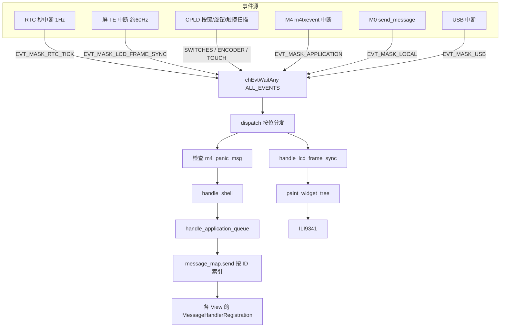
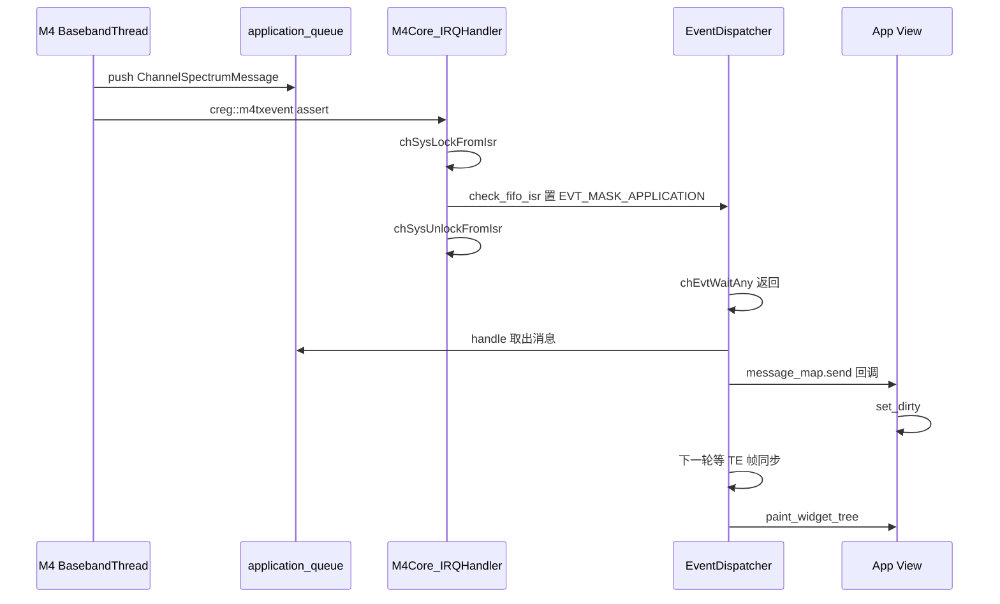

# EventDispatcher（M0 事件循环）—— event_m0.hpp / event_m0.cpp

> 对应源文件：
> - `firmware/application/event_m0.hpp`（165 行）
> - `firmware/application/event_m0.cpp`（662 行）
>
> 合计 827 行。本文行号以当前仓库为准。
> 相关 Docs：[01-启动流程与调度](../../../references/firmware/mayhem-firmware/Docs/01-启动流程与调度.md)、[02-应用框架与导航](../../../references/firmware/mayhem-firmware/Docs/02-应用框架与导航.md)
> 相关 KB：[navigation.md](navigation.md)、[app_view.md](app_view.md)

---

## 1. 一句话职责

`EventDispatcher` 是 **M0 核唯一的事件循环**：它把 8 类异步事件（秒 tick、屏帧同步、按键、旋钮、
触摸、M4 消息、本地消息、USB）收敛到一个线程里串行处理，并按 `Message::ID` 把消息分发给注册的
处理函数。整个固件只有一个线程碰 UI，因此**任何处理函数阻塞 = 整机卡死**。

## 2. 核心结构

### 2.1 事件位（`event_m0.hpp:41-48`）

| 宏 | 位 | 触发源 | 处理函数 |
|---|---|---|---|
| `EVT_MASK_RTC_TICK` | 0 | RTC 秒中断（`irq_rtc.cpp:121-138`） | `handle_rtc_tick()` |
| `EVT_MASK_LCD_FRAME_SYNC` | 1 | 屏 TE 上升沿（`irq_lcd_frame.cpp:53-70`） | `handle_lcd_frame_sync()` |
| `EVT_MASK_SWITCHES` | 3 | 按键扫描（`switch_update`） | `handle_switches()` |
| `EVT_MASK_ENCODER` | 4 | 编码器（`encoder_update`） | `handle_encoder()` |
| `EVT_MASK_TOUCH` | 5 | 触摸采样完成（`touch_update`） | `handle_touch()` |
| `EVT_MASK_APPLICATION` | 6 | M4 的 `creg::m4txevent` | `handle_application_queue()` |
| `EVT_MASK_LOCAL` | 7 | M0 自己 `send_message()` | `handle_local_queue()` |
| `EVT_MASK_USB` | 8 | USB 传输完成 | `handle_usb()` / `handle_usb_transfer()` |

> 位 2 未使用。`EVENT_MASK(n)` 是 ChibiOS 的 `1UL << n`。

### 2.2 成员（`event_m0.hpp:107-150`）

| 成员 | 类型 | 含义 | 行号 |
|---|---|---|---|
| `thread_event_loop` | `static Thread*` | 事件循环线程句柄，供 ISR `chEvtSignalI` | 107 |
| `touch_manager` | `touch::Manager` | 触摸状态机 | 109 |
| `top_widget` | `ui::Widget* const` | 根控件（实际是 `SystemView`） | 110 |
| `painter` | `ui::Painter` | 复用的绘制器 | 111 |
| `context` | `ui::Context&` | 焦点管理器宿主 | 112 |
| `encoder_last` | `uint32_t` | 上次旋钮计数，用于求增量 | 113 |
| `is_running` | `static bool` | `request_stop()` 置假，退出循环 | 114 |
| `display_sleep` | `static bool` | 熄屏状态；抑制绘制与旋钮/触摸 | 117 |
| `in_key_event` | `bool` | 一次按键只产生一个 KeyEvent | 117 |
| `waiting_for_frame` | `volatile bool` | `wait_finish_frame()` 的自旋标志 | 118 |
| `waiting_for_shellmode` / `shellmode_active` | `volatile bool` | USB shell 独占 UI 的握手 | 119-120 |
| `injected_touch_event` / `injected_keyboard_event` | 指针 | 跨线程注入事件（`emulate*`） | 121-122 |
| `captured_widget` | `ui::Widget*` | 触摸 Start 时捕获的目标 | 136 |

### 2.3 消息注册表（`event_m0.cpp:77-104`）

```cpp
class MessageHandlerMap {
   public:
    using MessageHandler = std::function<void(Message* const p)>;

    void register_handler(const Message::ID id, MessageHandler&& handler) {
        if (map_[toUType(id)] != nullptr) {
            chDbgPanic("MsgDblReg");
        }
        map_[toUType(id)] = std::move(handler);
    }

    void unregister_handler(const Message::ID id) {
        map_[toUType(id)] = nullptr;
    }

    void send(Message* const message) {
        if (message->id < Message::ID::MAX) {
            auto& fn = map_[toUType(message->id)];
            if (fn) {
                fn(message);
            }
        }
    }

   private:
    using MapType = std::array<MessageHandler, toUType(Message::ID::MAX)>;
    MapType map_{};
};
```

| 特性 | 说明 |
|---|---|
| 索引方式 | `Message::ID` 直接当下标，O(1) |
| 容量 | `ID::MAX`（当前 124）个 `std::function`，约 2 KB BSS |
| 重复注册 | `chDbgPanic("MsgDblReg")` 直接死机 |
| 未注册 ID | 静默丢弃（`if (fn)`） |
| 生命周期 | 由 `MessageHandlerRegistration` 的 RAII 保证（`event_m0.cpp:653-662`） |

## 3. 逐函数表

| 函数 | 行号（.cpp） | 作用 | 调用者 |
|---|---|---|---|
| `EventDispatcher::EventDispatcher` | 111-124 | 初始化队列、记录线程、挂触摸回调 | `main.cpp:175` |
| `run()` | 126-131 | `while (is_running) { wait(); dispatch(); }` | `main.cpp:184` |
| `request_stop()` | 133-135 | 置 `is_running = false` | 关机/切模式 |
| `set_display_sleep()` | 137-149 | 背光 + LCD 硬件睡眠，维护静态标志 | `DisplaySleep` 消息 |
| `charge_deep_sleep()` | 151-328 | 深度睡眠 + 充电指示死循环（几乎独立子系统） | 低电量流程 |
| `wait()` | 330-332 | `chEvtWaitAny(ALL_EVENTS)` | `run()` |
| `dispatch()` | 334-386 | 按位分发；先查 M4 panic、再 shell | `run()` |
| `handle_application_queue()` | 388-392 | 消费 M4 → M0 消息 | dispatch |
| `pump_application_queue()` | 394-398 | 供长耗时 handler 内主动抽消息 | `wait_finish_frame` 等 |
| `handle_local_queue()` | 400-404 | 消费 M0 本地消息 | dispatch |
| `handle_rtc_tick()` | 406-420 | SD 插拔、背光计时、秒回调、cache 落盘 | dispatch |
| `handle_usb()` / `handle_usb_transfer()` | 422-428 | USB 串口协议 | dispatch |
| `handle_shell()` | 430-448 | shell 独占握手 + 注入事件 | dispatch |
| `touch_widget()` | 450-472 | 递归命中测试（逆深度） | `on_touch_event` |
| `emulateTouch()` / `emulateKeyboard()` | 474-488 | 跨线程注入事件并等待消费 | shell 命令 |
| `on_keyboard_event()` | 490-496 | 键盘事件冒泡 | 注入/键盘 |
| `on_touch_event()` | 498-516 | Start 捕获 + 后续投递 | `touch_manager` |
| `getTopWidget()` / `getFocusedWidget()` | 518-524 | 访问器 | 各处 |
| `handle_lcd_frame_sync()` | 526-538 | 广播帧消息 + 绘制 + 开背光 | dispatch |
| `wait_finish_frame()` | 540-545 | 5 ms 轮询等一帧画完 | App |
| `enter_shell_working_mode()` / `exit_...` | 547-557 | shell 独占 UI | USB shell |
| `handle_switches()` | 559-605 | 去重、组合键、冒泡/焦点 | dispatch |
| `handle_encoder()` | 607-624 | 增量 → `EncoderEvent` → 冒泡 | dispatch |
| `handle_touch()` | 626-630 | 喂触摸帧 | dispatch |
| `event_bubble_key()` | 632-640 | 从焦点向上冒泡按键 | `handle_switches` |
| `event_bubble_encoder()` | 642-647 | 同上，旋钮 | `handle_encoder` |
| `init_message_queues()` | 649-651 | placement new 重建共享内存 | 构造函数 |
| `MessageHandlerRegistration` 构造/析构 | 653-662 | 注册/注销 | 各 View |

## 4. 逐字摘录

### 4.1 事件标志与消息发送（`event_m0.hpp:72-94`）

```cpp
    static inline void check_fifo_isr() {
        if (!shared_memory.application_queue.is_empty()) {
            events_flag_isr(EVT_MASK_APPLICATION);
        }
    }

    static inline void events_flag(const eventmask_t events) {
        if (thread_event_loop) {
            chEvtSignal(thread_event_loop, events);
        }
    }

    static inline void events_flag_isr(const eventmask_t events) {
        if (thread_event_loop) {
            chEvtSignalI(thread_event_loop, events);
        }
    }

    template <typename T>
    static void send_message(T& message) {
        shared_memory.app_local_queue.push(message);
        events_flag(EVT_MASK_LOCAL);
    }
```

逐行解释：

- `check_fifo_isr()` 在 `M4Core_IRQHandler` 里调用（`event_m0.cpp:63-74`），
  **只有队列非空才置位**，避免空唤醒。
- `events_flag` / `events_flag_isr` 的区别是后者要求调用者已关中断（`chSysLockFromIsr`）。
- `send_message` 是"M0 自己给自己发消息"的模板：先入本地队列，再置 `EVT_MASK_LOCAL`。
  `TransmitterModel::enable()` 里的 `TXDisabledMessage` 就是这么发的。

### 4.2 主循环与分发（`event_m0.cpp:126-131` + `334-350`）

```cpp
void EventDispatcher::run() {
    while (is_running) {
        const auto events = wait();
        dispatch(events);
    }
}
```

```cpp
void EventDispatcher::dispatch(const eventmask_t events) {
    if (shared_memory.m4_panic_msg[0] != 0) {
        if (shared_memory.bb_data.data[0] == 0)
            draw_guru_meditation(CORTEX_M4, shared_memory.m4_panic_msg);
        else
            draw_guru_meditation(
                CORTEX_M4,
                shared_memory.m4_panic_msg,
                (struct extctx*)&shared_memory.bb_data.data[8],
                *(uint32_t*)&shared_memory.bb_data.data[4]);
    }

    handle_shell();

    if (events & EVT_MASK_APPLICATION) {
        handle_application_queue();
    }
```

- `run()` 是**永不返回的循环**，直到 `request_stop()`；没有看门狗喂狗逻辑，靠硬件 WDT。
- `dispatch()` 里 M4 panic 检查是**每轮无条件执行**的（不看 `events`），这是"最后一道安全网"。
- `handle_shell()` 在消息处理之前：shell 可能要独占 UI（`while (shellmode_active) sleep(5)`），
  晚处理会让 shell 命令与 UI 抢焦点。

### 4.3 消息注册的 RAII（`event_m0.cpp:653-662`）

```cpp
MessageHandlerRegistration::MessageHandlerRegistration(
    const Message::ID message_id,
    MessageHandlerMap::MessageHandler&& callback)
    : message_id{message_id} {
    message_map.register_handler(message_id, std::move(callback));
}

MessageHandlerRegistration::~MessageHandlerRegistration() {
    message_map.unregister_handler(message_id);
}
```

典型用法是 View 的成员：

```cpp
    MessageHandlerRegistration message_handler_refresh{
        Message::ID::StatusRefresh,
        [this](const Message* const p) {
            (void)p;
            this->refresh();
        }};
```

**构造即注册，析构即注销**，与 View 生命周期严格绑定。这也是为什么 `pop()` 销毁 View 后
不会再有回调打到悬空 `this`——前提是 View 的成员确实随 View 析构。

## 5. 事件流



## 6. 一次 M4 消息的完整时序



## 7. 陷阱与读码建议

- **`Message::ID` 有重号**：`FSKRxConfigure = 58` 与 `BlePacket = 58`（`message.hpp:116-117`）。
  注册表按 ID 索引，两者只能有一个处理器生效。这是真实缺陷，读代码时别以为是笔误。
- **`MessageHandlerRegistration` 必须活到 View 析构**：如果把它放在栈上（局部变量），
  构造函数注册、离开作用域就注销，回调永远收不到——很多"消息没反应"的 bug 都是这个。
- **`dispatch()` 里任何一个 handler 阻塞都会拖垮全局**：尤其是
  `baseband::send_message()` 的自旋（最长 3 s）和 `wait_finish_frame()` 的 5 ms 轮询。
- **`display_sleep` 会屏蔽旋钮/触摸但不屏蔽消息**：`event_m0.cpp:377-385`
  只包住了 `EVT_MASK_ENCODER` 与 `EVT_MASK_TOUCH`。所以 stealth 发射时数据流仍在跑。
- **`in_key_event` 的去重语义**：一次按键只在**按下**时产生事件，按住不放不会连发；
  想实现"长按"要在 App 层自己计时（`handle_switches` 只清零 `bl_tick_counter`）。
- **`touch_widget()` 是 O(控件数) 的递归**，且每层都算 `screen_rect()`（O(深度)）。
  控件特别多的界面，触摸延迟主要花在这里。
- **`charge_deep_sleep()` 是一个 `while(1)`**（`event_m0.cpp:236-324`）：进去就再也不返回，
  靠 RTC/事件路由器唤醒后继续循环。它和主事件循环是**互斥**的两套逻辑，读的时候单独看。
- 建议阅读顺序：`event_m0.hpp` 的事件位 → `run()`/`dispatch()` → `handle_*` 逐个 →
  最后看 `MessageHandlerRegistration` 与 `MessageHandlerMap`，理解"消息怎么找到 View"。
