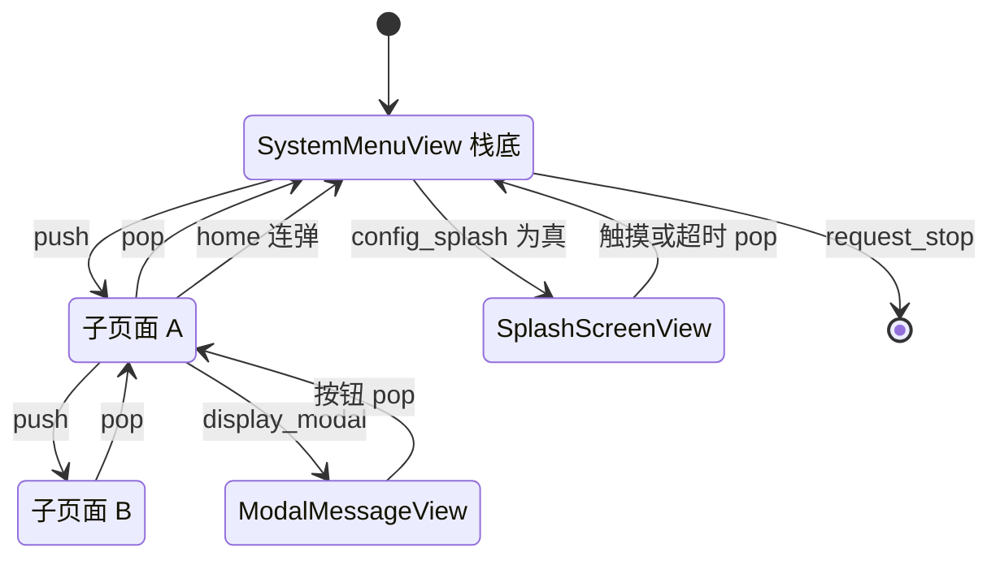
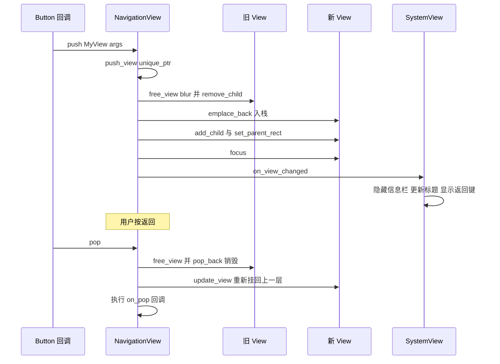

# Navigation（视图栈与系统外壳）—— ui_navigation.hpp / ui_navigation.cpp

> 对应源文件：
> - `firmware/application/ui_navigation.hpp`（556 行）
> - `firmware/application/ui_navigation.cpp`（1376 行）
>
> 合计 1932 行。本文行号以当前仓库为准。
> 相关 Docs：[02-应用框架与导航](../../../references/firmware/mayhem-firmware/Docs/02-应用框架与导航.md)
> 相关 KB：[app_view.md](app_view.md)、[event_dispatcher.md](event_dispatcher.md)

---

## 1. 一句话职责

`NavigationView` 是一个**持有 `unique_ptr<View>` 的栈**：`push` 新建页面、`pop` 销毁页面、
栈底永远是主菜单。配套的 `SystemView` 把屏分成"顶部状态栏 / 中部导航区 / 底部信息栏"，
并定义了 App 注册表 `appList`——整个 UI 的骨架都在这两个文件里。

## 2. 核心结构

### 2.1 `NavigationView`（`ui_navigation.hpp:97-183`）

| 成员/方法 | 类型 | 含义 | 行号 |
|---|---|---|---|
| `on_view_changed` | `std::function<void(const View&)>` | 页面变化通知（`SystemView` 用来切信息栏） | 99 |
| `push<T>(args...)` | 模板 | `new T(*this, args...)` 后压栈 | 111-114 |
| `replace<T>(args...)` | 模板 | 先 `pop()` 再 `push` | 116-120 |
| `push_view(unique_ptr)` | `View*` | 真正入栈，返回裸指针 | 123 |
| `pop(bool trigger_update = true)` | void | 出栈并销毁 | 125 |
| `home(bool)` | void | 连弹到栈底 | 126 |
| `display_modal(...)` | void | 压入 `ModalMessageView` | 128-134 |
| `set_on_pop(fn)` | bool | 给当前页注册"销毁后回调" | 140 |
| `appList` | `static const AppList` | 全部内置 App 的元数据 | 144 |
| `StartAppByName` | bool | 按 id 启动（串口/自启） | 146 |
| `handle_autostart` | void | 开机自启 | 147 |
| `start_app_search` / `launch_search_entry` | void | 应用搜索 | 154 / 161 |
| `view_stack` | `std::vector<ViewState>` | 栈本体 | 177 |
| `view()` | `Widget*` | 返回 `children_[0]` | 179 |

`ViewState`（`:164-167`）：

```cpp
    struct ViewState {
        std::unique_ptr<View> view;
        std::function<void()> on_pop;
    };
```

**所有权在栈里**，`pop` 即 `delete`。`on_pop` 是"销毁之后"才执行的收尾回调。

### 2.2 `SystemView`（`ui_navigation.hpp:472-496`）

| 成员 | 类型 | 位置/尺寸 | 行号 |
|---|---|---|---|
| `status_view` | `SystemStatusView` | 顶部 16 px | 490 |
| `navigation_view` | `NavigationView` | 其下 `h-16` | 489 |
| `info_view` | `InformationView` | 底部 16 px（仅主页） | 491 |
| `notification_view` | `NotificationView` | 全屏覆盖 | 492 |
| `overlay` / `overlay2` | `unique_ptr<DfuMenu/DfuMenu2>` | 调试覆盖层 | 493-494 |
| `context_` | `Context&` | 焦点管理器宿主 | 495 |

### 2.3 `AppInfo`（`ui_navigation.hpp:73-81`）

| 字段 | 类型 | 含义 |
|---|---|---|
| `id` | `const char*` | 唯一短名；`nullptr` = 纯菜单项 |
| `displayName` | `const char*` | 按钮文字 |
| `menuLocation` | `app_location_t` | HOME/RX/TX/TRX/UTILITIES |
| `iconColor` | `Color` | 图标着色 |
| `icon` | `const Bitmap*` | 32×32 单色图 |
| `viewFactory` | `ViewFactoryBase*` | 工厂，**永不析构** |

## 3. 逐函数表

| 函数 | 行号（.cpp） | 作用 |
|---|---|---|
| `StartAppByName` | 153-163 | `home(false)` 后遍历 `appList` 匹配 id 并 push |
| `ascii_lower` / `name_contains` | 171-191 | 搜索用的无分配小写比较 |
| `start_app_search` | 193-208 | 打开键盘，确认后进结果页 |
| `open_app_search_results` | 210-243 | 构建匹配列表（内部/外部/standalone） |
| `launch_search_entry` | 245-274 | 关搜索结果再启动目标 |
| `StatusTray::StatusTray/add/update_layout/clear/paint` | 276-315 | 右侧图标托盘（向左生长） |
| `SystemStatusView::SystemStatusView` | 317-418 | 状态栏控件装配 + 消息注册 |
| `SystemStatusView::on_tx_disabled` | 420-427 | TX 被禁用时提示 |
| `SystemStatusView::on_battery_details` | 429-437 | 电池详情弹窗 |
| `SystemStatusView::on_battery_data` | 439-467 | 电池状态刷新 |
| `SystemStatusView::refresh` | 469-517 | 全量刷新（图标/文字） |
| `set_back_enabled/hidden/title_image_enabled/title` | 519-547 | 外部改状态栏 |
| `on_converter/on_bias_tee/on_camera/on_clk/on_sd_card/on_title` | 549-626 | 各图标点击处理 |
| `rtc_battery_workaround` | 627-677 | RTC 掉电时伪造日期 |
| `InformationView::InformationView` | 679-702 | 底栏（版本+时钟+搜索图标） |
| `InformationView::refresh` | 703-708 | 刷新版本 |
| `firmware_checksum_error` | 709-726 | 固件校验失败提示 |
| `InformationView::on_touch` | 727-740 | 点整条信息栏 → 应用搜索 |
| `is_top` / `is_valid` | 742-748 | 栈深判断 |
| `push_view` | 750-757 | 入栈 |
| `pop` | 759-774 | 出栈 |
| `home` | 776-782 | 回到栈底 |
| `display_modal` | 784-797 | 模态框 |
| `free_view` | 799-807 | blur + remove_child |
| `update_view` | 809-821 | add_child + 定尺寸 + focus + dirty |
| `view` / `focus` / `set_on_pop` | 823-842 | 访问器 |
| `handle_autostart` | 844-886 | 读 `SETTINGS/nav.ini` 自启 |
| `add_apps` / `add_external_items` | 888-933 | 按 location 填充网格 |
| 五个 MenuView 构造/on_populate | 935-1009 | 各分类网格 |
| `AppSearchResultsView` | 1011-1035 | 搜索结果网格 |
| `SystemMenuView::hackrf_mode` | 1037-1051 | 切到 HackRF 模式 |
| `SystemView::SystemView` | 1068-1121 | 三段式装配 |
| `context/get_navigation_view/get_status_view` | 1123-1131 | 访问器 |
| `SystemView::toggle_overlay` | 1133-1160 | 三态调试覆盖层 |
| `SystemView::paint_overlay` | 1162-1180 | 覆盖层 1 Hz 刷新 |
| `SystemView::set_app_fullscreen` | 1182-1189 | 隐藏状态栏全屏 |
| `SplashScreenView::*` | 1193-1300 | 开机图（随机选图、触摸关闭） |
| `ModalMessageView::*` | 1307-1376 | 信息/是/否/中止 三种模态 |

## 4. 逐字摘录

### 4.1 入栈与出栈（`ui_navigation.cpp:750-774`）

```cpp
View* NavigationView::push_view(std::unique_ptr<View> new_view) {
    free_view();
    const auto p = new_view.get();
    view_stack.emplace_back(ViewState{std::move(new_view), {}});

    update_view();
    return p;
}

void NavigationView::pop(bool trigger_update) {
    // Don't pop off the NavView.
    if (view_stack.size() <= 1)
        return;

    auto on_pop = view_stack.back().on_pop;

    free_view();
    view_stack.pop_back();

    // NB: These are executed _after_ the view has been
    // destroyed. The old view MUST NOT be referenced in
    // these callbacks or it will cause crashes.
    if (trigger_update) update_view();
    if (on_pop) on_pop();
}
```

- `push_view()` 先 `free_view()` 把**旧页面从控件树摘掉**（但不出栈），再压新页；
  所以栈里保留着旧页面对象，返回时不用重建（保留滚动位置、输入状态）。
- `pop()` 的 `trigger_update=false` 用于 `home()` 连弹：中间态不刷新，只刷最终页。
- `on_pop` 必须在 `pop_back()` **之后**执行——`ViewState` 已被销毁，只剩拷贝出来的
  `std::function`。回调里碰旧 View = use-after-free。

### 4.2 尺寸重排（`ui_navigation.cpp:809-821`）

```cpp
void NavigationView::update_view() {
    const auto& top = view_stack.back();
    auto top_view = top.view.get();

    add_child(top_view);
    auto newSize = (is_top()) ? Size{size().width(), size().height() - 16} : size();  // if top(), then there is the info bar at the bottom, so leave space for it
    top_view->set_parent_rect({{0, 0}, newSize});
    focus();
    set_dirty();

    if (on_view_changed)
        on_view_changed(*top_view);
}
```

- `is_top()` = `view_stack.size() == 1`（`:742-744`），**只有栈底那一页**才给底部信息栏留 16 px。
- `set_parent_rect()` 内部会 `set_dirty()`（`ui_widget.cpp:79-82`），所以整页必重绘。
- `on_view_changed` 让 `SystemView` 同步：主页显示信息栏、子页隐藏信息栏、更新标题/返回键
  （`ui_navigation.cpp:1096-1109`）。

### 4.3 App 注册表（`ui_navigation.cpp:100-111`）

```cpp
const NavigationView::AppList NavigationView::appList = {
    /* HOME ******************************************************************/
    {nullptr, "Receive", HOME, Color::cyan(), &bitmap_icon_receivers, new ViewFactory<ReceiversMenuView>()},
    {nullptr, "Transmit", HOME, Color::cyan(), &bitmap_icon_transmit, new ViewFactory<TransmittersMenuView>()},
    {nullptr, "Transceiver", HOME, Color::cyan(), &bitmap_icon_transceivers, new ViewFactory<TransceiversMenuView>()},
    {"recon", "Recon", HOME, Color::green(), &bitmap_icon_scanner, new ViewFactory<ReconView>()},
    {"capture", "Capture", HOME, Color::red(), &bitmap_icon_capture, new ViewFactory<CaptureAppView>()},
    {"replay", "Replay", HOME, Color::green(), &bitmap_icon_replay, new ViewFactory<PlaylistView>()},
    {"lookingglass", "Looking Glass", HOME, Color::green(), &bitmap_icon_looking, new ViewFactory<GlassView>()},
    {nullptr, "Utilities", HOME, Color::cyan(), &bitmap_icon_utilities, new ViewFactory<UtilitiesMenuView>()},
    {nullptr, "Games", HOME, Color::cyan(), &bitmap_icon_games, new ViewFactory<GamesMenuView>()},
    {nullptr, "Settings", HOME, Color::cyan(), &bitmap_icon_setup, new ViewFactory<SettingsMenuView>()},
    /* RX ********************************************************************/
    {"audio", "Audio", RX, Color::green(), &bitmap_icon_speaker, new ViewFactory<AnalogAudioView>()},
```

- 这是**编译期常量表**，放在 `.cpp` 里避免头文件重复定义。
- `new ViewFactory<T>()` 是**故意泄漏**的（注释 `ui_navigation.hpp:80`：
  "Never destroyed, and I believe it's ok ;) Having a unique_ptr here breaks the initializer list"）。
  约 100 个工厂对象 × 4 B = 400 B 常驻堆，换来初始化列表的简洁。
- `nullptr` id 的条目（Receive/Transmit/Utilities…）只是**子菜单入口**，不能按名启动。

## 5. 视图栈状态机



## 6. push/pop 的调用时序



## 7. 陷阱与读码建议

- **栈底不可 pop**：`size() <= 1` 直接返回（`ui_navigation.cpp:761-762`）。所以
  `SystemView` 构造时压入的 `SystemMenuView` 是永远存在的"地板"。
- **`pop()` 后旧指针立即失效**：`on_pop` 在销毁后执行，任何捕获旧 View 的 lambda 都会悬空。
  需要"关闭后做事"就用 `set_on_pop()` 注册**无捕获**回调。
- **`set_on_pop()` 只能设一次**（`ui_navigation.cpp:836-838` 已存在则返回 false），
  第二次调用会静默失败。
- **`free_view()` 里的 `blur()` 是保命操作**：`FocusManager` 存裸指针，不先清空焦点，
  删 View 后下一次焦点切换会调 `on_blur()` 到已释放对象（注释 `:800-805` 写得很清楚）。
- **`display_modal()` 也是 push**：它会压入一个 `ModalMessageView`，所以模态框期间
  栈深 +1、`is_top()` 为假、底部信息栏消失。关闭模态框走的是普通的 `pop()`。
- **`toggle_overlay()` 的三态**：1 → DfuMenu，2 → DfuMenu2，3 → 清空并恢复计数模式。
  它直接 `add_child` 到 `SystemView`（不是 push），所以不受视图栈管理。
- **`paint_overlay()` 用 `chTimeNow()` 限 1 Hz**（`:1162-1180`），
  调试面板刷新率与 UI 帧率解耦，避免拖慢主界面。
- **App 搜索会临时销毁自己**：`launch_search_entry()` 先 `home()` 释放结果页，
  再用**按值捕获**的参数启动目标（`ui_navigation.hpp:156-161` 的注释专门强调这一点）。
- 想加新页面：写 `View` 子类 → 在 `appList` 加一行 → （若需基带）构造里
  `baseband::run_image()`。不需要改 `NavigationView` 本身。
