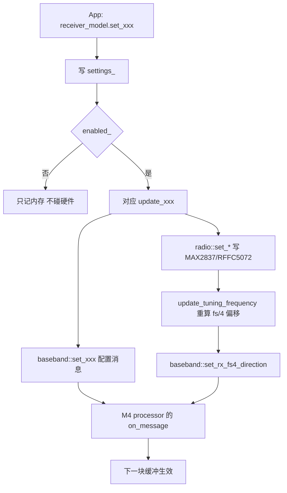
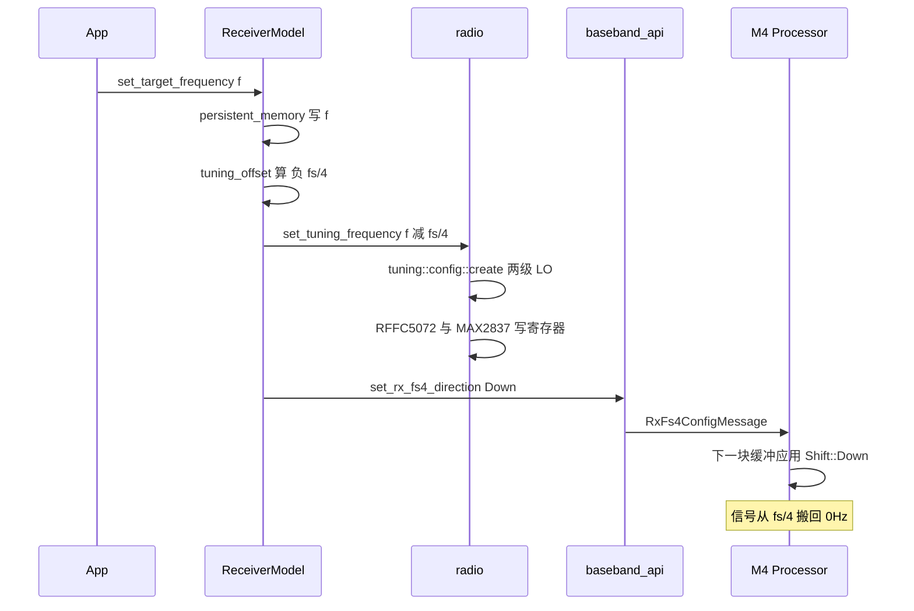

# ReceiverModel（接收参数模型）—— receiver_model.hpp / receiver_model.cpp

> 对应源文件：
> - `firmware/application/receiver_model.hpp`（184 行）
> - `firmware/application/receiver_model.cpp`（564 行）
>
> 合计 748 行。本文行号以当前仓库为准。
> 相关 Docs：[03-接收链路与基带](../../../references/firmware/mayhem-firmware/Docs/03-接收链路与基带.md)
> 相关 KB：[transmitter_model.md](transmitter_model.md)、[baseband_processor.md](baseband_processor.md)

---

## 1. 一句话职责

`ReceiverModel` 是**接收参数的唯一真相源**：频率、增益、带宽、采样率、解调模式、静噪、音量都存
在这里，每次 `set_*()` 都会同步写硬件（`radio::*`）或给 M4 发配置消息。App 只跟它打交道，
不直接碰 `radio`。

> 全局实例是 `portapack::receiver_model`（`portapack.cpp` 里定义），**整个固件只有一个**——
> 所以两个 App 不可能同时独立接收，切 App 必须 `disable()/enable()`。

## 2. 核心结构

### 2.1 `settings_t`（`receiver_model.hpp:50-66`）

```cpp
    struct settings_t {
        uint32_t baseband_bandwidth = max283x::filter::bandwidth_minimum;
        uint32_t sampling_rate = 3'072'000;
        rf::Frequency frequency_step = 25'000;
        rf::Frequency frequency_app_override = 0;
        uint8_t lna_gain_db = 32;
        uint8_t vga_gain_db = 32;
        bool rf_amp = false;
        Mode mode = Mode::NarrowbandFMAudio;
        uint8_t am_config_index = 0;
        uint8_t amfm_config_index = 0;
        uint8_t wfmam_config_index = 0;
        uint8_t nbfm_config_index = 0;
        uint8_t wfm_config_index = 0;
        uint8_t squelch_level = 80;
        uint8_t am_squelch_level = 0;  // AM channel-power squelch threshold (0 = off)
    };
```

| 字段 | 默认 | 单位/范围 | 落点 |
|---|---|---|---|
| `baseband_bandwidth` | 1 750 000 | Hz，1.75–28 M | MAX2837 RX LPF |
| `sampling_rate` | 3 072 000 | Sa/s | `clock_manager.set_sampling_frequency` |
| `frequency_step` | 25 000 | Hz | 仅 UI 步进，不下发 |
| `frequency_app_override` | 0 | Hz | 记录 App 设过的频率（调试用） |
| `lna_gain_db` | 32 | 0–40，步进 8 | MAX2837 LNA |
| `vga_gain_db` | 32 | 0–62，步进 2 | MAX2837 VGA |
| `rf_amp` | false | 0/+14 dB | RF 开关 |
| `mode` | `NarrowbandFMAudio` | 7 种 | 选哪套解调配置 |
| `am_config_index` | 0 | 0–11 | `am_configs[]` 下标 |
| `nbfm_config_index` | 0 | 0–3 | `nbfm_configs[]` 下标 |
| `wfm_config_index` | 0 | 0–2 | `wfm_configs[]` 下标 |
| `squelch_level` | 80 | 0–100 | NFM 静噪门限 |
| `am_squelch_level` | 0 | 0–100，0=关 | AM 通道功率静噪 |

### 2.2 `Mode` 枚举（`receiver_model.hpp:40-48`）

| 值 | 名称 | 用途 |
|---|---|---|
| 0 | `AMAudio` | AM/SSB/CW |
| 1 | `NarrowbandFMAudio` | NFM |
| 2 | `WidebandFMAudio` | WFM 广播 |
| 3 | `SpectrumAnalysis` | 纯频谱（不调谐偏移） |
| 4 | `AMAudioFMApt` | Wefax（USB + FM 副载波） |
| 5 | `WFMAudioAMApt` | NOAA APT |
| 6 | `Capture` | 原始 IQ 抓取 |

### 2.3 其它成员（`receiver_model.hpp:154-164`）

| 成员 | 类型 | 含义 | 行号 |
|---|---|---|---|
| `am_spectrum_zoom_` | `Zoom_waterfall` | AM 瀑布 zoom ×1/×2 | 154 |
| `settings_` | `settings_t` | 全部参数 | 155 |
| `enabled_` | bool | 是否已 `enable()` | 156 |
| `application_fs4_direction_` | `RxFs4Direction` | 1/4 速率搬移方向 | 161 |
| `hidden_offset` | `rf::Frequency` | 对用户隐藏的频率偏移（Wefax −300 Hz） | 162 |

## 3. 逐函数表

| 函数 | 行号（.cpp） | 作用 | 是否立即生效 |
|---|---|---|---|
| `target_frequency()` | 87-89 | 读持久化内存里的频率 | — |
| `set_target_frequency(f)` | 91-95 | 写持久化 + `update_tuning_frequency()` | 是 |
| `set_target_frequency_with_hidden_offset` | 97-104 | 带隐藏偏移（Wefax） | 是 |
| `baseband_bandwidth()` / `set_...` | 106-113 | LPF 带宽 | 是 |
| `sampling_rate()` / `set_...` | 115-122 | 采样率 | 是 |
| `frequency_step()` / `set_...` | 124-130 | 步进（仅记录） | 否 |
| `lna()` / `set_lna()` | 132-139 | LNA 增益 | 是 |
| `vga()` / `set_vga()` | 141-148 | VGA 增益 | 是 |
| `rf_amp()` / `set_rf_amp()` | 150-157 | RF 放大 | 是 |
| `modulation()` / `set_modulation()` | 159-166 | 解调模式 | 是 |
| `am_configuration()` / `set_...` | 168-188 | AM 配置索引 | 是 |
| `amfm_configuration()` / `set_...` | 190-210 | Wefax 配置索引 | 是 |
| `nbfm_configuration()` / `set_...` | 212-221 | NFM 配置索引 | 是 |
| `wfm_configuration()` / `set_...` | 223-232 | WFM 配置索引 | 是 |
| `wfmam_configuration()` / `set_...` | 234-243 | NOAA 配置索引 | 是 |
| `squelch_level()` / `set_...` | 245-252 | NFM 静噪 | 是 |
| `am_squelch_level()` / `set_...` | 254-261 | AM 静噪 | 是 |
| `set_antenna_bias()` | 263-265 | 天线偏置 | 是 |
| `headphone_volume()` / `set_...` | 267-274 | 音量（存持久化） | 是 |
| `normalized_headphone_volume()` | 276-286 | 0–99 归一化 | — |
| `enable()` | 288-324 | 打开接收，刷新全部参数 | — |
| `disable()` | 326-333 | 关射频、复位 zoom | — |
| `initialize()` | 335-343 | 恢复默认 | — |
| `set_configuration_without_update` | 345-361 | 批量改参数不刷硬件 | 否 |
| `configure_from_app_settings` | 363-371 | 从 App 设置覆盖 | 否 |
| `tuning_offset()` | 387-397 | 算 1/4 采样率偏移 | — |
| `update_tuning_frequency()` | 399-420 | 写 LO + 下发 fs4 方向 | 是 |
| `set_hidden_offset()` | 422-425 | 改隐藏偏移并重调谐 | 是 |
| `update_baseband_bandwidth()` | 427-469 | 写 LPF（PRALINE 有动态算法） | 是 |
| `update_sampling_rate()` | 471-487 | 写采样率并重调谐 | 是 |
| `update_lna/vga/rf_amp` | 489-502 | 写增益 | 是 |
| `update_modulation()` | 504-534 | 按 mode 分派到具体配置 | 是 |
| `update_am/nbfm/wfm/wfmam_configuration` | 536-554 | 给 M4 发配置消息 | 是 |
| `update_antenna_bias()` | 556-559 | 写偏置 | 是 |
| `update_headphone_volume()` | 561-564 | 写音频编解码器 | 是 |

## 4. 逐字摘录

### 4.1 调谐偏移：为什么频率要 +fs/4（`receiver_model.cpp:387-397`）

```cpp
int32_t ReceiverModel::tuning_offset() {
    if ((modulation() == Mode::SpectrumAnalysis)) {
        return 0;
    } else {
        const int32_t quarter_rate = static_cast<int32_t>(sampling_rate() / 4);
        const rf::Frequency effective_frequency = target_frequency() + hidden_offset;
        return baseband::supports_rx_fs4() && effective_frequency - quarter_rate < 0
                   ? quarter_rate
                   : -quarter_rate;
    }
}
```

- 除了纯频谱模式，**实际 LO 都比目标频率低 fs/4**（负偏移）。
- 这样想要的信号落在基带 +fs/4 处，避开 DC 附近的 LO 泄漏与直流偏移；
  M4 的第一级抽取器 `FIRC8xR16x24FS4Decim4` 支持 `Shift::Up/Down`，把信号搬回 0 Hz。
- 若目标频率低于 fs/4（例如收 100 kHz 而 fs = 3.072 MHz），负偏移会让 LO 为负，
  所以改成 **+fs/4**（正偏移）。
- `supports_rx_fs4()` 只在带 1/4 搬移能力的镜像上为真（AM/NFM/WFM/Capture，
  见 `baseband_api.cpp:506-509`）。

### 4.2 写调谐频率（`receiver_model.cpp:399-420`）

```cpp
void ReceiverModel::update_tuning_frequency() {
    if (enabled_) {
        const auto offset = tuning_offset();
#ifdef PRALINE
        const auto afe_policy = capture_afe_policy();
        if (!radio::set_tuning_frequency(target_frequency() + hidden_offset + offset, afe_policy.disable_quarter_shift))
#else
        if (!radio::set_tuning_frequency(target_frequency() + hidden_offset + offset))
#endif
            return;

        if (modulation() != Mode::SpectrumAnalysis && baseband::supports_rx_fs4()) {
            application_fs4_direction_ = offset > 0 ? RxFs4Direction::Up : RxFs4Direction::Down;
            // Re-send on enable too: the active processor may have restarted.
            baseband::set_rx_fs4_direction(application_fs4_direction_);
        }
#ifdef PRALINE
        // A tune can change the FPGA shift (including the special zero entry).
        update_baseband_bandwidth();
#endif
    }
}
```

- `if (enabled_)` 是所有 `update_*` 的统一守卫：**没 enable 就只改内存，不碰硬件**。
  所以 `enable()` 里必须把所有 `update_*` 再跑一遍（见 4.4）。
- 调谐成功后**同时**把方向发给 M4——硬件 LO 偏移与数字搬移必须成对，缺一不可。
- PRALINE 上调谐会改变 FPGA 的 1/4 搬移档位，进而影响 LPF 需求，所以再调一次带宽。

### 4.3 采样率变更（`receiver_model.cpp:471-487`）

```cpp
void ReceiverModel::update_sampling_rate() {
    // TODO: Move more low-level radio control stuff to M4. It'll enable tighter
    // synchronization for things like wideband (sweeping) spectrum analysis, and
    // protocols that need quick RX/TX turn-around.

    // Disabling baseband while changing sampling rates seems like a good idea...
    if (enabled_) {
        radio::set_baseband_rate(sampling_rate());
    }
    update_tuning_frequency();

#ifdef PRALINE
    // GSG reference: re-apply frequency after sample rate change
    // This reconfigures LPF bandwidth based on new decimation
    update_baseband_bandwidth();
#endif
}
```

**改采样率必须重调谐**：因为 `tuning_offset()` 依赖 `sampling_rate()/4`，偏移量变了。
这是阅读顺序里最容易漏的耦合。

### 4.4 打开接收的全部动作（`receiver_model.cpp:288-324`）

```cpp
void ReceiverModel::enable() {
    enabled_ = true;
    radio::set_direction(rf::Direction::Receive);

#ifdef PRALINE
    ...
#define PRALINE_RX_IQ_VCM 0
    radio::set_rx_buff_vcm(PRALINE_RX_IQ_VCM);
#endif

    update_tuning_frequency();
    update_antenna_bias();
    update_rf_amp();
    update_lna();
    update_vga();
    update_baseband_bandwidth();
    update_sampling_rate();
    update_modulation();

    // TODO: maybe not the perfect place for this, but it's reasonable.
    update_headphone_volume();
}
```

顺序上的讲究：

1. 先 `set_direction(Receive)`——后续增益/带宽写的是 RX 寄存器；
2. `update_tuning_frequency()` 用当前采样率算偏移；
3. `update_sampling_rate()` 又会调一次 `update_tuning_frequency()`（幂等，但多两次 SPI 写）；
4. `update_modulation()` 最后：它给 M4 发配置消息，必须在镜像已加载之后。

`disable()`（`:326-333`）只做两件事：`enabled_ = false`、`radio::disable()`（关 PA/LO/偏置）。
**它不会给 M4 发消息**——基带镜像还在跑，需要 App 自己 `baseband::shutdown()`。

## 5. 参数更新链



## 6. 一次改频率的时序



## 7. 陷阱与读码建议

- **`set_target_frequency()` 写的是全局持久化内存**（`persistent_memory::set_target_frequency`），
  不是 `settings_` 里那份。所以两个 App 切换时频率是"粘"的，这是设计（用户期望）。
- **`settings_.frequency_app_override` 只用于记录**，真正调谐用 `target_frequency()`
  （读持久化内存）。
- **`hidden_offset` 对 UI 不可见**：Wefax 需要 −300 Hz 补偿，用
  `set_target_frequency_with_hidden_offset()` 设置，退出时必须
  `set_hidden_offset(0)`（`analog_audio_app.cpp:443-446` 的析构里做了）。
- **改采样率会改调谐频率**：`update_sampling_rate()` → `update_tuning_frequency()`。
  如果只改 `settings_.sampling_rate` 而不调 update，硬件与数字搬移会不一致，信号"消失"。
- **`SpectrumAnalysis` 模式偏移为 0**：因为它不需要避开 DC（瀑布本来就要看 DC 附近）。
  切模式时务必让 `update_tuning_frequency()` 重跑，否则残留 fs/4 偏移。
- **PRALINE 与 HackRF One 的带宽算法不同**：`update_baseband_bandwidth()` 里
  `#ifdef PRALINE` 分支用 `build/4` 与 1/4 搬移量动态算 LPF（`:427-467`），
  非 PRALINE 直接用 `baseband_bandwidth()`。读的时候分开看。
- **`enable()` 里 `update_sampling_rate()` 会二次调谐**：不是 bug，但会多花两次 SPI 写
  （每次几十 µs）。对启动时间敏感时可以接受。
- **静噪是两级**：`squelch_level` 走 `NBFMConfigureMessage`，`am_squelch_level` 走
  `AMConfigureMessage`。AM 的静噪是按通道功率，不是音频幅度。
- **`configure_from_app_settings()` 不校验范围**：它直接覆盖 `settings_`；
  越界值（如 LNA 50 dB）会被下层 `clip` 或寄存器截断，行为不确定。App 侧要自己保证合法。
