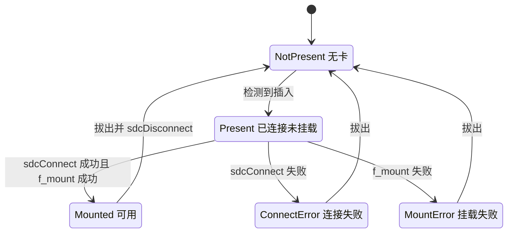
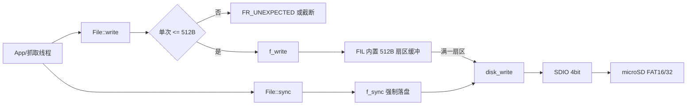

# SD 卡与文件系统封装 —— sd_card.* / file.*

> 对应源文件：
> - `firmware/application/sd_card.hpp`（50 行）
> - `firmware/application/sd_card.cpp`（76 行）
> - `firmware/application/file.hpp`（368 行）
> - `firmware/application/file.cpp`（645 行）
>
> 合计 1139 行。本文覆盖 **SD 卡挂载/热插拔** 与 **`std::filesystem` 风格的文件封装**两部分。
> 底层 FatFs（`ff.c`）与 SDIO 驱动在 `firmware/chibios*` / 第三方目录，不在本文范围。
> 本文行号以当前仓库为准。
> 相关 Docs：[06-存储与文件格式](../../../references/firmware/mayhem-firmware/Docs/06-存储与文件格式.md)

---

## 1. 一句话职责

`sd_card` 命名空间负责"卡在不在、挂没挂上"（一个 1 Hz 轮询 + 一个状态信号）；
`file` 这一层用 `std::filesystem::path` / `directory_iterator` / `File` 三件套把 FatFs 的 C API
包成 RAII 的 C++ 接口，向上供 App、抓取线程、WAV 读写、频率库使用。

## 2. 核心结构

### 2.1 `sd_card::Status`（`sd_card.hpp:34-41`）

| 枚举 | 值 | 含义 |
|---|---|---|
| `IOError` | −3 | 底层读写失败（有定义但 `poll_inserted` 不产生） |
| `MountError` | −2 | `f_mount` 失败 |
| `ConnectError` | −1 | `sdcConnect` 失败 |
| `NotPresent` | 0 | 无卡 |
| `Present` | 1 | 有卡但未挂载 |
| `Mounted` | 2 | 可用 |

### 2.2 `sd_card` 全局对象（`sd_card.cpp:28-44`）

| 对象 | 类型 | 含义 | 行号 |
|---|---|---|---|
| `fs` | `FATFS` | FatFs 卷对象（全局唯一） | 30 |
| `card_present` | static bool | 上次轮询到的插入状态 | 34 |
| `status_` | static `Status` | 当前状态 | 36 |
| `status_signal` | `Signal<Status>` | 状态变化广播 | 44 |

### 2.3 `File`（`file.hpp:308-366`）

| 成员 | 类型 | 含义 | 行号 |
|---|---|---|---|
| `Size` / `Offset` / `Timestamp` | `uint64_t` / `uint64_t` / `uint32_t` | 类型别名 | 310-312 |
| `Error` | `std::filesystem::filesystem_error` | 错误封装 | 313 |
| `f` | `FIL` | FatFs 文件对象（含 512 B 扇区缓冲） | 363 |
| `open()` | `Optional<Error>` | 打开（默认只读） | 334 |
| `append()` / `create()` | `Optional<Error>` | 追加/新建 | 336-337 |
| `read()` / `write()` | `Result<Size>` | 读写 | 339-340 |
| `tell()` / `seek()` / `truncate()` | — | 位置与截断 | 342-344 |
| `size()` / `eof()` | `Size` / `Result<bool>` | 大小/EOF | 345-346 |
| `write_line()` | `Optional<Error>` | 写一行 + CRLF | 353 |
| `sync()` | `Optional<Error>` | `f_sync` 落盘 | 356 |
| `read_file()` | `Result<std::string>` | 整个文件读成字符串（<10 KB） | 360 |

> 注释明确：**`sizeof(File) == 556 B`**，因为 `FIL` 内含 512 B 扇区缓冲（`file.hpp:307`）。

### 2.4 路径与目录（`file.hpp:69-250`）

| 类型/函数 | 含义 | 行号 |
|---|---|---|
| `std::filesystem::path` | UTF-16 内部字符串，`operator/` 拼路径 | 69-162 |
| `path_iequal()` | 大小写不敏感比较（`towupper`） | `file.cpp:527-543` |
| `directory_entry` | 继承 `FILINFO`，带 `status()/size()/path()` | 192-202 |
| `directory_iterator` | 输入迭代器，内部 `shared_ptr<Impl>` 持有 `DIR` | 204-239 |
| `scan_root_files()` | 按扩展名扫描 | 281-287 |
| `next_filename_matching_pattern()` | `FOO_???.txt` 自增命名 | 295 |
| `is_cxx_capture_file()` | `.C8/.CU8/.C16` 判定 | `file.cpp:545-548` |

## 3. 逐函数表

### 3.1 `sd_card.cpp`

| 函数 | 行号 | 作用 |
|---|---|---|
| `mount()`（匿名命名空间） | 38-40 | `f_mount(&fs, "", 1)` 立即挂载默认卷 |
| `poll_inserted()` | 46-70 | 读卡检测脚；状态变化时 connect/mount 或 disconnect，并 `status_signal.emit()` |
| `status()` | 72-74 | 返回当前状态 |

### 3.2 `file.cpp`

| 函数 | 行号 | 作用 |
|---|---|---|
| `filesystem_error::what()` | 约 30-35 | 把 `FRESULT` 转字符串 |
| `path::parent_path/extension/filename/stem` | 约 180-260 | 路径分解 |
| `path::replace_extension/append_filename` | 约 270-310 | 拼接 |
| `path::string()` | 约 320-340 | UTF-16 → UTF-8 |
| `path_iequal` | 527-543 | 大小写不敏感比较 |
| `is_cxx_capture_file` | 545-548 | 抓取文件判定 |
| `capture_file_sample_size` | 550-558 | 按扩展名返回 2/2/4 B |
| `directory_iterator` 构造/`operator++` | 560-590 | `f_findfirst` / `f_findnext` |
| `is_directory/is_regular_file/file_exists/is_empty_directory` | 约 380-430 | 属性查询 |
| `space()` | 约 440-460 | `f_getfree` 换算容量 |
| `delete_file/rename_file/copy_file` | 约 470-520 | 文件操作 |
| `ensure_directory/make_new_directory` | 约 600-640 | 目录创建 |
| `File::open/close/append/create` | 36-80 | RAII 打开（`open_fatfs` 36-56、`open` 58-80） |
| `File::read/write` | 82-105 | 带 `max_file_block_size` 检查 |
| `File::tell/seek/truncate/size/eof` | 106-139 | 位置操作 |
| `File::sync` | 154-161 | `f_sync` |
| `File::read_file` | 163-180 | 整文件读取（大文件会失败） |

## 4. 逐字摘录

### 4.1 热插拔轮询（`sd_card.cpp:46-70`）

```cpp
void poll_inserted() {
    const auto card_present_now = sdcIsCardInserted(&SDCD1);
    if (card_present_now != card_present) {
        card_present = card_present_now;

        Status new_status{card_present ? Status::Present : Status::NotPresent};

        if (card_present) {
            if (sdcConnect(&SDCD1) == CH_SUCCESS) {
                if (mount() == FR_OK) {
                    new_status = Status::Mounted;
                } else {
                    new_status = Status::MountError;
                }
            } else {
                new_status = Status::ConnectError;
            }
        } else {
            sdcDisconnect(&SDCD1);
        }

        status_ = new_status;
        status_signal.emit(status_);
    }
}
```

- **只在状态变化时动作**：`sdcConnect` 有几百毫秒的初始化开销，不能每秒都调。
- `sdcConnect` 成功但 `f_mount` 失败 → `MountError`（卡是好的但文件系统不认）；
  `sdcConnect` 失败 → `ConnectError`（卡坏/接触不良）。
- 拔卡只 `sdcDisconnect`，**不调用 `f_mount(nullptr,...)`**——卷对象还在，
  下次插卡重新 mount 会覆盖。
- `status_signal.emit()` 让状态栏图标与文件管理器即时更新。

> 调用者是 `EventDispatcher::handle_rtc_tick()`（`event_m0.cpp:407`），即 **1 Hz**。
> 插卡后最多 1 s 才能用；UI 上"插卡没反应"通常是这 1 s 的延迟。

### 4.2 `File` 的对象布局与约束（`file.hpp:297-313`）

```cpp
/* Values added to FatFs FRESULT enum, values outside the FRESULT data type */
static_assert(sizeof(FIL::err) == 1, "FatFs FIL::err size not expected.");

/* Dangerous to expose these, as FatFs native error values are byte-sized. However,
 * my filesystem_error implementation is fine with it. */
#define FR_DISK_FULL (0x100)
#define FR_EOF (0x101)
#define FR_BAD_SEEK (0x102)
#define FR_UNEXPECTED (0x103)

/* NOTE: sizeof(File) == 556 bytes because of the FIL's buf member. */
class File {
   public:
    using Size = uint64_t;
    using Offset = uint64_t;
    using Timestamp = uint32_t;
    using Error = std::filesystem::filesystem_error;
```

- FatFs 的 `FRESULT` 是 1 字节，自定义错误从 `0x100` 起，**故意超出** `FRESULT` 范围，
  这样 `filesystem_error` 能区分"FatFs 错误"与"封装层错误"。
- `File` 556 B 意味着**不能随便在栈上放多个**：抓取线程栈只有 1024 B，
  放两个 `File` 就溢出。这是 `CaptureThread` 用堆栈 1024 B 却"Need significant stack for FATFS"
  注释的原因。
- `Size`/`Offset` 用 `uint64_t`，支持 >4 GB 卡上的大文件。

### 4.3 抓取文件判定（`file.cpp:545-558`）

```cpp
bool is_cxx_capture_file(const path& filename) {
    auto ext = filename.extension();
    return path_iequal(c8_ext, ext) || path_iequal(cu8_ext, ext) || path_iequal(c16_ext, ext);
}

uint8_t capture_file_sample_size(const path& filename) {
    if (path_iequal(filename.extension(), c8_ext))
        return sizeof(complex8_t);
    if (path_iequal(filename.extension(), cu8_ext))
        return sizeof(complexu8_t);
    if (path_iequal(filename.extension(), c16_ext))
        return sizeof(complex16_t);
    return 0;
}
```

扩展名常量在 `file.cpp:32-34`：

```cpp
static const fs::path c8_ext{u".C8"};
static const fs::path cu8_ext{u".CU8"};
static const fs::path c16_ext{u".C16"};
```

**扩展名不区分大小写**（`path_iequal` 用 `towupper`），所以 `.c8` 与 `.C8` 等价。
返回 0 表示"不是抓取文件"，调用者必须判 0。

### 4.4 底层读写（`file.cpp:94`、`:155`）

```cpp
    const auto result = f_write(&f, data, bytes_to_write, &bytes_written);
```

```cpp
    const auto result = f_sync(&f);
```

`File::write()` 只做一次 `f_write`，**不保证写满**（FatFs 返回实际写入字节数）。
封装层用 `Result<Size>` 把实际写入量返回给调用者，由上层循环补写——
`CaptureThread::run()` 就是假设 `writer->write()` 会处理完整缓冲。

## 5. SD 卡状态机



## 6. 写文件的数据流



## 7. 量化与配置

| 项目 | 值 | 出处 |
|---|---|---|
| 单次读写上限 | 512 B | `file.hpp:179` `max_file_block_size` |
| `File` 对象大小 | 556 B | `file.hpp:307` 注释 |
| FatFs 扇区 | 512 B | `ffconf.h:158` `_MAX_SS` |
| 卷数 | 1 | `ffconf.h:138` `_VOLUMES` |
| 长文件名 | 开启（静态 BSS 缓冲） | `ffconf.h:93` `_USE_LFN 3` |
| 可重入 | 是，超时 1000 tick | `ffconf.h:221-223` |
| 代码页 | 437（ASCII） | `ffconf.h:65` |
| 抓取线程栈 | 1024 B | `capture_thread.cpp:50` |
| 插拔检测周期 | 1 s | `event_m0.cpp:407` |

## 8. 陷阱与读码建议

- **`poll_inserted()` 是 1 Hz 的**：插卡后 UI 可能延迟 1 s 才更新。需要"立刻可用"的场景
  （如开机自启读配置）要自己再调一次 `poll_inserted()`——`portapack::init()` 里就是这么做的
  （`portapack.cpp:670`）。
- **`File` 不能放栈上多个**：556 B × 2 就超过抓取线程的 1024 B 栈。
  需要多个文件时用 `std::unique_ptr<File>` 或复用。
- **`f_write` 不保证写满**：封装返回实际字节数，调用者要检查。
  `FileWriter`/`CaptureThread` 外层有循环，直接用 `File::write` 则要自己处理。
- **`_USE_LFN = 3` 的静态缓冲不是线程安全的**：FATFS 的 `_FS_REENTRANT` 保护的是卷/文件对象，
  长文件名转换用的全局缓冲仍可能被并发踩。**边抓取边浏览目录**是高危操作。
- **`read_file()` 只适合小文件**：注释写 "will likely fail for files larger than ~10kB"
  （`file.hpp:358-359`），因为它一次性 `std::string` 分配。大文件用 `File` + 分块读。
- **`directory_iterator` 是输入迭代器**：只能单遍扫描，不能回退；`operator*` 返回的
  `directory_entry` 引用在 `++` 后失效。
- **`next_filename_matching_pattern()` 的 `?` 必须连续**（`file.hpp:293`），
  `FOO?_??` 这种模式不支持，会返回空路径。
- **`FR_DISK_FULL` 不是 FatFs 原生错误**：它是封装层自定义的 `0x100`。
  判断磁盘满要比较 `error.code() == FR_DISK_FULL`，不能拿 `FRESULT` 直接比。
- **拔卡时正在写的文件**：`sdcDisconnect` 会让后续 `f_write` 返回 `FR_NOT_READY`；
  `File` 析构会 `f_close`，但数据可能丢。抓取界面应在拔卡前停止录制。
- 读码顺序建议：`sd_card.cpp`（状态机）→ `file.hpp` 的 `File` 声明 → `file.cpp` 的
  `open/write/sync` → `directory_iterator` → 最后看 `capture_thread.cpp` 如何把它用在实时路径上。
