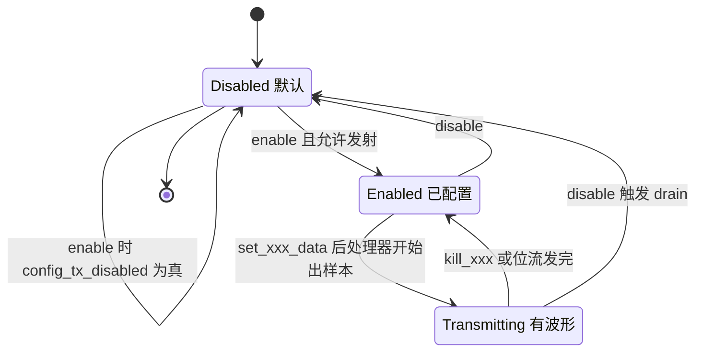
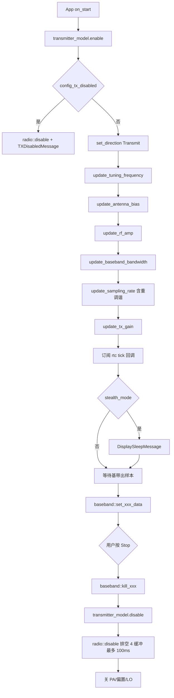

# TransmitterModel（发射参数模型）—— transmitter_model.hpp / transmitter_model.cpp

> 对应源文件：
> - `firmware/application/transmitter_model.hpp`（97 行）
> - `firmware/application/transmitter_model.cpp`（200 行）
>
> 合计 297 行。本文行号以当前仓库为准。
> 相关 Docs：[04-发射链路与应用](../../../references/firmware/mayhem-firmware/Docs/04-发射链路与应用.md)
> 相关 KB：[receiver_model.md](receiver_model.md)、[baseband_processor.md](baseband_processor.md)

---

## 1. 一句话职责

`TransmitterModel` 是**发射参数的唯一入口**：频率、TX 增益、RF 放大、基带带宽、采样率，
外加两条硬性合规约束（全局 TX 禁用、全局增益上限）。它比 `ReceiverModel` 小得多——
发射没有解调模式、没有静噪、没有音量。

全局实例是 `portapack::transmitter_model`。

## 2. 核心结构

### 2.1 `settings_t`（`transmitter_model.hpp:40-48`）

```cpp
    struct settings_t {
        uint32_t baseband_bandwidth = max283x::filter::bandwidth_minimum;
        uint32_t sampling_rate = 3'072'000;
        uint32_t channel_bandwidth = 1;
        /* Platform default chosen to avoid PRALINE MAX2831 overdrive while
         * preserving legacy HackRF One behavior. */
        uint8_t tx_gain_db = hackrf::one::default_tx_gain_db;
        bool rf_amp = false;
    };
```

| 字段 | 默认 | 范围 | 落点 |
|---|---|---|---|
| `baseband_bandwidth` | 1.75 MHz | 1.75–28 MHz（16 档） | MAX2837 TX LPF |
| `sampling_rate` | 3.072 MSa/s | 应用自定 | Si5351 + FPGA 插值 |
| `channel_bandwidth` | 1 | — | **仅保存，不下发** |
| `tx_gain_db` | 35 dB（HackRF One）/ 16 dB（PRALINE） | 0–47 dB，步进 1 | MAX2837 TX VGA |
| `rf_amp` | false | 0/+14 dB | RF 开关 |

`channel_bandwidth` 是**死字段**，头文件注释写得很直白（`:57`）：`// TODO: Doesn't actually affect radio.`

### 2.2 其它成员（`transmitter_model.hpp:83-94`）

| 成员 | 类型 | 含义 | 行号 |
|---|---|---|---|
| `settings_` | `settings_t` | 参数 | 84 |
| `enabled_` | bool | 是否已 enable | 85 |
| `signal_token_tick_second` | `SignalToken` | 退订秒回调的凭据 | 86 |
| `update_tuning_frequency` 等 | private 方法 | 每个参数一个 | 88-94 |
| `on_tick_second()` | private | stealth 模式翻转 LED | 94 |

## 3. 逐函数表

| 函数 | 行号（.cpp） | 作用 | 立即生效 |
|---|---|---|---|
| `target_frequency()` | 41-43 | 读持久化频率 | — |
| `set_target_frequency(f)` | 45-48 | 写持久化 + 重调谐 | 是 |
| `baseband_bandwidth()` / `set_...` | 50-57 | TX LPF | 是 |
| `sampling_rate()` / `set_...` | 59-66 | 采样率 | 是 |
| `channel_bandwidth()` / `set_...` | 68-74 | 仅记录 | 否 |
| `tx_gain()` | 76-81 | 读增益（含禁用/上限钳制） | — |
| `set_tx_gain(v)` | 83-92 | 写增益（钳制后下发） | 是 |
| `rf_amp()` / `set_rf_amp()` | 94-104 | RF 放大（禁用时强制 false） | 是 |
| `set_antenna_bias()` | 106-108 | 天线偏置 | 是 |
| `enable()` | 110-137 | 打开发射（含合规检查） | — |
| `disable()` | 139-145 | 关射频、退订秒回调 | — |
| `initialize()` | 147-149 | 恢复默认 | — |
| `configure_from_app_settings()` | 151-158 | 从 App 设置覆盖 | 否 |
| `update_tuning_frequency()` | 160-163 | 写 LO | 是 |
| `update_baseband_bandwidth()` | 165-168 | 写 TX LPF | 是 |
| `update_sampling_rate()` | 170-180 | 写采样率 + 重调谐 | 是 |
| `update_tx_gain()` | 182-185 | 写 TX VGA | 是 |
| `update_rf_amp()` | 187-190 | 写 RF 开关 | 是 |
| `update_antenna_bias()` | 192-195 | 写偏置 | 是 |
| `on_tick_second()` | 197-200 | stealth 模式每秒翻转 TX LED | — |

## 4. 逐字摘录

### 4.1 增益的两道钳制（`transmitter_model.cpp:76-92`）

```cpp
uint8_t TransmitterModel::tx_gain() const {
    if (persistent_memory::config_tx_disabled()) {
        return 0;
    }
    return std::min(settings_.tx_gain_db, portapack::persistent_memory::config_tx_gain_max_db());
}

void TransmitterModel::set_tx_gain(uint8_t v_db) {
    uint8_t newgain = v_db;
    if (persistent_memory::config_tx_disabled()) {
        newgain = 0;
    } else if (v_db > portapack::persistent_memory::config_tx_gain_max_db()) {
        newgain = portapack::persistent_memory::config_tx_gain_max_db();
    }
    settings_.tx_gain_db = newgain;
    update_tx_gain();
}
```

| 场景 | 行为 |
|---|---|
| 全局 TX 禁用 | 读返回 0，写强制 0 |
| App 设 50 dB（> 47 或 > 上限） | 写时钳到 `config_tx_gain_max_db()` |
| 上限后来被调低 | **读时** `min` 再钳一次，无需重新 set |
| 正常 | 原样下发 |

这是"防御性编程"的典型：**读路径与写路径都钳**，避免任何一条路径绕过合规限制。

### 4.2 `enable()`：合规优先（`transmitter_model.cpp:110-137`）

```cpp
void TransmitterModel::enable() {
    if (portapack::persistent_memory::config_tx_disabled()) {
        radio::disable();

        TXDisabledMessage message;
        EventDispatcher::send_message(message);

        return;
    }

    enabled_ = true;
    radio::set_direction(rf::Direction::Transmit);
    update_tuning_frequency();
    update_antenna_bias();
    update_rf_amp();
    update_baseband_bandwidth();
    update_sampling_rate();
    update_tx_gain();

    signal_token_tick_second = rtc_time::signal_tick_second += [this]() {
        this->on_tick_second();
    };

    if (portapack::persistent_memory::stealth_mode()) {
        DisplaySleepMessage message;
        EventDispatcher::send_message(message);
    }
}
```

逐段解释：

1. **第一件事就是查 `config_tx_disabled()`**。禁用时不仅不配置，还主动 `radio::disable()`
   把可能残留的发射状态关掉，然后通知 UI。这是"默认安全"的实现。
2. `enabled_ = true` 之后才能让 `update_*()` 生效（它们都有 `if (enabled_)`）。
3. 顺序：方向 → 频率 → 偏置 → RF 放大 → 带宽 → 采样率 → 增益。**增益最后**，
   避免在 LO 未稳定时以高增益发射。
4. `rtc_time::signal_tick_second += lambda` 返回一个 token，`disable()` 用它精确退订。
   这是自研的 `Signal<>` 观察者（`common/signal.hpp`），不是 `std::function` 列表。
5. stealth 模式发 `DisplaySleepMessage`：熄屏但继续发射。

### 4.3 秒回调与 LED（`transmitter_model.cpp:197-200`）

```cpp
void TransmitterModel::on_tick_second() {
    if (portapack::persistent_memory::stealth_mode())
        led_tx.toggle();
}
```

非 stealth 模式下 TX LED 由硬件/`radio` 控制；stealth 模式要"看起来没在发射"，
所以用 1 Hz 的极短闪烁代替常亮（实际上仍然是可被观察到的，只是不显眼）。

## 5. 状态机



## 6. 开/关发射的调用链



## 7. 与 ReceiverModel 的对照

| 维度 | ReceiverModel | TransmitterModel |
|---|---|---|
| 行数 | 748 | 297 |
| 模式枚举 | 7 种 | 无 |
| 静态配置表 | `am_configs[12]`、`nbfm_configs[4]`… | 无 |
| 安全开关 | 无 | `config_tx_disabled` / `config_tx_gain_max_db` |
| 秒回调 | 无 | stealth LED |
| 关断顺序 | 直接 `radio::disable()` | 先 drain 再关 |
| 隐藏偏移 | 有（Wefax） | 无 |

## 8. 陷阱与读码建议

- **`enable()` 不等于开始发射**：它只配置射频；真正的波形要等 `baseband::set_xxx_data()` 后，
  M4 的 `execute()` 开始填缓冲才出现。两者顺序反了会"配置了但没发"。
- **`disable()` 有最多 100 ms 的阻塞**：`radio::disable()` 里的 drain 自旋
  （`radio.cpp:484-493`）。在 UI 线程调用会掉 6 帧，属于可接受但要注意的操作。
- **`rf_amp()` 返回的是"有效值"**：`settings_.rf_amp && !config_tx_amp_disabled() && !config_tx_disabled()`
  （`:94-96`）。直接读 `settings().rf_amp` 会绕过禁用逻辑。
- **`channel_bandwidth` 是死字段**：设了不会影响任何硬件，别指望它改带宽。
- **`signal_tick_second` 是 `SignalToken` 不是句柄**：`disable()` 里 `-=` 退订
  （`:144`），漏了这一步会让 lambda 在对象销毁后仍被调用（`this` 悬空）。
- **PRALINE 默认 16 dB**：不是笔误。MAX2831 的 TX 链路增益比 MAX2837 高，
  35 dB 会过驱失真。跨板移植代码时别硬编码 35。
- **`target_frequency()` 与接收共用同一个持久化字段**：`persistent_memory::target_frequency()`。
  所以"收 433.92 后切发射"默认还是 433.92——对遥控类 App 是便利，对双工场景要注意。
- 读码顺序建议：`settings_t` → `tx_gain()/set_tx_gain()` → `enable()/disable()` →
  再看 `radio.cpp` 的 `set_direction`/`set_tx_gain`/`disable`（drain 逻辑）。
