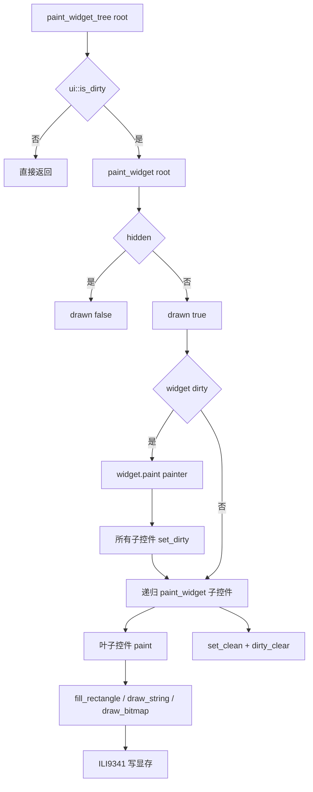
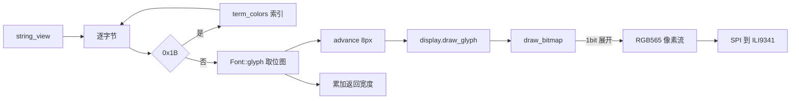

# Painter（绘制器与重绘策略）—— ui_painter.hpp / ui_painter.cpp

> 对应源文件：
> - `firmware/common/ui_painter.hpp`（95 行）
> - `firmware/common/ui_painter.cpp`（147 行）
>
> 合计 242 行。本文行号以当前仓库为准。
> 相关 Docs：[05-UI组件与渲染](../../../references/firmware/mayhem-firmware/Docs/05-UI组件与渲染.md)
> 相关 KB：[app_view.md](app_view.md)

---

## 1. 一句话职责

`Painter` 是**控件树与屏驱动之间的唯一薄层**：它把"画一个字符/位图/矩形"翻译成
`portapack::display`（ILI9341）的像素操作，并决定**这一帧要重绘哪些子树**。
它自己不做裁剪、不做双缓冲、不保存画布——所有状态都在屏的显存里。

## 2. 核心结构

### 2.1 `Style` / `MutableStyle`（`ui_painter.hpp:33-62`）

| 类型 | 字段 | 含义 | 行号 |
|---|---|---|---|
| `Style` | `const Font& font` | 字体引用（不拥有） | 34 |
| `Style` | `Color background` | 背景色（RGB565） | 35 |
| `Style` | `Color foreground` | 前景色 | 36 |
| `Style::invert()` | — | 交换前景/背景，用于高亮 | 38 |
| `MutableStyle` | `const Font* font` + 两个 Color | 可变版本，`invert()` 原地交换 | 42-62 |

`MutableStyle` 的存在是为了在绘制循环里"临时反色"而不产生新对象：

```cpp
struct MutableStyle {
    const Font* font;
    Color background;
    Color foreground;

    MutableStyle(const Style& s)
        : font{&s.font},
          background{s.background},
          foreground{s.foreground} {}

    void invert() {
        std::swap(background, foreground);
    }

    operator Style() const {
        return {
            .font = *font,
            .background = background,
            .foreground = foreground};
    }
};
```

### 2.2 `Painter` 的 API（`ui_painter.hpp:66-91`）

| 方法 | 返回 | 作用 | 底层调用 |
|---|---|---|---|
| `draw_char(p, style, c, zoom)` | 前进宽度 px | 画一个字符 | `display.draw_glyph` |
| `draw_string(p, style, text)` | 宽度 px | 画字符串（支持颜色转义） | 逐字符 `draw_glyph` |
| `draw_string(p, font, fg, bg, text)` | 宽度 px | 同上，显式颜色 | 同上 |
| `draw_bitmap(p, bitmap, bg, fg)` | — | 画 1 bit 位图 | `display.draw_bitmap` |
| `draw_rectangle(r, c)` | — | 空心矩形（4 条线） | `fill_rectangle` ×4 |
| `fill_rectangle(r, c)` | — | 实心矩形 | `display.fill_rectangle` |
| `fill_rectangle_unrolled8(r, c)` | — | 实心矩形（8 像素展开优化） | `display.fill_rectangle_unrolled8` |
| `paint_widget_tree(w)` | — | 整树重绘入口 | 递归 `paint_widget` |
| `draw_hline(p, w, c)` | — | 水平线 | `fill_rectangle({p,{w,1}})` |
| `draw_vline(p, h, c)` | — | 垂直线 | `fill_rectangle({p,{1,h}})` |

### 2.3 `Bitmap`（`firmware/application/bitmap.hpp`）

| 字段 | 类型 | 含义 |
|---|---|---|
| `size` | `ui::Size` | 像素宽高 |
| `data` | `const uint8_t*` | 1 bit/像素，行优先，LSB 在前 |

`Painter::draw_bitmap()` 还做了一件"可读性"优化（`ui_painter.cpp:84-90`）：

```cpp
void Painter::draw_bitmap(Point p, const Bitmap& bitmap, Color foreground, Color background) {
    // If bright foreground colors on white background, darken the foreground color to improve visibility
    if ((background.v == ui::Color::white().v) && (foreground.to_greyscale() > 146))
        foreground = foreground.dark();

    display.draw_bitmap(p, bitmap.size, bitmap.data, foreground, background);
}
```

白底 + 亮前景（灰度 > 146）时自动压暗前景，避免图标"看不见"。

## 3. 逐函数表

| 函数 | 行号（.cpp） | 作用 | 复杂度 |
|---|---|---|---|
| `Style::invert()` | 32-37 | 生成反色 Style | O(1) |
| `Painter::draw_char()` | 39-45 | 取字形 → 画 → 返回 advance × zoom | O(1) 次屏写 |
| `Painter::draw_string(Style)` | 47-49 | 转调完整版 | — |
| `Painter::draw_string(font,fg,bg,text)` | 51-82 | 逐字符 + 颜色转义 | O(n) |
| `Painter::draw_bitmap()` | 84-90 | 白底自动压暗 + 转屏驱动 | O(1) |
| `Painter::draw_hline()` | 92-94 | 1 px 高填充 | O(w) |
| `Painter::draw_vline()` | 96-98 | 1 px 宽填充 | O(h) |
| `Painter::draw_rectangle()` | 100-105 | 4 条边 | O(w+h) |
| `Painter::fill_rectangle()` | 107-109 | 直接填充 | O(w×h) |
| `Painter::fill_rectangle_unrolled8()` | 111-113 | 8 像素展开填充 | O(w×h/8) 循环开销 |
| `Painter::paint_widget_tree()` | 115-120 | 全局 dirty 检查后递归 | O(n) |
| `Painter::paint_widget()` | 122-145 | 递归绘制/强制子脏 | O(n) |

## 4. 逐字摘录

### 4.1 整树绘制的决策（`ui_painter.cpp:115-145`）

```cpp
void Painter::paint_widget_tree(Widget* w) {
    if (ui::is_dirty()) {
        paint_widget(w);
        ui::dirty_clear();
    }
}

void Painter::paint_widget(Widget* w) {
    if (w->hidden()) {
        // Mark widget (and all children) as not drawn.
        w->drawn(false);
    } else {
        // Mark this widget as drawn and recurse.
        w->drawn(true);

        if (w->dirty()) {
            w->paint(*this);
            // Force-paint all children.
            for (const auto child : w->children()) {
                child->set_dirty();
                paint_widget(child);
            }
            w->set_clean();
        } else {
            // Selectively paint all children.
            for (const auto child : w->children()) {
                paint_widget(child);
            }
        }
    }
}
```

逐行解释：

- **`ui::is_dirty()` 是全局闸门**：没有任何控件变脏时，整帧只花一次布尔判断。
- **`hidden` 分支**：自己不画、子树也不进（但会递归下去把 `drawn` 全置假，
  这样触摸/焦点逻辑知道它们没显示）。
- **父脏**：先画自己，然后把**所有子控件强制置脏**再递归——因为父控件的
  `paint()` 可能覆盖子控件区域，必须重画子控件才能恢复。
- **父净**：只递归，子控件各自判断。这是唯一的"增量绘制"路径。
- **`set_clean()` 在子树画完之后**：递归期间父控件保持 dirty，防止重入时重复绘制。

### 4.2 字符串与颜色转义（`ui_painter.cpp:51-82`）

```cpp
int Painter::draw_string(
    Point p,
    const Font& font,
    Color foreground,
    Color background,
    std::string_view text) {
    bool escape = false;
    size_t width = 0;
    Color pen = foreground;

    for (auto c : text) {
        if (escape) {
            if (c < std::size(term_colors))
                pen = term_colors[(uint8_t)c];
            else
                pen = foreground;
            escape = false;
        } else {
            if (c == '\x1B') {
                escape = true;
            } else {
                const auto glyph = font.glyph(c);
                display.draw_glyph(p, glyph, pen, background);
                const auto advance = glyph.advance();
                p += advance;
                width += advance.x();
            }
        }
    }

    return width;
}
```

- 转义序列是 **两字节**：`0x1B` + 索引（0–15）。宏见 `ui.hpp:71-87`。
- 索引越界时回退到原前景色（不崩）。
- **返回宽度不含转义序列**，但因为转义不占格，所以返回的是"可见字符宽度"。
- `p += advance` 依赖 `Glyph::advance() = {w, 0}`，即等宽字体、不换行。
  要换行必须自己算 `p.y += font.line_height()`。

### 4.3 矩形与线（`ui_painter.cpp:92-113`）

```cpp
void Painter::draw_hline(Point p, int width, Color c) {
    display.fill_rectangle({p, {width, 1}}, c);
}

void Painter::draw_vline(Point p, int height, Color c) {
    display.fill_rectangle({p, {1, height}}, c);
}

void Painter::draw_rectangle(Rect r, Color c) {
    draw_hline(r.location(), r.width(), c);
    draw_vline({r.left(), r.top() + 1}, r.height() - 2, c);
    draw_vline({r.left() + r.width() - 1, r.top() + 1}, r.height() - 2, c);
    draw_hline({r.left(), r.top() + r.height() - 1}, r.width(), c);
}

void Painter::fill_rectangle(Rect r, Color c) {
    display.fill_rectangle(r, c);
}

void Painter::fill_rectangle_unrolled8(Rect r, Color c) {
    display.fill_rectangle_unrolled8(r, c);
}
```

`draw_rectangle()` 是**四次独立的填充**，每个角只画一次（垂直线从 `top+1` 开始、
高度 `h-2`），避免角像素重复写。代价是 4 次"设窗口 + 写像素"，对细边框来说
反而比一次整块填充慢——所以边框只用在少数控件上。

## 5. 绘制调用链



## 6. 一次文本绘制的数据流



## 7. 量化与性能

| 操作 | 像素写次数 | 备注 |
|---|---|---|
| `draw_char`（8×16） | 128 | 一次 `draw_glyph` → 一次 `draw_bitmap` 窗口 + 128 次写 |
| `draw_string`（30 字符） | 3 840 | 无换行、无裁剪 |
| `fill_rectangle(240×320)` | 76 800 | 整屏，约 150 KiB 数据 |
| `draw_rectangle(240×320)` | 2×240 + 2×318 ≈ 1 116 | 空心 |
| `paint_widget_tree` 空闲帧 | 0 | 只花一次 `is_dirty()` |
| `paint_widget_tree` 根脏 | 全树 | 与控件数 × 面积成正比 |

递归本身的开销：每个控件一次 `hidden()`、一次 `dirty()`、一次 `children()` 调用，
约 20–30 个周期。600 个控件的树，纯遍历约 1.5 万周期（@200 MHz ≈ 75 µs）——
远小于一次整屏 SPI 传输（>20 ms），所以**瓶颈永远是像素量，不是递归**。

## 8. 陷阱与读码建议

- **`fill_rectangle` 不做裁剪**（裁剪在 LCD 驱动里做，`lcd_ili9341.cpp:408-415`）。
  画到屏幕外的矩形会走完整个循环才发现被裁掉，浪费 SPI 带宽。
- **`draw_rectangle` 是 4 次填充**，比 `fill_rectangle` 慢；大面积边框考虑用
  "填背景 + 填内区"两次。
- **`draw_string` 不换行、不裁剪**：超长字符串会一路画出屏外（被驱动裁掉），
  但返回值宽度是"全部字符"的宽度，可能远超控件宽度。
- **颜色转义不占宽度**：`STR_COLOR_RED "abc"` 的返回宽度等于 `"abc"` 的宽度。
  但如果你用返回值做"下一个控件起点"，要注意转义序列不产生位移。
- **白底自动压暗只对 `draw_bitmap` 生效**：`draw_string` 走的是 `draw_glyph` →
  `display.draw_bitmap`（驱动层），**不经过** `Painter::draw_bitmap`，所以白底上的
  亮色文字不会自动压暗。这是两条不同的路径（`ui_painter.cpp:42` vs `:89`）。
- **`paint_widget_tree` 只处理一棵树**：传进去的根必须是 `SystemView`，
  否则覆盖层/通知栏不会被绘制。
- **`dirty_clear()` 在 `paint_widget()` 之后无条件执行**：即使某个 `paint()` 内部又
  `set_dirty()`，这一帧结束后全局脏标志也会被清掉——下一次 `set_dirty()` 才会再触发。
  这意味着"在 paint 里改状态并置脏"不会导致同帧无限重绘，但也可能丢一次更新。
- **不要缓存 `Painter` 对象做跨帧绘制**：它无状态，唯一的"状态"在屏显存与控件标志里。
- 读码建议：先看 `paint_widget()`（唯一的算法）→ `draw_string()`（唯一的转义逻辑）→
  再到 `lcd_ili9341.cpp` 的 `draw_bitmap()` 看位展开与透明色。
