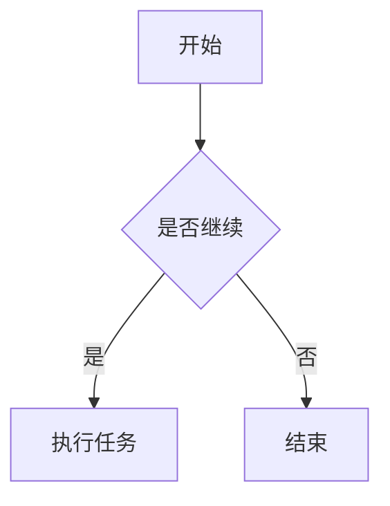
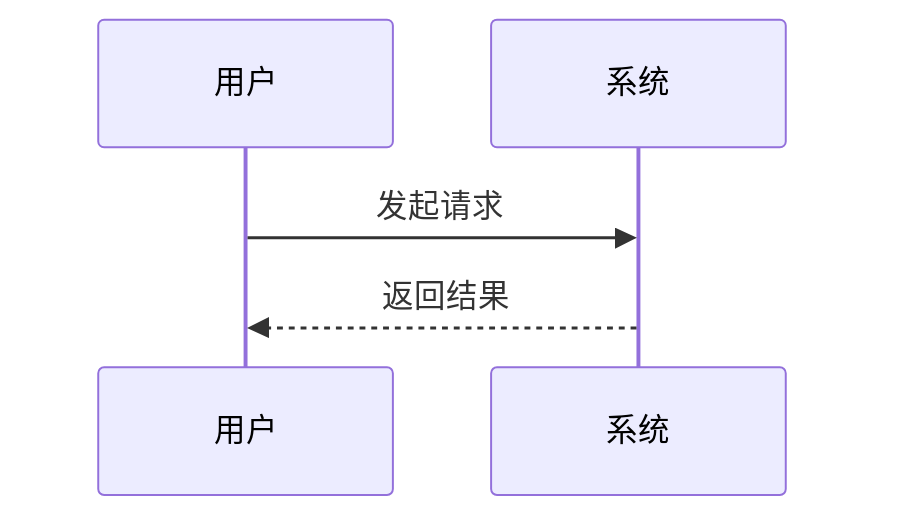

# Markdown 写作指南

Markdown（简称 MD）是一种用纯文本编写格式文档的轻量标记语言。文件后缀通常为 `.md`，推荐使用 UTF-8 编码保存。

核心规则：

- 用符号标记格式，例如 `#` 表示标题，`**` 表示粗体。
- 段落之间通常空一行。
- 符号后面通常需要空格，例如 `# 标题`、`- 列表项`。
- 不同平台对扩展语法支持不同，基础语法通常通用。

---

## 目录

- [1. 标题](#1-标题)
- [2. 段落与换行](#2-段落与换行)
- [3. 强调文字](#3-强调文字)
- [4. 列表](#4-列表)
- [5. 链接与图片](#5-链接与图片)
- [6. 引用](#6-引用)
- [7. 代码](#7-代码)
- [8. 分隔线](#8-分隔线)
- [9. 表格](#9-表格)
- [10. 任务列表](#10-任务列表)
- [11. 转义字符](#11-转义字符)
- [12. 脚注](#12-脚注)
- [13. 数学公式](#13-数学公式)
- [14. Mermaid 图表](#14-mermaid-图表)
- [15. HTML 与折叠内容](#15-html-与折叠内容)
- [16. 目录与锚点](#16-目录与锚点)
- [17. 常见注意事项](#17-常见注意事项)
- [18. 推荐工具](#18-推荐工具)
- [19. 完整示例](#19-完整示例)

---

## 1. 标题

使用 `#` 加空格表示标题，1 个 `#` 是一级标题，最多支持 6 级标题。

```markdown
# 一级标题
## 二级标题
### 三级标题
#### 四级标题
##### 五级标题
###### 六级标题
```

注意：

- `#` 和标题文字之间必须有空格。
- 一级标题通常一个文档只用一个。
- 标题层级建议按顺序使用，不要从一级直接跳到四级。

---

## 2. 段落与换行

段落之间空一行即可。

```markdown
这是第一段。

这是第二段。
```

如果只想在段落内换行，可以在行尾加两个空格，或者加反斜杠 `\`。不同平台支持略有差异。

```markdown
第一行  
第二行

第一行\
第二行
```

不建议用很多空行来做排版，不同平台渲染效果可能不同。

---

## 3. 强调文字

```markdown
**粗体**
*斜体*
***粗斜体***
~~删除线~~
`行内代码`
```

效果示例：

- **粗体**
- *斜体*
- ***粗斜体***
- ~~删除线~~
- `行内代码`

注意：

- 粗体通常用两个星号 `**`。
- 斜体通常用一个星号 `*`。
- 删除线需要平台支持，常见于 GitHub、Typora、Obsidian 等。

---

## 4. 列表

### 4.1 无序列表

使用 `-`、`*` 或 `+` 加空格。

```markdown
- 苹果
- 香蕉
- 橙子
```

嵌套列表需要缩进：

```markdown
- 水果
  - 苹果
  - 香蕉
- 蔬菜
  - 白菜
  - 萝卜
```

### 4.2 有序列表

```markdown
1. 第一步
2. 第二步
3. 第三步
```

也可以嵌套：

```markdown
1. 安装依赖
2. 启动项目
   1. 开发环境
   2. 生产环境
3. 访问页面
```

### 4.3 列表注意事项

- 列表符号后要有空格。
- 嵌套列表通常缩进 2 个或 4 个空格。
- 列表项之间可以空行，也可以不空行，按平台习惯即可。

---

## 5. 链接与图片

### 5.1 链接

```markdown
[链接文字](https://example.com)
```

带标题的链接：

```markdown
[链接文字](https://example.com "鼠标悬停时显示的文字")
```

### 5.2 图片

```markdown

```

本地图片可以使用相对路径：

```markdown

```

带标题的图片：

```markdown

```

### 5.3 图片链接

图片也可以作为链接：

```markdown
[](https://example.com)
```

---

## 6. 引用

使用 `>` 加空格表示引用。

```markdown
> 这是一段引用。
> 可以写多行。
>
> 这是引用的第二段。
```

嵌套引用：

```markdown
> 第一层引用
>
> > 第二层引用
```

引用中也可以使用其他 Markdown 语法：

```markdown
> **提示：** 这里是重点内容。
>
> - 支持列表
> - 支持代码 `inline code`
```

---

## 7. 代码

### 7.1 行内代码

使用反引号包裹：

```markdown
使用 `npm install` 安装依赖。
```

效果：使用 `npm install` 安装依赖。

### 7.2 代码块

使用三个反引号包裹代码块，开头可以写语言名，用于语法高亮。

```markdown
```python
print("Hello Markdown")
```
```

常用语言名：

- `bash`
- `shell`
- `python`
- `javascript`
- `js`
- `typescript`
- `ts`
- `json`
- `yaml`
- `html`
- `css`
- `sql`
- `java`
- `go`
- `rust`
- `markdown`

### 7.3 代码块示例

```bash
npm install
npm run dev
```

```json
{
  "name": "demo",
  "version": "1.0.0"
}
```

```python
def hello(name):
    print(f"Hello, {name}")

hello("Markdown")
```

---

## 8. 分隔线

单独一行使用三个或更多 `-`、`*`、`_`。

```markdown
---
```

也可以：

```markdown
***
```

```markdown
___
```

建议分隔线上下各空一行。

---

## 9. 表格

基础表格：

```markdown
| 姓名 | 年龄 | 城市 |
| --- | --- | --- |
| 张三 | 18 | 北京 |
| 李四 | 20 | 上海 |
```

对齐方式：

```markdown
| 左对齐 | 居中对齐 | 右对齐 |
| :--- | :---: | ---: |
| A | B | C |
| 1 | 2 | 3 |
```

说明：

- `:---` 表示左对齐。
- `:---:` 表示居中对齐。
- `---:` 表示右对齐。
- 表格列之间用 `|` 分隔。
- 表头下面必须有一行分隔线。

---

## 10. 任务列表

任务列表常用于待办事项，需要平台支持。

```markdown
- [x] 已完成任务
- [ ] 未完成任务
- [ ] 另一个未完成任务
```

效果示例：

- [x] 已完成任务
- [ ] 未完成任务
- [ ] 另一个未完成任务

---

## 11. 转义字符

如果想显示 Markdown 符号本身，可以使用反斜杠 `\` 转义。

```markdown
\*这不是斜体\*
\# 这不是标题
\- 这不是列表
\[这不是链接\]
```

常见需要转义的符号：

```text
\ ` * _ { } [ ] ( ) # + - . ! | >
```

---

## 12. 脚注

脚注属于扩展语法，不是所有平台都支持。

```markdown
这是一个带脚注的句子[^1]。

[^1]: 这里是脚注内容。
```

也可以使用命名脚注：

```markdown
Markdown 很适合写文档[^markdown]。

[^markdown]: Markdown 是一种轻量标记语言。
```

---

## 13. 数学公式

数学公式通常需要平台支持，例如 Typora、Obsidian、语雀、GitHub 的部分场景等。

行内公式：

```markdown
质能方程是 $E = mc^2$。
```

块级公式：

```markdown
$$
a^2 + b^2 = c^2
$$
```

更多示例：

```markdown
$$
\frac{a}{b} + \sqrt{x}
$$
```

```markdown
$$
\sum_{i=1}^{n} i = \frac{n(n+1)}{2}
$$
```

---

## 14. Mermaid 图表

Mermaid 是扩展语法，需要平台支持。常见于 GitHub、Typora、Obsidian、语雀等。

流程图：

```markdown

```

时序图：

```markdown

```

如果平台不支持 Mermaid，会显示为普通代码块。

---

## 15. HTML 与折叠内容

Markdown 通常允许嵌入部分 HTML，但不同平台支持程度不同。

### 15.1 基础 HTML

```markdown
<br>

<hr>

<strong>加粗文字</strong>

<em>斜体文字</em>
```

### 15.2 折叠内容

部分平台支持 `<details>` 和 `<summary>`：

```markdown
<details>
<summary>点击展开更多内容</summary>

这里是折叠区域里的内容。

- 可以写列表
- 可以写文字

</details>
```

注意：微信公众号、部分博客平台可能不支持或会过滤 HTML。

---

## 16. 目录与锚点

### 16.1 自动目录

部分平台支持 `[TOC]`：

```markdown
[TOC]
```

注意：不是所有平台都支持，GitHub 原生不支持 `[TOC]`。

### 16.2 手动锚点

很多平台会根据标题自动生成锚点。例如：

```markdown
[跳转到标题](#1-标题)
```

标题：

```markdown
## 1. 标题
```

不同平台生成锚点的规则可能不同，常见规则是：

- 转小写。
- 空格转连字符。
- 去掉部分标点。

### 16.3 HTML 锚点

部分平台支持：

```markdown
<a id="custom-anchor"></a>

[跳转到自定义锚点](#custom-anchor)
```

---

## 17. 常见注意事项

1. 文件后缀使用 `.md`。
2. 文件编码建议使用 UTF-8。
3. `#` 和标题之间必须有空格。
4. 列表符号后必须有空格。
5. 段落之间建议空一行。
6. 代码块开头写语言名可以获得语法高亮。
7. 表格的表头下面必须有分隔线。
8. 图片路径要正确，本地图片建议使用相对路径。
9. 不同平台支持的扩展语法不同，例如脚注、数学公式、Mermaid、`[TOC]`。
10. 不要过度依赖 HTML，很多平台会过滤 HTML。
11. 标题层级要清晰，方便生成目录。
12. 写完后一定要预览，检查换行、表格和代码块是否正确。
13. 如果要把 Markdown 粘贴到微信公众号，可能需要使用专门的排版工具转换。
14. 如果代码块中本身包含三个反引号，可以使用四个反引号包裹代码块。
15. 文件命名建议使用英文、数字和连字符，避免特殊字符。

---

## 18. 推荐工具

### 18.1 编辑器

- **VS Code**：免费，插件丰富，推荐安装 Markdown Preview Enhanced。
- **Typora**：所见即所得，适合写长文档。
- **Obsidian**：适合知识库和个人笔记。
- **语雀**：在线文档，支持 Markdown。
- **Notion**：支持部分 Markdown 输入。
- **GitHub**：适合托管和预览 Markdown 文档。

### 18.2 VS Code 常用插件

- Markdown Preview Enhanced
- Markdown All in One
- markdownlint
- Paste Image
- Mermaid Preview

### 18.3 常用命令

如果使用 VS Code，可以按 `Ctrl + Shift + V` 预览 Markdown。

如果使用 Typora，直接打开 `.md` 文件即可预览。

---

## 19. 完整示例

下面是一个完整的 Markdown 文档示例，可以直接复制修改。

```markdown
# 项目说明

这是一个 Markdown 示例文档，包含 **粗体**、*斜体*、`行内代码` 和 [链接](https://example.com)。

## 功能列表

- 支持标题
- 支持列表
  - 支持嵌套列表
- 支持代码块
- 支持表格
- 支持任务列表

## 安装步骤

1. 下载项目
2. 安装依赖：

```bash
npm install
```

3. 启动项目：

```bash
npm run dev
```

4. 打开浏览器访问：

```text
http://localhost:3000
```

## 配置表格

| 参数 | 类型 | 默认值 | 说明 |
| --- | --- | --- | --- |
| name | string | 无 | 项目名称 |
| port | number | 3000 | 服务端口 |
| debug | boolean | false | 是否开启调试 |

## 代码示例

```javascript
function greet(name) {
  return `Hello, ${name}`;
}

console.log(greet("Markdown"));
```

## 待办事项

- [x] 写文档
- [x] 添加示例
- [ ] 发布上线

## 引用提示

> 提示：不同平台对扩展语法支持不同。
>
> 建议写完后先预览效果。

## 图片示例


## 分隔线

---

## 联系方式

- 邮箱：example@example.com
- 网站：[https://example.com](https://example.com)
```

---

## 20. 快速记忆表

| 功能 | 语法 |
| --- | --- |
| 一级标题 | `# 标题` |
| 二级标题 | `## 标题` |
| 粗体 | `**粗体**` |
| 斜体 | `*斜体*` |
| 删除线 | `~~删除线~~` |
| 行内代码 | `` `code` `` |
| 链接 | `[文字](URL)` |
| 图片 | `` |
| 无序列表 | `- 项目` |
| 有序列表 | `1. 项目` |
| 引用 | `> 引用` |
| 代码块 | 三个反引号包裹 |
| 分隔线 | `---` |
| 表格 | `\| 表头 \|` |
| 任务列表 | `- [x] 完成` |
| 脚注 | `文字[^1]` |
| 行内公式 | `$E=mc^2$` |
| 块级公式 | `$$ ... $$` |
| 目录 | `[TOC]` |

---

## 21. 总结

学习 Markdown 建议按以下顺序掌握：

1. 标题
2. 段落与换行
3. 粗体、斜体、删除线
4. 列表
5. 链接与图片
6. 引用
7. 代码与代码块
8. 表格
9. 任务列表
10. 转义字符

掌握以上基础语法后，就可以写大多数 Markdown 文档。脚注、数学公式、Mermaid、`[TOC]`、HTML 折叠等属于扩展语法，按平台支持情况使用即可。