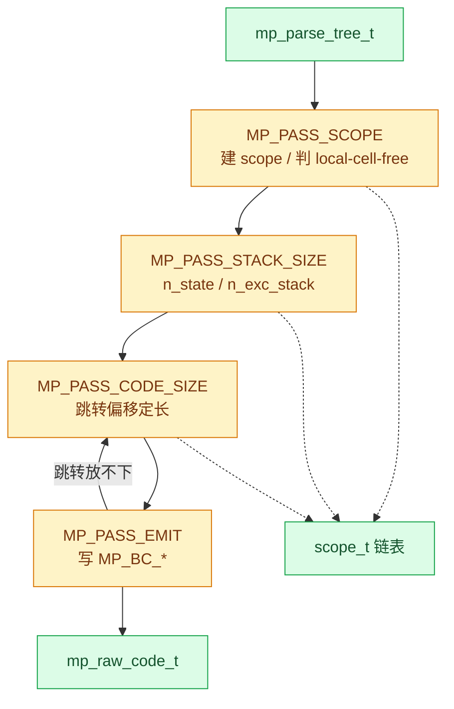

# compile：词法后的语法分析与字节码生成

> 对应源文件：`py/compile.c`（共 3711 行）+ `py/parse.c`（共 1416 行）
> 辅以 `py/lexer.c`（1166 行）、`py/grammar.h`、`py/scope.h`、`py/emitbc.c`（935 行）
> 覆盖范围：`mp_parse()` 的表驱动语法分析、`mp_compile_to_raw_code()` 的作用域收集与多遍遍历、
> 字节码发射的调用方式。
> 不覆盖：词法细节（`lexer.c`）、原生代码发射（`emitnative.c`，见 `06` 篇）。

一句话职责：把 `mp_lexer_t` 的 token 流变成 `mp_parse_tree_t`（AST），
再把 AST 变成 `mp_raw_code_t`（字节码 + qstr/常量表），供 `mp_make_function_from_proto_fun` 包装成函数对象。

---

## 1. 两段式管线


两段之间只有一种数据结构：`mp_parse_tree_t`。它不持有 lexer，也不持有编译器状态，
所以 `.mpy` 可以在没有源码的情况下直接跳到 `mp_raw_code_t`（反序列化）。

---

## 2. `parse.c`：表驱动 LL(1)

MicroPython 不用 yacc/bison，而是把语法规则编码成几张表：

| 表 | 行 | 内容 |
|---|---|---|
| `rule_act_table[]` | 83-115 | 每条规则的动作类型 + 参数个数 |
| `rule_arg_combined_table[]` | 116-168 | 规则参数（token 或子规则） |
| `rule_arg_offset_table[]` | 169-183 | 参数表偏移（>255 时用） |
| `rule_name_table[]` | 199-249 | 规则名（调试/报错） |

规则本身来自 `py/grammar.h` 的 `DEF_RULE(...)` 宏，构建期展开成这些表。

### 2.1 核心算法

`mp_parse()` 维护两个栈：

- `rule_stack[]`：待展开的规则（含当前匹配到第几个参数）；
- `result_stack[]`：已归约的 AST 节点。

主循环（`py/parse.c:1096-1108`）：

```c
    for (;;) {
    next_rule:
        if (parser.rule_stack_top == 0) {
            break;
        }

        // Pop the next rule to process it
        size_t i; // state for the current rule
        size_t rule_src_line; // source line for the first token matched by the current rule
        uint8_t rule_id = pop_rule(&parser, &i, &rule_src_line);
        uint8_t rule_act = rule_act_table[rule_id];
        const uint16_t *rule_arg = get_rule_arg(rule_id);
        size_t n = rule_act & RULE_ACT_ARG_MASK;
```

`rule_act & RULE_ACT_KIND_MASK` 区分四种动作：匹配 token、匹配子规则、列表、可选。
回溯（backtrack）只允许“还没吃 token”的情况，所以语法被设计成 LL(1) 可判定。

### 2.2 入口

```c
mp_parse_tree_t mp_parse(mp_lexer_t *lex, mp_parse_input_kind_t input_kind) {
    // Set exception handler to free the lexer if an exception is raised.
    MP_DEFINE_NLR_JUMP_CALLBACK_FUNCTION_1(ctx, mp_lexer_free, lex);
    nlr_push_jump_callback(&ctx.callback, mp_call_function_1_from_nlr_jump_callback);

    // initialise parser and allocate memory for its stacks

    parser_t parser;

    parser.rule_stack_alloc = MICROPY_ALLOC_PARSE_RULE_INIT;
    parser.rule_stack_top = 0;
    parser.rule_stack = m_new(rule_stack_t, parser.rule_stack_alloc);
    ...
    // work out the top-level rule to use, and push it on the stack
    size_t top_level_rule;
    switch (input_kind) {
        case MP_PARSE_SINGLE_INPUT:
            top_level_rule = RULE_single_input;
            break;
        case MP_PARSE_EVAL_INPUT:
            top_level_rule = RULE_eval_input;
            break;
        default:
            top_level_rule = RULE_file_input;
    }
    push_rule(&parser, lex->tok_line, top_level_rule, 0);
```
（`py/parse.c:1052-1090`）

三种入口对应 REPL 的三种模式：单行、`eval()`、文件。

### 2.3 常量折叠

`fold_constants()`（`py/parse.c:749-923`）在归约时直接计算 `1 + 2`、`"a" * 3` 这类表达式，
结果存进 `parser.consts` 表（`MICROPY_COMP_CONST` 开启时）。
这样 `LOAD_CONST_SMALL_INT` 能直接编码，省掉运行时运算。

`fold_logical_constants()`（`py/parse.c:692-748`）处理 `and/or` 的短路常量折叠，
但只在“结果与副作用无关”时做。

### 2.4 内存管理：chunk 链表

AST 节点不是逐个 `malloc`，而是从 `mp_parse_chunk_t` 里分配（`py/parse.c:260-300`）。
解析结束后 `mp_parse_tree_clear()` 整块释放（`py/parse.c:1406-1415`），
避免几千次小分配。节点本身是 32 位打包值：

- 低 2 位区分“叶子/结构体/常量”；
- 叶子存 token 类型 + 值；
- 结构体存 `kind_num_nodes` + 变长 `nodes[]`。

---

## 3. `compile.c`：作用域 + 多遍遍历

### 3.1 关键结构

| 结构 | 定义 | 含义 |
|---|---|---|
| `compiler_t` | `compile.c:180-213` | 编译器全局状态：当前 scope、label、emit 器、错误 |
| `scope_t` | `scope.h` | 一个作用域：kind、id 表、`stack_size`、`raw_code` |
| `id_info_t` | `scope.h` | 名字的信息：kind（local/global/cell/free） |
| `emit_method_table_t` | `emit.h` | 发射器虚表（bytecode / native / viper） |

`compiler_t` 的核心字段：

| 字段 | 行 | 含义 |
|---|---|---|
| `scope_cur` | 200 | 当前正在编译的作用域 |
| `scope_head` | 199 | 所有作用域链表头 |
| `pass` | 182 | 当前遍（SCOPE/STACK_SIZE/CODE_SIZE/EMIT） |
| `compile_error` | 186 | 第一个错误（后续不再编译） |
| `emit` | 202 | 发射器实例 |
| `emit_method_table` | 204 | 发射器函数表 |

### 3.2 函数表

| 函数 | 行 | 职责 |
|---|---|---|
| `mp_emit_common_init` | 223-233 | 初始化 qstr/常量表 |
| `mp_emit_common_start_pass` | 234-245 | 每遍开始，重置计数 |
| `mp_emit_common_populate_module_context` | 246-268 | 生成 `mp_module_context_t` 的常量表 |
| `compile_error_set_line` | 269-275 | 把错误定位到源码行 |
| `compile_syntax_error` | 276-283 | 抛 `SyntaxError` |
| `scope_new_and_link` | 318-333 | 新建作用域并挂到链表 |
| `compile_load_id` / `store_id` / `delete_id` | 360-395 | 名字读写（区分 local/global/cell/free） |
| `c_if_cond` | 405-452 | 条件跳转（含短路） |
| `c_assign` | 531-621 | 赋值（含解包、属性、下标） |
| `close_over_variables_etc` | 622-663 | 闭包：把 free 变量变成 cell |
| `compile_funcdef_lambdef` | 755-790 | 函数/lambda 的作用域与默认参数 |
| `compile_classdef_helper` | 811-842 | 类定义：建 `__build_class__` 调用 |
| `compile_decorated` | 894-961 | 装饰器：从内到外调用 |
| `compile_return_stmt` | 1042-1069 | return（含 finally 交互） |
| `compile_raise_stmt` | 1075-1094 | raise（含 `from`） |
| `do_import_name` | 1095-1155 | import 的 qstr 与层级处理 |
| `compile_scope` | 3051-3488 | **单遍编译主函数** |
| `mp_compile_to_raw_code` | 3489-3700 | **总入口**：建 scope、跑多遍、收尾 |
| `mp_compile` | 3702-3711 | 包装成函数对象 |

### 3.3 多遍遍历

```c
            // need a pass to compute stack size
            compile_scope(comp, s, MP_PASS_STACK_SIZE);

            // second last pass: compute code size
            if (comp->compile_error == MP_OBJ_NULL) {
                compile_scope(comp, s, MP_PASS_CODE_SIZE);
            }

            // final pass: emit code
            // the emitter can request multiple of these passes
            if (comp->compile_error == MP_OBJ_NULL) {
                while (!compile_scope(comp, s, MP_PASS_EMIT)) {
                }
            }
```
（`py/compile.c:3610-3623`）

为什么四遍？

| 遍 | 目的 | 为什么不能合并 |
|---|---|---|
| `MP_PASS_SCOPE` | 收集名字、判定 local/global/cell/free、建子 scope | 必须先知道所有名字才能决定 cell |
| `MP_PASS_STACK_SIZE` | 模拟执行，算出 `n_state` 与 `n_exc_stack` | 栈大小影响 prelude 编码长度 |
| `MP_PASS_CODE_SIZE` | 算出每条跳转的最终偏移 | 跳转是相对偏移，长度依赖前后指令 |
| `MP_PASS_EMIT` | 真正写字节 | 前面都确定后才能定位 |

`MP_PASS_EMIT` 可能重复多次：原生发射器在“短跳转放不下”时会要求重来，
所以是 `while (!compile_scope(...))`。

### 3.4 入口与收尾

```c
void mp_compile_to_raw_code(mp_parse_tree_t *parse_tree, qstr source_file, bool is_repl, mp_compiled_module_t *cm) {
    ...
    scope_t *module_scope = scope_new_and_link(comp, SCOPE_MODULE, parse_tree->root, emit_opt);

    // create standard emitter; it's used at least for MP_PASS_SCOPE
    emit_t *emit_bc = emit_bc_new(&comp->emit_common);

    // compile MP_PASS_SCOPE
    comp->emit = emit_bc;
    ...
    for (scope_t *s = comp->scope_head; s != NULL && comp->compile_error == MP_OBJ_NULL; s = s->next) {
        ...
            compile_scope(comp, s, MP_PASS_SCOPE);
        ...
    }
```
（`py/compile.c:3489-3538`，中间是初始化 emit 器与 `MICROPY_EMIT_NATIVE` 分支）

```c
mp_obj_t mp_compile(mp_parse_tree_t *parse_tree, qstr source_file, bool is_repl) {
    mp_compiled_module_t cm;
    cm.context = m_new_obj(mp_module_context_t);
    cm.context->module.globals = mp_globals_get();
    mp_compile_to_raw_code(parse_tree, source_file, is_repl, &cm);
    // return function that executes the outer module
    return mp_make_function_from_proto_fun(cm.rc, cm.context, NULL);
}
```
（`py/compile.c:3702-3711`）

`mp_compile()` 返回的是**模块顶层代码的函数对象**，用 `mp_call_function_0()` 执行——
这就是 `mp_parse_compile_execute()` 的最后一步（见 `mp_init.md` / `01` 篇）。

---

## 4. 作用域与闭包

`scope_t` 的四种 kind：

| kind | 触发 | 特殊行为 |
|---|---|---|
| `SCOPE_MODULE` | 文件/REPL | `locals == globals` |
| `SCOPE_FUNCTION` | `def` | 参数、`return`、`yield` |
| `SCOPE_LAMBDA` | `lambda` | 只能有一个表达式 |
| `SCOPE_CLASS` | `class` | 独立的命名空间，方法不绑定 |

名字解析（`scope_find_or_add_id` + `scope_update_mpz`）在 `MP_PASS_SCOPE` 完成：

1. 赋值 → `ID_INFO_KIND_LOCAL`；
2. `global/nonlocal` 声明 → `GLOBAL/FREE`；
3. 内层引用外层的局部变量 → 外层变 `CELL`，内层变 `FREE`；
4. 编译时 `close_over_variables_etc()` 在函数入口为每个 cell 生成
   `mp_obj_new_cell()`（`py/bc.c:303-308` 的 prelude 循环）。



---

## 5. 量化

| 项 | 数值 | 说明 |
|---|---|---|
| `parse.c` 规则数 | ~150 条 | `grammar.h` 的 `DEF_RULE` |
| AST 节点大小 | 4 B（叶子）/ 8+4n B（结构体） | 打包值 |
| 解析 100 行脚本的峰值 | 2~6 KB | 规则栈 + 结果栈 + chunk |
| 编译 100 行脚本的峰值 | 4~10 KB | scope 表 + emit 缓冲 |
| 编译器代码体积 | ~180 KB Flash | 可由 `MICROPY_ENABLE_COMPILER=0` 裁掉 |

---

## 6. 陷阱与读码建议

1. **`mp_parse()` 的异常安全靠 `nlr_jump_callback`**：解析中途抛异常时，
   lexer 会被回调释放；但 `parser.rule_stack/result_stack` 不会——它们只在正常路径释放，
   所以 OOM 后可能残留（可接受，因为通常紧接着就复位）。
2. **`mp_compile()` 会释放 parse tree**（`mp_parse_tree_clear`，`compile.c:3688`），
   调用方不能再访问 AST。
3. **`compile_error` 一旦置位就停止后续编译**，但已分配的 scope 仍会在收尾时释放；
   不要在错误路径里 `return` 得太早，否则泄漏。
4. **`-O1` 会跳过 `assert` 的编译**（`compile.c:1308-1313`），
   所以 `assert` 里的副作用在 `-O1` 下不会发生——不要把必要逻辑写进 assert。
5. **`MP_PASS_EMIT` 可能跑多次**，发射器必须可重入（每次 `start_pass` 重置状态）。
6. **`mp_parse_node_t` 不是指针**，是 32 位打包值；`MP_PARSE_NODE_IS_*` 宏先看低位。
   直接强转成结构体会读到非法地址。
7. 读码建议：先读 `parse.c:1052-1105` 的主循环，再读 `compile.c:3051-3100`
   的 `compile_scope` 开头，最后看 `compile.c:3610-3623` 的遍数控制。

相关文档：[03-字节码虚拟机](../../../references/firmware/micropython/mp-notes/03-字节码虚拟机.md) ·
[vm.md](vm.md) · [runtime.md](runtime.md)
