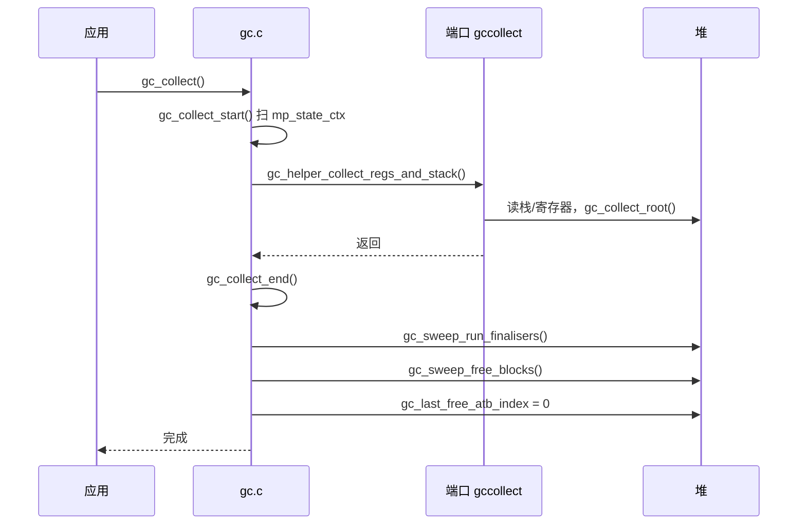
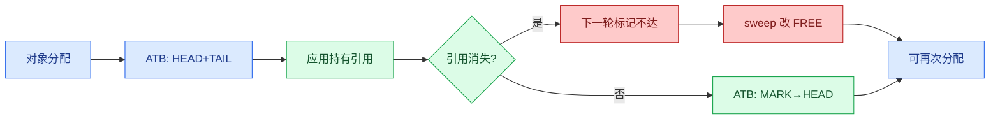

# gc：标记-清除垃圾回收器

> 对应源文件：`py/gc.c`（共 1487 行），辅以 `py/gc.h`（94 行）、`py/mpstate.h`（356 行）
> 覆盖范围：堆布局（ATB/FTB/WTB/Pool）、分配/释放/重分配、根扫描、标记、清除、分片堆、finaliser。
> 不覆盖：端口侧 `gc_collect()` 的寄存器保存细节（`shared/runtime/gchelper_*.s`，各架构一份）。

一句话职责：用“每 16 字节 block + 每 block 2 bit 分配表”的标记-清除算法，
在无 MMU、RAM 只有几十 KB 的 MCU 上管理 Python 对象生命周期。

---

## 1. 核心数据结构

### 1.1 `mp_state_mem_t`（`py/mpstate.h:124-166`）

| 字段 | 行 | 含义 |
|---|---|---|
| `area` | 131 | 第一个（或唯一）堆区域的描述符 |
| `gc_stack_overflow` | 137 | 标记栈溢出标志 |
| `gc_block_stack[]` | 138 | 显式 DFS 栈（默认 64 项） |
| `gc_area_stack[]` | 141 | 分片堆时每项对应的区域 |
| `gc_auto_collect_enabled` | 147 | 是否允许分配失败时自动收集 |
| `gc_alloc_amount/threshold` | 150-151 | 按分配量触发 GC |
| `gc_last_free_area` | 155 | 上次成功分配的区域 |
| `gc_collected` | 159 | 上次收集释放的块数 |
| `gc_mutex` | 164 | 无 GIL 多线程时的 GC 锁 |

### 1.2 `mp_state_mem_area_t`（`py/mpstate.h:103-121`）

| 字段 | 行 | 含义 |
|---|---|---|
| `next` | 105 | 分片堆链表 |
| `gc_alloc_table_start` | 108 | ATB 起始 |
| `gc_alloc_table_byte_len` | 109 | ATB 字节数（1 字节管 4 block） |
| `gc_finaliser_table_start` | 111 | FTB 起始（可选） |
| `gc_weakref_table_start` | 114 | WTB 起始（可选） |
| `gc_pool_start/end` | 116-117 | 对象池范围 |
| `gc_last_free_atb_index` | 119 | 分配游标（减少碎片） |
| `gc_last_used_block` | 120 | 最高已用块（清除时少扫） |

### 1.3 ATB 四态（`py/gc.c:83-90`）

| 值 | 宏 | 含义 |
|---|---|---|
| `0b00` | `AT_FREE` | 空闲块 |
| `0b01` | `AT_HEAD` | 对象链头 |
| `0b10` | `AT_TAIL` | 对象链尾 |
| `0b11` | `AT_MARK` | 已标记的链头 |

宏定义（`py/gc.c:97-100`）用移位/掩码直接操作字节，没有函数调用：

```c
#define BLOCK_SHIFT(block) (2 * ((block) & (BLOCKS_PER_ATB - 1)))
#define ATB_GET_KIND(area, block) (((area)->gc_alloc_table_start[(block) / BLOCKS_PER_ATB] >> BLOCK_SHIFT(block)) & 3)
#define ATB_ANY_TO_FREE(area, block) do { area->gc_alloc_table_start[(block) / BLOCKS_PER_ATB] &= (~(AT_MARK << BLOCK_SHIFT(block))); } while (0)
```

---

## 2. 堆布局计算

```c
static void gc_setup_area(mp_state_mem_area_t *area, void *start, void *end) {
    // calculate parameters for GC (T=total, A=alloc table, F=finaliser table, P=pool; all in bytes):
    // T = A + F + W + P
    //     F = A * BLOCKS_PER_ATB / BLOCKS_PER_FTB
    //     W = A * BLOCKS_PER_ATB / BLOCKS_PER_WTB
    //     P = A * BLOCKS_PER_ATB * BYTES_PER_BLOCK
    // => T = A * (1 + BLOCKS_PER_ATB / BLOCKS_PER_FTB + BLOCKS_PER_ATB / BLOCKS_PER_WTB + BLOCKS_PER_ATB * BYTES_PER_BLOCK)
    size_t total_byte_len = (byte *)end - (byte *)start;
```
（`py/gc.c:156-163`）

无 finaliser/weakref 时简化为（`py/gc.c:177-179`）：

```c
    area->gc_alloc_table_byte_len = (total_byte_len - ALLOC_TABLE_GAP_BYTE) / (1 + MP_BITS_PER_BYTE / 2 * BYTES_PER_BLOCK);
```

即 `A = T / 65`（块 16 B 时），开销 1.54%。

| 堆 T | A（ATB） | 块数 | 可用 pool | 开销 |
|---|---|---|---|---|
| 32 KB | 504 B | 2016 | 32,256 B | 1.54% |
| 64 KB | 1008 B | 4032 | 64,512 B | 1.54% |
| 128 KB | 2016 B | 8064 | 129,024 B | 1.54% |
| 256 KB | 4033 B | 16,132 | 258,112 B | 1.54% |

开 finaliser 后分母变 65.5，开销约 2.3%；开 weakref 再加 0.8%。

---

## 3. 函数表

| 函数 | 行 | 职责 | 备注 |
|---|---|---|---|
| `gc_setup_area` | 156-245 | 切分 ATB/FTB/WTB/pool | 从 `end` 往回算 pool |
| `gc_init` | 247-279 | 初始化主区域 | 对齐 `end` 到块边界 |
| `gc_add` | 282-301 | 追加分片堆 | 区域头放在 `start` |
| `gc_try_add_heap` | 305-396 | 自动扩堆（估算 13/512 开销） | `SPLIT_HEAP_AUTO` |
| `gc_lock` / `gc_unlock` | 398-409 | 禁止/允许分配 | 只加深度，不关中断 |
| `gc_is_locked` | 411-414 | 查询锁 | — |
| `gc_get_ptr_area` | 416-470 | 指针 → 区域 | 分片堆时遍历链表 |
| `gc_collect_start` | 472-491 | 扫 `mp_state_ctx` 根区 + pystack | **根区偏移是硬契约** |
| `gc_collect_root` | 500-529 | 扫一段指针数组 | 保守判定 |
| `gc_mark_subtree` | 536-607 | 显式栈 DFS 标记 | 溢出置标志 |
| `gc_sweep_all` | 609-612 | 不标记直接清 | 软复位用 |
| `gc_collect_end` | 614-629 | 处理溢出、跑 finaliser、清除 | — |
| `gc_deal_with_stack_overflow` | 631-651 | 补扫“已标记未展开”的块 | 最坏 O(n²) |
| `gc_sweep_run_finalisers` | 653-713 | 对未标记对象跑 finaliser | 然后才释放 |
| `gc_sweep_free_blocks` | 716-773 | 释放未标记链 | `MARK → HEAD` |
| `gc_get_ptr` | 781-788 | 读指针（ASan 友好） | 处理非法地址 |
| `gc_info` | 790-861 | 统计 total/used/free/碎片 | `mem_info` 用 |
| `gc_info_fast` | 864-882 | 只算 total/used/free | — |
| `gc_alloc` | 901-1054 | 分配 | first-fit + 游标 |
| `gc_free` | 1058-1135 | 立即释放 | 不跑 finaliser |
| `gc_meta_bits` / `gc_nbytes` | 1137-1191 | 查询块元信息/大小 | — |
| `gc_realloc` | 1193-1343 | 扩容/缩容 | 可能搬家 |
| `gc_dump_info` | 1345-1355 | 打印汇总 | — |
| `gc_dump_alloc_table` | 1357 起 | 打印 ATB 字符图 | `mem_info(1)` |

---

## 4. 根扫描：唯一的“可达性”来源

```c
void gc_collect_start(void) {
    gc_collect_start_common();
    #if MICROPY_GC_ALLOC_THRESHOLD
    MP_STATE_MEM(gc_alloc_amount) = 0;
    #endif

    // Trace root pointers.  This relies on the root pointers being organised
    // correctly in the mp_state_ctx structure.  We scan nlr_top, dict_locals,
    // dict_globals, then the root pointer section of mp_state_vm.
    void **ptrs = (void **)(void *)&mp_state_ctx;
    size_t root_start = offsetof(mp_state_ctx_t, thread.dict_locals);
    size_t root_end = offsetof(mp_state_ctx_t, vm.qstr_last_chunk);
    gc_collect_root(ptrs + root_start / sizeof(void *), (root_end - root_start) / sizeof(void *));

    #if MICROPY_ENABLE_PYSTACK
    // Trace root pointers from the Python stack.
    ptrs = (void **)(void *)MP_STATE_THREAD(pystack_start);
    gc_collect_root(ptrs, (MP_STATE_THREAD(pystack_cur) - MP_STATE_THREAD(pystack_start)) / sizeof(void *));
    #endif
}
```
（`py/gc.c:472-491`）

根有四个来源，缺一不可：

| 根 | 谁扫 | 在哪 |
|---|---|---|
| `mp_state_ctx` 根区 | `gc_collect_start` | `py/gc.c:481-484` |
| pystack | `gc_collect_start` | `py/gc.c:486-490` |
| C 栈 + 寄存器 | 端口 `gc_collect` → `gc_helper_collect_regs_and_stack` | `ports/stm32/gccollect.c:38` |
| 线程/软定时器 | 端口 `gc_collect` → `mp_thread_gc_others` / `soft_timer_gc_mark_all` | 同上 |

### 4.1 保守判定的三个条件

```c
void gc_collect_root(void **ptrs, size_t len) {
    ...
    for (size_t i = 0; i < len; i++) {
        MICROPY_GC_HOOK_LOOP(i);
        void *ptr = gc_get_ptr(ptrs, i);
        ...
        if (!VERIFY_PTR(ptr)) {
            continue;
        }
        size_t block = BLOCK_FROM_PTR(area, ptr);
        if (ATB_GET_KIND(area, block) == AT_HEAD) {
            // An unmarked head: mark it, and mark all its children
            TRACE_MARK_R(ptr_block, ptr);
            ATB_HEAD_TO_MARK(area, block);
            gc_mark_subtree(block);
        }
    }
}
```
（`py/gc.c:500-529`）

1. `VERIFY_PTR`：落在 `[pool_start, pool_end)` 且按块对齐；
2. `AT_HEAD`：必须是对象起点；
3. 未标记：避免重复展开。

**任意整数只要满足这三个条件就会被当成指针**。这是“保守”的含义，
也是唯一会产生“假存活”的地方。

### 4.2 寄存器怎么进栈

`gc_helper_get_regs_and_sp()` 是汇编例程，把 callee-saved 寄存器写进
`gc_helper_collect_regs_and_stack()` 的局部数组，于是它们自然落在当前栈帧内，
被随后的栈扫描覆盖（`shared/runtime/gchelper_native.c:38-45`）：

```c
MP_NOINLINE void gc_helper_collect_regs_and_stack(void) {
    // get the registers and the sp
    gc_helper_regs_t regs;
    uintptr_t sp = gc_helper_get_regs_and_sp(regs);

    // trace the stack, including the registers (since they live on the stack in this function)
    gc_collect_root((void **)sp, ((uintptr_t)MP_STATE_THREAD(stack_top) - sp) / sizeof(uintptr_t));
}
```

---

## 5. 分配与释放

### 5.1 分配

```c
void *gc_alloc(size_t n_bytes, unsigned int alloc_flags) {
    bool has_finaliser = alloc_flags & GC_ALLOC_FLAG_HAS_FINALISER;
    size_t n_blocks = ((n_bytes + BYTES_PER_BLOCK - 1) & (~(BYTES_PER_BLOCK - 1))) / BYTES_PER_BLOCK;
    ...
    // check if GC is locked
    if (MP_STATE_THREAD(gc_lock_depth) > 0) {
        return NULL;
    }
```
（`py/gc.c:901-914`）

向上取整到 16 B；锁内直接失败。查找用四路展开的线性扫描，
`gc_last_free_atb_index` 作为起点（`py/gc.c:946-957`）。
找到后 `HEAD + TAIL` 标记，并把**尾部未用字节清零**（`py/gc.c:1037-1047`），
防止上一任租户的指针造成假存活。

### 5.2 释放

`gc_free()`（`py/gc.c:1058`）把整条链改回 `FREE`，但：

- **不跑 finaliser**（注释在 `py/gc.c:1057`）；
- GC 锁内不允许释放，除非正在 sweep（`py/gc.c:1059-1066` 的注释）；
- 会调整 `gc_last_free_atb_index`，把游标回退到被释放的块之前，避免碎片。

### 5.3 重分配

`gc_realloc()`（`py/gc.c:1193`）先尝试原地扩展（后面紧跟空闲块），
失败则分配新块 + `memcpy` + 释放旧块。**可能搬家**，C 扩展保存的指针要更新。

---

## 6. 两次收集的时序





---

## 7. 分片堆与 finaliser

### 7.1 分片堆

`MICROPY_GC_SPLIT_HEAP` 允许把 CCM/SRAM/SDRAM 都交给 GC。`gc_add()` 把
`mp_state_mem_area_t` 放在区域头部，再切 ATB/pool（`py/gc.c:282-301`）。
`gc_alloc` 从 `gc_last_free_area` 开始遍历链表，找不到再从头找。

`MICROPY_GC_SPLIT_HEAP_AUTO` 允许在 OOM 时向平台要新内存：

```c
static bool gc_try_add_heap(size_t failed_alloc) {
    // 'needed' is the size of a heap large enough to hold failed_alloc, with
    // the additional metadata overheads as calculated in gc_setup_area().
    //
    // Rather than reproduce all of that logic here, we approximate that adding
    // (13/512) is enough overhead for sufficiently large heap areas (the
    // overhead converges to 3/128, but there's some fixed overhead and some
    // rounding up of partial block sizes).
    size_t needed = failed_alloc + MAX(2048, failed_alloc * 13 / 512);
```
（`py/gc.c:305-313`）

### 7.2 finaliser

FTB 每 block 1 bit，标记“该对象有 finaliser”。清除阶段先跑 finaliser
（`gc_sweep_run_finalisers`，`py/gc.c:653-713`），再释放。注意：

- 只跑一次（跑完清 FTB 位）；
- finaliser 内不能分配（GC 仍在锁内），但可以 `gc_free` 立即还内存；
- `gc_sweep_all()`（软复位）也会跑 finaliser，用于关文件/关 socket。

---

## 8. 诊断 API

| API | 输出 | 用途 |
|---|---|---|
| `gc.mem_free()` | 空闲字节 | 粗看余量 |
| `gc.mem_alloc()` | 已用字节 | 与 free 相加 ≈ 堆总量 |
| `gc.collect()` | 立即收集 | 测真实存活 |
| `gc.threshold(n)` | 设置分配阈值 | 控制收集频率 |
| `gc.disable()/enable()` | 关/开自动收集 | 实时循环 |
| `micropython.mem_info()` | 栈/堆汇总 | 看水位 |
| `micropython.mem_info(1)` | ATB 字符图 | 看碎片 |
| `gc_info_t` 字段 | `total/used/free/max_free/num_1block/num_2block/max_block` | `gc_info()` 填充 |

`gc_info()` 的关键统计（`py/gc.c:790-861`）：

| 字段 | 含义 |
|---|---|
| `total` | pool 总字节 |
| `used` | 已分配块 × 16 |
| `free` | 空闲块 × 16 |
| `max_free` | **最大连续空闲块** × 16 |
| `num_1block/num_2block` | 1/2 块对象数量 |
| `max_block` | 最大对象块数 |

`max_free` 是判断碎片的核心：`free` 很大但 `max_free` 很小 → 分配大对象必失败。

---

## 9. 陷阱与读码建议

1. **`gc_collect_start` 依赖 `mp_state_ctx` 字段顺序**。在 `dict_locals` 之前
   插入非指针字段、或在 `qstr_last_chunk` 之后放根指针，都会漏扫。
2. **静态变量不是根**。`static mp_obj_t x;` 必须配合 `MP_REGISTER_ROOT_POINTER`。
3. **`gc_lock_depth` 是 per-thread 的**。ISR 里分配会读到错误深度；
   中断上下文只能用 `mp_sched_schedule`。
4. **`gc_free` 不跑 finaliser**。需要关文件/释放外部资源时用
   `m_malloc_with_finaliser` 或显式 `close()`。
5. **`gc_realloc` 可能搬家**，旧指针失效；C 扩展里不要缓存 `m_malloc` 的返回值
   跨 realloc 使用。
6. **`gc_sweep_all` 不是“回收垃圾”**，是“清空整个堆”。软复位专用，
   业务代码不要调用。
7. **`micropython.mem_info(1)` 的图很大**，在串口上打印会阻塞数秒；
   只在调试时用。
8. 读码建议：先看 `gc.c:83-120` 的宏，再看 `:156-245` 的布局，
   然后 `:472-529` 的根扫描、`:716-773` 的清除、`:901-1054` 的分配。
   这四段覆盖 90% 的行为。

相关文档：[04-垃圾回收](../../../references/firmware/micropython/mp-notes/04-垃圾回收.md) ·
[07-性能与调试](../../../references/firmware/micropython/mp-notes/07-性能与调试.md) ·
[mp_init.md](mp_init.md)
