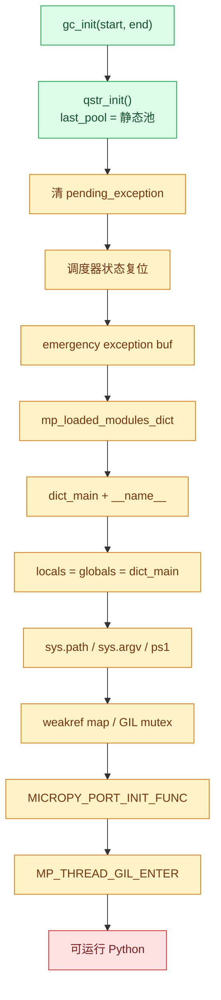
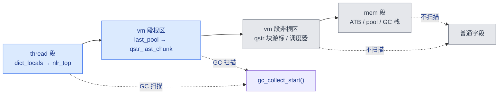

# mp_init：解释器初始化的唯一入口

> 对应源文件：`py/runtime.c`（共 1793 行），辅以 `py/mpstate.h`（356 行）、`py/qstr.c`（539 行）
> 说明：本仓库为 MicroPython 1.30.0，**不存在 `mp_init_with_src()`**（全仓库 grep 0 命中）。
> 老版本（≤1.19）用它注册模块源文件名，现在该职责由 `MP_REGISTER_MODULE` 的编译期表承担。

一句话职责：把 BSS 中的全局状态从“全零”变成“可运行”，建立 qstr 池、`__main__`/`builtins` 模块字典、
默认 `sys` 值、调度器状态，最后调用端口钩子 `MICROPY_PORT_INIT_FUNC`。

---

## 1. 调用位置与前置条件

`mp_init()` 在 19 个端口里被调用，顺序**必须**是：

```
启动汇编 → 时钟/中断 → 端口外设 init0 → gc_init(start, end) → mp_init() → 运行 Python
```

| 端口 | 调用点 | GC 初始化 |
|---|---|---|
| `ports/stm32/main.c` | 605 | 580 |
| `ports/unix/main.c` | 496 | 474/481 |
| `ports/minimal/main.c` | 42 | 37 附近 |
| `ports/esp32/main.c` | 143 | `esp32/main.c` 的堆初始化之后 |

为什么 `gc_init` 必须在前：`mp_init()` 第 121 行就 `mp_obj_dict_init(&dict_main, 1)`，
这会分配 map 的槽数组；`m_malloc` → `gc_alloc` 需要 `MP_STATE_MEM(area).gc_pool_start` 有效。

---

## 2. 核心结构

### 2.1 `mp_state_ctx_t`（`py/mpstate.h:336-340`）

| 字段 | 类型 | 含义 |
|---|---|---|
| `thread` | `mp_state_thread_t` | 每线程状态；`dict_locals/globals`、`nlr_top`、`gc_lock_depth` |
| `vm` | `mp_state_vm_t` | 全局 VM 状态；qstr 池、`dict_main`、模块字典、调度器 |
| `mem` | `mp_state_mem_t` | GC 状态；ATB 指针、pool 边界、GC 栈 |

### 2.2 `mp_state_thread_t` 的关键字段（`py/mpstate.h:287-332`）

| 字段 | 行 | 含义 |
|---|---|---|
| `stack_top` | 289 | C 栈顶，`mp_cstack_check` 用 |
| `stack_limit` | 292 | `MICROPY_STACK_CHECK` 时的下限 |
| `pystack_start/end/cur` | 296-298 | 独立 Python 栈 |
| `gc_lock_depth` | 303 | GC 锁深度 + 收集标志位 |
| `dict_locals` / `dict_globals` | 311-312 | 当前作用域字典（**根区起点**） |
| `nlr_top` | 314 | 异常跳转链栈顶 |
| `mp_pending_exception` | 318 | 待处理异常（`volatile`） |
| `stop_iteration_arg` | 321 | `STOP_ITERATION` 的返回值 |

### 2.3 `mp_state_vm_t` 的关键字段（`py/mpstate.h:170-281`）

| 字段 | 行 | 含义 |
|---|---|---|
| `last_pool` | 178 | 最新 qstr 池（根区，必须第一个） |
| `mp_emergency_exception_obj` | 185 | 无内存时用的预分配异常 |
| `mp_loaded_modules_dict` | 204 | `sys.modules` |
| `dict_main` | 207 | `__main__` 的命名空间 |
| `mp_module_builtins_override_dict` | 211 | `builtins` 的动态覆盖表 |
| `qstr_last_chunk/alloc/used` | 227-229 | 动态 qstr 数据块（**根区终点**） |
| `mp_optimise_value` | 237 | `-O` 级别 |
| `sched_state/sched_len/sched_idx` | 252-264 | 调度器状态 |
| `map_lookup_cache` | 279 | dict 查找缓存 |

**根区边界**：`dict_locals`（thread 段）到 `qstr_last_chunk`（vm 段）之间的一切都被 GC 保守扫描
（`py/gc.c:481-484`）。改动这两个结构体的字段顺序会直接破坏 GC。

---

## 3. 逐函数表

| 函数 | 行 | 职责 | 关键副作用 |
|---|---|---|---|
| `mp_init` | 76-209 | 初始化全部全局状态 | 分配 `dict_main`、`mp_loaded_modules_dict`；建 `sys.path` 列表 |
| `mp_deinit` | 211-218 | 释放 GIL、调端口 deinit | 不释放堆（由 `gc_sweep_all` 负责） |
| `mp_globals_locals_set_from_nlr_jump_callback` | 220-224 | 异常时恢复 globals/locals | 挂在 `nlr_jump_callback` 链上 |
| `mp_call_function_1_from_nlr_jump_callback` | 226-229 | 异常时调用清理函数 | 同上 |
| `mp_load_name` | 231-242 | `LOAD_NAME`：locals → globals → builtins | 无 |
| `mp_load_global` | 244-268 | `LOAD_GLOBAL`：globals → builtins | 找不到抛 `NameError` |
| `mp_load_build_class` | 270-282 | 取 `__build_class__` | 可被覆盖 |
| `mp_store_name` / `mp_delete_name` | 284-293 | 写/删 locals | 无 |
| `mp_store_global` / `mp_delete_global` | 295-304 | 写/删 globals | 无 |
| `mp_parse_compile_execute` | 1655-1689 | 源码 → 执行 | 切换并恢复 globals/locals |
| `m_malloc_fail` | 1693-1704 | 分配失败统一抛 `MemoryError` | `MP_NORETURN` |

---

## 4. 逐字摘录

### 4.1 入口：qstr 与待处理异常

```c
void mp_init(void) {
    qstr_init();

    // no pending exceptions to start with
    MP_STATE_THREAD(mp_pending_exception) = MP_OBJ_NULL;
```
（`py/runtime.c:76-80`）

`qstr_init()` 只做两件事（`py/qstr.c:190-197`）：把 `last_pool` 指向静态池
`CONST_POOL`，把 `qstr_last_chunk` 置 NULL。**它不分配内存**，所以可以安全地在
`gc_init` 之前或之后调用（本仓库在 `mp_init` 里，即 `gc_init` 之后）。

### 4.2 建立 `__main__` 与当前作用域

```c
    // initialise the __main__ module
    mp_obj_dict_init(&MP_STATE_VM(dict_main), 1);
    mp_obj_dict_store(MP_OBJ_FROM_PTR(&MP_STATE_VM(dict_main)), MP_OBJ_NEW_QSTR(MP_QSTR___name__), MP_OBJ_NEW_QSTR(MP_QSTR___main__));

    // locals = globals for outer module (see Objects/frameobject.c/PyFrame_New())
    mp_locals_set(&MP_STATE_VM(dict_main));
    mp_globals_set(&MP_STATE_VM(dict_main));
```
（`py/runtime.c:121-127`）

`mp_obj_dict_init(&dict, 1)` 的第二个参数是**初始槽数提示**，不是容量上限；
传 1 表示“这是个小字典”，避免一上来分配 16 个槽。
`dict_main` 是嵌入在 `mp_state_vm_t` 里的结构体，不是堆对象——它的 `map.table`
仍然指向堆，但字典本身不参与 GC 分配。

### 4.3 端口钩子与 GIL

```c
    // call port specific initialization if any
    #ifdef MICROPY_PORT_INIT_FUNC
    MICROPY_PORT_INIT_FUNC;
    #endif

    MP_THREAD_GIL_ENTER();

    #if MICROPY_VFS_ROM && MICROPY_VFS_ROM_IOCTL
    // Mount ROMFS if it exists.
    mp_vfs_mount_romfs_protected();
    #endif
}
```
（`py/runtime.c:198-209`）

`MICROPY_PORT_INIT_FUNC` 是端口在 `mpconfigport.h` 里定义的宏，通常用来初始化
“必须在 Python 可用之后才能跑”的东西（如注册 `atexit` 回调）。
`MP_THREAD_GIL_ENTER()` 在单线程下是空操作，在多线程下拿全局解释器锁。

### 4.4 软复位时的对称操作

```c
void mp_deinit(void) {
    MP_THREAD_GIL_EXIT();

    // call port specific deinitialization if any
    #ifdef MICROPY_PORT_DEINIT_FUNC
    MICROPY_PORT_DEINIT_FUNC;
    #endif
}
```
（`py/runtime.c:211-218`）

注意 `mp_deinit` **不释放任何堆内存**。软复位的完整顺序是
`gc_sweep_all()`（清空堆）→ `mp_deinit()`（放 GIL、端口清理）→ `goto soft_reset`
（重新 `gc_init`/`mp_init`）。见 `ports/stm32/main.c:802-805`。

---

## 5. 初始化顺序图





---

## 6. 陷阱与读码建议

1. **不要重复调用 `mp_init()`**。第二次会 `mp_obj_dict_init` 覆盖 `dict_main`，
   旧的 `map.table` 变成垃圾，且 `qstr_init` 会把动态池丢掉（`last_pool` 回退到静态池），
   已有的动态 qstr ID 全部失效。
2. **`mp_init()` 之前不能用 `MP_OBJ_NEW_QSTR(MP_QSTR_xxx)` 以外的对象操作**。
   静态 qstr 在 ROM 里可用；动态 qstr 需要堆。
3. **`mp_init_with_src()` 不存在**。看到老文章/老补丁引用它时，对应的是 1.19 及更早版本；
   本仓库的模块来源信息在 `mp_module_context_t.constants.source_file`。
4. **`mp_deinit()` 不回收内存**。如果你在端口里自己 `malloc` 了东西，要在
   `MICROPY_PORT_DEINIT_FUNC` 里释放。
5. 读码建议：先看 `mp_init()` 里的 `#if` 分支，把每个分支和 `mpconfigport.h` 的开关对上，
   就能理解“为什么同一个函数在不同板子上行为不同”。

相关文档：[00-总览与架构](../../../references/firmware/micropython/mp-notes/00-总览与架构.md) ·
[01-启动流程与运行模型](../../../references/firmware/micropython/mp-notes/01-启动流程与运行模型.md) ·
[05-内存与mpconfig裁剪](../../../references/firmware/micropython/mp-notes/05-内存与mpconfig裁剪.md)
