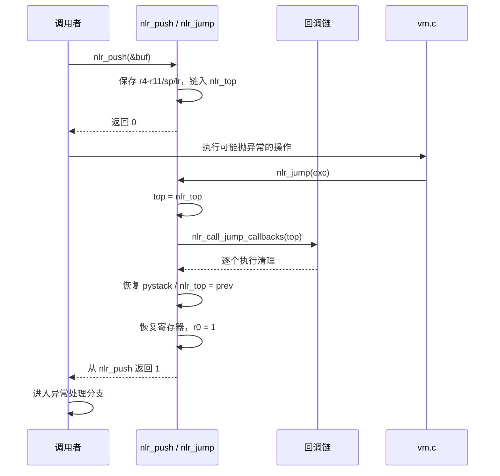
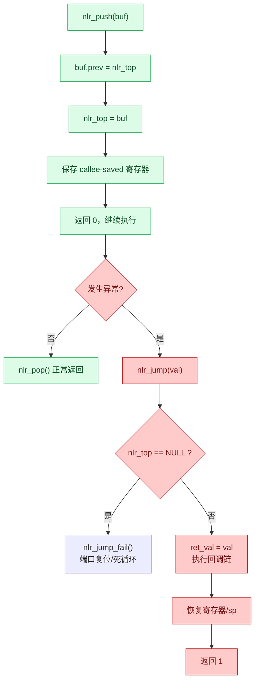

# nlr：非局部跳转与异常传播

> 对应源文件：`py/nlr.h`（共 233 行）+ `py/nlrthumb.c`（149 行）/ `py/nlrx64.c`（132 行）
> 辅以 `py/nlrx86.c`（114 行）、`py/nlraarch64.c`、`py/nlrrv32.c` 等各架构实现
> 覆盖范围：`nlr_buf_t` 布局、`nlr_push/pop/jump` 语义、Cortex-M 与 x86-64 的汇编实现、
> `nlr_jump_callback` 清理链。
> 不覆盖：`nlr_jump_fail()` 的端口实现（各端口自己定义，通常死循环/复位）。

一句话职责：在没有 C++ 异常、也不依赖 `setjmp/longjmp` 的情况下，
用“保存 callee-saved 寄存器 + 改返回地址”实现从任意深度直接跳回 `nlr_push` 点，
并把“跳转时顺便执行的清理函数”串成链表。

---

## 1. `nlr_buf_t` 布局

```c
typedef struct _nlr_buf_t nlr_buf_t;
struct _nlr_buf_t {
    // The entries in this struct must all be machine word size.

    // Pointer to the previous nlr_buf_t in the chain.
    // Or NULL if it's the top-level one.
    nlr_buf_t *prev;

    // The exception that is being raised:
    // - NULL means the jump is because of a VM abort (only if MICROPY_ENABLE_VM_ABORT enabled)
    // - otherwise it's always a concrete object (an exception instance)
    void *ret_val;

    #if MICROPY_NLR_SETJMP
    jmp_buf jmpbuf;
    #else
    void *regs[MICROPY_NLR_NUM_REGS];
    #endif

    #if MICROPY_ENABLE_PYSTACK
    void *pystack;
    #endif
};
```
（`py/nlr.h:123-145`）

| 偏移（32 位） | 字段 | 含义 |
|---|---|---|
| 0 | `prev` | 链上一节点（`MP_STATE_THREAD(nlr_top)`） |
| 4 | `ret_val` | 抛出的对象（异常实例）或 NULL（VM abort） |
| 8 | `regs[0]` | 架构相关：返回地址/`lr` |
| 12... | `regs[1..]` | callee-saved 寄存器 |
| 末尾 | `pystack` | 可选，保存 `pystack_cur` |

**所有字段都是机器字**，所以 `regs` 可以用固定偏移访问。Cortex-M 的偏移
（`py/nlrthumb.c:49-80`）：`lr` 在 8，`r4-r7` 在 12/16/20/24，`r8-r11` 在 28/32/36/40，
`sp` 在 44，浮点 `d8-d10` 在 48/56/64（仅硬浮点时）。

x86-64 的偏移（`py/nlrx64.c:79-94`）：`rip` 16，`rbp` 24，`rsp` 32，
`rbx` 40，`r12-r15` 48/56/64/72；Windows 额外存 `rdi/rsi` 在 80/88。

---

## 2. 三个核心函数

| 函数 | 行（nlr.h） | 语义 | 返回 |
|---|---|---|---|
| `nlr_push(buf)` | 181-184 | 保存寄存器，登记到 `nlr_top` | 首次返回 0 |
| `nlr_pop()` | 187 | 从链上摘掉 `nlr_top` | 无 |
| `nlr_jump(val)` | 188 | 跳到 `nlr_top`，`ret_val = val` | 不返回 |
| `nlr_push_tail(buf)` | 186 | C 部分：链栈操作 | 0 |
| `nlr_push_jump_callback` | 224 | 压入清理回调 | 无 |
| `nlr_pop_jump_callback` | 228 | 弹出并可选执行回调 | 无 |
| `nlr_call_jump_callbacks` | 231 | 执行某 buf 之后的全部回调 | 无 |

### 2.1 `nlr_push` 为什么是宏

```c
#if MICROPY_NLR_SETJMP
// nlr_push() must be defined as a macro, because "The stack context will be
// invalidated if the function which called setjmp() returns."
// For this case it is safe to call nlr_push_tail() first.
#define nlr_push(buf) (nlr_push_tail(buf), setjmp((buf)->jmpbuf))
#else
unsigned int nlr_push(nlr_buf_t *);
#endif
```
（`py/nlr.h:177-184`）

setjmp 版本必须宏，因为 `setjmp` 保存的是“调用它的函数”的栈上下文；
如果包成函数，函数返回后上下文失效。汇编版本没有这个问题，可以是普通函数
（`__attribute__((naked))` 保证不生成序言/尾声）。

### 2.2 `nlr_jump` 的公共头部

```c
#define MP_NLR_JUMP_HEAD(val, top) \
    nlr_buf_t **_top_ptr = &MP_STATE_THREAD(nlr_top); \
    nlr_buf_t *top = *_top_ptr; \
    if (top == NULL) { \
        nlr_jump_fail(val); \
    } \
    top->ret_val = val; \
    nlr_call_jump_callbacks(top); \
    MP_NLR_RESTORE_PYSTACK(top); \
    *_top_ptr = top->prev; \
```
（`py/nlr.h:166-176`）

顺序很重要：

1. 取 `nlr_top`；为 NULL 说明异常没人接 → `nlr_jump_fail()`（端口实现，通常复位）；
2. 写 `ret_val`；
3. **执行清理回调**（此时 C 栈还没被掀，回调能安全访问栈上的资源）；
4. 恢复 pystack 指针；
5. 把 `nlr_top` 指向 `prev`（弹栈）；
6. 后面的架构汇编恢复寄存器并返回 1。

---

## 3. Cortex-M 实现

### 3.1 `nlr_push`

```c
__attribute__((naked)) unsigned int nlr_push(nlr_buf_t *nlr) {
    ...
    __asm volatile (
        "str    r4, [r0, #12]       \n" // store r4 into nlr_buf
        "str    r5, [r0, #16]       \n" // store r5 into nlr_buf
        "str    r6, [r0, #20]       \n" // store r6 into nlr_buf
        "str    r7, [r0, #24]       \n" // store r7 into nlr_buf

        #if !defined(__thumb2__)
        "mov    r1, r8              \n"
        "str    r1, [r0, #28]       \n" // store r8 into nlr_buf
        ...
        "mov    r1, r13             \n"
        "str    r1, [r0, #44]       \n" // store r13=sp into nlr_buf
        "mov    r1, lr              \n"
        "str    r1, [r0, #8]        \n" // store lr into nlr_buf
        #else
        "str    r8, [r0, #28]       \n" // store r8 into nlr_buf
        ...
        "str    r13, [r0, #44]      \n" // store r13=sp into nlr_buf
        #if MICROPY_NLR_NUM_REGS == 16
        "vstr   d8, [r0, #48]       \n" // store s16-s17 into nlr_buf
        ...
        #endif
        "str    lr, [r0, #8]        \n" // store lr into nlr_buf
        #endif
        ...
        "b      nlr_push_tail       \n" // do the rest in C
        );
```
（`py/nlrthumb.c:39-94`，省略 Thumb1 的寄存器搬运细节）

- 只存 **callee-saved**：`r4-r11` + `sp` + `lr`。`r0-r3` 是 caller-saved，
  调用者本来就不指望它们跨函数调用。
- `__attribute__((naked))` 禁止编译器生成 push/pop 序言，否则会多存一份。
- 末尾 `b nlr_push_tail` 是尾调用，把链栈操作留给 C（可移植）。
- `MICROPY_NLR_THUMB_USE_LONG_JUMP=1` 用于 `b` 跳转超出 ±16 MB 范围的极端情况
  （`py/nlrthumb.c:82-86` 的注释）。

### 3.2 `nlr_jump`

```c
MP_NORETURN void nlr_jump(void *val) {
    MP_NLR_JUMP_HEAD(val, top)

    __asm volatile (
        "mov    r0, %0              \n" // r0 points to nlr_buf
        "ldr    r4, [r0, #12]       \n" // load r4 from nlr_buf
        ...
        "ldr    r13, [r0, #44]      \n" // load r13=sp from nlr_buf
        ...
        "ldr    lr, [r0, #8]        \n" // load lr from nlr_buf
        "movs   r0, #1              \n" // return 1, non-local return
        "bx     lr                  \n" // return
        :                           // output operands
        : "r" (top)                 // input operands
        : "memory"                  // clobbered registers
        );
```
（`py/nlrthumb.c:103-144`）

`bx lr` 回到 `nlr_push` 的调用点，`r0 = 1` 让 `if (nlr_push(&nlr) == 0)` 走 else 分支。
**栈指针被恢复成 push 时的值**，所以中间所有栈帧一次性作废。

### 3.3 x86-64 的差异

x86-64 没有 `lr`，返回地址在栈顶：

```c
        "movq   (%rsp), %rax        \n" // load return %rip
        "movq   %rax, 16(%rdi)      \n" // store %rip into nlr_buf
        "movq   %rbp, 24(%rdi)      \n" // store %rbp into nlr_buf
        "movq   %rsp, 32(%rdi)      \n" // store %rsp into nlr_buf
        "movq   %rbx, 40(%rdi)      \n" // store %rbx into nlr_buf
        "movq   %r12, 48(%rdi)      \n" // store %r12 into nlr_buf
        ...
        "jmp    nlr_push_tail       \n" // do the rest in C
```
（`py/nlrx64.c:79-94`）

恢复时把保存的 `rip` 写回 `(%rsp)`，再 `ret`（`py/nlrx64.c:117-123`）：

```c
        "movq   32(%%rcx), %%rsp    \n" // load saved %rsp
        "movq   24(%%rcx), %%rbp    \n" // load saved %rbp
        "movq   16(%%rcx), %%rax    \n" // load saved %rip
        "movq   %%rax, (%%rsp)      \n" // store saved %rip to stack
        "xorq   %%rax, %%rax        \n" // clear return register
        "inc    %%al                \n" // increase to make 1, non-local return
        "ret                        \n" // return
```

Windows x64 额外保存 `rdi/rsi`（非 volatile 寄存器），所以 `MICROPY_NLR_NUM_REGS_X64_WIN = 10`
（`py/nlr.h:40`）。

---

## 4. 各架构寄存器数

| 架构 | 宏 | 数量 | 说明 |
|---|---|---|---|
| x86 | `MICROPY_NLR_NUM_REGS_X86` | 6 | 32 位 |
| x86-64 | `..._X64` | 8 | SysV |
| x86-64 Win | `..._X64_WIN` | 10 | 多 `rdi/rsi` |
| ARM Thumb | `..._ARM_THUMB` | 10 | 软浮点 |
| ARM Thumb + FP | `..._ARM_THUMB_FP` | 16 | 多 `s16-s21` |
| AArch64 | `..._AARCH64` | 13 | — |
| MIPS | `..._MIPS` | 13 | — |
| Xtensa | `..._XTENSA` | 10 | — |
| Xtensa Win | `..._XTENSAWIN` | 17 | 窗口化 ABI |
| RV32/RV64 | `..._RV32I/RV64I` | 14 | — |
| Loong64 | `..._LOONG64` | 13 | — |

（`py/nlr.h:38-49`）

`nlr_buf_t` 的大小 = 2 个字（prev/ret_val）+ N 个字（regs）+ 可选 pystack。
Cortex-M 软浮点：`8 + 10*4 = 48 B`；硬浮点：`8 + 16*4 = 72 B`。
**每次 Python 调用压一个**（`mp_execute_bytecode` 外层循环），深递归时这是可观的栈开销。

---

## 5. 清理回调链

`nlr_jump_callback_node_t`（`py/nlr.h:149-154`）是一个侵入式链表节点：

```c
struct _nlr_jump_callback_node_t {
    nlr_jump_callback_node_t *prev;
    nlr_jump_callback_fun_t fun;
};
```

用法（`py/runtime.c:1655-1686`）：

```c
    nlr_jump_callback_node_globals_locals_t ctx;
    ctx.globals = mp_globals_get();
    ctx.locals = mp_locals_get();
    ...
    nlr_push_jump_callback(&ctx.callback, mp_globals_locals_set_from_nlr_jump_callback);
    ...
    nlr_pop_jump_callback(true);
```

`nlr_call_jump_callbacks(top)` 在 `nlr_jump` 里被调用，遍历 `top` 之后注册的所有节点，
逐个执行 `fun(ctx)`。这解决了“长跳转绕过 C 的 cleanup”问题：

| 场景 | 回调做什么 |
|---|---|
| 切换 globals/locals | 恢复调用者的字典 |
| 解析失败 | 释放 lexer（`py/parse.c:1054-1055`） |
| 文件操作 | 关闭文件句柄 |
| 临时缓冲区 | `m_free` |

注意回调节点本身在 C 栈上，跳转后栈已失效——所以 `nlr_jump` **先执行回调、再恢复 sp**。

---

## 6. 时序





---

## 7. 陷阱与读码建议

1. **`nlr_jump` 之后局部变量不可信**。被跳过的函数栈帧已作废，
   所以 `mp_execute_bytecode` 把 `exc_sp` 声明为 `volatile`，并在 `nlr_push` 外保存
   `ip/sp`（`py/vm.c:298-314`）。
2. **`nlr_buf_t` 必须在栈上**。放在堆上或静态区，第二次 push 会覆盖第一次的链；
   放在寄存器里更不行（`prev`/`ret_val` 需要取地址）。
3. **生成器 `yield` 前必须 `nlr_pop()`**。挂起后 C 栈帧消失，`nlr_top` 指向失效内存
   （`py/vm.c:1221`）。
4. **不要在 `nlr_jump` 路径上分配内存**。GC 可能处于锁定状态，`m_malloc` 返回 NULL
   会再次抛异常，形成嵌套跳转。
5. **`nlr_jump_fail` 是端口的责任**。默认实现通常是关中断 + 死循环，
   方便调试器停在现场；生产固件可改成复位。
6. **setjmp 版本的 `nlr_push` 是宏**，不能取地址、不能包函数；
   跨平台代码不要写 `&nlr_push`。
7. **回调链节点不能是临时变量**。`nlr_push_jump_callback(&ctx.callback, ...)`
   的 `ctx` 必须在整个作用域内存活；用 compound literal 会立刻失效。
8. 读码建议：先读 `nlr.h:123-176`，再读 `nlrthumb.c:39-147`（Cortex-M 最直观），
   最后对照 `nlrx64.c` 理解“返回地址在栈上”的差异。

相关文档：[01-启动流程与运行模型](../../../references/firmware/micropython/mp-notes/01-启动流程与运行模型.md) ·
[vm.md](vm.md) · [port_stm32.md](port_stm32.md)
