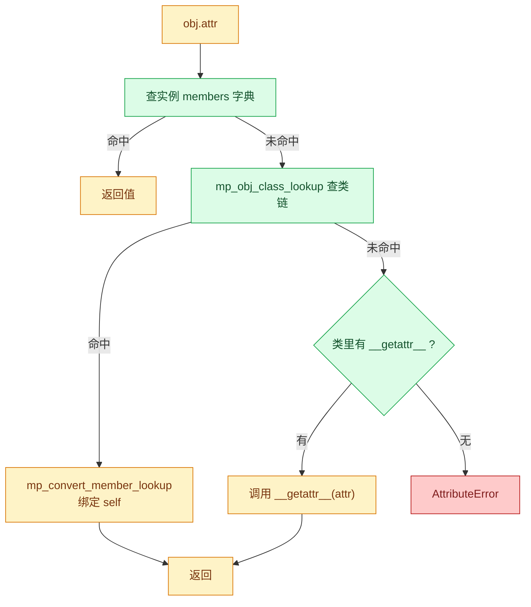

# obj：对象表示、类型槽与实例查找

> 对应源文件：`py/obj.c`（共 627 行）+ `py/objtype.c`（共 1558 行）
> 辅以 `py/obj.h`（1323 行）、`py/objtype.h`（57 行）
> 覆盖范围：`mp_obj_t` 的表示与判定、`mp_obj_type_t` 的 slot 机制、用户类/实例的创建与属性查找。
> 不覆盖：各具体类型（str/list/dict/int）的实现，它们各有独立文件。

一句话职责：`obj.c` 提供“对象无关”的通用操作（判型、真值、比较、下标、buffer），
`objtype.c` 提供“Python 类”这一层（`type` 对象、实例字典、MRO 查找、绑定方法）。

---

## 1. 对象表示：默认是 tagged pointer，不是 NaN-boxing

`mp_obj_t` 的定义（`py/obj.h:40-46`）：

```c
#if MICROPY_OBJ_REPR == MICROPY_OBJ_REPR_D
typedef uint64_t mp_obj_t;
typedef uint64_t mp_const_obj_t;
#else
typedef void *mp_obj_t;
typedef const void *mp_const_obj_t;
#endif
```

默认 `MICROPY_OBJ_REPR_A`（`py/mpconfig.h:162-164`），编码规则：

| 低位模式 | 类型 | 取值方式 | 宏 |
|---|---|---|---|
| `xxxx...xxx1` | 小整数 | 算术右移 1 位 | `MP_OBJ_SMALL_INT_VALUE` |
| `xxxx...x010` | qstr | 右移 3 位 | `MP_OBJ_QSTR_VALUE` |
| `xxxx...x110` | 立即对象（None/True/False） | 右移 3 位索引 | `MP_OBJ_IMMEDIATE_OBJ_VALUE` |
| `xxxx...xx00` | 对象指针 | 直接解引用 | `MP_OBJ_TO_PTR` |

只有 `REPR_D` 才是 NaN-boxing（64 位、双精度内联）。`obj.h:148-155` 的注释给出了
完整位布局：float 用 `seeeeeee...`，指针用 `0x7ffc...` 前缀，小整数/qstr 用 `0x7ffd/0x7ffe`。
**默认配置下浮点仍是堆对象**，这点与 CPython 的“float 是对象”一致，与 LuaJIT 的 NaN-boxing 不同。

### 1.1 三个哨兵

| 宏 | 非调试值 | 调试值 | 语义 |
|---|---|---|---|
| `MP_OBJ_NULL` | 0 | 0 | 无对象/操作不支持 |
| `MP_OBJ_STOP_ITERATION` | 0 | 4 | 迭代结束（避免抛异常） |
| `MP_OBJ_SENTINEL` | 4 | 8 | 内部“特殊标记” |

（`py/obj.h:70-78`）

非调试模式下 `STOP_ITERATION == NULL == 0`，所以**不能用 `== MP_OBJ_NULL` 区分**
“迭代结束”和“没有值”；要看调用上下文。`SENTINEL` 保持独立值 4，用于
`mp_obj_class_lookup` 表示“命中原生槽”。

### 1.2 对象头

```c
struct _mp_obj_base_t {
    const mp_obj_type_t *type MICROPY_OBJ_BASE_ALIGNMENT;
};
```
（`py/obj.h:54-56`）

所有具体对象第一个字段必须是它。`MICROPY_OBJ_BASE_ALIGNMENT` 在 REPR_D 下要求 8 字节对齐，
因为指针的高 16 位必须为 0。

---

## 2. `obj.c`：通用操作

### 2.1 函数表

| 函数 | 行 | 职责 | 备注 |
|---|---|---|---|
| `mp_obj_malloc_helper` | 41-45 | 分配并设置 `type` | `MP_NOINLINE`，供宏复用 |
| `mp_obj_malloc_with_finaliser_helper` | 49-53 | 带 finaliser 的分配 | 需 `MICROPY_ENABLE_FINALISER` |
| `mp_obj_get_type` | 56-112 | 由 `mp_obj_t` 求类型 | 小整数/qstr/立即对象查表 |
| `mp_obj_get_type_str` | 114-116 | 类型名（qstr → C 字符串） | 调试/报错用 |
| `mp_obj_print_helper` | 118-133 | `str/repr` 分派 | 调 `print` 槽 |
| `mp_obj_print` | 135-137 | 打到 `MP_PYTHON_PRINTER` | REPL 用 |
| `mp_obj_print_exception` | 140-165 | 打印 traceback | 逆序输出 |
| `mp_obj_is_true` | 167-198 | 真值判断 | `len()` / `__bool__` |
| `mp_obj_is_callable` | 200-206 | 可调用性 | 实例类型特殊处理 |
| `mp_obj_equal_not_equal` | 221-300 | `==` / `!=` | 数值跨类型比较 |
| `mp_obj_equal` | 302-304 | `==` 的布尔版 | — |
| `mp_obj_get_int/uint/ll` | 306-345 | 取整数 | 失败抛 `TypeError` |
| `mp_obj_get_int_maybe` | 358-377 | 尝试取整数 | 不抛异常 |
| `mp_obj_get_float_maybe` | 379-404 | 尝试取浮点 | — |
| `mp_obj_get_array` | 452-466 | 取序列的 `(len, items)` | list/tuple |
| `mp_get_index` | 482-517 | 下标归一化（负索引） | 越界抛 `IndexError` |
| `mp_obj_len` / `mp_obj_len_maybe` | 538-570 | `len()` | 走 `unary_op` |
| `mp_obj_subscr` | 572-605 | 下标读写删 | `value` 为 `SENTINEL/NULL/其他` |
| `mp_get_buffer` | 617-625 | buffer 协议 | 调 `buffer` 槽 |

### 2.2 `mp_obj_get_type`：一次查表解决三种非指针

```c
const mp_obj_type_t *MICROPY_WRAP_MP_OBJ_GET_TYPE(mp_obj_get_type)(mp_const_obj_t o_in) {
    #if MICROPY_OBJ_IMMEDIATE_OBJS && MICROPY_OBJ_REPR == MICROPY_OBJ_REPR_A

    if (mp_obj_is_obj(o_in)) {
        const mp_obj_base_t *o = MP_OBJ_TO_PTR(o_in);
        return o->type;
    } else {
        static const mp_obj_type_t *const types[] = {
            NULL, &mp_type_int, &mp_type_str, &mp_type_int,
            NULL, &mp_type_int, &mp_type_NoneType, &mp_type_int,
            NULL, &mp_type_int, &mp_type_str, &mp_type_int,
            NULL, &mp_type_int, &mp_type_bool, &mp_type_int,
        };
        return types[(uintptr_t)o_in & 0xf];
    }
```
（`py/obj.c:56-70`）

设计意图：`o_in & 0xf` 的低 4 位已经足够区分 `None/True/False` 与 qstr 标记；
查表比 4 次 `if` 少分支预测失败。表里的 `NULL` 槽是“非法组合”，正常不会命中。

### 2.3 真值：先槽后 len

```c
bool mp_obj_is_true(mp_obj_t arg) {
    if (arg == mp_const_false) {
        return 0;
    } else if (arg == mp_const_true) {
        return 1;
    } else if (arg == mp_const_none) {
        return 0;
    } else if (mp_obj_is_small_int(arg)) {
        ...
    } else {
        const mp_obj_type_t *type = mp_obj_get_type(arg);
        if (MP_OBJ_TYPE_HAS_SLOT(type, unary_op)) {
            mp_obj_t result = MP_OBJ_TYPE_GET_SLOT(type, unary_op)(MP_UNARY_OP_BOOL, arg);
            if (result != MP_OBJ_NULL) {
                return result == mp_const_true;
            }
        }

        mp_obj_t len = mp_obj_len_maybe(arg);
        if (len != MP_OBJ_NULL) {
            // obj has a length, truth determined if len != 0
            return len != MP_OBJ_NEW_SMALL_INT(0);
        } else {
            // any other obj is true per Python semantics
            return 1;
        }
    }
}
```
（`py/obj.c:167-198`）

顺序很重要：`__bool__`（`MP_UNARY_OP_BOOL`）优先于 `__len__`。返回 `MP_OBJ_NULL`
表示“该类型没实现”，继续走 `len`。这与 CPython 的 `bool()` 协议一致。

---

## 3. `objtype.c`：类与实例

### 3.1 数据结构

| 结构/字段 | 行 | 含义 |
|---|---|---|
| `mp_obj_instance_t.base` | `objtype.h:34` | 指向“类”这个 type 对象 |
| `mp_obj_instance_t.members` | 35 | 实例属性 `mp_map_t` |
| `mp_obj_instance_t.subobj[]` | 36 | 原生基类的内嵌对象（最多 1 个） |
| `class_lookup_data.obj` | `objtype.c:135` | 实例指针（查类属性时为 NULL） |
| `.attr` | 136 | 要查的 qstr |
| `.slot_offset` | 137 | 特殊方法对应的槽偏移（0 表示普通查找） |
| `.dest[2]` | 138 | 输出：`(值/函数, self)` |
| `.is_type` | 139 | 是否在“类”上查找（影响 `self` 绑定） |

### 3.2 函数表

| 函数 | 行 | 职责 |
|---|---|---|
| `instance_count_native_bases` | 60-100 | 统计原生基类数量（≤1） |
| `native_base_init_wrapper` | 95-105 | `super().__init__()` 转发到原生基类 |
| `mp_obj_new_instance` | 107-125 | 分配实例 + 初始化 `members` |
| `mp_obj_class_lookup` | 143-250 | **核心**：沿 MRO 查属性/特殊方法 |
| `instance_print` | 252-292 | `__str__`/`__repr__` |
| `mp_obj_instance_make_new` | 294-380 | `__new__` + `__init__` |
| `instance_binary_op` | 552-592 | 二元运算转发到 dunder |
| `mp_obj_instance_load_attr` | 594-696 | 读属性（含 `__getattr__`） |
| `mp_obj_instance_store_attr` | 698-819 | 写/删属性（含 property/descriptor） |
| `mp_obj_instance_attr` | 821-829 | `attr` 槽入口：读或写 |
| `instance_subscr` | 831-864 | `__getitem__/__setitem__/__delitem__` |
| `mp_obj_instance_call` | 884-901 | `__call__` |
| `mp_obj_instance_getiter` | 904-930 | `__iter__` |
| `mp_obj_new_type` | 1175-1290 | 运行时创建类（`type(name, bases, dict)`） |

### 3.3 查找主循环

```c
static void mp_obj_class_lookup(struct class_lookup_data *lookup, const mp_obj_type_t *type) {
    assert(lookup->dest[0] == MP_OBJ_NULL);
    assert(lookup->dest[1] == MP_OBJ_NULL);
    for (;;) {
        ...
        // Optimize special method lookup for native types
        // This avoids extra method_name => slot lookup. On the other hand,
        // this should not be applied to class types, as will result in extra
        // lookup either.
        if (lookup->slot_offset != 0 && mp_obj_is_native_type(type)) {
            // Check if there is a non-zero value in the specified slot index,
            // with a special case for getiter where the slot won't be set
            // for MP_TYPE_FLAG_ITER_IS_STREAM.
            if (MP_OBJ_TYPE_HAS_SLOT_BY_OFFSET(type, lookup->slot_offset) || (lookup->slot_offset == MP_OBJ_TYPE_OFFSETOF_SLOT(iter) && type->flags & MP_TYPE_FLAG_ITER_IS_STREAM)) {
                lookup->dest[0] = MP_OBJ_SENTINEL;
                return;
            }
        }

        if (MP_OBJ_TYPE_HAS_SLOT(type, locals_dict)) {
            // search locals_dict (the set of methods/attributes)
            mp_map_t *locals_map = &MP_OBJ_TYPE_GET_SLOT(type, locals_dict)->map;
            mp_map_elem_t *elem = mp_map_lookup(locals_map, MP_OBJ_NEW_QSTR(lookup->attr), MP_MAP_LOOKUP);
            if (elem != NULL) {
                ...
                mp_convert_member_lookup(obj_obj, type, elem->value, lookup->dest);
                return;
            }
        }
```
（`py/objtype.c:143-201`）

三个设计决策：

1. **`slot_offset != 0` 优先**：查 `__iter__` 等特殊方法时先看原生槽，
   避免“先查字典、再查槽”的双重开销。命中返回 `MP_OBJ_SENTINEL`。
2. **MRO 是 DFS 左到右**，不是 C3。源码注释明确承认不合规（`objtype.c:126-130`）。
3. **`locals_dict` 必须是 dict 或 ordered-dict**（`objtype.c:166` 的断言），
   这是 MicroPython 的限制：类的命名空间不能是任意映射。

### 3.4 成员转换

`mp_convert_member_lookup()`（`py/runtime.c:1125-1178`）决定“取出来的值怎么用”：

| 成员类型 | `dest[0]` | `dest[1]` |
|---|---|---|
| 普通函数（`MP_TYPE_FLAG_BINDS_SELF`） | 函数 | `self` |
| `staticmethod` | 被包裹函数 | NULL |
| `classmethod` | 被包裹函数 | 类 |
| 内建函数（`MP_TYPE_FLAG_BUILTIN_FUN`） | 函数 | `self` 或包一层 `checked_fun` |
| 普通值 | 值 | NULL |

`mp_load_attr()` 在 `dest[1] != NULL` 时创建 bound method 对象（`py/runtime.c:1062-1074`）；
VM 的 `LOAD_METHOD` 则不创建，直接把 `(fun, self)` 压栈。

### 3.5 `__getattr__` 的兜底

`mp_obj_instance_load_attr()`（`py/objtype.c:594-696`）的流程：



注意顺序：**实例字典优先于类**（与 Python 一致），但 `data descriptor`（property）
在 CPython 里优先于实例字典；MicroPython 的 `store_attr` 对 property 做了特判
（`objtype.c:720-751`），读路径则依赖 `mp_obj_class_lookup` 的 `slot_offset` 逻辑。

---

## 4. 内存量化

| 对象 | 32 位大小 | 说明 |
|---|---|---|
| 小整数 | 0（内联） | 不分配 |
| `None/True/False` | 0（立即对象） | 不分配 |
| `mp_obj_instance_t` 头 | 24 B | type 4 + `mp_map_t` 20 |
| 空实例（无属性） | 32 B | 2 个 GC block |
| 1 个属性的实例 | ~64 B | 头 + 字典槽数组（4 项 × 8 B） |
| 用户类 `mp_obj_full_type_t` | ~64 B | 12 个 slot 指针 + 头 |
| 类的 `locals_dict` | 48 B + 槽 | 空字典也有固定开销 |

结论：**在 MCU 上，一个“只有 1 个字段”的类实例约 64~80 B，而一个 2 元素 tuple 只要 24 B。**
数据容器优先用 tuple/list，只有需要行为时才用类。

---

## 5. 陷阱与读码建议

1. **`mp_obj_get_type()` 对小整数返回 `&mp_type_int`，但小整数不是 `mp_obj_int_t`**。
   需要取具体值时先 `mp_obj_is_small_int()`，否则会读到非法指针。
2. **`dest` 数组必须初始化为 `{MP_OBJ_NULL, MP_OBJ_NULL}`**，`mp_obj_class_lookup`
   入口有断言；复用时先清空。
3. **`MP_OBJ_SENTINEL` 不是属性值**。它表示“命中原生槽”，调用方要用 `subobj[0]`。
4. **多继承的 MRO 与 CPython 不同**。依赖 C3 的顺序（如 `super()` 链）在 MicroPython
   上可能得到不同结果；跨平台代码应避免菱形继承。
5. **`__getattr__` 只在类上找，不在实例字典里找**。给实例塞一个 `__getattr__`
   函数不会生效。
6. **`mp_obj_new_type()` 创建的类不能被 GC 立刻回收**：它被 `locals_dict` 和
   基类 tuple 引用；如果动态创建大量类，记得丢掉所有引用后 `gc.collect()`。
7. 读码建议：先读 `obj.h:638-717` 的 slot 表，再读 `objtype.c:143-250`，
   最后看 `runtime.c:1125-1178` 的转换规则——这三段构成完整的属性协议。

相关文档：[02-对象模型精读](../../../references/firmware/micropython/mp-notes/02-对象模型精读.md) ·
[runtime.md](runtime.md) · [qstr.md](qstr.md)
