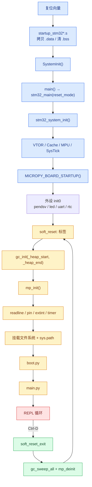

# port_stm32：STM32 端口启动与 HAL 适配层

> 对应源文件：`ports/stm32/main.c`（共 808 行），辅以 `ports/stm32/mphalport.h`（182 行）、
> `ports/stm32/mphalport.c`（238 行）、`ports/stm32/mpconfigport.h`、`ports/stm32/mpconfigboard_common.h`
> 覆盖范围：`stm32_main()` 的启动阶段、软复位循环、`mp_hal_*` 的 STM32 实现、
> 板级配置（`boards/<board>/`）与链接脚本符号。
> 不覆盖：具体外设驱动（`i2c.c` / `spi.c` / `uart.c` / `usb.c`，各自数百到数千行）。

一句话职责：把 `py/` 核心从一个“裸机复位向量”带到“REPL 可用”，
并在 `mp_hal_*` 这层把 STM32 HAL 的阻塞式 API 适配成 MicroPython 期望的原语。

---

## 1. 端口目录结构

| 路径 | 作用 |
|---|---|
| `ports/stm32/main.c` | 启动主流程、软复位、`pyb.main()` 入口 |
| `ports/stm32/mpconfigport.h` | 端口级配置（ROM level、computed goto） |
| `ports/stm32/mpconfigboard_common.h` | 所有板共享的默认配置（堆边界、USB 缓冲） |
| `ports/stm32/boards/<BOARD>/` | `mpconfigboard.h` + `pins.csv` + `board.json` + 变体 `.mk` |
| `ports/stm32/*.c` | 外设驱动：`uart.c` / `i2c.c` / `spi.c` / `timer.c` / `usb.c` … |
| `ports/stm32/*.s` | 启动/异常处理汇编：`resethandler*.s`、`gchelper_*.s` |
| `ports/stm32/*.ld` | 链接脚本（由 `boards/<BOARD>/` 选择） |

`boards/PYBV11/` 是最常用的参考板：`mpconfigboard.h` 定义引脚与堆边界，
`pins.csv` 给 `machine.Pin` 提供名字到编号的映射，`board.json` 描述构建元数据。

---

## 2. 启动阶段



### 2.1 早期初始化

```c
void stm32_main(uint32_t reset_mode) {
    // Low-level MCU initialisation.
    stm32_system_init();

    // Set VTOR, the location of the interrupt vector table.
    // On N6, SystemInit does this, setting VTOR to &g_pfnVectors.
    #if !defined(STM32F0) && !defined(STM32N6)
    #if MICROPY_HW_ENABLE_ISR_UART_FLASH_FUNCS_IN_RAM
    // Copy IRQ vector table to RAM and point VTOR there
    extern uint32_t __isr_vector_flash_addr, __isr_vector_ram_start, __isr_vector_ram_end;
    size_t __isr_vector_size = (&__isr_vector_ram_end - &__isr_vector_ram_start) * sizeof(uint32_t);
    memcpy(&__isr_vector_ram_start, &__isr_vector_flash_addr, __isr_vector_size);
    SCB->VTOR = (uint32_t)&__isr_vector_ram_start;
```
（`ports/stm32/main.c:333-345`）

向量表搬到 RAM 的原因：Flash 擦写期间取指会停顿，若 UART 中断向量还在 Flash，
REPL 会在写文件时丢字符。`MICROPY_HW_ENABLE_ISR_UART_FLASH_FUNCS_IN_RAM`
就是为“运行时写 Flash”的板子准备的。

### 2.2 阶段表

| 行 | 阶段 | 关键动作 |
|---|---|---|
| 333 | 进入 | `stm32_system_init()` |
| 337-352 | VTOR | 可选搬向量表到 RAM |
| 354-357 | 栈对齐 | `SCB->CCR |= SCB_CCR_STKALIGN_Msk` |
| 361 | 板级钩子 | `MICROPY_BOARD_STARTUP()` |
| 365-406 | 缓存 | F4/F7/H7/L4 的 I/D cache、ART |
| 428 | MPU | `mpu_init()` |
| 432 | 中断分组 | `NVIC_SetPriorityGrouping(NVIC_PRIORITYGROUP_4)` |
| 436-439 | 时钟 | `HAL_InitTick` + `SystemClock_Config()` |
| 466 | 板级早期 | `MICROPY_BOARD_EARLY_INIT()` |
| 490-509 | 子系统 | 线程、pendsv、led、switch、machine、rtc、uart |
| 567 | 软复位点 | `soft_reset:` |
| 580 | GC | `gc_init(MICROPY_HEAP_START, MICROPY_HEAP_END)` |
| 605 | 核心 | `mp_init()` |
| 612-631 | 外设 init0 | readline/pin/extint/timer/network/can/usb/i2s |
| 636-649 | 文件系统 | `/flash`、`/sd` 挂载 |
| 677 | boot.py | `MICROPY_BOARD_RUN_BOOT_PY` |
| 715 | main.py | `MICROPY_BOARD_RUN_MAIN_PY` |
| 722-732 | REPL | 友好/原始两种模式循环 |
| 735 | 软复位出口 | `soft_reset_exit:` |
| 802-805 | 复位 | `gc_sweep_all()` + `mp_deinit()` + `goto soft_reset` |

### 2.3 堆边界

```c
// Heap start / end definitions
#ifndef MICROPY_HEAP_START
#define MICROPY_HEAP_START &_heap_start
#endif
#ifndef MICROPY_HEAP_END
#define MICROPY_HEAP_END &_heap_end
#endif
```
（`ports/stm32/mpconfigboard_common.h:373-380`）

`_heap_start/_heap_end` 由链接脚本定义，通常放在 `.bss` 之后、栈之前。
外扩 SDRAM 的板子会覆盖成 `sdram_start()/sdram_end()`（如 `ports/stm32/boards/STM32F7DISC/mpconfigboard.h:99-100`），
把整个 SDRAM 交给 GC。

### 2.4 软复位

```c
soft_reset_exit:

    // soft reset

    MICROPY_BOARD_START_SOFT_RESET(&state);

    #if MICROPY_HW_ENABLE_STORAGE
    if (state.log_soft_reset) {
        mp_printf(&mp_plat_print, "MPY: sync filesystems\n");
    }
    storage_flush();
    #endif
```
（`ports/stm32/main.c:735-746`）

```c
    MICROPY_BOARD_END_SOFT_RESET(&state);

    gc_sweep_all();
    mp_deinit();

    goto soft_reset;
```
（`ports/stm32/main.c:800-805`）

软复位不重启芯片：USB、时钟、文件系统缓存都保留，只把 Python 世界清空。
`gc_sweep_all()` 是“不标记直接清”，把堆整体重置；`mp_deinit()` 放 GIL、调端口 deinit。

---

## 3. `mp_hal` 适配层

### 3.1 必须实现的函数

| 函数 | STM32 实现位置 | 行为 |
|---|---|---|
| `mp_hal_stdin_rx_chr` | `mphalport.c:53` | 从 `stdin_ringbuf` 取字符，阻塞时喂狗 |
| `mp_hal_stdout_tx_strn` | `mphalport.c:82` | 按 `pyb_stdio_uart` 选 UART/USB 输出 |
| `mp_hal_stdio_poll` | `mphalport.c:39` | 返回可读状态 |
| `mp_hal_ticks_ms/us` | `mphalport.c`（`systick.c` 配合） | SysTick 计数 |
| `mp_hal_delay_ms/us` | `mphalport.c` | 忙等 + `MICROPY_EVENT_POLL_HOOK` |
| `mp_hal_pin_*` | `mphalport.c:160-199` | GPIO 配置/读写 |
| `mp_hal_get_mac` | `mphalport.c:212` | 生成/读取 MAC |

### 3.2 原子区：宏而不是函数

```c
#include "irq.h"

#define MICROPY_BEGIN_ATOMIC_SECTION()     disable_irq()
#define MICROPY_END_ATOMIC_SECTION(state)  enable_irq(state)
```
（`ports/stm32/mphalport.h:54-57`）

核心代码写：

```text
uint32_t state = MICROPY_BEGIN_ATOMIC_SECTION();
// 临界区
MICROPY_END_ATOMIC_SECTION(state);
```
（调用方示意，不是源码摘录）

在 STM32 上展开成 `disable_irq()` / `enable_irq(state)`（保存并恢复 PRIMASK），
在 Unix 上是空操作。宏的好处是零调用开销，且能适配“返回类型不同”的端口。

### 3.3 PendSV / 后台任务

```c
// For regular code that wants to prevent "background tasks" from running.
// These background tasks (LWIP, Bluetooth) run in PENDSV context.
#define MICROPY_PY_PENDSV_ENTER   uint32_t atomic_state = raise_irq_pri(IRQ_PRI_PENDSV);
#define MICROPY_PY_PENDSV_REENTER atomic_state = raise_irq_pri(IRQ_PRI_PENDSV);
#define MICROPY_PY_PENDSV_EXIT    restore_irq_pri(atomic_state);
```
（`ports/stm32/mphalport.h:59-63`）

STM32 端口把 lwIP/蓝牙的回调放在 PendSV（最低优先级中断）里跑，
用“提升中断优先级到 PendSV 之上”来互斥，而不是关全局中断——
这样高优先级中断（USB、定时器）仍能响应，只挡住后台任务。

### 3.4 标准输入环形缓冲

`ports/stm32/mphalport.c:20`：

```c
ringbuf_t stdin_ringbuf = { stdin_ringbuf_array, sizeof(stdin_ringbuf_array), 0, 0 };
```

UART/USB 的 RX 中断把字节塞进 `stdin_ringbuf`，`mp_hal_stdin_rx_chr()` 在主循环取。
中断里绝不调用 `mp_printf` 或分配内存——这是端口层最重要的纪律。

---

## 4. 板级配置

| 宏 | 典型值 | 作用 |
|---|---|---|
| `MICROPY_HW_BOARD_NAME` | `"PYBV11"` | `os.uname().machine` |
| `MICROPY_HW_MCU_NAME` | `"STM32F405RG"` | `os.uname().machine` |
| `MICROPY_HW_HAS_SWITCH` | 1 | 是否有用户按键 |
| `MICROPY_HW_HAS_FLASH` | 1 | 是否挂载内部 Flash |
| `MICROPY_HW_ENABLE_SDCARD` | 1 | 是否初始化 SD 卡 |
| `MICROPY_HW_CLK_PLLM/N/P/Q` | 4/336/2/7 | 时钟树 |
| `MICROPY_HW_UART_REPL` | `PYB_UART_1` | REPL 走哪个 UART |
| `MICROPY_HW_USB_VID/PID` | 0xf055/0x9800 | USB 身份 |

这些宏在 `boards/<BOARD>/mpconfigboard.h` 里定义，`mpconfigboard_common.h` 提供默认值。
`pins.csv` 被 `make-pins.py` 转成 `pins_PYBV11.c` 的 `pin_obj_t` 表，
`machine.Pin("PA0")` 就是查这张表。

---

## 5. 陷阱与读码建议

1. **`gc_init` 必须在 `mp_init` 之前**（`main.c:580` vs `:605`）。反了会在
   `mp_obj_dict_init` 里对 NULL 池做指针运算。
2. **软复位不重置 C 静态变量**。`MP_STATE_PORT` 变量、外设句柄、DMA 缓冲都要在
   `soft_reset_exit` 段显式 deinit（`main.c:752-800` 那一长串）。
3. **`mp_hal_delay_ms` 里要喂狗/轮询事件**。STM32 的实现通过
   `MICROPY_EVENT_POLL_HOOK` 调 `mp_handle_pending()`，否则长延时期间 Ctrl-C 无效。
4. **中断里不要调 `mp_printf`/`m_malloc`**。前者可能阻塞在 UART，后者会碰 GC 锁；
   用 `mp_sched_schedule()` 推迟到主循环。
5. **USB 与 UART 的 stdout 只能有一个**。`pyb_stdio_uart` 为 NULL 时走 USB，
   非 NULL 时走 UART；切换要在 `boot.py` 里做，且要在 `mp_init` 之后。
6. **`MICROPY_HW_ENABLE_ISR_UART_FLASH_FUNCS_IN_RAM` 不是所有板都需要**，
   开了会多占几 KB RAM（向量表副本），但能在写 Flash 时保持 REPL 响应。
7. 读码建议：先读 `main.c:333-439`（硬件初始化），再读 `:567-605`（软复位点与 GC/mp_init），
   最后读 `mphalport.h:50-62` 与 `mphalport.c:20-100`（stdio 与原子区）。

相关文档：[01-启动流程与运行模型](../../../references/firmware/micropython/mp-notes/01-启动流程与运行模型.md) ·
[06-端口移植与C扩展](../../../references/firmware/micropython/mp-notes/06-端口移植与C扩展.md) ·
[mp_init.md](mp_init.md) · [gc.md](gc.md)
