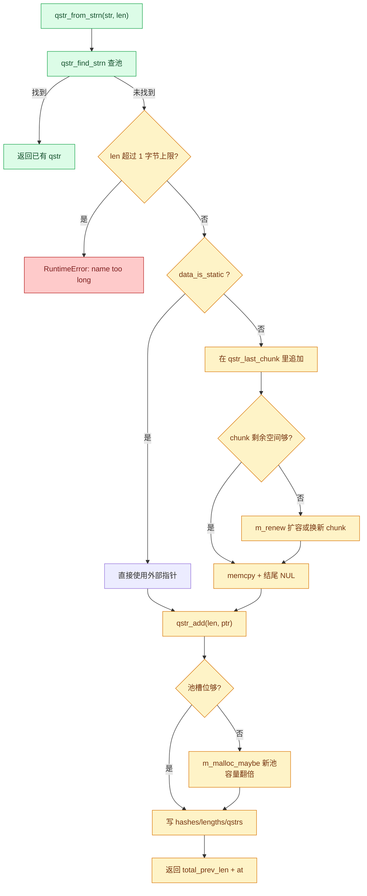

# qstr：字符串驻留与名字标识

> 对应源文件：`py/qstr.c`（共 539 行），辅以 `py/qstr.h`（121 行）、`py/mpconfig.h`（2510 行）
> 覆盖范围：qstr 的编号规则、静态/动态池、哈希与查找、驻留 API、内存统计。
> 不覆盖：`py/makeqstrdata.py` 的生成细节（构建期脚本，另有 500+ 行）。

一句话职责：把所有 Python 标识符（变量名、属性名、模块名、字符串常量）映射成**小整数 ID**，
让“名字比较”退化成整数比较，并把字符串数据只存一份。

---

## 1. 为什么需要 qstr

Python 代码里大量出现重复字符串：`self`、`__init__`、`append`、`MP_QSTR_...`。
如果每个字符串对象都独立存储：

- 每个属性访问都要做字符串哈希（O(len)）；
- 同一名字在 ROM/RAM 里存多份；
- `.mpy` 里要序列化完整字符串。

qstr 把名字变成 `size_t` 整数（`py/qstr.h:63`），带来：

| 收益 | 量化 |
|---|---|
| 属性名比较 | O(1) 整数比较，而不是 O(len) `memcmp` |
| 存储 | 同一名字只在池里存一份 |
| 字节码 | `LOAD_ATTR` 只带一个变长整数，不带字符串 |
| `.mpy` | qstr 表 + 索引，加载时重建映射 |

代价：**只增不减**。动态 qstr 永远不会被回收，这是 MicroPython 最隐蔽的泄漏源。

---

## 2. 池的结构

```c
typedef struct _qstr_pool_t {
    const struct _qstr_pool_t *prev;
    size_t total_prev_len : (8 * sizeof(size_t) - 1);
    size_t is_sorted : 1;
    size_t alloc;
    size_t len;
    #if MICROPY_QSTR_BYTES_IN_HASH
    qstr_hash_t *hashes;
    #endif
    qstr_len_t *lengths;
    const char *qstrs[];
} qstr_pool_t;
```
（`py/qstr.h:81-92`）

| 字段 | 含义 | 备注 |
|---|---|---|
| `prev` | 上一个池 | 静态池为 NULL |
| `total_prev_len` | 之前所有池的条目总数 | 把局部下标转成全局 ID |
| `is_sorted` | 池内字符串是否按字典序 | 静态池 false，固件池 true |
| `alloc` | 已分配槽数 | 动态池按 2 倍增长 |
| `len` | 已用槽数 | — |
| `hashes[]` | 每条 qstr 的哈希（1/2 字节） | `MICROPY_QSTR_BYTES_IN_HASH` |
| `lengths[]` | 每条 qstr 的字节长度（1/2 字节） | `MICROPY_QSTR_BYTES_IN_LEN` |
| `qstrs[]` | 指向字符串数据的指针数组 | 数据本身在别处 |

### 2.1 三层池

| 池 | 变量 | 位置 | 排序 | 内容 |
|---|---|---|---|---|
| 静态池 | `mp_qstr_const_pool_static` | `.rodata` | 否 | ID < 256 的 qstr（`.mpy` ABI 固定） |
| 固件池 | `mp_qstr_const_pool` | `.rodata` | 是 | 其余 `MP_QSTR_*` |
| 动态池 | `MP_STATE_VM(last_pool)` | GC 堆 | 否 | 运行时 `qstr_from_str()` 新增 |

静态池必须保持顺序稳定，因为它是 `.mpy` ABI 的一部分（`py/qstr.c:87-92` 的注释）。
`MP_QSTRnumber_of_static` 就是分界点：前 256 个 ID 由 `unsorted_qstr_list` 固定。

### 2.2 哈希：djb2

```c
size_t qstr_compute_hash(const byte *data, size_t len) {
    // djb2 algorithm; see http://www.cse.yorku.ca/~oz/hash.html
    size_t hash = 5381;
    for (const byte *top = data + len; data < top; data++) {
        hash = ((hash << 5) + hash) ^ (*data); // hash * 33 ^ data
    }
    hash &= Q_HASH_MASK;
    // Make sure that valid hash is never zero, zero means "hash not computed"
    if (hash == 0) {
        hash++;
    }
    return hash;
}
```
（`py/qstr.c:73-85`）

`Q_HASH_MASK` 由 `MICROPY_QSTR_BYTES_IN_HASH` 决定：1 字节 → `0xff`，
2 字节 → `0xffff`（`py/qstr.c:54-58`）。默认 2 字节，冲突率约 1/65536。
这个哈希**必须与 `makeqstrdata.py` 完全一致**，否则静态池里的预计算哈希对不上，
查找会退化成逐个 `memcmp`。

---

## 3. 查找：先二分，再线性

```c
qstr qstr_find_strn(const char *str, size_t str_len) {
    if (str_len == 0) {
        // strncmp behaviour is undefined for str==NULL.
        return MP_QSTR_;
    }

    #if MICROPY_QSTR_BYTES_IN_HASH
    // work out hash of str
    size_t str_hash = qstr_compute_hash((const byte *)str, str_len);
    #endif

    // search pools for the data
    for (const qstr_pool_t *pool = MP_STATE_VM(last_pool); pool != NULL; pool = pool->prev) {
        size_t low = 0;
        size_t high = pool->len - 1;

        // binary search inside the pool
        if (pool->is_sorted) {
            while (high - low > 1) {
                size_t mid = (low + high) / 2;
                int cmp = strncmp(str, pool->qstrs[mid], str_len);
                if (cmp <= 0) {
                    high = mid;
                } else {
                    low = mid;
                }
            }
        }

        // sequential search for the remaining strings
        for (mp_uint_t at = low; at < high + 1; at++) {
            if (
                #if MICROPY_QSTR_BYTES_IN_HASH
                pool->hashes[at] == str_hash &&
                #endif
                pool->lengths[at] == str_len
                && memcmp(pool->qstrs[at], str, str_len) == 0) {
                return pool->total_prev_len + at;
            }
        }
    }

    // not found; return null qstr
    return MP_QSTRnull;
}
```
（`py/qstr.c:271-315`）

复杂度分析：

| 池 | 查找方式 | 复杂度 |
|---|---|---|
| 静态池（未排序） | 线性 + hash/len 过滤 | O(256) 最坏，实际 ~256 次比较 |
| 固件池（排序） | 二分（约 log2(3000) ≈ 12 次 `strncmp`）+ 2 次线性 | O(log n) |
| 动态池（未排序） | 线性 | O(新增数量) |

**动态池越多，查找越慢**。这就是为什么大量 `setattr(obj, "x%d" % i, v)`
不仅泄漏内存，还会让后续所有属性查找变慢。

---

## 4. 插入：分块存储字符串数据

`qstr_from_strn_helper()`（`py/qstr.c:321-389`）的逻辑：



关键设计：**字符串数据不是逐条 `malloc`，而是放在一个可增长的大 chunk 里**
（`qstr_last_chunk`，初始 `MICROPY_ALLOC_QSTR_CHUNK_INIT = 32` 字节）：

```c
        // compute number of bytes needed to intern this string
        size_t n_bytes = len + 1;

        if (MP_STATE_VM(qstr_last_chunk) != NULL && MP_STATE_VM(qstr_last_used) + n_bytes > MP_STATE_VM(qstr_last_alloc)) {
            // not enough room at end of previously interned string so try to grow
            char *new_p = m_renew_maybe(char, MP_STATE_VM(qstr_last_chunk), MP_STATE_VM(qstr_last_alloc), MP_STATE_VM(qstr_last_alloc) + n_bytes, false);
            if (new_p == NULL) {
                // could not grow existing memory; shrink it to fit previous
                (void)m_renew_maybe(char, MP_STATE_VM(qstr_last_chunk), MP_STATE_VM(qstr_last_alloc), MP_STATE_VM(qstr_last_used), false);
                MP_STATE_VM(qstr_last_chunk) = NULL;
            } else {
                // could grow existing memory
                MP_STATE_VM(qstr_last_alloc) += n_bytes;
            }
        }
```
（`py/qstr.c:339-353`）

为什么按 chunk 而不是逐条分配？

- 逐条分配每条约 16 B 的 GC 块开销（qstr 平均 8 字符，浪费 50%）；
- chunk 可以 `m_renew` 原地扩容，减少碎片；
- `qstr_last_chunk` 是 GC 根（`mp_state_vm_t` 的根区终点），整块数据自动保活。

代价：chunk 扩容失败时会“缩回已用大小并置 NULL”，下一条 qstr 重新开新 chunk。
这在堆碎片化时会发生，表现为“qstr 数据分散在多个 chunk”。

### 4.1 池扩容

```c
    // make sure we have room in the pool for a new qstr
    if (MP_STATE_VM(last_pool)->len >= MP_STATE_VM(last_pool)->alloc) {
        size_t new_alloc = MP_STATE_VM(last_pool)->alloc * 2;
        ...
        mp_uint_t pool_size = sizeof(qstr_pool_t)
            + (sizeof(const char *)
                #if MICROPY_QSTR_BYTES_IN_HASH
                + sizeof(qstr_hash_t)
                #endif
                + sizeof(qstr_len_t)) * new_alloc;
        qstr_pool_t *pool = (qstr_pool_t *)m_malloc_maybe(pool_size);
```
（`py/qstr.c:220-233`）

容量翻倍，且 `hashes/lengths/qstrs` 三段紧跟在池头之后（`py/qstr.c:244-249`），
一次分配搞定，不产生三个独立块。

---

## 5. 内存量化

32 位、默认 2 字节 hash、1 字节 len：

| 项 | 字节 |
|---|---|
| 每条 qstr 的 `qstrs[]` 指针 | 4 |
| `hashes[]` | 2 |
| `lengths[]` | 1 |
| 字符串数据 + NUL | len + 1 |
| 池头摊销（每池约 24 B / 数千条） | ~0 |
| **合计** | **len + 8** |

| 场景 | qstr 数 | 平均长度 | 总占用 |
|---|---|---|---|
| 最小固件（minimal） | ~300 | 7 | ~4.5 KB（ROM） |
| STM32 默认固件 | ~3000 | 9 | ~51 KB（ROM） |
| 动态生成 10000 个属性名 | +10000 | 12 | +200 KB（堆）→ 必然 OOM |

`qstr_pool_info()` 只统计动态池（`py/qstr.c:427-452`），所以：

```python
import micropython
micropython.qstr_info()
# qstr pool: n_pool=1, n_qstr=0, n_str_data_bytes=0, n_total_bytes=0
```

刚启动时 `n_qstr=0` 是正常的：静态池不计入。

---

## 6. 查找 API 一览

| 函数 | 行 | 作用 | 是否分配 |
|---|---|---|---|
| `qstr_init` | 190-197 | `last_pool = CONST_POOL` | 否 |
| `qstr_find_strn` | 271-315 | 查找，不存在返回 `MP_QSTRnull` | 否 |
| `qstr_from_str` | 317-319 | `strlen` + `qstr_from_strn` | 可能 |
| `qstr_from_strn` | 391-393 | 驻留，不存在则插入 | 是 |
| `qstr_from_strn_static` | 397-399 | 直接引用外部字符串（ROMFS） | 仅池槽 |
| `qstr_hash` | 402-409 | 取哈希 | 否 |
| `qstr_len` | 411-414 | 取长度 | 否 |
| `qstr_str` | 416-419 | 取 C 字符串指针 | 否 |
| `qstr_data` | 421-425 | 取 `(data, len)` | 否 |
| `qstr_pool_info` | 427-452 | 统计动态池 | 否 |
| `qstr_dump_data` | 455-463 | 打印所有动态 qstr | 否 |

`find_qstr()`（`py/qstr.c:199-209`）是内部核心：从最新池往回找，
用 `total_prev_len` 把全局 ID 转成池内下标。

---

## 7. 陷阱与读码建议

1. **动态 qstr 永不回收**。`eval`、`exec`、`setattr` 拼名字、`__import__` 动态模块名
   都会新增 qstr；在长期运行设备上要限制。
2. **`qstr_from_strn` 的 `len` 上限是 `2^(8*MICROPY_QSTR_BYTES_IN_LEN) - 1`**，
   默认 255 字节；超长名字抛 `RuntimeError: name too long`（`py/qstr.c:328-331`）。
3. **`qstr_str(q)` 返回的指针指向池内，不要在 qstr 池扩容后长期持有**：
   池扩容会 `m_malloc` 新池，但字符串数据在 chunk 里，**指针本身仍然有效**；
   真正会失效的是 `qstrs[]` 数组（池对象搬家）。安全做法是存 `qstr` 而不是 `const char *`。
4. **`MP_QSTRnull` 是 0**，表示“空/无效”。很多 API 用它表示“没有名字”，
   不要和空字符串 `MP_QSTR_`（长度 0 的 qstr）混淆。
5. **静态池的 ID 不能变**。往 `qstrdefs.h` 里加 `MP_QSTR_xxx` 会改变后续 ID，
   导致旧 `.mpy` 加载后名字错乱；跨版本必须重新编译 `.mpy`。
6. **多线程下 `qstr_from_strn` 有锁**（`QSTR_ENTER/EXIT`，`py/qstr.c:60-66`），
   但 `qstr_find_strn` 没有；并发只读是安全的，读写混合需要外部同步。
7. 读码建议：先看 `qstr.h` 的池结构，再看 `qstr_find_strn` 的二分，
   最后看 `qstr_from_strn_helper` 的 chunk 分配——这三段就是全部。

相关文档：[02-对象模型精读](../../../references/firmware/micropython/mp-notes/02-对象模型精读.md) ·
[07-性能与调试](../../../references/firmware/micropython/mp-notes/07-性能与调试.md) ·
[obj.md](obj.md)
