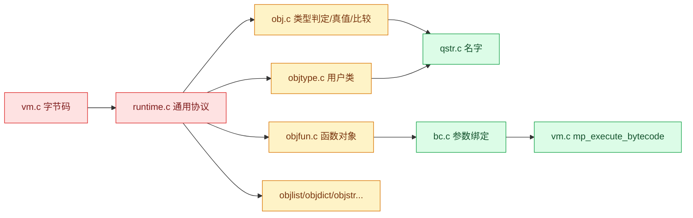
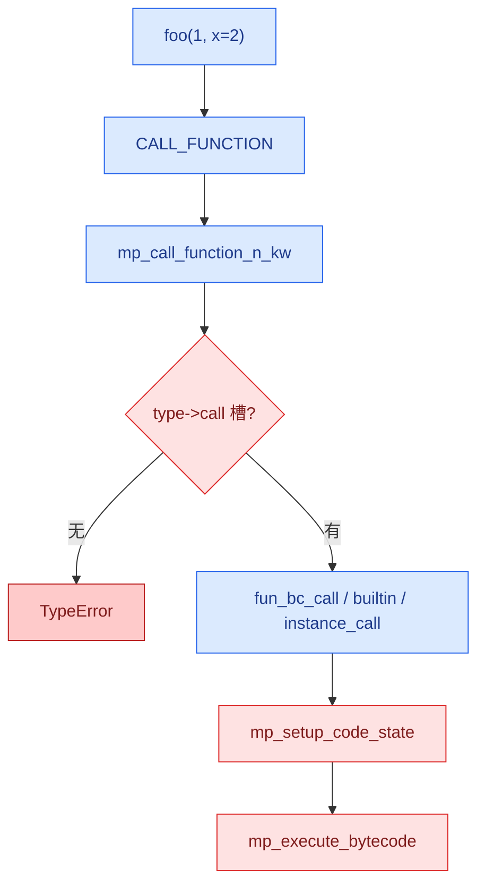
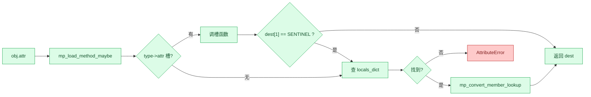

# runtime：调用协议与属性协议的主干

> 对应源文件：`py/runtime.c`（共 1793 行）
> 辅以 `py/objtype.c`（1558 行）、`py/obj.c`（627 行）、`py/bc.c`（345 行）
> 覆盖范围：`mp_call_function_n_kw()` 的通用调用路径、`mp_load_attr()` / `mp_load_method_maybe()` 的
> 属性查找路径、`mp_convert_member_lookup()` 的绑定规则、`mp_resume()` 的生成器恢复。
> 不覆盖：`mp_init`（见 `mp_init.md`）、运算符的具体实现（各 `obj*.c`）。

一句话职责：把“调用一个对象”“读写一个属性”“取一个迭代器”这些 Python 语义，
统一收敛到“查类型槽 → 调槽函数”两条路径，并为内建类型提供快路径。

---

## 1. 运行时在体系中的位置



`runtime.c` 不实现具体类型，它是**协议层**：所有“对任意对象做 X”的入口都在这里，
具体行为由 `mp_obj_type_t` 的槽决定。

---

## 2. 调用路径

### 2.1 通用入口

```c
mp_obj_t mp_call_function_n_kw(mp_obj_t fun_in, size_t n_args, size_t n_kw, const mp_obj_t *args) {
    // TODO improve this: fun object can specify its type and we parse here the arguments,
    // passing to the function arrays of fixed and keyword arguments

    DEBUG_OP_printf("calling function %p(n_args=" UINT_FMT ", n_kw=" UINT_FMT ", args=%p)\n", fun_in, n_args, n_kw, args);

    // get the type
    const mp_obj_type_t *type = mp_obj_get_type(fun_in);

    // do the call
    if (MP_OBJ_TYPE_HAS_SLOT(type, call)) {
        return MP_OBJ_TYPE_GET_SLOT(type, call)(fun_in, n_args, n_kw, args);
    }

    #if MICROPY_ERROR_REPORTING <= MICROPY_ERROR_REPORTING_TERSE
    mp_raise_TypeError(MP_ERROR_TEXT("object not callable"));
    #else
    mp_raise_msg_varg(&mp_type_TypeError,
        MP_ERROR_TEXT("'%s' object isn't callable"), mp_obj_get_type_str(fun_in));
    #endif
}
```
（`py/runtime.c:713-733`）

这就是**全部**的调用分派：没有参数个数检查（由被调用的 `call` 槽自己查），
没有默认值处理（在 `mp_setup_code_state` 里），没有 bound method 拆包
（`mp_call_method_n_kw` 已经把它摊平成 `args[]`）。

### 2.2 方法调用

```c
// args contains: fun  self/NULL  arg(0)  ...  arg(n_args-2)  arg(n_args-1)  kw_key(0)  kw_val(0)  ... kw_key(n_kw-1)  kw_val(n_kw-1)
// if n_args==0 and n_kw==0 then there are only fun and self/NULL
mp_obj_t mp_call_method_n_kw(size_t n_args, size_t n_kw, const mp_obj_t *args) {
    DEBUG_OP_printf("call method (fun=%p, self=%p, n_args=" UINT_FMT ", n_kw=" UINT_FMT ", args=%p)\n", args[0], args[1], n_args, n_kw, args);
    int adjust = (args[1] == MP_OBJ_NULL) ? 0 : 1;
    return mp_call_function_n_kw(args[0], n_args + adjust, n_kw, args + 2 - adjust);
}
```
（`py/runtime.c:735-741`）

`args` 的布局是 VM 栈上的连续区域：`fun, self, arg0..argN, key0, val0..`。
`self == NULL` 表示“不是方法调用”（如 `obj.attr()` 里 attr 是普通值），
此时跳过 self，把 `arg0` 当成第一个位置参数。

### 2.3 `*args` / `**kwargs`

`mp_call_prepare_args_n_kw_var()`（`py/runtime.c:747-945`）负责把
`f(*a, **k)` 摊平成普通参数数组：

1. 解析 `n_args_n_kw` 的低 8 位/次 8 位得到位置/关键字个数；
2. `star_args` 是 `*a` 元组的长度；
3. 新建 `args2[]`，依次填 `fun, self, 位置参数, *a 展开, 关键字 key/value, **k 展开`；
4. 检测重复关键字 → `TypeError`。

这段代码有 200 行，是 `runtime.c` 里最长的函数；它只在 `CALL_FUNCTION_VAR_KW`
时执行，普通调用不经过。

### 2.4 函数对象的 `call` 槽

| 类型 | `call` 槽 | 行为 |
|---|---|---|
| `mp_type_fun_bc` | `fun_bc_call` | 建 `mp_code_state_t`，跑 VM |
| `mp_type_fun_builtin_*` | `mp_builtin_fun_call` | 直接调 C 函数指针 |
| `mp_type_fun_native` | `fun_bc_call`（复用） | 跑机器码 |
| `mp_type_bound_meth` | `bound_method_call` | 插入 self 后转发 |
| 用户类实例 | `mp_obj_instance_call` | 查 `__call__` |

`fun_bc_call` 的关键步骤（`py/objfun.c:246-300`）：

1. `DECODE_CODESTATE_SIZE` 从 prelude 取 `n_state/n_exc_stack`；
2. `state_size > VM_MAX_STATE_ON_STACK` → 堆分配，否则 `alloca`；
3. `INIT_CODESTATE` → `mp_setup_code_state`；
4. 切换 globals 到函数定义时的模块；
5. `mp_execute_bytecode(code_state, MP_OBJ_NULL)`；
6. 恢复 globals，释放堆上的 `code_state`。

---

## 3. 属性路径

### 3.1 `mp_load_attr`：普通读

```c
mp_obj_t mp_load_attr(mp_obj_t base, qstr attr) {
    DEBUG_OP_printf("load attr %p.%s\n", base, qstr_str(attr));
    // use load_method
    mp_obj_t dest[2];
    mp_load_method(base, attr, dest);
    if (dest[1] == MP_OBJ_NULL) {
        // load_method returned just a normal attribute
        return dest[0];
    } else {
        // load_method returned a method, so build a bound method object
        return mp_obj_new_bound_meth(dest[0], dest[1]);
    }
}
```
（`py/runtime.c:1062-1074`）

`mp_load_attr` 是“值语义”的读：如果读到方法，**创建 bound method 对象**。
VM 的 `LOAD_ATTR` 走这条；而 `LOAD_METHOD` 走 `mp_load_method_maybe` 直接拿
`(fun, self)`，不分配——这是 `obj.meth()` 比 `f = obj.meth; f()` 快的原因。

### 3.2 `mp_load_method_maybe`：查找主流程

```c
void mp_load_method_maybe(mp_obj_t obj, qstr attr, mp_obj_t *dest) {
    // clear output to indicate no attribute/method found yet
    dest[0] = MP_OBJ_NULL;
    dest[1] = MP_OBJ_NULL;

    // Note: the specific case of obj being an instance type is fast-path'ed in the VM
    // for the MP_BC_LOAD_ATTR opcode. Instance types handle type->attr and look up directly
    // in their member's map.

    // get the type
    const mp_obj_type_t *type = mp_obj_get_type(obj);
    ...
    if (MP_OBJ_TYPE_HAS_SLOT(type, attr)) {
        // this type can do its own load, so call it
        MP_OBJ_TYPE_GET_SLOT(type, attr)(obj, attr, dest);
        // If type->attr has set dest[1] = MP_OBJ_SENTINEL, we should proceed
        // with lookups below (i.e. in locals_dict). If not, return right away.
        if (dest[1] != MP_OBJ_SENTINEL) {
            return;
        }
        // Clear the fail flag set by type->attr so it's like it never ran.
        dest[1] = MP_OBJ_NULL;
    }
    if (MP_OBJ_TYPE_HAS_SLOT(type, locals_dict)) {
        // generic method lookup
        // this is a lookup in the object (ie not class or type)
        assert(MP_OBJ_TYPE_GET_SLOT(type, locals_dict)->base.type == &mp_type_dict); // MicroPython restriction, for now
        mp_map_t *locals_map = &MP_OBJ_TYPE_GET_SLOT(type, locals_dict)->map;
        mp_map_elem_t *elem = mp_map_lookup(locals_map, MP_OBJ_NEW_QSTR(attr), MP_MAP_LOOKUP);
        if (elem != NULL) {
            mp_convert_member_lookup(obj, type, elem->value, dest);
        }
        return;
    }
}
```
（`py/runtime.c:1183-1231`）

三个关键点：

1. **`dest[1] == MP_OBJ_SENTINEL` 是“继续查”的暗号**。类型的 `attr` 槽如果只处理了
   部分属性（比如 `mp_obj_instance_attr` 没找到），会置 `SENTINEL` 让调用方继续查
   `locals_dict`。
2. **`locals_dict` 断言必须是 `dict`**（`py/runtime.c:1223`）。这是 MicroPython 限制：
   模块/类的命名空间不能是任意 Mapping。
3. **`__next__` 有快路径**（`py/runtime.c:1204-1208`）：类型带 `ITER_IS_ITERNEXT` 时，
   `obj.__next__` 直接映射到内建 `next`，避免为每个迭代器类型建方法。

### 3.3 `mp_load_method`：读不到就抛

`mp_load_method()`（`py/runtime.c:1233-1270`）在 `mp_load_method_maybe` 之上加错误处理：

- 类型对象：`type object 'X' has no attribute 'y'`；
- 模块：`module 'm' has no attribute 'y'`（还会检查 `__all__`）；
- 其他：`'X' object has no attribute 'y'`。

错误消息分级由 `MICROPY_ERROR_REPORTING` 控制，TERSE 档只有 “no such attribute”。

### 3.4 `mp_store_attr`

`mp_store_attr()`（`py/runtime.c:1286-1305`）把写操作编码成 `dest = {SENTINEL, value}`，
调类型的 `attr` 槽；`value == MP_OBJ_NULL` 表示删除。这套编码在 `py/obj.h:668-680`
的注释里有完整说明。

### 3.5 `mp_convert_member_lookup`：绑定的唯一实现

```c
void mp_convert_member_lookup(mp_obj_t self, const mp_obj_type_t *type, mp_obj_t member, mp_obj_t *dest) {
    if (mp_obj_is_obj(member)) {
        const mp_obj_type_t *m_type = ((mp_obj_base_t *)MP_OBJ_TO_PTR(member))->type;
        if (m_type->flags & MP_TYPE_FLAG_BINDS_SELF) {
            // `member` is a function that binds self as its first argument.
            if (m_type->flags & MP_TYPE_FLAG_BUILTIN_FUN) {
                // `member` is a built-in function, which has special behaviour.
                if (mp_obj_is_instance_type(type)) {
                    // Built-in functions on user types always behave like a staticmethod.
                    dest[0] = member;
                }
                ...
```
（`py/runtime.c:1125-1148`）

规则汇总：

| `member` 的类型 | 结果 |
|---|---|
| 普通函数（`BINDS_SELF`） | `dest = {fun, self}` |
| 内建函数 + 用户类 | `dest[0] = member`（当 staticmethod） |
| 内建函数 + 原生类型 | `dest = {fun, self}` 或包 `checked_fun` |
| `staticmethod` | `dest[0] = 被包裹函数` |
| `classmethod` | `dest = {被包裹函数, 类}` |
| 普通值 | `dest[0] = 值` |

`checked_fun`（`py/runtime.c:1082-1123`）是给内建方法加 self 类型检查的包装器，
只在 `MICROPY_BUILTIN_METHOD_CHECK_SELF_ARG` 开启时生成。

---

## 4. 其他协议入口

| 函数 | 行 | 协议 | 备注 |
|---|---|---|---|
| `mp_unary_op` | 306-387 | `-x`、`not x`、`hash` | `NOT` 特判在最前 |
| `mp_binary_op` | 388-695 | 算术/比较/位运算 | 含 `ZeroDivisionError` |
| `mp_getiter` | 1306-1356 | `iter(x)` | 支持 `iter_buf` 栈上迭代器 |
| `mp_iternext_allow_raise` | 1371-1395 | `next(x)` | 可抛 `StopIteration` |
| `mp_iternext` | 1396-1430 | VM 用 | 把 `StopIteration` 转成 `MP_OBJ_STOP_ITERATION` |
| `mp_resume` | 1431-1511 | 生成器 `send/throw/close` | 返回 `MP_VM_RETURN_*` |
| `mp_make_raise_obj` | 1512-1530 | 把任意值变成异常 | 字符串 → `Exception` |
| `mp_import_name` | 1531-1555 | `__import__` | — |
| `mp_import_from` | 1556-1603 | `from m import x` | 支持子模块 |
| `mp_import_all` | 1604-1651 | `from m import *` | 跳过 `_` 开头 |
| `mp_parse_compile_execute` | 1655-1689 | 源码 → 执行 | 见 `mp_init.md` |

### 4.1 `mp_iternext` 的哨兵转换

```c
mp_obj_t mp_iternext(mp_obj_t o_in) {
    mp_cstack_check(); // enumerate, filter, map and zip can recursively call mp_iternext
    const mp_obj_type_t *type = mp_obj_get_type(o_in);
    if (TYPE_HAS_ITERNEXT(type)) {
        MP_STATE_THREAD(stop_iteration_arg) = MP_OBJ_NULL;
        return type_get_iternext(type)(o_in);
    } else {
        // check for __next__ method
        mp_obj_t dest[2];
        mp_load_method_maybe(o_in, MP_QSTR___next__, dest);
        if (dest[0] != MP_OBJ_NULL) {
            // __next__ exists, call it and return its result
            nlr_buf_t nlr;
            if (nlr_push(&nlr) == 0) {
                mp_obj_t ret = mp_call_method_n_kw(0, 0, dest);
                nlr_pop();
                return ret;
            } else {
                if (mp_obj_is_subclass_fast(MP_OBJ_FROM_PTR(((mp_obj_base_t *)nlr.ret_val)->type), MP_OBJ_FROM_PTR(&mp_type_StopIteration))) {
                    return mp_make_stop_iteration(mp_obj_exception_get_value(MP_OBJ_FROM_PTR(nlr.ret_val)));
                } else {
                    nlr_jump(nlr.ret_val);
                }
            }
        ...
    }
}
```
（`py/runtime.c:1396-1429`，省略了最后的 `TypeError` 分支）

VM 的 `FOR_ITER` 期望“结束”用 `MP_OBJ_STOP_ITERATION` 表示，而不是异常；
`mp_iternext` 把 `StopIteration` 异常吞掉并转成哨兵，避免 for 循环每轮都走异常路径。

### 4.2 `mp_resume`

`mp_resume()`（`py/runtime.c:1431-1511`）处理生成器的三种恢复：

| 参数 | 语义 | 底层 |
|---|---|---|
| `send_value != NULL` | `gen.send(v)` | `mp_execute_bytecode(state, NULL)` 前把 v 压栈 |
| `throw_value != NULL` | `gen.throw(e)` | `mp_execute_bytecode(state, e)` |
| 两者都 NULL | `next(gen)` | 注入 `None` |

返回值是 `MP_VM_RETURN_NORMAL/YIELD/EXCEPTION`，由调用方（`YIELD_FROM` 或
`mp_obj_gen_resume`）解释。

---

## 5. 调用与属性路径图





---

## 6. 陷阱与读码建议

1. **`dest` 必须是长度 2 的数组**。`mp_load_method*` 会写 `dest[0]` 和 `dest[1]`；
   传 `mp_obj_t *` 指向单个变量会踩栈。
2. **`MP_OBJ_SENTINEL` 在 `dest[1]` 里是控制流信号**，不是返回值。
   调用方看到它必须继续查 `locals_dict`，否则会漏掉方法。
3. **`mp_call_function_n_kw` 不检查参数个数**。内建函数用
   `MP_DEFINE_CONST_FUN_OBJ_*` 声明的 `n_args_min/max` 在 `call` 槽里检查；
   Python 函数在 `mp_setup_code_state` 里检查。
4. **`mp_load_attr` 会分配 bound method**。热循环里 `obj.meth()` 应尽量让 VM 走
   `LOAD_METHOD`，而不是先 `f = obj.meth`。
5. **`mp_resume` 的 `throw_value` 会被注入到生成器内部**，如果生成器没捕获，
   会以 `MP_VM_RETURN_EXCEPTION` 返回；调用方要负责 `nlr_raise`。
6. **`mp_import_all` 会跳过 `_` 开头的名字**，但不会跳过 `__all__` 里显式列出的；
   两者顺序是先看 `__all__`，没有再遍历 `locals`。
7. 读码建议：先读 `runtime.c:713-741`（调用）、`:1183-1231`（属性）、
   `:1125-1178`（绑定），再看 `objfun.c:246` 与 `bc.c:127` 的落地。

相关文档：[02-对象模型精读](../../../references/firmware/micropython/mp-notes/02-对象模型精读.md) ·
[03-字节码虚拟机](../../../references/firmware/micropython/mp-notes/03-字节码虚拟机.md) ·
[obj.md](obj.md) · [vm.md](vm.md)
