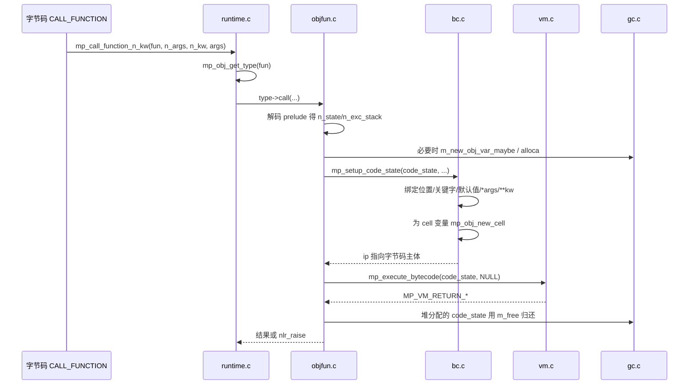

# vm：字节码解释器主循环

> 对应源文件：`py/vm.c`（共 1526 行），辅以 `py/bc.h`（349 行）、`py/bc0.h`（162 行）、`py/bc.c`（345 行）
> 覆盖范围：`mp_code_state_t` 栈帧布局、指令编码、分派机制、return/yield/exception 三条退出路径、
> 调用与参数绑定、生成器恢复。
> 不覆盖：字节码如何生成（`py/emitbc.c` / `py/compile.c`，见 `compile.md`）。

一句话职责：取指、解码、执行 `MP_BC_*` 指令，维护值栈与异常栈，
把“函数调用/返回/异常/生成器挂起”翻译成 C 层的控制流。

---

## 1. 栈帧：`mp_code_state_t`

```c
typedef struct _mp_code_state_t {
    // The fun_bc entry points to the underlying function object that is being executed.
    // It is needed to access the start of bytecode and the const_table.
    // It is also needed to prevent the GC from reclaiming the bytecode during execution,
    // because the ip pointer below will always point to the interior of the bytecode.
    struct _mp_obj_fun_bc_t *fun_bc;
    const byte *ip;
    mp_obj_t *sp;
    uint16_t n_state;
    uint16_t exc_sp_idx;
    mp_obj_dict_t *old_globals;
    ...
    // Variable-length
    mp_obj_t state[0];
    // Variable-length, never accessed by name, only as (void*)(state + n_state)
    // mp_exc_stack_t exc_state[0];
} mp_code_state_t;
```
（`py/bc.h:234-256`）

| 字段 | 行 | 含义 |
|---|---|---|
| `fun_bc` | 239 | 函数对象；**GC 靠它保活字节码** |
| `ip` | 240 | 指令指针（指向字节码内部） |
| `sp` | 241 | 值栈顶（指向栈顶元素，不是下一个空位） |
| `n_state` | 242 | `state[]` 的槽数（局部变量 + 值栈） |
| `exc_sp_idx` | 243 | 异常栈索引（`uint16`，不是指针） |
| `old_globals` | 244 | 调用者的 globals，返回时恢复 |
| `prev` | 246 | 无栈模式下的上一层状态 |
| `prev_state/frame` | 249-250 | `sys.settrace` 用 |
| `state[]` | 253 | 变长数组：局部变量 + 值栈 |
| `exc_state[]` | 255 | 紧跟 `state[n_state]`，异常栈 |

### 1.1 内存布局

```
高地址
+---------------------------+
| exc_stack[n_exc-1]        |  每项 3 字：handler / val_sp / prev_exc
| ...                       |
+---------------------------+  state + n_state
| local[0] <- fastn[0]      |
| local[1] <- fastn[-1]     |
| ...                       |
+---------------------------+
| 值栈顶 <- sp              |
| ...                       |
+---------------------------+  state + 0
低地址
```

`py/vm.c:289-296` 建立两个常量指针：

```c
    // Pointers which are constant for particular invocation of mp_execute_bytecode()
    mp_obj_t * /*const*/ fastn;
    mp_exc_stack_t * /*const*/ exc_stack;
    {
        size_t n_state = code_state->n_state;
        fastn = &code_state->state[n_state - 1];
        exc_stack = (mp_exc_stack_t*)(code_state->state + n_state);
    }
```

注释解释为什么倒排（`py/vm.c:224-225`）：

```c
// fastn has items in reverse order (fastn[0] is local[0], fastn[-1] is local[1], etc)
// sp points to bottom of stack which grows up
```

### 1.2 栈大小从哪来

`fun_bc_call()` 从函数 prelude 解码（`py/objfun.c:204-214`）：

```c
#define DECODE_CODESTATE_SIZE(bytecode, n_state_out_var, state_size_out_var) \
    { \
        const uint8_t *ip = bytecode; \
        size_t n_exc_stack, scope_flags, n_pos_args, n_kwonly_args, n_def_args; \
        MP_BC_PRELUDE_SIG_DECODE_INTO(ip, n_state_out_var, n_exc_stack, scope_flags, n_pos_args, n_kwonly_args, n_def_args); \
        ...
        state_size_out_var = n_state_out_var * sizeof(mp_obj_t)                   \
            + n_exc_stack * sizeof(mp_exc_stack_t);                \
    }
```

`n_state` 在**编译期**由 `MP_PASS_STACK_SIZE` 算出（见 `compile.md`），运行时只读不写。

---

## 2. 指令编码

高 4 位是格式，低 4 位是操作（`py/bc0.h:43-70`）：

| 高 4 位 | 格式 | 操作数 |
|---|---|---|
| `0x1_` | QSTR | 1 个 qstr（变长整数编码） |
| `0x2_` | VAR_UINT + extra | 无符号变长 + 额外字节 |
| `0x3_` | VAR_UINT | 无符号变长 |
| `0x4_` | OFFSET | 有符号相对跳转 |
| `0x5_`/`0x6_` | BYTE | 无操作数 |
| `0x7_`-`0xa_` | 小整数直编 | 值 = opcode - 0x70 - 16 |
| `0xb_`/`0xc_` | 局部变量直编 | 索引 = 0xb0/0xc0 - opcode |
| `0xd0-0xd6` | 一元运算 | 运算号 = opcode - 0xd0 |
| `0xd7-0xdf` | 二元运算 | 运算号 = opcode - 0xd7 |

`MP_BC_FORMAT(op)` 用一个 16 位常量查表（`py/bc0.h:43-52`）：

```c
#define MP_BC_FORMAT(op) ((0x000003a4 >> (2 * ((op) >> 4))) & 3)
```

`0x3a4` 的二进制按 2 bit 分组，正好描述 8 个高 4 位区段的格式。

### 2.1 常用指令

| 指令 | 值 | 操作数 | 语义 |
|---|---|---|---|
| `LOAD_CONST_FALSE/NONE/TRUE` | `0x50/0x51/0x52` | — | 压常量 |
| `LOAD_CONST_SMALL_INT` | `0x22` | 有符号变长 | 压小整数 |
| `LOAD_CONST_STRING` | `0x10` | qstr | 压字符串常量 |
| `LOAD_FAST_N` / `STORE_FAST_N` | `0x24/0x26` | uint | 读写局部变量 |
| `LOAD_ATTR` / `LOAD_METHOD` | `0x13/0x14` | qstr | 读属性/方法 |
| `JUMP` / `POP_JUMP_IF_FALSE` | `0x42/0x44` | 有符号偏移 | 跳转 |
| `CALL_FUNCTION` | `0x34` | uint | 调用函数 |
| `RETURN_VALUE` / `RAISE_OBJ` / `YIELD_VALUE` | `0x63/0x65/0x67` | — | 退出/异常/挂起 |

（完整表见 `py/bc0.h:80-160`。这些值是 `MP_BC_BASE_*` 加偏移算出来的，
例如 `LOAD_FAST_N = 0x20 + 0x04 = 0x24`、`CALL_FUNCTION = 0x30 + 0x04 = 0x34`；
改代码时以宏定义为准，不要手算。）

---

## 3. 分派：computed goto vs switch

```c
#if MICROPY_OPT_COMPUTED_GOTO
    #include "py/vmentrytable.h"
    #define DISPATCH() do { \
        TRACE(ip); \
        MARK_EXC_IP_GLOBAL(); \
        TRACE_TICK(ip, sp, false); \
        goto *entry_table[*ip++]; \
    } while (0)
    #define DISPATCH_WITH_PEND_EXC_CHECK() goto pending_exception_check
    #define ENTRY(op) entry_##op
    #define ENTRY_DEFAULT entry_default
#else
    #define DISPATCH() goto dispatch_loop
    #define DISPATCH_WITH_PEND_EXC_CHECK() goto pending_exception_check
    #define ENTRY(op) case op
    #define ENTRY_DEFAULT default
#endif
```
（`py/vm.c:255-271`）

`entry_table[]` 在 `py/vmentrytable.h`（构建期由 `makevmentrytable.py` 生成），
每个表项是 `&&entry_MP_BC_xxx`。computed goto 省掉 switch 的范围检查与跳转表查找，
在 GCC/Clang 上是“一次间接跳转”。

### 3.1 双层循环

```c
    // outer exception handling loop
    for (;;) {
        nlr_buf_t nlr;
outer_dispatch_loop:
        if (nlr_push(&nlr) == 0) {
            // local variables that are not visible to the exception handler
            const byte *ip = code_state->ip;
            mp_obj_t *sp = code_state->sp;
            ...
            // loop to execute byte code
            for (;;) {
dispatch_loop:
```
（`py/vm.c:307-335`）

外层负责异常（`nlr_push`），内层负责分派。C 层抛异常时长跳回外层，
`nlr_push` 返回非 0，进入 `exception_handler`。**一次 Python 调用只压一次 nlr**。

### 3.2 `RAISE` 必须是 goto

```c
    // nlr_raise needs to be implemented as a goto, so that the C compiler's flow analyser
    // sees that it's possible for us to jump from the dispatch loop to the exception
    // handler.  Without this, the code may have a different stack layout in the dispatch
    // loop and the exception handler, leading to very obscure bugs.
    #define RAISE(o) do { nlr_pop(); nlr.ret_val = MP_OBJ_TO_PTR(o); goto exception_handler; } while (0)
```
（`py/vm.c:273-277`）

如果写成函数，编译器可能认为 `exception_handler` 不可达，把 `ip/sp` 留在寄存器里，
长跳转恢复后读到旧值。

## 4. 三条退出路径

| 返回值 | 有效字段 | 触发 |
|---|---|---|
| `MP_VM_RETURN_NORMAL` | `sp` 指向返回值 | `RETURN_VALUE` |
| `MP_VM_RETURN_YIELD` | `ip`、`sp` | `YIELD_VALUE` |
| `MP_VM_RETURN_EXCEPTION` | `state[0]` | 无 handler 的异常 |

### 4.1 正常返回

```c
                    nlr_pop();
                    code_state->sp = sp;
                    assert(exc_sp == exc_stack - 1);
                    MICROPY_VM_HOOK_RETURN
                    ...
                    FRAME_LEAVE();
                    return MP_VM_RETURN_NORMAL;
```
（`py/vm.c:1163-1185`）

`RETURN_VALUE` 前面还有一段“执行未激活的 finally”逻辑（`py/vm.c:1131-1162`），
把 return 变成“跳到 finally 协程，结束后再回来”。

### 4.2 生成器挂起

```c
                ENTRY(MP_BC_YIELD_VALUE):
yield:
                    nlr_pop();
                    code_state->ip = ip;
                    code_state->sp = sp;
                    code_state->exc_sp_idx = MP_CODE_STATE_EXC_SP_IDX_FROM_PTR(exc_stack, exc_sp);
                    FRAME_LEAVE();
                    return MP_VM_RETURN_YIELD;
```
（`py/vm.c:1219-1226`）

`nlr_pop()` 是关键：生成器挂起后 C 栈帧消失，`nlr_top` 上的 buf 必须摘掉。
恢复时 `mp_resume()` 重新 `mp_execute_bytecode(code_state, ...)`，从 `ip` 继续。

### 4.3 异常展开

`exception_handler`（`py/vm.c:1407`）的四步：

1. **`StopIteration` 特判**（`:1419-1435`）：
   - 在 `FOR_ITER` 处 → 跳到循环结束，弹出迭代器；
   - 在 `YIELD_FROM` 处 → 用 `StopIteration.value` 作为 `yield from` 的结果。
2. **补 traceback**（`:1447-1472`）：解码 prelude 的行号表，`mp_obj_exception_add_traceback`。
3. **弹掉已越过的 handler**（`:1474-1485`）：
   `while (exc_sp >= exc_stack && exc_sp->handler <= code_state->ip) POP_EXC_BLOCK();`
4. **有 handler 就跳过去**（`:1487-1495`）：

```c
            if (exc_sp >= exc_stack) {
                // catch exception and pass to byte code
                code_state->ip = exc_sp->handler;
                mp_obj_t *sp = MP_TAGPTR_PTR(exc_sp->val_sp);
                // save this exception in the stack so it can be used in a reraise, if needed
                exc_sp->prev_exc = nlr.ret_val;
                // push exception object so it can be handled by bytecode
                PUSH(MP_OBJ_FROM_PTR(nlr.ret_val));
                code_state->sp = sp;
```
（`py/vm.c:1487-1495`）

否则 `state[0] = exc; return MP_VM_RETURN_EXCEPTION`（`:1517-1523`）。

## 5. 调用路径



### 5.1 通用入口

```c
mp_obj_t mp_call_function_n_kw(mp_obj_t fun_in, size_t n_args, size_t n_kw, const mp_obj_t *args) {
    ...
    // get the type
    const mp_obj_type_t *type = mp_obj_get_type(fun_in);

    // do the call
    if (MP_OBJ_TYPE_HAS_SLOT(type, call)) {
        return MP_OBJ_TYPE_GET_SLOT(type, call)(fun_in, n_args, n_kw, args);
    }
    ...
}
```
（`py/runtime.c:713-733`）

### 5.2 参数绑定

`mp_setup_code_state_helper()`（`py/bc.c:127-316`）的核心片段：

```c
    // var_pos_kw_args points to the stack where the var-args tuple, and var-kw dict, should go (if they are needed)
    mp_obj_t *var_pos_kw_args = &code_state_state[n_state - 1 - n_pos_args - n_kwonly_args];

    // check positional arguments

    if (n_args > n_pos_args) {
        // given more than enough arguments
        if ((scope_flags & MP_SCOPE_FLAG_VARARGS) == 0) {
            fun_pos_args_mismatch(self, n_pos_args, n_args);
        }
        // put extra arguments in varargs tuple
        *var_pos_kw_args-- = mp_obj_new_tuple(n_args - n_pos_args, args + n_pos_args);
        n_args = n_pos_args;
    }
```
（`py/bc.c:152-164`）

绑定顺序：

1. `memset(state, 0, ...)` 把局部变量置 `MP_OBJ_NULL`；
2. positional：多余装 `*args`，不足用 `extra_args[]` 补默认值；
3. keyword：线性查 `arg_names[]`，重复则 `TypeError`，多余装 `**kwargs`；
4. cell 变量用 `mp_obj_new_cell()` 包装，最后 `code_state->ip = ip` 跳过 prelude。

`MP_OBJ_NULL` 在局部变量里表示“未绑定”，`LOAD_FAST` 遇到它抛 `UnboundLocalError`。

---

## 7. 量化

以 32 位 Cortex-M 为例：

| 项 | 字节 |
|---|---|
| `mp_code_state_t` 头 | 24（6 字段 × 4） |
| 每个 `state[]` 槽 | 4 |
| 每个异常栈项 | 12 |
| 典型小函数（4 局部 + 0 异常） | 24 + 16 = 40 B（`alloca`） |
| 大函数（20 局部 + 2 异常） | 24 + 80 + 24 = 128 B（堆） |

`VM_MAX_STATE_ON_STACK = sizeof(mp_uint_t) * 11`（`py/objfun.c:202`），
32 位机上 44 B 是“栈分配”的分界线。

---

## 8. 陷阱与读码建议

1. **`code_state->fun_bc` 必须保持可达**。`ip` 指向字节码内部，GC 只认 `fun_bc`；
   把它置 NULL 会让字节码在调用中途被回收。
2. **`sp` 指向栈顶元素，不是空位**。`PUSH` 是 `*++sp`，`POP` 是 `*sp--`；
   空栈时 `sp == state - 1`。
3. **`SELECTIVE_EXC_IP` 影响 traceback**。默认关闭，`code_state->ip` 在每条指令前更新；
   开启后只在可能抛异常的指令前更新，行号可能差 1 字节。
4. **`nlr_pop()` 必须在 `YIELD`/`RETURN` 前调用**，否则 `nlr_top` 指向失效栈帧。
5. **不要手算 opcode 值**。`bc0.h` 里大量 `BASE + offset`，且 `_MULTI` 区段与单指令区段
   有重叠的数值空间（靠 `MICROPY_OPT_COMPUTED_GOTO` 区分处理）。
6. **`FOR_ITER` 的 `StopIteration` 不进异常栈**，是 VM 内的直接跳转（`py/vm.c:1421-1426`），
   调试时不要以为“异常被吞了”。
7. 读码建议：先读 `bc.h:234-256` 和 `vm.c:289-296` 建立栈布局，
   再读 `vm.c:307-343` 的双层循环，最后按需看具体指令。

相关文档：[03-字节码虚拟机](../../../references/firmware/micropython/mp-notes/03-字节码虚拟机.md) ·
[compile.md](compile.md) · [runtime.md](runtime.md) · [nlr.md](nlr.md)
