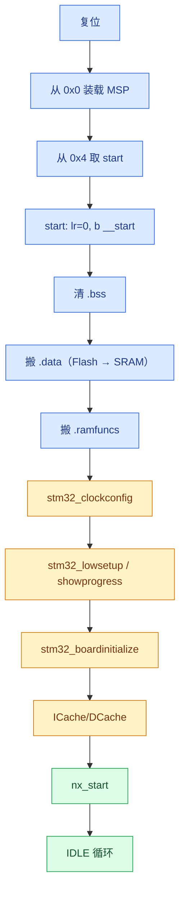
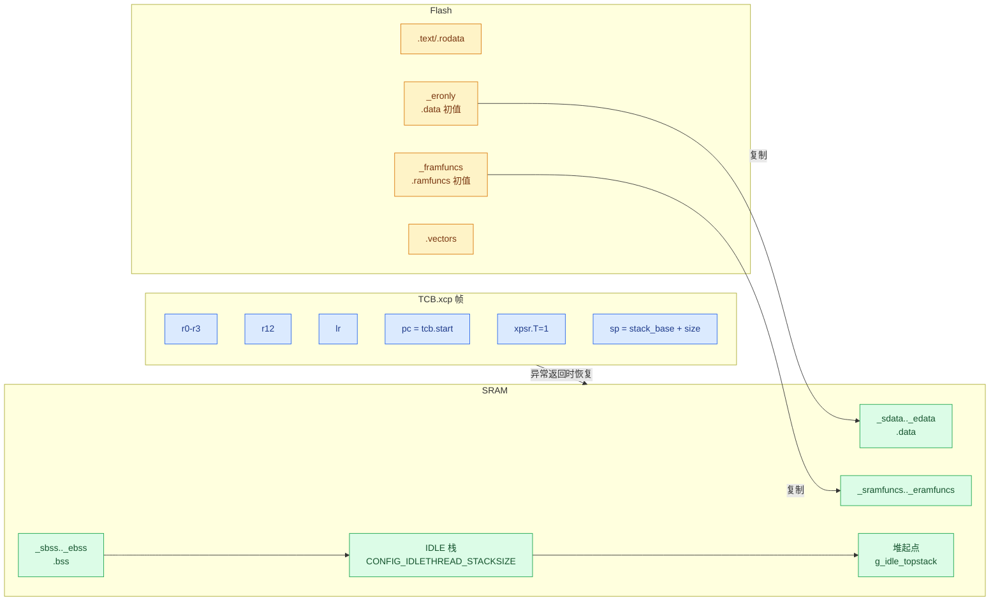

# arch/arm 启动链 —— 向量表、__start、异常入口与初始上下文

> 对应源文件（以 STM32H7 / Cortex-M7 为目标，典型完整目标）：
> - `arch/arm/src/stm32h7/stm32_start.c`（共 320 行）
> - `arch/arm/src/armv7-m/arm_vectors.c`（共 107 行）
> - `arch/arm/src/armv7-m/arm_exception.S`（共 267 行）
> - `arch/arm/src/common/arm_initialize.c`（共 121 行）
> - `arch/arm/src/armv7-m/arm_initialstate.c`（共 208 行）
>
> 五个文件合计 1,023 行。关联：`arch/arm/src/armv7-m/arm_doirq.c`（133 行）、
> `arm_svcall.c`（381 行）。
> 逐段解读见 [Docs/01-启动流程与初始化链.md](../../../references/rtos/NuttX/Docs/01-启动流程与初始化链.md)。

---

## 1. 一句话职责

在 C 运行时可用之前，用汇编/C 手工建立"栈、`.bss`、`.data`、时钟、串口"，
再把控制权交给 `nx_start()`；同时提供异常入口和"伪造寄存器帧"，
让新任务第一次被调度时像从没离开过一样开始执行。

## 2. 文件分工

| 文件 | 语言 | 职责 |
|---|---|---|
| `arm_vectors.c` | C | 定义 `.vectors` 段：初始 MSP、复位向量、异常向量 |
| `stm32_start.c` | C | `__start()`：清 bss、搬 data、时钟、串口、板级初始化 |
| `arm_exception.S` | 汇编 | `exception_common`：保存现场、调 `arm_doirq`、恢复现场 |
| `arm_initialize.c` | C | `up_initialize()`：中断栈、额外堆、PM、DMA、串口、网络 |
| `arm_initialstate.c` | C | `up_initial_state()`：为新 TCB 构造 `xcp` 寄存器帧 |

## 3. 逐函数表

### 3.1 `stm32_start.c`

| 函数 | 行号 | 作用 |
|---|---:|---|
| `stm32_tcmenable()` | 130 | 使能/关闭 ITCM/DTCM（仅 Cortex-M7） |
| `__start()` | 183 | 复位 C 入口，永不返回 |

### 3.2 `arm_vectors.c`

| 符号/函数 | 行号 | 作用 |
|---|---:|---|
| `start()` | 61 | 清 `lr` 后跳 `__start` |
| `_vectors[]` | 91 | 向量表，`.vectors` 段 |

### 3.3 `arm_exception.S`

| 符号 | 行号 | 作用 |
|---|---:|---|
| `exception_common` | 124 | 公共异常入口：保存 `r2-r12,r14`，调 `arm_doirq` |
| `exception_direct` | 文件后半 | 直接分发的外设中断入口 |

### 3.4 `arm_initialize.c`

| 函数 | 行号 | 作用 |
|---|---:|---|
| `up_initialize()` | 62 | 架构级初始化总入口 |

### 3.5 `arm_initialstate.c`

| 函数 | 行号 | 作用 |
|---|---:|---|
| `up_initial_state()` | 约 60 | 填 `tcb->xcp.regs`，设 SP/PC/XPSR/EXC_RETURN |
| `arm_initialize_stack()` | 179 | 重设 PSP/MSP（中断栈模式） |

## 4. 逐字摘录

### 4.1 向量表

```c
const void * const _vectors[] locate_data(".vectors")
                              aligned_data(VECTAB_ALIGN) =
{
  /* Initial stack */

  IDLE_STACK,

  /* Reset exception handler */

  start,

  /* Vectors 2 - n point directly at the generic handler */

  [2 ... NVIC_IRQ_PENDSV] = &exception_common,
  [(NVIC_IRQ_PENDSV + 1) ... (15 + ARMV7M_PERIPHERAL_INTERRUPTS)]
                          = &exception_direct
};
```

（`arch/arm/src/armv7-m/arm_vectors.c:91-107`）

`[2 ... NVIC_IRQ_PENDSV]` 是 GCC 的指定初始化扩展：把 2..14 号异常
（NMI、HardFault、MemManage、BusFault、UsageFault、SVCall、DebugMon、
PendSV）全部指向 `exception_common`，外设中断指向 `exception_direct`。

### 4.2 复位跳板

```c
static void start(void)
{
  /* Zero lr to mark the end of backtrace */

  asm volatile ("mov lr, #0\n\t"
                "b  __start\n\t");
}
```

（`arm_vectors.c:61-67`）

`lr=0` 让 backtrace 在 `__start` 处停止，避免回溯到未初始化的栈。

### 4.3 `__start()`：清 bss、搬 data

```c
osentry_function
void __start(void)
{
  const uint32_t *src;
  uint32_t *dest;

#ifdef CONFIG_ARMV7M_STACKCHECK
  /* Set the stack limit before we attempt to call any functions */

  __asm__ volatile("sub r10, sp, %0" : :
                   "r"(CONFIG_IDLETHREAD_STACKSIZE - 64) :);
#endif
...
  /* Clear .bss.  We'll do this inline (vs. calling memset) just to be
   * certain that there are no issues with the state of global variables.
   */

  for (dest = (uint32_t *)_sbss; dest < (uint32_t *)_ebss; )
    {
      *dest++ = 0;
    }

  /* Move the initialized data section from his temporary holding spot in
   * FLASH into the correct place in SRAM.  The correct place in SRAM is
   * give by _sdata and _edata.  The temporary location is in FLASH at the
   * end of all of the other read-only data (.text, .rodata) at _eronly.
   */

  for (src = (const uint32_t *)_eronly,
       dest = (uint32_t *)_sdata; dest < (uint32_t *)_edata;
      )
    {
      *dest++ = *src++;
    }
```

（`stm32_start.c:183-225`，节选）

`__start` 被标记为 `osentry_function`（`arch/arm/src/stm32h7/stm32_start.h`），
告诉编译器这是"OS 入口"，不要做栈保护/插桩。

### 4.4 时钟/串口/板级

```c
  /* Configure the UART so that we can get debug output as soon as possible */

  stm32_clockconfig();
  arm_fpuconfig();
  stm32_lowsetup();
  showprogress('A');

#ifdef CONFIG_ARCH_CHIP_STM32H7_CORTEXM7
  /* Enable/disable tightly coupled memories */

  stm32_tcmenable();
#endif

  /* Initialize onboard resources */

  stm32_boardinitialize();
  showprogress('B');

#ifdef CONFIG_ARCH_CHIP_STM32H7_CORTEXM7
  /* Enable I- and D-Caches */

  up_enable_icache();
  up_enable_dcache();
#endif
  showprogress('C');
```

（`stm32_start.c:247-271`）

`showprogress(c)` 只在 `CONFIG_DEBUG_FEATURES` 下展开为
`arm_lowputc(c)`（`stm32_start.c:104-108`）。

### 4.5 启动 NuttX

```c
  /* Then start NuttX */

  showprogress('\r');
  showprogress('\n');

#if defined(CONFIG_ARCH_STM32H7_DUALCORE) && \
    defined(CONFIG_ARCH_CHIP_STM32H7_CORTEXM7) && \
    defined(CONFIG_STM32_CORTEXM4_ENABLED)

  /* Start CM4 core after clock configuration is done */

  stm32_start_cm4();
#endif

  nx_start();

  /* Shouldn't get here */

  for (; ; );
}
```

（`stm32_start.c:301-320`）

### 4.6 异常入口

```asm
exception_common:
	.cfi_sections	.debug_frame
	.cfi_startproc
	mrs		r0, ipsr				/* R0=exception number */
	mrs		r12, control				/* R12=control */

	/* Complete the context save */

	/* The EXC_RETURN value tells us whether the context is on the MSP or PSP */

	tst		r14, #EXC_RETURN_PROCESS_STACK		/* nonzero if context on process stack */
	beq		1f					/* Branch if context already on the MSP */
	mrs		r1, psp					/* R1=The process stack pointer (PSP) */
	b		2f
1:
	mrs		r1, msp					/* R1=The main stack pointer (MSP) */
	sub		r2, r1, #SW_XCPT_SIZE			/* Reserved stack space */
	msr		msp, r2
	isb		sy
```

（`arch/arm/src/armv7-m/arm_exception.S:124-143`）

保存现场：

```asm
	stmdb		r1!, {r2-r12,r14}		/* Save the remaining registers plus the SP/PRIMASK values */
```

（`arm_exception.S:172`）

FPU 使能时：

```asm
	tst		r14, #EXC_RETURN_STD_CONTEXT
	ite		eq
	vstmdbeq	r1!, {s16-s31}			/* Save the non-volatile FP context */
	subne		r1, #(4*SW_FPU_REGS)
```

（`arm_exception.S:166-169`）

### 4.7 `up_initial_state()`：伪造第一次运行

```c
  /* Save the initial stack pointer */

  xcp->regs[REG_SP]      = (uint32_t)tcb->stack_base_ptr +
                                     tcb->adj_stack_size;

  /* Save the task entry point (stripping off the thumb bit) */

  xcp->regs[REG_PC]      = (uint32_t)tcb->start & ~1;

  /* Specify thumb mode */

  xcp->regs[REG_XPSR]    = ARMV7M_XPSR_T;
```

（`arch/arm/src/armv7-m/arm_initialstate.c:99-114`）

```c
  xcp->regs[REG_EXC_RETURN] = EXC_RETURN_THREAD;

  xcp->regs[REG_CONTROL] = getcontrol() & ~CONTROL_NPRIV;
```

（`arm_initialstate.c:153-155`）

`SP` 指向栈顶（高地址），`PC` 指向 `tcb->start`（通常是 `nxtask_start`），
`XPSR.T=1` 表示 Thumb 模式，`EXC_RETURN_THREAD` 表示异常返回后进入
线程模式而不是 handler 模式。

## 5. 启动流程



## 6. 内存布局与上下文帧



## 7. 量化

- 异常保存：`r2-r12,r14` = 12 字 = 48 B；FPU 再加 `s16-s31` = 16 字 = 64 B；
- `SW_XCPT_SIZE` / `HW_XCPT_SIZE` 定义在 `arch/arm/include/armv7-m/irq.h:112/157`，
  `HW_XCPT_SIZE` 是硬件自动压栈的 8 字（r0-r3,r12,lr,pc,xpsr）= 32 B；
- IDLE 栈大小 `CONFIG_IDLETHREAD_STACKSIZE`，堆起点
  `HEAP_BASE = _ebss + CONFIG_IDLETHREAD_STACKSIZE`（`stm32_start.c:74`）；
- `VECTAB_ALIGN` 由 `ram_vectors.h:89` 根据 `NVIC_VECTAB_TBLOFF_MASK` 计算，
  保证向量表基址对齐到异常数向上取整的 2 的幂；
- `showprogress` 每个字符一次阻塞式 UART 输出，启动慢但可定位。

## 8. 移植到新 ARM 芯片的检查表

| 步骤 | 文件 | 检查 |
|---:|---|---|
| 1 | `arch/arm/src/<chip>/Make.defs` | `include armv7-m/Make.defs`，加 `xxx_start.c` |
| 2 | `xxx_start.c` | `__start()` 清 bss/搬 data/时钟/串口/板级 |
| 3 | `xxx_vectors.c` 或复用 `arm_vectors.c` | `IDLE_STACK`、`start`、`exception_common` |
| 4 | `xxx_initialstate.c` 或复用 | `REG_SP/PC/XPSR/EXC_RETURN` |
| 5 | `xxx_allocateheap.c` | `up_allocate_heap/kheap/pgheap` |
| 6 | `xxx_serial.c` | `uart_ops_s`，`uart_register()` |
| 7 | `boards/<board>/src/xxx_boot.c` | `xxx_boardinitialize()` |

## 9. 陷阱与读码建议

- **`__start` 不能用全局变量**：`.data` 还没搬完；
- **`showprogress` 可能被编译掉**：先查 `CONFIG_DEBUG_FEATURES`；
- **`nx_start()` 不返回**：`__start` 末尾的 `for(;;);` 只是保险；
- **`arm_vectors.c` 的 `[2 ... NVIC_IRQ_PENDSV]` 是 GCC 扩展**，
  IAR/GHS 有各自的向量表实现；
- **`REG_PC = tcb->start & ~1`**：Thumb 地址最低位是状态位，必须清掉；
- **读码顺序**：`arm_vectors.c` → `stm32_start.c` → `arm_exception.S` →
  `arm_initialstate.c` → `arm_doirq.c` → `arm_svcall.c`。
