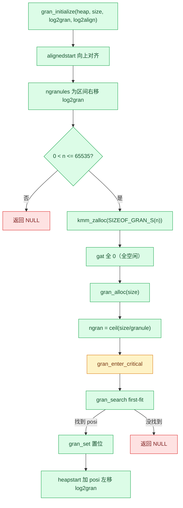
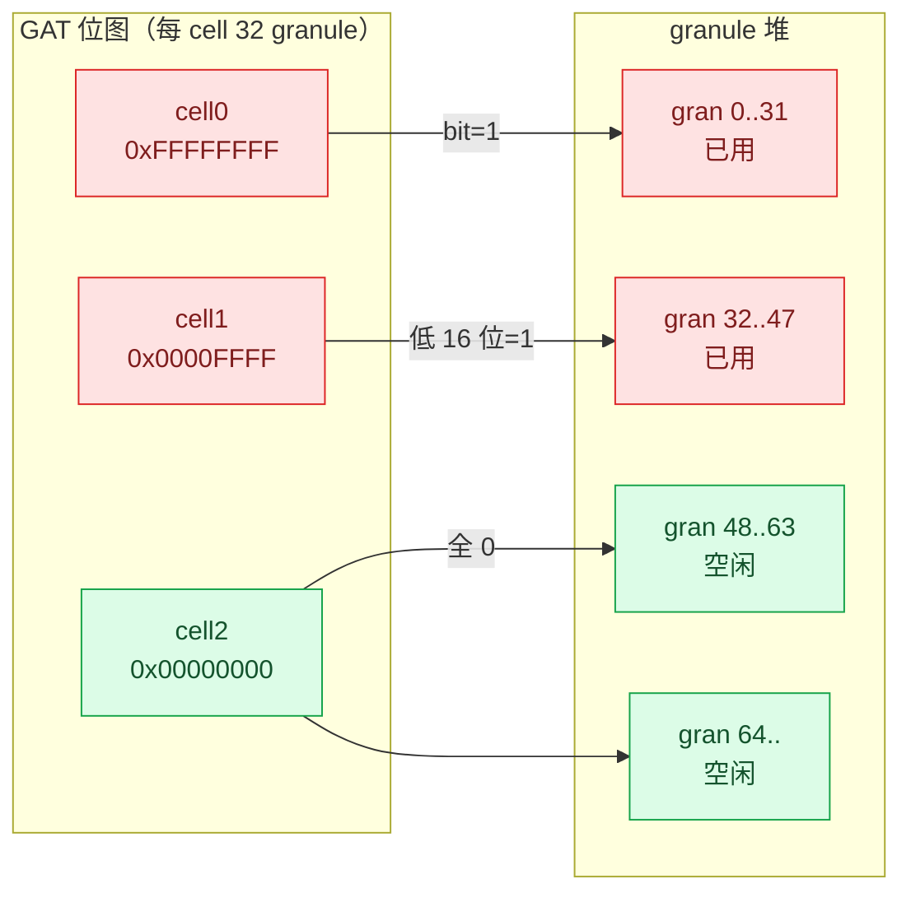

# mm/mm_gran/ —— 颗粒（granule）分配器

> 对应源文件：`mm/mm_gran/*.c`（共 9 个文件，1,781 行）
>
> 核心：`mm_graninit.c`（159 行）、`mm_granalloc.c`（131 行）、
> `mm_granfree.c`（74 行）、`mm_grantable.c`（313 行）、
> `mm_granreserve.c`（97 行）、`mm_pgalloc.c`（227 行）。
> 逐段解读见 [Docs/04-内存管理.md](../../../references/rtos/NuttX/Docs/04-内存管理.md)。

---

## 1. 一句话职责

把一块连续内存切成固定大小的 granule，用 **1 bit/granule 的位图（GAT）**
管理分配状态；它是页分配器、DMA 缓冲池、虚拟页号分配器的共同底座。

## 2. 核心结构

```c
struct gran_s
{
  uint8_t    log2gran;  /* Log base 2 of the size of one granule */
  uint8_t    log2align; /* Log base 2 of required alignment */
  uint16_t   ngranules; /* The total number of (aligned) granules in the heap */
#ifdef CONFIG_GRAN_INTR
  irqstate_t irqstate;  /* For exclusive access to the GAT */
  spinlock_t lock;
#else
  mutex_t    lock;       /* For exclusive access to the GAT */
#endif
  uintptr_t  heapstart; /* The aligned start of the granule heap */
  uint32_t   gat[1];    /* Start of the granule allocation table */
};
```

（`mm/mm_gran/mm_gran.h:74-84`）

| 字段 | 含义 | 约束 |
|---|---|---|
| `log2gran` | granule 大小 = `1 << log2gran` | 1..31 |
| `log2align` | 对齐 = `1 << log2align` | `<= log2gran` |
| `ngranules` | granule 总数 | 1..65535（`uint16_t`） |
| `heapstart` | 对齐后的堆起点 | 由 `gran_initialize()` 计算 |
| `gat[]` | 位图，1=已用，0=空闲 | 32 bit/cell |

`gat[1]` 是柔性数组；实际分配大小：

```c
#define SIZEOF_GAT(n) \
  ((n + 31) >> 5)
#define SIZEOF_GRAN_S(n) \
  (sizeof(struct gran_s) + sizeof(uint32_t) * (SIZEOF_GAT(n) - 1))
```

（`mm_gran.h:44-47`）

## 3. 逐函数表

| 函数 | 文件:行号 | 作用 |
|---|---|---|
| `gran_initialize()` | `mm_graninit.c:96` | 计算对齐、granule 数、分配 `gran_s` |
| `gran_release()` | `mm_granrelease.c:58` | 释放 `gran_s` |
| `gran_alloc()` | `mm_granalloc.c:43` | first-fit 分配 |
| `gran_alloc_align()` | `mm_granalloc.c:84` | 带对齐的分配 |
| `gran_free()` | `mm_granfree.c:43` | 释放并清位 |
| `gran_reserve()` | `mm_granreserve.c:43` | 预留一段（标记已用） |
| `gran_info()` | `mm_graninfo.c:486` | 统计空闲 granule 数 |
| `gran_range()` | `mm_grantable.c:133` | 计算起止 cell/掩码 |
| `gran_match()` | `mm_grantable.c:169` | 检查一段是否全空/全用 |
| `gran_search()` | `mm_grantable.c:260` | 线性扫描 first-fit |
| `gran_set()` | `mm_grantable.c:285` | 置位一段 |
| `gran_clear()` | `mm_grantable.c:300` | 清位一段 |
| `gran_enter_critical()` | `mm_grancritical.c:59` | 拿锁/关中断 |
| `gran_leave_critical()` | `mm_grancritical.c:69` | 放锁/恢复中断 |
| `mm_pginitialize()` | `mm_pgalloc.c:99` | 页分配器初始化 |
| `mm_pgalloc()` | `mm_pgalloc.c:148` | 分配 npages 页 |
| `mm_pgfree()` | `mm_pgalloc.c:194` | 释放页 |
| `mm_pginfo()` | `mm_pgalloc.c:215` | 页统计 |

## 4. 逐字摘录

### 4.1 `gran_initialize()`：对齐与 granule 数

```c
  DEBUGASSERT(heapstart && heapsize > 0 &&
              log2gran > 0 && log2gran < 32 &&
              log2gran >= log2align);

  /* Get the aligned start of the heap */

  mask         = (1 << log2align) - 1;
  alignedstart = ((uintptr_t)heapstart + mask) & ~mask;

  /* Determine the number of granules */

  mask         = (1 << log2gran) - 1;
  heapend      = (uintptr_t)heapstart + heapsize;
  alignedsize  = (heapend - alignedstart) & ~mask;
  ngranules    = alignedsize >> log2gran;

  /* Reject oversized pools. */

  DEBUGASSERT(ngranules > 0 && ngranules <= UINT16_MAX);
  if (ngranules == 0 || ngranules > UINT16_MAX)
    {
      return NULL;
    }
```

（`mm_graninit.c:111-133`）

注意 `heapend` 用的是**未对齐**的 `heapstart + heapsize`，而
`alignedstart` 是向上对齐的；两者相减后再按 granule 向下取整，
所以尾部不足一个 granule 的字节会被丢弃。

### 4.2 `gran_alloc()`：first-fit

```c
  ngran = NGRANULE(gran, size);
  if (!ngran || ngran > gran->ngranules)
    {
      return NULL;
    }

  ret = gran_enter_critical(gran);
  if (ret < 0)
    {
      return NULL;
    }

  posi = gran_search(gran, ngran);
  if (posi >= 0)
    {
      gran_set(gran, posi, ngran);
    }

  gran_leave_critical(gran);
  if (posi < 0)
    {
      return NULL;
    }

  retp = gran->heapstart + (posi << gran->log2gran);
```

（`mm_granalloc.c:52-76`）

`NGRANULE(g, s)` 的定义：

```c
#define NGRANULE(g, s)      ((s + GRANMASK(g)) >> g->log2gran)
```

（`mm_grantable.h:34`）

即 `ceil(s / granule_size)`。

### 4.3 `gran_search()` 与 `gran_match()`

```c
int gran_search(const gran_t *gran, size_t size)
{
  int ret = -EINVAL;
  size_t i;

  if (gran == NULL || gran->ngranules < size)
    {
      return ret;
    }

  ret = -ENOMEM;
  for (i = 0; i <= gran->ngranules - size; i++)
    {
      if (gran_match(gran, i, size, 0, &i))
        {
          ret = i;
          break;
        }
    }

  return ret;
}
```

（`mm_grantable.c:260-281`）

`gran_match()` 用 `gran_range()` 把 `[posi, posi+size)` 映射成
"起始 cell + 结束 cell + 掩码"，然后：

- 若起止在同一 cell，只比较 `smask & emask`；
- 否则先比较结束 cell 的 `emask`、中间整 cell 是否 `GATCFULL`、
  起始 cell 的 `smask`。

`gran_range()`：

```c
  rang->sidx = posi / rang->width;
  rang->soff = posi % rang->width;

  posi += size - 1;
  rang->eidx = posi / GATC_BITS(gran);
  rang->eoff = posi % GATC_BITS(gran);

  rang->smask = ~(BIT(rang->soff) - 1);
  rang->emask = (BIT(rang->eoff) - 1) | BIT(rang->eoff);
```

（`mm_grantable.c:148-156`）

`smask` 是"从 soff 到 cell 末尾全 1"，`emask` 是"从 cell 开头到 eoff 全 1"。

### 4.4 `gran_free()`：双释放检测

```c
  do
    {
      ret = gran_enter_critical(gran);
      DEBUGASSERT(ret == OK || ret == -ECANCELED);
    }
  while (ret < 0);  /* Retry upon task cancellation */

  /* check double free */

  DEBUGASSERT(gran_match(gran, posi, ngran, 1, NULL));
  gran_clear(gran, posi, ngran);
  gran_leave_critical(gran);
```

（`mm_granfree.c:60-71`）

`gran_enter_critical()` 在等互斥量时如果被信号取消，返回 `-ECANCELED`；
这里选择**重试**而不是把错误抛给调用者，因为 `free` 语义上不能失败。

### 4.5 页分配器：`mm_pgalloc`

```c
void mm_pginitialize(FAR void *heap_start, size_t heap_size)
{
  g_pgalloc = gran_initialize(heap_start, heap_size, MM_PGSHIFT, MM_PGSHIFT);
  DEBUGASSERT(g_pgalloc != NULL);
}
...
uintptr_t mm_pgalloc(unsigned int npages)
{
  return (uintptr_t)gran_alloc(g_pgalloc, (size_t)npages << MM_PGSHIFT);
}
```

（`mm_pgalloc.c:99-151`）

页分配器就是 `log2gran = log2align = MM_PGSHIFT` 的 gran 实例。
`mm_pgalloc()` 返回的是**物理地址**，在 MMU 系统里还要
`up_addrenv_vaddr()` 映射后才能用。

## 5. GAT 位图与分配





## 6. 量化

| granule | 堆大小 | granule 数 | GAT 字节 | 开销 |
|---:|---:|---:|---:|---:|
| 16 B | 64 KiB | 4096 | 512 | 0.78% |
| 64 B | 64 KiB | 1024 | 128 | 0.20% |
| 64 B | 4 MiB | 65536 | 8192 | 0.20% |
| 4 KiB（页） | 16 MiB | 4096 | 512 | 0.003% |

- 最大堆 = `65535 << log2gran`；64 B 时约 4 MiB，4 KiB 时约 256 MiB。
- `gran_search()` 最坏 O(n)，n 为 granule 数；`gran_match()` 每个 cell
  一次 32 位比较，实际是 O(n/32)。
- 分配粒度浪费：申请 47 B、granule 64 B 时浪费 17 B（26.6%）。

## 7. 陷阱与读码建议

- **`ngranules` 是 16 位**：4 MiB/64 B 刚好 65536，会被拒绝；
- **`gran_alloc()` 不保证字节对齐，只保证 granule 对齐**；
- **`gran_free()` 必须传原始 `size`**：它用 `NGRANULE()` 重算，传大了会清掉别人的位；
- **`gran_reserve()` 与 `gran_alloc()` 不同**：前者只置位不返回内存，
  用于"把某段物理内存从池里挖掉"；
- **`CONFIG_GRAN_INTR` 用关中断而不是互斥量**：适合中断里分配的场景，
  但临界区会变长；
- **读码顺序**：`mm_gran.h` → `mm_grantable.h` 的宏 → `mm_graninit.c`
  → `mm_grantable.c` 的 `gran_range()/gran_match()/gran_search()`
  → `mm_granalloc.c` → `mm_granfree.c` → `mm_pgalloc.c`。
