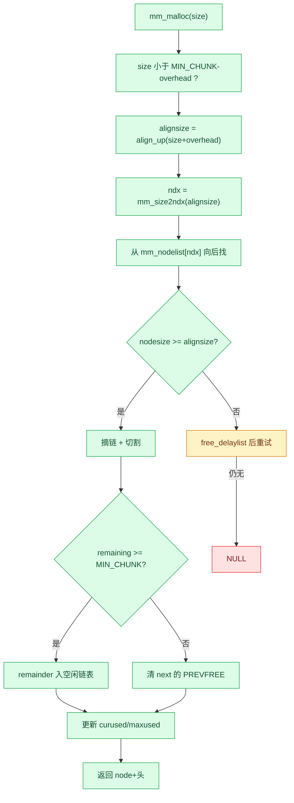
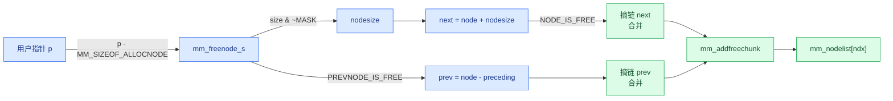

# mm/mm_heap/ —— 通用字节堆

> 对应源文件：`mm/mm_heap/*.c`（共 17 个文件，3,324 行）
>
> 核心：`mm_initialize.c`（410 行）、`mm_malloc.c`（413 行）、
> `mm_free.c`（256 行）、`mm_shrinkchunk.c`（132 行）、`mm_extend.c`（121 行）、
> `mm_memalign.c`（294 行）、`mm_realloc.c`（431 行）、`mm_mallinfo.c`（222 行）。
> 逐段解读见 [Docs/04-内存管理.md](../../../references/rtos/NuttX/Docs/04-内存管理.md)。

---

## 1. 一句话职责

用"边界标记 + 分箱空闲链表"实现 `malloc/free/realloc/memalign`，
在 O(1) 合并、O(log n + k) 分配之间取折中；它不管理页表，也不管
`mm_gran` 的固定粒度块。

## 2. 核心结构

### 2.1 已分配块头

```c
struct mm_allocnode_s
{
  mmsize_t preceding;                       /* Physical preceding chunk size */
  mmsize_t size;                            /* Size of this chunk */
#if CONFIG_MM_BACKTRACE >= 0
  pid_t pid;                                /* The pid for caller */
#  ifdef CONFIG_MM_BACKTRACE_SEQNO
  unsigned long seqno;                      /* The sequence of memory malloc */
#  endif
#  if CONFIG_MM_BACKTRACE > 0
  FAR void *backtrace[CONFIG_MM_BACKTRACE]; /* The backtrace buffer for caller */
#  endif
#endif
};
```

（`mm/mm_heap/mm.h:175-188`）

| 字段 | 含义 |
|---|---|
| `preceding` | 物理前一块的大小；`free` 时 `node - preceding` 找前块 |
| `size` | 本块大小，低 2 位是标志：bit0 `MM_ALLOC_BIT`、bit1 `MM_PREVFREE_BIT` |
| `pid/seqno/backtrace` | 调试信息，`CONFIG_MM_BACKTRACE` 控制 |

### 2.2 空闲块

```c
struct mm_freenode_s
{
  mmsize_t preceding;                       /* Physical preceding chunk size */
  mmsize_t size;                            /* Size of this chunk */
#if CONFIG_MM_BACKTRACE >= 0
  pid_t pid;                                /* The pid for caller */
  unsigned long seqno;                      /* The sequence of memory malloc */
...
  FAR struct mm_freenode_s *flink;          /* Supports a doubly linked list */
  FAR struct mm_freenode_s *blink;
};
```

（`mm/mm_heap/mm.h:192-206`，节选）

空闲块在已分配块头之后多了 `flink/blink`，所以
`MM_MIN_CHUNK = 1 << LOG2_CEIL(sizeof(struct mm_freenode_s))`（`mm.h:114`）。
32 位、`MM_BACKTRACE=-1` 时 `sizeof(mm_freenode_s)=16`，故 `MM_MIN_CHUNK=16 B`。

### 2.3 堆对象

```c
struct mm_heap_s
{
  /* Mutex for controlling access to this heap */

  mutex_t mm_lock;

  /* This is the size of the heap provided to mm */

  size_t mm_heapsize;

  /* This is the heap maximum used memory size */

  size_t mm_maxused;

  /* This is the current used size of the heap */

  size_t mm_curused;

  /* The first and last allocated nodes of each region */

  FAR struct mm_allocnode_s *mm_heapstart[CONFIG_MM_REGIONS];
  FAR struct mm_allocnode_s *mm_heapend[CONFIG_MM_REGIONS];
...
  struct mm_freenode_s mm_nodelist[MM_NNODES];

  /* Free delay list, as sometimes we can't do free immdiately. */

  FAR struct mm_delaynode_s *mm_delaylist[CONFIG_SMP_NCPUS];
...
};
```

（`mm/mm_heap/mm.h:221-270`，节选）

`MM_NNODES = MM_MAX_SHIFT - MM_MIN_SHIFT + 1`（`mm.h:116`）：
默认 `MM_MAX_SHIFT=22`、`MM_MIN_SHIFT=4`，所以 19 个 bin。

## 3. 逐函数表

| 函数 | 文件:行号 | 作用 |
|---|---|---|
| `mm_initialize_heap()` | `mm_initialize.c:235` | 初始化堆结构 + 添加首个 region |
| `mm_initialize_pool()` | `mm_initialize.c:314` | 带 mempool 的初始化 |
| `mm_addregion()` | `mm_initialize.c:103` | 添加一段内存，建 guard node |
| `mm_uninitialize()` | `mm_initialize.c:382` | 反初始化 |
| `mm_malloc()` | `mm_malloc.c:170` | 分配 |
| `mm_zalloc()` | `mm_zalloc.c:45` | 分配并清零 |
| `mm_calloc()` | `mm_calloc.c:43` | 乘法溢出检查 + 清零 |
| `mm_realloc()` | `mm_realloc.c:68` | 扩/缩/搬家 |
| `mm_memalign()` | `mm_memalign.c:55` | 对齐分配 |
| `mm_free()` | `mm_free.c:232` | 释放入口 |
| `mm_delayfree()` | `mm_free.c:84` | 实际释放/合并 |
| `mm_free_delaylist()` | `mm_malloc.c:151` | 强制清空 delay list |
| `mm_shrinkchunk()` | `mm_shrinkchunk.c:54` | 缩小/切出尾部 |
| `mm_extend()` | `mm_extend.c:54` | 把新块接到堆尾 |
| `mm_malloc_size()` | `mm_malloc_size.c:41` | 返回块大小 |
| `mm_brkaddr()` | `mm_brkaddr.c:48` | 返回 region 的 break 地址 |
| `mm_heapmember()` | `mm_heapmember.c:58` | 指针是否属于该堆 |
| `mm_mallinfo()` | `mm_mallinfo.c:128` | 统计 arena/used/free |
| `mm_heapfree_largest()` | `mm_mallinfo.c:205` | 最大连续空闲块 |

## 4. 逐字摘录

### 4.1 `mm_addregion()`：guard node 与首个空闲块

```c
  heapbase = MM_ALIGN_UP((uintptr_t)heapstart + 2 * MM_SIZEOF_ALLOCNODE) -
             2 * MM_SIZEOF_ALLOCNODE;
  heapsize = heapsize - (heapbase - (uintptr_t)heapstart);
...
  heap->mm_heapstart[idx]          = (FAR struct mm_allocnode_s *)heapbase;
  MM_ADD_BACKTRACE(heap, heap->mm_heapstart[idx]);
  heap->mm_heapstart[idx]->size    = MM_SIZEOF_ALLOCNODE | MM_ALLOC_BIT;
  node                             = (FAR struct mm_freenode_s *)
                                     (heapbase + MM_SIZEOF_ALLOCNODE);
  DEBUGASSERT((((uintptr_t)node + MM_SIZEOF_ALLOCNODE) % MM_ALIGN) == 0);
  node->size                       = heapsize - 2 * MM_SIZEOF_ALLOCNODE;
  heap->mm_heapend[idx]            = (FAR struct mm_allocnode_s *)
                                     (heapend - MM_SIZEOF_ALLOCNODE);
  heap->mm_heapend[idx]->size      = MM_SIZEOF_ALLOCNODE | MM_ALLOC_BIT |
                                     MM_PREVFREE_BIT;
  heap->mm_heapend[idx]->preceding = node->size;
  MM_ADD_BACKTRACE(heap, heap->mm_heapend[idx]);
```

（`mm_initialize.c:151-200`）

`2 * MM_SIZEOF_ALLOCNODE` 是首尾两个 guard 的预留；中间的 free node
`size = heapsize - 2*head`，不包含自己的头。

### 4.2 `mm_malloc()`：对齐与 best fit

```c
  if (size < MM_MIN_CHUNK - MM_ALLOCNODE_OVERHEAD)
    {
      size = MM_MIN_CHUNK - MM_ALLOCNODE_OVERHEAD;
    }

  alignsize = MM_ALIGN_UP(size + MM_ALLOCNODE_OVERHEAD);
  if (alignsize < size)
    {
      /* There must have been an integer overflow */

      return NULL;
    }

  DEBUGASSERT(alignsize >= MM_ALIGN);

  /* We need to hold the MM mutex while we muck with the nodelist. */

  DEBUGVERIFY(mm_lock(heap));

  /* Convert the request size into a nodelist index */

  ndx = mm_size2ndx(alignsize);

  /* Search for a large enough chunk in the list of nodes. This list is
   * ordered by size, but will have occasional zero sized nodes as we visit
   * other mm_nodelist[] entries.
   */

  for (node = heap->mm_nodelist[ndx].flink; node; node = node->flink)
    {
      DEBUGASSERT(node->blink->flink == node);
      nodesize = MM_SIZEOF_NODE(node);
      if (nodesize >= alignsize)
        {
          break;
        }
    }
```

（`mm_malloc.c:198-234`）

切割逻辑：

```c
      remaining = nodesize - alignsize;
      if (remaining >= MM_MIN_CHUNK)
        {
          /* Create the remainder node */

          remainder = (FAR struct mm_freenode_s *)
            (((FAR char *)node) + alignsize);

          remainder->size = remaining;

          /* Adjust the size of the node under consideration */

          node->size = alignsize | (node->size & MM_MASK_BIT);

          /* Adjust the 'preceding' size of the (old) next node. */

          next->preceding = remaining;

          /* Add the remainder back into the nodelist */

          mm_addfreechunk(heap, remainder);
        }
      else
        {
          /* Previous physical memory node is alloced, so clear the previous
           * free bit in next->size.
           */

          next->size &= ~MM_PREVFREE_BIT;
        }
```

（`mm_malloc.c:277-306`）

### 4.3 `mm_delayfree()`：合并

```c
  if (mm_lock(heap) < 0)
    {
      /* Meet -ESRCH return, which means we are in situations
       * during context switching(See mm_lock() & gettid()).
       * Then add to the delay list.
       */

      add_delaylist(heap, mem);
      return;
    }
```

（`mm_free.c:92-101`）

```c
      nodesize            += nextsize;
      node->size           = nodesize | (node->size & MM_MASK_BIT);
      andbeyond->preceding = nodesize;
      next                 = (FAR struct mm_freenode_s *)andbeyond;
    }
  else
    {
      next->size     |= MM_PREVFREE_BIT;
      next->preceding = nodesize;
    }
```

（`mm_free.c:176-185`）

### 4.4 `mm_extend()`：接一段新内存

```c
  oldnode = heap->mm_heapend[region];
  DEBUGASSERT((uintptr_t)oldnode + MM_SIZEOF_ALLOCNODE == blockstart);

  /* The size of the old node now extends to the new terminal node.
   * This is the old size (MM_SIZEOF_ALLOCNODE) plus the size of
   * the block (size) minus the size of the new terminal node
   * (MM_SIZEOF_ALLOCNODE) or simply:
   */

  oldnode->size = size | (oldnode->size & MM_MASK_BIT);

  /* The old node should already be marked as allocated */

  DEBUGASSERT(MM_NODE_IS_ALLOC(oldnode));

  /* Get and initialize the new terminal node in the heap */

  newnode       = (FAR struct mm_allocnode_s *)
                  (blockend - MM_SIZEOF_ALLOCNODE);
  newnode->size = MM_SIZEOF_ALLOCNODE | MM_ALLOC_BIT;

  heap->mm_heapend[region] = newnode;
```

（`mm_extend.c:88-109`）

## 5. 分配/释放流程





## 6. 量化

| 项目 | 默认配置（32 位，`MM_BACKTRACE=-1`） | 打开 `MM_BACKTRACE=0` |
|---|---:|---:|
| `sizeof(mm_allocnode_s)` | 8 B | 12 B |
| `MM_ALLOCNODE_OVERHEAD` | 4 B | 8 B |
| `sizeof(mm_freenode_s)` | 16 B | 20 B |
| `MM_MIN_CHUNK` | 16 B | 32 B |
| `MM_MAX_CHUNK` | 4 MiB | 4 MiB |
| `MM_NNODES` | 19 | 19 |
| 8 B 对齐 | `CONFIG_MM_DEFAULT_ALIGNMENT=8` | 同左 |

一次 64 B 请求的实际占用：`align_up(64+4)=72 B`，其中用户 64 B，
头 8 B（4 B `preceding` 算在前一块）。碎片率约 11%。

## 7. 陷阱与读码建议

- **`free()` 可能延迟**：`mm_lock()` 返回 `-ESRCH` 时挂
  `mm_delaylist[this_cpu()]`，不是错误；
- **`MM_BACKTRACE` 改变 `MM_MIN_CHUNK`**：调试开关会影响碎片率；
- **`mm_realloc()` 可能搬家**：只有"下一块空闲且足够"才原地扩；
- **`mm_malloc_size()` 返回的是 chunk 大小，不是用户请求大小**；
- **`mm_heapmember()` 只检查 region 范围**，不保证指针是块首；
- **读码顺序**：`mm.h` 节点结构 → `mm_initialize.c` 的 `mm_addregion()`
  → `mm_malloc.c` → `mm_free.c` → `mm_shrinkchunk.c` → `mm_realloc.c`。
