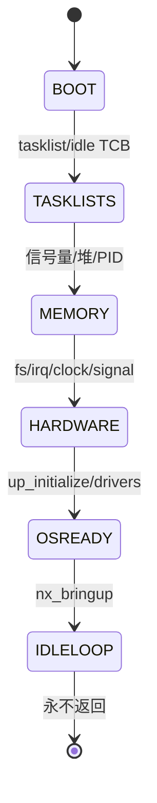

# nx_start.c —— NuttX 内核总初始化入口

> 对应源文件：`sched/init/nx_start.c`（共 772 行）
>
> 关联文件：`sched/init/nx_bringup.c`（`nx_bringup()` 在 496 行）、
> `include/nuttx/init.h`（`enum nx_initstate_e`）、
> `include/nuttx/sched.h`（`struct tcb_s` / `struct tasklist_s`）。
> 逐段解读见 [Docs/01-启动流程与初始化链.md](../../../references/rtos/NuttX/Docs/01-启动流程与初始化链.md)。

---

## 1. 一句话职责

`nx_start()` 是 **C 世界的第一个内核函数**：它把静态的 `g_idletcb[]` 变成
可调度的 IDLE 任务，按固定顺序初始化信号量、堆、文件系统、中断、时钟、
驱动，最后创建 init 线程并进入 `up_idle()` 循环；此后永不返回。

## 2. 全局表与全局变量

| 符号 | 行号 | 类型 | 含义 | 谁写 |
|---|---:|---|---|---|
| `g_readytorun` | 95 | `dq_queue_t` | 就绪队列（单核时表头=当前任务） | `nxsched_add_readytorun()` |
| `g_assignedtasks[]` | 118 | `struct tcb_s *[]` | SMP 每 CPU 当前任务 | `nxsched_switch_running()` |
| `g_running_tasks[]` | 124 | `struct tcb_s *[]` | 每 CPU 运行任务（中断上下文有效） | 调度器 |
| `g_pendingtasks` | 133 | `dq_queue_t` | 抢占被禁止时的高优先级任务 | `nxsched_add_readytorun()` |
| `g_waitingforsignal` | 138 | `dq_queue_t` | 等信号的 TCB | `sig_suspend.c` |
| `g_waitingforfill` | 143 | `dq_queue_t` | 等缺页填充（legacy paging） | `pg_worker` |
| `g_stoppedtasks` | 151 | `dq_queue_t` | 被 SIGSTOP 停止的 TCB | `sig_default.c` |
| `g_inactivetasks` | 158 | `dq_queue_t` | 已初始化未激活 | `nxtask_setup_scheduler()` |
| `g_lastpid` | 162 | `volatile pid_t` | 最近分配的 PID | `nxtask_assign_pid()` |
| `g_pidhash` | 171 | `struct tcb_s **` | PID → TCB 哈希表 | `nxtask_assign_pid()` |
| `g_npidhash` | 172 | `volatile int` | 哈希表大小（2 的幂） | `nx_start()` / 扩容 |
| `g_tasklisttable[]` | 181 | `struct tasklist_s[]` | 状态 → 队列/属性映射 | `tasklist_initialize()` |
| `g_nx_initstate` | 188 | `volatile enum` | 初始化阶段 | `nx_start()` |
| `g_idletcb[]` | 198 | `struct tcb_s[]` | 每 CPU 的 IDLE TCB（静态） | `idle_task_initialize()` |

`g_tasklisttable` 的 `attr` 只有三种位（见 `sched/sched/sched.h`）：

- `TLIST_ATTR_PRIORITIZED`：插入时按优先级排序；
- `TLIST_ATTR_RUNNABLE`：该队列上的任务可被调度；
- `TLIST_ATTR_OFFSET`：`list` 字段存的是成员偏移，不是队列地址。

## 3. 逐函数表

| 函数 | 行号 | 作用 | 关键依赖 |
|---|---:|---|---|
| `tasklist_initialize()` | 226 | 填 `g_tasklisttable[]` | 无（纯静态） |
| `idle_task_initialize()` | 328 | 为每 CPU 建 IDLE TCB | `g_idletcb[]`、`up_update_task()` |
| `idle_group_initialize()` | 430 | 给 IDLE 建 group、PID 哈希、TLS | `group_allocate()`、`tls_init_info()` |
| `nx_start()` | 502 | 总初始化 | 以上 + 几乎所有子系统 |

### 3.1 `tasklist_initialize()`（226-318）

按 `TSTATE_*` 枚举顺序填表。最关键的是 READY/RUNNING 共用
`list_readytorun()`：

```c
  /* TSTATE_TASK_READYTORUN */

  tlist[TSTATE_TASK_READYTORUN].list = list_readytorun();
  tlist[TSTATE_TASK_READYTORUN].attr = TLIST_ATTR_PRIORITIZED |
                                       TLIST_ATTR_RUNNABLE;

  /* TSTATE_TASK_RUNNING */

  tlist[TSTATE_TASK_RUNNING].list = list_readytorun();
  tlist[TSTATE_TASK_RUNNING].attr = TLIST_ATTR_PRIORITIZED |
                                    TLIST_ATTR_RUNNABLE;
```

（`nx_start.c:246-255`）

`TSTATE_WAIT_SEM` 用偏移而不是队列地址：

```c
  tlist[TSTATE_WAIT_SEM].list = (FAR void *)offsetof(sem_t, waitlist);
  tlist[TSTATE_WAIT_SEM].attr = TLIST_ATTR_PRIORITIZED |
                                TLIST_ATTR_OFFSET;
```

（`nx_start.c:276-278`）

这样 `nxsched_add_blocked()` 可以直接把 TCB 挂到"某个信号量的
`waitlist` 成员"上，不需要为每种等待对象维护全局队列。

### 3.2 `idle_task_initialize()`（328-419）

- `memset(g_idletcb, 0, sizeof(g_idletcb))`：IDLE TCB 全部从 0 开始；
- `tcb->pid = i`：CPU0 的 IDLE pid=0，CPU1 的 pid=1……；
- `tcb->lockcount = 1`：IDLE 默认不可被抢占；
- `tcb->start = nx_start`（CPU0）/ `nx_idle_trampoline`（CPU>0）；
- `tcb->flags = TCB_FLAG_TTYPE_KERNEL`，SMP 下再加 `TCB_FLAG_CPU_LOCKED`；
- `dq_addfirst(tcb, TLIST_HEAD(tcb))`：IDLE 直接进就绪队列头。

### 3.3 `idle_group_initialize()`（430-483）

```c
      hashndx = PIDHASH(i);
      g_pidhash[hashndx] = tcb;

      /* Allocate the IDLE group */

      DEBUGVERIFY(
        group_allocate(tcb, tcb->flags));

      /* Initialize the task join */

      nxtask_joininit(tcb);
...
      /* Initialize the processor-specific portion of the TCB */

      up_initial_state(tcb);

      /* Initialize the thread local storage */

      tls_init_info(tcb);

      /* Complete initialization of the IDLE group.  Suppress retention
       * of child status in the IDLE group.
       */

      group_initialize(tcb);
      tcb->group->tg_flags = GROUP_FLAG_NOCLDWAIT | GROUP_FLAG_PRIVILEGED;
```

（`nx_start.c:438-478`，节选）

IDLE 组被强制标记为 `GROUP_FLAG_PRIVILEGED`，因为内核线程的 group
必须能访问内核堆。

## 4. `nx_start()` 的阶段表

| 行号 | 动作 | 状态/标记 |
|---:|---|---|
| 510 | `g_nx_initstate = OSINIT_BOOT` | BOOT |
| 515 | `tasklist_initialize()` | — |
| 519 | `idle_task_initialize()` | — |
| 523 | `g_nx_initstate = OSINIT_TASKLISTS` | TASKLISTS |
| 528 | `drivers_early_initialize()` | — |
| 538 | `nxsem_initialize()` | — |
| 554/563/573 | `kumm_initialize` / `kmm_initialize` / `mm_pginitialize` | — |
| 593 | `iob_initialize()` | — |
| 611 | `idle_group_initialize()` | — |
| 617 | `g_nx_initstate = OSINIT_MEMORY` | MEMORY |
| 622 | `task_initialize()` | — |
| 630 | `fs_initialize()` | — |
| 634 | `irq_initialize()` | — |
| 638 | `clock_initialize()` | — |
| 647 | `nxsig_initialize()` | — |
| 676 | `up_initialize()` | — |
| 680 | `drivers_initialize()` | — |
| 689 | `board_early_initialize()` | — |
| 695 | `g_nx_initstate = OSINIT_HARDWARE` | HARDWARE |
| 721 | `group_setupidlefiles()` | 建 fd 0/1/2 |
| 734 | `nx_smp_start()` | 启动其他 CPU |
| 742 | `g_nx_initstate = OSINIT_OSREADY` | OSREADY |
| 747 | `nx_bringup()` | 建 init 线程 |
| 751 | `g_nx_initstate = OSINIT_IDLELOOP` | IDLELOOP |
| 757 | `sched_unlock()` | 允许调度 |
| 769 | `up_idle()` | 死循环 |

## 5. 逐字摘录

### 5.1 入口与 BOOT 阶段

```c
void nx_start(void)
{
  int i;

  sinfo("Entry\n");

  /* Boot up is complete */

  g_nx_initstate = OSINIT_BOOT;
  sched_trace_mark("BOOT");

  /* Initialize task list table *********************************************/

  tasklist_initialize();

  /* Initialize the IDLE task TCB *******************************************/

  idle_task_initialize();

  /* Task lists are initialized */

  g_nx_initstate = OSINIT_TASKLISTS;
  sched_trace_mark("TASKLISTS");
```

（`nx_start.c:502-524`）

### 5.2 文件系统/中断/时钟/信号

```c
  /* Initialize the file system (needed to support device drivers) */

  fs_initialize();

  /* Initialize the interrupt handling subsystem (if included) */

  irq_initialize();

  /* Initialize the POSIX timer facility (if included in the link) */

  clock_initialize();

#ifndef CONFIG_DISABLE_POSIX_TIMERS
  timer_initialize();
#endif

  /* Initialize the signal facility (if in link) */

#ifndef CONFIG_DISABLE_ALL_SIGNALS
  nxsig_initialize();
#endif
```

（`nx_start.c:628-648`）

### 5.3 进入多任务

```c
  /* The OS is fully initialized and we are beginning multi-tasking */

  g_nx_initstate = OSINIT_OSREADY;
  sched_trace_mark("OSREADY");

  /* Create initial tasks and bring-up the system */

  DEBUGVERIFY(nx_bringup());

  /* Enter to idleloop */

  g_nx_initstate = OSINIT_IDLELOOP;
  sched_trace_mark("IDLELOOP");

  /* Let other threads have access to the memory manager */

  sched_trace_end();
  sched_unlock();
```

（`nx_start.c:742-757`）

## 6. 状态机



## 7. 初始化依赖图


## 8. 陷阱与读码建议

- **`nx_start()` 永不返回**：末尾 `for (;;) up_idle()`（761-771 行），
  不要在它后面加清理代码。
- **`g_nx_initstate` 是契约不是日志**：堆初始化之前不能 `kmm_malloc`，
  硬件初始化之前不能等中断。
- **`idle_group_initialize()` 在 `OSINIT_MEMORY` 之前调用**：
  它内部会 `kmm_zalloc`，所以 `g_nx_initstate` 在 611 行之前不能设成
  `OSINIT_MEMORY`；实际代码是在 617 行才设，顺序正确。
- **`g_pidhash` 扩容**：`nx_start()` 按 `LOG2_CEIL(CONFIG_PID_INITIAL_COUNT)`
  向上取 2 的幂（595-607 行），至少覆盖 `CONFIG_SMP_NCPUS`。
- **`group_setupidlefiles()` 必须在 `nx_bringup()` 之前**：init 线程要继承
  fd 0/1/2。
- **读码建议**：先读 `include/nuttx/init.h` 的状态枚举，再按第 4 节表格
  逐行对照；不要跳过条件编译块，`CONFIG_MM_KERNEL_HEAP` /
  `CONFIG_SMP` 会改变调用顺序。
