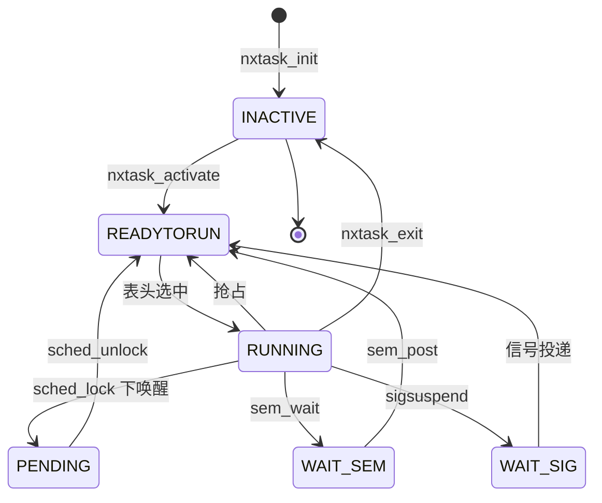
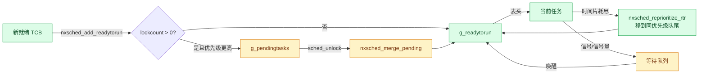

# sched/sched/ —— 调度器核心

> 对应源文件：`sched/sched/*.c`（共 51 个文件，10,977 行；核心 12 个文件约 3,400 行）
>
> 重点文件：`sched_addreadytorun.c`（289 行）、`sched_switchcontext.c`（100 行）、
> `sched_setpriority.c`（约 330 行）、`sched_reprioritize.c`（约 130 行）、
> `sched_roundrobin.c`（约 320 行）、`sched_sporadic.c`（约 750 行）、
> `sched_processtick.c`（约 230 行）、`sched_releasetcb.c`（195 行）。
> 逐段解读见 [Docs/02-调度器与任务管理.md](../../../references/rtos/NuttX/Docs/02-调度器与任务管理.md)。

---

## 1. 一句话职责

`sched/sched/` 实现"任务状态迁移 + 队列维护 + 时间片记账"，
它**不保存寄存器**（那是 `arch/` 的事），也不创建 TCB（那是 `sched/task/` 的事）。

## 2. 核心数据结构

| 结构/符号 | 定义位置 | 含义 |
|---|---|---|
| `struct tcb_s` | `include/nuttx/sched.h:583` | 调度实体，含 `flink/blink`、`sched_priority`、`task_state` |
| `g_readytorun` | `sched/init/nx_start.c:95` | 就绪队列，降序 |
| `g_pendingtasks` | `nx_start.c:133` | 抢占被禁止时的暂存队列 |
| `g_assignedtasks[]` | `nx_start.c:118` | SMP 每 CPU 当前任务 |
| `g_tasklisttable[]` | `nx_start.c:181` | `TSTATE_*` → 队列/属性 |
| `nxsched_add_prioritized()` | `sched/sched/sched.h:477` | 有序插入的唯一实现 |

`nxsched_add_prioritized()` 的关键循环（`sched.h:493-495`）：

```c
  for (next = (FAR struct tcb_s *)list->head;
       (next && sched_priority <= next->sched_priority);
       next = next->flink);
```

降序 + `<=` 保证同优先级 FIFO。

## 3. 逐函数表

| 函数 | 文件:行号 | 作用 | 调用者 |
|---|---|---|---|
| `nxsched_add_readytorun()` | `sched_addreadytorun.c:79` | 插入就绪/ pending 队列 | `nxtask_activate()`、信号唤醒、`sem_post()` |
| `nxsched_switch_running()` | `sched_addreadytorun.c:162` | SMP 下切换当前 CPU 的表头 | `nxsched_process_roundrobin()` |
| `nxsched_add_blocked()` | `sched_addblocked.c:59` | 按 `task_state` 挂到等待队列 | `sem_wait()`、`mq_receive()` |
| `nxsched_remove_blocked()` | `sched_removeblocked.c:58` | 从等待队列摘除 | `nxtask_activate()`、超时 |
| `nxsched_switch_context()` | `sched_switchcontext.c:50` | 记账（RR/sporadic/critmon/trace），不换栈 | `nxtask_exit()`、`arm_doirq()` |
| `nxsched_set_priority()` | `sched_setpriority.c:281` | 改变优先级并重新排位 | `sched_setparam()` |
| `nxsched_reprioritize()` | `sched_reprioritize.c:68` | 通用的"改优先级 + 可能切换" | `nxsched_set_priority()` |
| `nxsched_reprioritize_rtr()` | `sched_reprioritizertr.c:58` | 把任务移到同优先级队尾 | `nxsched_process_roundrobin()` |
| `nxsched_process_roundrobin()` | `sched_roundrobin.c:127` | tick 里递减时间片 | `nxsched_cpu_scheduler()` |
| `nxsched_suspend_roundrobin()` | `sched_roundrobin.c:253` | tickless 下暂停记账 | `nxsched_switch_context()` |
| `nxsched_resume_roundrobin()` | `sched_roundrobin.c:280` | tickless 下恢复记账 | `nxsched_switch_context()` |
| `nxsched_process_sporadic()` | `sched_sporadic.c`（约 700 行后） | sporadic 预算递减 | `nxsched_cpu_scheduler()` |
| `nxsched_process_timer()` | `sched_processtick.c:169` | tick 总入口 | `arm_systick`/定时器 ISR |
| `nxsched_merge_pending()` | `sched_mergepending.c:64` | 把 `g_pendingtasks` 合并回就绪队列 | `sched_unlock()` |
| `nxsched_release_tcb()` | `sched_releasetcb.c:101` | 释放 TCB 资源 | `nxtask_exit()` |

## 4. 逐字摘录

### 4.1 抢占锁与 pending

```c
  if (nxsched_islocked_tcb(rtcb) &&
      rtcb->sched_priority < btcb->sched_priority)
    {
      /* Yes.  Preemption would occur!  Add the new ready-to-run task to the
       * g_pendingtasks task list for now.
       */

      nxsched_add_prioritized(btcb, list_pendingtasks());
      btcb->task_state = TSTATE_TASK_PENDING;
      ret = false;
    }

  /* Otherwise, add the new task to the ready-to-run task list */

  else if (nxsched_add_prioritized(btcb, list_readytorun()))
    {
      /* The new btcb was added at the head of the ready-to-run list.  It
       * is now the new active task!
       */

      DEBUGASSERT(!nxsched_islocked_tcb(rtcb) && !is_idle_task(btcb));

      btcb->task_state = TSTATE_TASK_RUNNING;
      btcb->flink->task_state = TSTATE_TASK_READYTORUN;
      up_update_task(btcb);
      ret = true;
    }
```

（`sched_addreadytorun.c:90-116`）

### 4.2 切换只记账

```c
void nxsched_switch_context(FAR struct tcb_s *from, FAR struct tcb_s *to)
{
  nxsched_checkstackoverflow(from);

#if CONFIG_RR_INTERVAL > 0 && defined(CONFIG_SCHED_TICKLESS)
  /* If the task being switched out uses round-robin scheduling, account
   * for the time it has consumed from its timeslice.
   */

  if ((from->flags & TCB_FLAG_POLICY_MASK) == TCB_FLAG_SCHED_RR)
    {
      nxsched_suspend_roundrobin(from);
    }
#endif

#ifdef CONFIG_SCHED_SPORADIC
  /* Perform sporadic schedule operations */

  if ((from->flags & TCB_FLAG_POLICY_MASK) == TCB_FLAG_SCHED_SPORADIC)
    {
      DEBUGVERIFY(nxsched_suspend_sporadic(from));
    }

  if ((to->flags & TCB_FLAG_POLICY_MASK) == TCB_FLAG_SCHED_SPORADIC)
    {
      DEBUGVERIFY(nxsched_resume_sporadic(to));
    }
#endif
```

（`sched_switchcontext.c:50-77`）

### 4.3 tick 入口

```c
void nxsched_process_timer(void)
{
#ifdef CONFIG_CLOCK_TIMEKEEPING
  /* Process wall time */

  clock_update_wall_time();
#endif

  /* Increment the system time (if in the link) */

  clock_increase_sched_ticks(1);

  /* Check if the currently executing task has exceeded its
   * timeslice.
   */

  nxsched_process_scheduler();

  /* Process watchdogs */

#ifdef CONFIG_HRTIMER
  hrtimer_process(clock_systime_nsec());
#else
  wd_timer(clock_systime_ticks());
#endif
```

（`sched_processtick.c:169-191`）

## 5. 状态迁移



## 6. 队列与切换路径



## 7. 量化与边界

- 优先级 0..255（`include/sys/types.h:83-85`），0 给 IDLE；
- 插入最坏 O(n)，n 为队列长度；同优先级 FIFO 摊还 O(1)；
- `nxsched_process_scheduler()` 每个 tick 遍历 `CONFIG_SMP_NCPUS` 个 CPU；
- RR 时间片 `CONFIG_RR_INTERVAL` ms，换算 `MSEC2TICK()`；
- 一次切换保存 `r2-r12,r14` 12 字（48 B），FPU 再加 `s16-s31` 16 字（64 B）。

## 8. 陷阱与读码建议

- **`g_readytorun` 表头是 RUNNING，不是"所有就绪任务"**；
- **`nxsched_switch_context()` 不换栈**：ARM 上真正切换在 `arm_doirq()` 返回；
- **`lockcount` 不是关中断**：`sched_lock()` 只禁调度；
- **SMP 分支**：`sched_addreadytorun.c:263` 是另一个同名实现，逻辑与单核不同；
- **`nxsched_reprioritize_rtr()` 是 RR 的核心技巧**：改回原优先级 = 移到队尾；
- **读码顺序**：`sched.h` 的 `nxsched_add_prioritized()` →
  `sched_addreadytorun.c` → `sched_switchcontext.c` → `sched_processtick.c`
  → `sched_roundrobin.c` → `sched_sporadic.c`。
