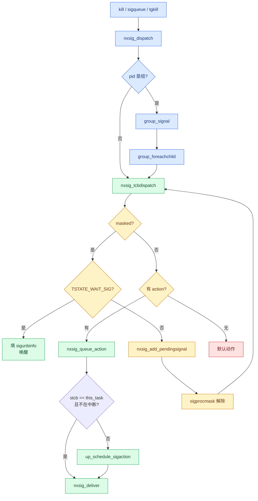
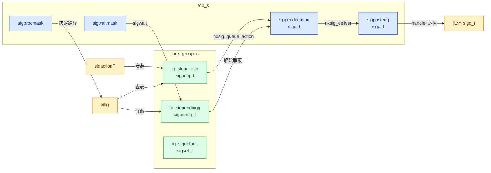

# sched/signal/ —— POSIX 信号实现

> 对应源文件：`sched/signal/*.c`（共 29 个文件，5,694 行）
>
> 核心：`sig_action.c`（469 行）、`sig_dispatch.c`（817 行）、
> `sig_deliver.c`（216 行）、`sig_procmask.c`（212 行）、
> `sig_default.c`（598 行）、`sig_initialize.c`（217 行）、
> `sig_timedwait.c`（314 行）、`sig_unmaskpendingsignal.c`（120 行）。
> 逐段解读见 [Docs/05-POSIX信号机制.md](../../../references/rtos/NuttX/Docs/05-POSIX信号机制.md)。

---

## 1. 一句话职责

把 `kill/sigqueue/tgkill` 产生的 `siginfo_t` 按 POSIX 规则
"屏蔽则挂起、未屏蔽则执行 handler"，并在任务被信号唤醒时返回 `EINTR`。

## 2. 三个队列

| 结构 | 定义 | 挂载点 | 数量级 | 作用 |
|---|---|---|---|---|
| `sigactq_t` | `signal.h:69` | `group->tg_sigactionq` | 每组一份 | 信号处置表 |
| `sigpendq_t` | `signal.h:82` | `group->tg_sigpendingq` | 每组一份 | 被屏蔽的待处理信号 |
| `sigq_t` | `signal.h:101` | `tcb->sigpendactionq` / `sigpostedq` | 每线程一份 | 待执行动作 |

```c
struct sigactq
{
  FAR struct sigactq *flink;     /* Forward link */
  struct sigaction act;          /* Sigaction data */
  uint8_t   signo;               /* Signal associated with action */
};
typedef struct sigactq  sigactq_t;

struct sigpendq
{
  FAR struct sigpendq *flink;    /* Forward link */
  FAR struct tcb_s *tcb;         /* TCB of thread to deliver to */
  siginfo_t info;                /* Signal information */
  uint8_t   type;                /* (Used to manage allocations) */
};
typedef struct sigpendq sigpendq_t;

struct sigq_s
{
  FAR struct sigq_s *flink;      /* Forward link */
  union
  {
    void (*sighandler)(int signo, siginfo_t *info, void *context);
  } action;                      /* Signal action */
  sigset_t  mask;                /* Additional signals to mask while the
                                  * the signal-catching function executes */
  siginfo_t info;                /* Signal information */
  uint8_t   type;                /* (Used to manage allocations) */
};
typedef struct sigq_s sigq_t;
```

（`sched/signal/signal.h:67-113`）

`type` 的取值：`SIG_ALLOC_FIXED`（预分配，永不释放）、
`SIG_ALLOC_DYN`（动态，空闲时归还）、`SIG_ALLOC_IRQ`（中断专用）。

## 3. 逐函数表

| 函数 | 文件:行号 | 作用 |
|---|---|---|
| `nxsig_initialize()` | `sig_initialize.c:183` | 预分配三类结构，挂全局空闲链表 |
| `nxsig_action()` | `sig_action.c:211` | 安装/查询处置（`sigaction` 包装在 428 行） |
| `nxsig_procmask()` | `sig_procmask.c:90` | 修改屏蔽字（`sigprocmask` 包装在 187 行） |
| `nxsig_kill()` | `sig_kill.c:78` | `kill()` 内部实现 |
| `nxsig_queue()` | `sig_queue.c:79` | `sigqueue()` 内部实现 |
| `nxsig_tgkill()` | `sig_tgkill.c:70` | 定向到线程 |
| `nxsig_tcbdispatch()` | `sig_dispatch.c:489` | 单 TCB 投递核心 |
| `nxsig_dispatch()` | `sig_dispatch.c`（约 760 行） | 按 pid 选组/线程 |
| `nxsig_deliver()` | `sig_deliver.c:55` | 执行 handler |
| `nxsig_unmask_pendingsignal()` | `sig_unmaskpendingsignal.c:50` | 解除屏蔽后补投 |
| `nxsig_timedwait()` | `sig_timedwait.c:102` | `sigtimedwait` |
| `pause()` / `sigsuspend()` | `sig_pause.c:64` / `sig_suspend.c:80` | 等信号 / 临时换屏蔽字 |
| `sigpending()` / `nxsig_pendingset()` | `sig_pending.c:61` / `80` | 查询待处理集合 |
| `nxsig_default()` | `sig_default.c`（约 497 行） | `SIG_DFL` 解析 |
| `nxsig_iscatchable()` | `sig_default.c:475` | 判断能否捕获 |
| `nxsig_cleanup()` / `nxsig_release()` | `sig_cleanup.c:47` / `84` | 线程/组退出清队列 |

## 4. 逐字摘录

### 4.1 `nxsig_action()`：安装

```c
int nxsig_action(int signo, FAR const struct sigaction *act,
                 FAR struct sigaction *oact, bool force)
{
  FAR struct tcb_s *rtcb = this_task();
  FAR struct task_group_s *group;
  FAR sigactq_t *sigact;
  _sa_handler_t handler;
  irqstate_t flags;

  /* Since sigactions can only be installed from the running thread of
   * execution, no special precautions should be necessary.
   */

  DEBUGASSERT(rtcb != NULL);

  group = rtcb->group;

  /* If the value of group is null, the task may have exited */

  if (group == NULL)
    {
      return -EINVAL;
    }

  /* Verify the signal number */

  if (!GOOD_SIGNO(signo))
    {
      return -EINVAL;
    }
```

（`sig_action.c:211-240`）

```c
#ifdef CONFIG_SIG_DEFAULT
  /* Check if the user is trying to catch or ignore a signal that cannot be
   * caught or ignored.
   */

  if (act != NULL && !force && act->sa_handler != SIG_DFL &&
      !nxsig_iscatchable(signo))
    {
      return -EINVAL;
    }
#endif

  /* Find the signal in the signal action queue */

  sigact = nxsig_find_action(group, signo);
```

（`sig_action.c:242-256`）

### 4.2 `nxsig_procmask()`：屏蔽字

```c
int nxsig_procmask(int how, FAR const sigset_t *set, FAR sigset_t *oset)
{
  FAR struct tcb_s *rtcb = this_task();
  irqstate_t flags;
  int        ret = OK;

  /* Return the old signal mask if requested */

  if (oset != NULL)
    {
      *oset = rtcb->sigprocmask;
    }

  /* Modify the current signal mask if so requested */

  if (set != NULL)
    {
      /* Some of these operations are non-atomic.  We need to protect
       * ourselves from attempts to process signals from interrupts
       */

      flags = enter_critical_section();

      /* Okay, determine what we are supposed to do */

      switch (how)
        {
          case SIG_BLOCK:
            sigorset(&rtcb->sigprocmask, &rtcb->sigprocmask, set);
            break;

          case SIG_UNBLOCK:
            nxsig_nandset(&rtcb->sigprocmask, &rtcb->sigprocmask, set);
            break;

          case SIG_SETMASK:
            rtcb->sigprocmask = *set;
            break;

          default:
            ret = -EINVAL;
            break;
        }

      leave_critical_section(flags);

      /* Now, process any pending signals that were just unmasked */

      nxsig_unmask_pendingsignal();
    }

  return ret;
}
```

（`sig_procmask.c:90-152`）

### 4.3 `nxsig_tcbdispatch()`：屏蔽分支

```c
  masked = nxsig_ismember(&stcb->sigprocmask, info->si_signo);
...
  if ((masked == 1) || (stcb->flags & TCB_FLAG_SYSCALL) != 0)
    {
      /* Check if the task is waiting for this pending signal. If so, then
       * unblock it. This must be performed in a critical section because
       * signals can be queued from the interrupt level.
       */

      if (stcb->task_state == TSTATE_WAIT_SIG &&
          (masked == 0 ||
           (nxsig_ismember(&stcb->sigwaitmask, info->si_signo) == 1)))
        {
          if (stcb->sigunbinfo != NULL)
            {
              memcpy(stcb->sigunbinfo, info, sizeof(siginfo_t));
            }

          sigemptyset(&stcb->sigwaitmask);
          if (WDOG_ISACTIVE(&stcb->waitdog))
            {
              wd_cancel(&stcb->waitdog);
            }

          /* Remove the task from waiting list */

          dq_rem((FAR dq_entry_t *)stcb, list_waitingforsignal());

          /* Add the task to ready-to-run task list and
           * perform the context switch if one is needed
           */

          if (nxsched_add_readytorun(stcb))
            {
              up_switch_context(this_task(), rtcb);
            }
        }

      /* Its not one we are waiting for... Add it to the list of pending
       * signals.
       */

      else
        {
          sigpend = nxsig_add_pendingsignal(stcb, info, group_dispatch);
        }
    }
```

（`sig_dispatch.c:539-626`）

### 4.4 `nxsig_deliver()`：执行 handler

```c
void nxsig_deliver(FAR struct tcb_s *stcb)
{
...
  for (; ; )
    {
      /* Test if this task is already handling a signal (we don't permit
       * nested signals on the same thread).
       */

      flags = enter_critical_section();
      if ((stcb->flags & TCB_FLAG_SIGNAL_ACTION) != 0)
        {
          /* Yes.. then we must wait for the signal handler to return */

          leave_critical_section(flags);
          break;
        }

      /* Remove the signal structure from the head of the sigpendactionq. */

      sigq  = (FAR sigq_t *)sq_remfirst(&stcb->sigpendactionq);
      if (sigq == NULL)
        {
          /* All queued signal actions have been dispatched */

          leave_critical_section(flags);
          break;
        }

      /* Indicate that a signal is being delivered */

      stcb->flags |= TCB_FLAG_SIGNAL_ACTION;
```

（`sig_deliver.c:74-102`）

屏蔽字更新：

```c
      savesigprocmask   = stcb->sigprocmask;
      sigorset(&newsigprocmask, &savesigprocmask, &sigq->mask);
      nxsig_addset(&newsigprocmask, sigq->info.si_signo);
      stcb->sigprocmask = newsigprocmask;
```

（`sig_deliver.c:120-123`）

### 4.5 `nxsig_unmask_pendingsignal()`

`nxsig_procmask()` 修改屏蔽字后调用它：先用 `nxsig_pendingset()` 取
TCB 的全部待处理信号，再 `nand` 掉当前 `sigprocmask` 得到"刚解除屏蔽"的
集合；若为空直接返回。否则按 `nxsig_lowest()` **从小到大**逐个
`nxsig_remove_pendingsignal()` → `nxsig_tcbdispatch()` →
`nxsig_release_pendingsignal()`（`sig_unmaskpendingsignal.c:70-113`）。
这满足 POSIX"至少投递编号最小的未屏蔽信号"。

## 5. 投递决策



## 6. 数据结构关系



## 7. 量化与限制

- 非实时信号 **每组只保留一份** pending（`sig_dispatch.c:324-330`）；
- 同一线程 **不允许嵌套** handler（`TCB_FLAG_SIGNAL_ACTION`）；
- 预分配：`CONFIG_SIG_PREALLOC_ACTIONS`、`NUM_PENDING_ACTIONS=4`、
  `NUM_SIGNALS_PENDING=4`；中断里用 `g_sigpendingirqsignal` 预留链表（`sig_dispatch.c:244-252`）；
- `SIGKILL`/`SIGSTOP` 不可捕获/忽略（`nxsig_iscatchable()`）。

## 8. 陷阱与读码建议

- **`sigprocmask` 是线程级**：很多移植代码误以为是进程级；
- **`kill()` 只支持正 pid**：`pid=0`/负值返回 `ENOSYS`；
- **handler 里不能调非 async-signal-safe 函数**；`nxsig_deliver()` 会改
  `xcp.regs` 构造信号帧，不能在中断里直接调用；
- **`SA_RESTART` 不完整**：大多数阻塞调用返回 `EINTR`，应用要自己重试；
- **读码顺序**：`signal.h` 三个结构 → `sig_action.c` → `sig_procmask.c`
  → `sig_dispatch.c` → `sig_deliver.c` → `sig_unmaskpendingsignal.c`。
