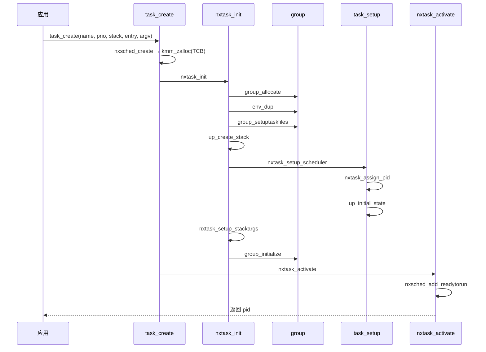
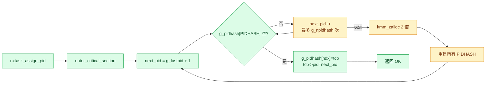

# task_create.c + task_setup.c + task_init.c —— 任务创建全链路

> 对应源文件：
> - `sched/task/task_create.c`（共 300 行）
> - `sched/task/task_setup.c`（共 764 行）
> - `sched/task/task_init.c`（共 272 行）
>
> 合计 1,336 行。逐段解读见
> [Docs/02-调度器与任务管理.md](../../../references/rtos/NuttX/Docs/02-调度器与任务管理.md)。
> 退出链路见 [task_exit.md](task_exit.md)。

---

## 1. 一句话职责

把"用户给的 `name/priority/stack/entry/argv`"变成一个**已插入就绪队列、
第一次被调度时能从 `nxtask_start` 开始执行**的 TCB；中间要建组、复制
环境与 fd、分配栈、伪造寄存器帧、分配 PID。

## 2. 调用链

```text
task_create()                    task_create.c:230
  └─ task_create_with_stack()    task_create.c:205
      └─ nxtask_create()         task_create.c:164
          └─ nxthread_create()   task_create.c:81
              ├─ kmm_zalloc(TCB)
              ├─ nxtask_init()   task_init.c:88
              │   ├─ group_allocate()
              │   ├─ env_dup()
              │   ├─ group_setuptaskfiles()
              │   ├─ nxtask_setup_name()
              │   ├─ up_create_stack() / up_use_stack()
              │   ├─ nxtask_setup_scheduler()  task_setup.c:677
              │   │   └─ nxthread_setup_scheduler() task_setup.c:402
              │   ├─ tls_init_info()
              │   ├─ nxtask_setup_stackargs() task_setup.c:520
              │   └─ group_initialize()
              └─ nxtask_activate() task_activate.c:60
```

## 3. 逐函数表

### 3.1 `task_create.c`

| 函数 | 行号 | 作用 | 备注 |
|---|---:|---|---|
| `nxthread_create()` | 81 | 公共实现：分配 TCB + init + activate | task/kthread 共用 |
| `nxtask_create()` | 164 | task 类型包装 | `envp ? envp : environ` |
| `task_create_with_stack()` | 205 | 使用调用者提供的栈 | `CONFIG_BUILD_KERNEL` 下不编译 |
| `task_create()` | 230 | POSIX 风格入口 | 内部调 `task_create_with_stack(..., NULL, ...)` |
| `kthread_create_with_stack()` | 263 | 内核线程 + 外部栈 | `TCB_FLAG_TTYPE_KERNEL` |
| `kthread_create()` | 295 | 内核线程入口 | 无环境复制 |

### 3.2 `task_setup.c`

| 函数 | 行号 | 作用 |
|---|---:|---|
| `nxtask_assign_pid()` | 84 | 分配唯一 PID，必要时扩容 `g_pidhash` |
| `nxtask_inherit_affinity()` | 227 | SMP 下继承父任务 CPU 亲和性 |
| `nxtask_save_parent()` | 258 | 记录父 PID，分配子进程状态结构 |
| `nxtask_dup_dspace()` | 359 | PIC 模式下复制 D-Space 引用 |
| `nxthread_setup_scheduler()` | 402 | 填优先级/入口/策略/信号屏蔽字/初始寄存器 |
| `nxtask_setup_stackargs()` | 520 | 把 argv/环境复制到任务栈 |
| `nxtask_setup_scheduler()` | 677 | task 类型包装 |
| `pthread_setup_scheduler()` | 710 | pthread 类型包装 |
| `nxtask_setup_name()` | 736 | 复制任务名，空格转下划线 |

### 3.3 `task_init.c`

| 函数 | 行号 | 作用 |
|---|---:|---|
| `nxtask_init()` | 88 | 两步创建的"第一步"：初始化但不激活 |

## 4. 逐字摘录

### 4.1 `nxthread_create()`：TCB 分配与激活

```c
int nxthread_create(FAR const char *name, uint8_t ttype, int priority,
                    FAR void *stack_addr, int stack_size, main_t entry,
                    FAR char * const argv[], FAR char * const envp[])
{
  FAR struct tcb_s *tcb;
  pid_t pid;
  int ret;

  /* Allocate a TCB for the new task. */

  tcb = kmm_zalloc(sizeof(struct tcb_s));
  if (!tcb)
    {
      serr("ERROR: Failed to allocate TCB\n");
      return -ENOMEM;
    }

  /* Setup the task type */

  tcb->flags = ttype | TCB_FLAG_FREE_TCB;

  /* Initialize the task */

  ret = nxtask_init(tcb, name, priority,
                    stack_addr, stack_size, entry, argv, envp, NULL);
  if (ret < OK)
    {
      kmm_free(tcb);
      return ret;
    }

  /* Get the assigned pid before we start the task */

  pid = tcb->pid;

  /* Activate the task */

  nxtask_activate(tcb);

  return pid;
}
```

（`task_create.c:81-121`）

`TCB_FLAG_FREE_TCB` 表示"这个 TCB 是堆分配的，退出时要 `kmm_free`"；
静态 TCB（IDLE）没有这个标志。`nxtask_init()` 失败时直接
`kmm_free(tcb)`，因为此时 group/栈可能还没建，不能走 `release_tcb`。

### 4.2 `nxtask_init()`：初始化顺序

```c
int nxtask_init(FAR struct tcb_s *tcb, const char *name, int priority,
                FAR void *stack, uint32_t stack_size,
                main_t entry, FAR char * const argv[],
                FAR char * const envp[],
                FAR const posix_spawn_file_actions_t *actions)
{
  uint8_t ttype = tcb->flags & TCB_FLAG_TTYPE_MASK;
  int ret;

  sched_trace_begin();
...
  /* Create a new task group */

  ret = group_allocate(tcb, tcb->flags);
  if (ret < 0)
    {
      sched_trace_end();
      return ret;
    }

#ifndef CONFIG_DISABLE_PTHREAD
  /* Initialize the task join */

  nxtask_joininit(tcb);
#endif

  /* Duplicate the parent tasks environment */

  ret = env_dup(tcb->group, envp);
  if (ret < 0)
    {
      goto errout_with_group;
    }

  /* Associate file descriptors with the new task */

  ret = group_setuptaskfiles(tcb, actions, true);
  if (ret < 0)
    {
      goto errout_with_group;
    }

  /* Set the task name */

  nxtask_setup_name(tcb, name);

  if (stack)
    {
      /* Use pre-allocated stack */

      ret = up_use_stack(tcb, stack, stack_size);
    }
  else
    {
      /* Allocate the stack for the TCB */

      ret = up_create_stack(tcb, stack_size, ttype);
    }
```

（`task_init.c:88-160`，节选）

顺序的关键点：

1. **先建 group**：后续 env/fd 都挂到 group 上；
2. **再复制环境**：`env_dup()` 失败时 group 还在，走 `errout_with_group`；
3. **再复制 fd**：依赖父任务的 fd 表；
4. **再分配栈**：栈大小由调用者给，`up_create_stack()` 可加保护页；
5. **最后才 setup scheduler**：因为 `up_initial_state()` 需要栈指针。

### 4.3 `nxthread_setup_scheduler()`：策略与寄存器帧

```c
static int nxthread_setup_scheduler(FAR struct tcb_s *tcb, int priority,
                                    start_t start, CODE void *entry,
                                    uint8_t ttype)
{
  irqstate_t flags;
  int ret;

  /* Assign a unique task ID to the task. */

  ret = nxtask_assign_pid(tcb);
  if (ret == OK)
    {
      /* Save task priority and entry point in the TCB */

      tcb->sched_priority = (uint8_t)priority;
      tcb->init_priority  = (uint8_t)priority;
#ifdef CONFIG_PRIORITY_INHERITANCE
      tcb->base_priority  = (uint8_t)priority;
#endif
      tcb->start          = start;
      tcb->entry.main     = (main_t)entry;

      /* Save the thread type.  This setting will be needed in
       * up_initial_state() is called.
       */

      ttype              &= TCB_FLAG_TTYPE_MASK;
      tcb->flags         &= ~TCB_FLAG_TTYPE_MASK;
      tcb->flags         |= ttype;

      /* Set the appropriate scheduling policy in the TCB */

      tcb->flags         &= ~TCB_FLAG_POLICY_MASK;
#if CONFIG_RR_INTERVAL > 0
      tcb->flags         |= TCB_FLAG_SCHED_RR;
      tcb->timeslice      = MSEC2TICK(CONFIG_RR_INTERVAL);
#else
      tcb->flags         |= TCB_FLAG_SCHED_FIFO;
#endif
```

（`task_setup.c:402-440`）

接着：

```c
      /* exec(), task_create(), and vfork() all inherit the affinity mask
       * from the parent thread. ...
       */

      nxtask_inherit_affinity(tcb);
#endif

      /* exec(), pthread_create(), task_create(), and vfork() all
       * inherit the signal mask of the parent thread.
       */

#ifndef CONFIG_DISABLE_ALL_SIGNALS
      tcb->sigprocmask = this_task()->sigprocmask;
#endif

      /* Initialize the task state.  It does not get a valid state
       * until it is activated.
       */

      tcb->task_state = TSTATE_TASK_INVALID;

      /* Clone the parent tasks D-Space (if it was running PIC).  This
       * must be done before calling up_initial_state() so that the
       * state setup will take the PIC address base into account.
       */

      nxtask_dup_dspace(tcb);

      /* Initialize the processor-specific portion of the TCB */

      up_initial_state(tcb);

      /* Add the task to the inactive task list */

      flags = enter_critical_section();
      dq_addfirst((FAR dq_entry_t *)tcb, list_inactivetasks());
      tcb->task_state = TSTATE_TASK_INACTIVE;
      leave_critical_section(flags);
```

（`task_setup.c:448-489`）

**注意**：新任务先挂 `g_inactivetasks`，不是 `g_readytorun`。
`nxtask_activate()` 会先 `nxsched_remove_blocked()` 再 `nxsched_add_readytorun()`。

### 4.4 `nxtask_setup_stackargs()`：把 argv 搬到栈上

```c
      argvlen   = (argc + 2) * sizeof(FAR char *);
      stackargv = (FAR char **)up_stack_frame(tcb, argvlen + strtablen);

      DEBUGASSERT(stackargv != NULL);
      if (stackargv == NULL)
        {
          ret = -ENOMEM;
        }
      else
        {
          /* Get the address of the string table that will lie immediately
           * after the argv[] array and mark it as a null string.
           */

          str = (FAR char *)stackargv + argvlen;

          /* Copy the task name.  Increment str to skip over the task name
           * and its NUL terminator in the string buffer.
           */

          stackargv[0] = str;
          nbytes       = strlen(name) + 1;
          strlcpy(str, name, strtablen);
          str         += nbytes;
          strtablen   -= nbytes;
```

（`task_setup.c:591-615`）

`argc + 2` 的 `+2` 是"任务名占 `argv[0]`" + "NULL 结尾"。
`up_stack_frame()` 在栈顶预留一段空间，返回的指针在**栈的高地址侧**，
不会与向下增长的调用栈冲突。

## 5. 创建时序



## 6. PID 分配与哈希扩容



`nxtask_assign_pid()` 在扩容时会先 `leave_critical_section()` 再
`kmm_zalloc()`，因为堆分配可能睡眠；分配后重新拿锁并检查
`temp != g_pidhash`（说明别人已经扩容），失败则重试（`task_setup.c:146-201`）。

## 7. 陷阱与读码建议

- **`task_create()` 参数是 4 个，不是 POSIX 的 `fork+exec`**：
  `name, priority, stack_size, entry, argv`；
- **栈大小单位是字节**：`up_create_stack()` 会按架构对齐并加保护页；
- **`argv` 被复制到新任务栈**：调用者可以立刻释放原数组；
- **`priority` 会被截断成 `uint8_t`**：合法范围 1..255；
- **`nxtask_init()` 失败路径要调 `group_leave()`**：`errout_with_group`
  标签里做了 `up_release_stack`、`nxtask_joindestroy`、`group_leave`；
- **读码顺序**：`task_create.c` 的 `nxthread_create()` →
  `task_init.c` 的 `nxtask_init()` → `task_setup.c` 的
  `nxthread_setup_scheduler()` → `nxtask_setup_stackargs()`。
