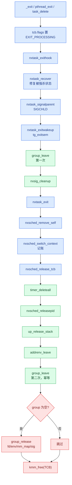
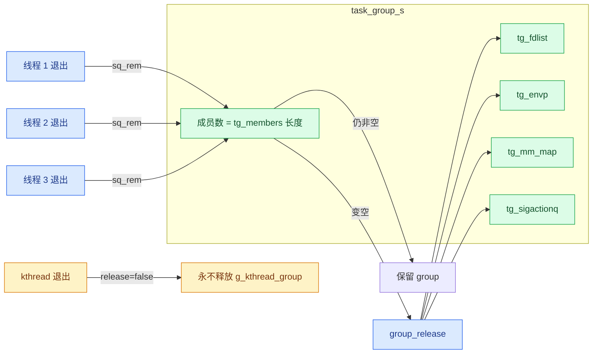

# task_exit.c + task_exithook.c + sched_releasetcb.c + group_leave.c —— 任务退出与资源回收

> 对应源文件：
> - `sched/task/task_exit.c`（共 175 行）
> - `sched/task/task_exithook.c`（共 472 行）
> - `sched/sched/sched_releasetcb.c`（共 195 行）
> - `sched/group/group_leave.c`（共 271 行）
>
> 合计 1,113 行。逐段解读见
> [Docs/03-任务组与地址空间.md](../../../references/rtos/NuttX/Docs/03-任务组与地址空间.md)。

---

## 1. 一句话职责

把"当前正在运行的任务"从调度器摘除，通知父进程/等待者，按
"线程私有资源 → 组共享资源"的顺序释放，最后可能 `kmm_free(TCB)`；
调用者不再返回。

## 2. 四层清理模型

| 层 | 函数 | 位置 | 释放什么 | 不释放什么 |
|---|---|---|---|---|
| 1 | `nxtask_exit()` | `task_exit.c:75` | 就绪队列位置、切换上下文 | 栈、group、fd |
| 2 | `nxtask_exithook()` | `task_exithook.c:406` | 信号、子进程状态、组引用 | 栈、TCB |
| 3 | `nxsched_release_tcb()` | `sched_releasetcb.c:101` | 定时器、PID、栈、dspace、地址环境 | group（已 leave） |
| 4 | `group_leave()` / `group_release()` | `group_leave.c:177` / `78` | fd 表、环境、mm_map、信号动作 | 内核线程的 `g_kthread_group` |

## 3. 逐函数表

### 3.1 `task_exit.c`

| 函数 | 行号 | 作用 |
|---|---:|---|
| `nxtask_exit()` | 75 | 退出主流程 |

### 3.2 `task_exithook.c`

| 函数 | 行号 | 作用 |
|---|---:|---|
| `nxtask_signalparent()` | 270 | 向父组发 SIGCHLD / 记录退出码 |
| `nxtask_exitwakeup()` | 315 | 唤醒 `waitpid()` 等待者 |
| `nxtask_exithook()` | 406 | 退出钩子总入口 |

### 3.3 `sched_releasetcb.c`

| 函数 | 行号 | 作用 |
|---|---:|---|
| `nxsched_releasepid()` | 52 | 从 `g_pidhash` 删除并回收 PID |
| `nxsched_release_tcb()` | 101 | 释放 TCB 内所有资源 |

### 3.4 `group_leave.c`

| 函数 | 行号 | 作用 |
|---|---:|---|
| `group_release()` | 78 | 释放组内所有共享资源 |
| `group_leave()` | 177 | 成员离开，最后一个成员触发 `group_release()` |
| `group_drop()` | 246 | 真正 `kmm_free(group)`，处理 waitpid 等待者 |

## 4. 逐字摘录

### 4.1 `nxtask_exit()`：摘除自己

```c
int nxtask_exit(void)
{
  FAR struct tcb_s *dtcb;
  FAR struct tcb_s *rtcb;
  int ret;
#ifdef CONFIG_SMP
  /* Avoid using this_task() because it may assume a state that is not
   * appropriate for an exiting task.
   */

  dtcb = current_task(this_cpu());
#else
  dtcb = this_task();
#endif
...
  nxsched_remove_self(dtcb);

  /* Get the new task at the head of the ready to run list */

#ifdef CONFIG_SMP
  rtcb = current_task(this_cpu());
#else
  rtcb = this_task();
#endif

  /* We are now in a bad state -- the head of the ready to run task list
   * does not correspond to the thread that is running.  Disabling pre-
   * emption on this TCB and marking the new ready-to-run task as not
   * running.
   *
   * We disable pre-emption here by directly incrementing the lockcount
   * (vs. calling sched_lock()).
   */

  rtcb->lockcount++;

  rtcb->task_state = TSTATE_TASK_READYTORUN;
```

（`task_exit.c:75-122`）

**为什么直接 `lockcount++`**：`sched_lock()` 可能触发
`nxsched_merge_pending()`/调度，而此刻"就绪队列头"已经不是"正在跑的任务"，
任何调度都会把状态搞乱。直接加计数只是禁止抢占，不触发调度。

### 4.2 切换与释放

```c
  dtcb->task_state = TSTATE_TASK_INACTIVE;

  /* Update scheduler parameters.
   *
   * When the thread exits, SYS_restore_context is called to
   * restore the context, which does not update the scheduling
   * information.
   * We need to update the scheduling information before tcb is released.
   */

  nxsched_switch_context(dtcb, rtcb);

  sched_note_stop(dtcb);
  ret = nxsched_release_tcb(dtcb, dtcb->flags & TCB_FLAG_TTYPE_MASK);

#ifdef CONFIG_SMP
  rtcb->irqcount--;
#endif

  rtcb->task_state = TSTATE_TASK_RUNNING;

  /* Decrement the lockcount on rctb. */

  rtcb->lockcount--;
```

（`task_exit.c:135-158`）

`nxsched_switch_context()` 在这里只做 RR/sporadic 记账，真正切换在
`SYS_restore_context`（ARM 的 `arm_svcall`）返回时发生。

### 4.3 `nxtask_exithook()`：通知与离开组

```c
void nxtask_exithook(FAR struct tcb_s *tcb, int status)
{
...
  DEBUGASSERT((tcb->flags & TCB_FLAG_EXIT_PROCESSING) != 0);

  nxsched_dumponexit();

  /* If the task was terminated by another task, it may be in an unknown
   * state.  Make some feeble effort to recover the state.
   */

  nxtask_recover(tcb);

  /* Disable the scheduling function to prevent other tasks from
   * being deleted after they are awakened
   */

  sched_lock();

  /* Send the SIGCHLD signal to the parent task group */

  nxtask_signalparent(tcb, status);

  /* Wakeup any tasks waiting for this task to exit */

  nxtask_exitwakeup(tcb, status);

  sched_unlock();

  /* Leave the task group.  Perhaps discarding any un-reaped child
   * status (no zombies here!)
   */

  group_leave(tcb);

  /* Deallocate anything left in the TCB's queues */

#ifndef CONFIG_DISABLE_ALL_SIGNALS
  nxsig_cleanup(tcb); /* Deallocate Signal lists */
#endif
```

（`task_exithook.c:406-460`）

顺序的含义：

1. `nxtask_recover()`：被 `task_delete()` 杀死时，任务可能停在
   半持有锁/半修改链表的状态，尽量恢复；
2. `sched_lock()`：防止在通知过程中被其他任务删掉；
3. `nxtask_signalparent()`：SIGCHLD + `tg_exitcode`；
4. `nxtask_exitwakeup()`：`waitpid()` 的 `tg_exitsem`；
5. `group_leave()`：递减组引用；
6. `nxsig_cleanup()`：释放 TCB 私有的信号队列。

### 4.4 `nxsched_release_tcb()`：TCB 资源清单

```c
int nxsched_release_tcb(FAR struct tcb_s *tcb, uint8_t ttype)
{
  int ret = OK;

  if (tcb)
    {
      /* Released tcb shouldn't on any list */

      DEBUGASSERT(tcb->flink == NULL && tcb->blink == NULL);

#ifndef CONFIG_DISABLE_POSIX_TIMERS
      /* Release any timers that the task might hold.  We do this
       * before release the PID because it may still be trying to
       * deliver signals (although interrupts are should be
       * disabled here).
       */

      timer_deleteall(tcb->pid);
#endif
```

（`sched_releasetcb.c:101-119`）

之后依次：

```c
      if (tcb->pid)
        {
          nxsched_releasepid(tcb->pid);
        }

      /* Delete the thread's stack if one has been allocated */

      if (tcb->stack_alloc_ptr)
        {
          up_release_stack(tcb, ttype);
        }
...
#ifdef CONFIG_ARCH_ADDRENV
      /* Release this thread's reference to the address environment */

      ret = addrenv_leave(tcb);
#endif

      /* Leave the group (if we did not already leave in task_exithook.c) */

      group_leave(tcb);

#ifndef CONFIG_DISABLE_PTHREAD
      /* Destroy the pthread join mutex */

      nxtask_joindestroy(tcb);
#endif
...
      /* And, finally, release the TCB itself */

      if (tcb->flags & TCB_FLAG_FREE_TCB)
        {
          kmm_free(tcb);
        }
```

（`sched_releasetcb.c:127-191`）

`group_leave()` 在这里被第二次调用（`nxtask_exithook()` 已调过一次），
但 `group_leave()` 第一次就把 `tcb->group = NULL`，第二次直接返回，
所以是幂等的。

### 4.5 `group_leave()`：最后一个成员才释放

```c
      bool release = !(tcb->flags & TCB_FLAG_TTYPE_KERNEL);

      /* Remove the member from group. */

#ifdef HAVE_GROUP_MEMBERS
      flags = spin_lock_irqsave(&group->tg_lock);
      sq_rem(&tcb->member, &group->tg_members);
      release = release && sq_empty(&group->tg_members);
      spin_unlock_irqrestore(&group->tg_lock, flags);

      /* Have all of the members left the group? */
#endif

      if (release)
        {
          /* Yes.. Release all of the resource held by the task group */

          group_release(group);
        }

      /* In any event, we can detach the group from the TCB so that we won't
       * do this again.
       */

      tcb->group = NULL;
```

（`group_leave.c:197-221`）

`group_release()` 的释放顺序（`group_leave.c:78-150`）：

1. `nxrmutex_destroy(&group->tg_mutex)`
2. `task_uninit_info(group)`
3. `group_remove_children(group)`
4. `nxsig_release(group)`
5. `pthread_release(group)`
6. `fdlist_free(&group->tg_fdlist)`
7. `env_release(group)`
8. `mm_map_destroy(&group->tg_mm_map)`
9. `binfmt_exit(group->tg_bininfo)`
10. `group->tg_flags |= GROUP_FLAG_DELETED`
11. `group_drop(group)`

## 5. 退出流程图



## 6. 组引用计数



## 7. 陷阱与读码建议

- **`nxtask_exit()` 不返回**：它切到下一个任务后，原任务的上下文永远不会
  再被恢复；
- **`lockcount` 直接加减**：不要在这段代码里改成 `sched_lock()`；
- **内核线程不释放 group**：`g_kthread_group` 是静态共享的，
  `group_release()` 会摧毁其他内核线程还在用的 fd 表/互斥量；
- **`nxtask_exithook()` 可能被调多次**：靠 `TCB_FLAG_EXIT_PROCESSING`
  和 `tcb->group == NULL` 做幂等；
- **`waitpid()` 的唤醒在 `sched_unlock()` 之前**：避免父进程被唤醒后
  立刻又抢占，导致退出路径重入；
- **读码顺序**：`task_exit.c` → `task_exithook.c` → `sched_releasetcb.c`
  → `group_leave.c`。
