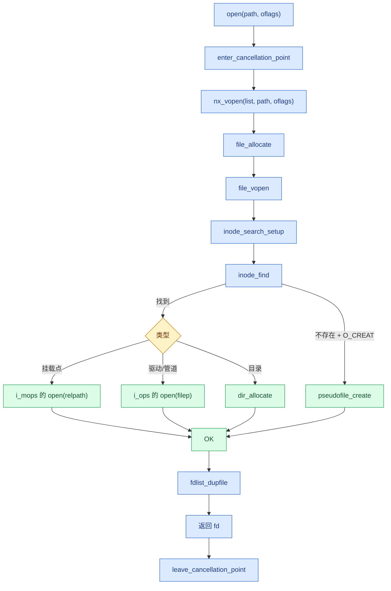
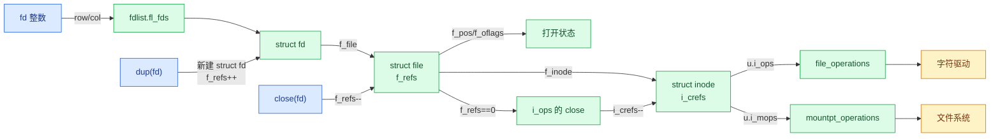

# fs/vfs/fs_open.c + fs_read.c + fs_write.c + fs_close.c —— VFS 四件套

> 对应源文件：
> - `fs/vfs/fs_open.c`（共 492 行）
> - `fs/vfs/fs_read.c`（共 420 行）
> - `fs/vfs/fs_write.c`（共 467 行）
> - `fs/vfs/fs_close.c`（共 233 行）
> - 关联：`fs/inode/fs_files.c`（共 982 行）、`include/nuttx/fs/fs.h`
>
> 四个 VFS 文件合计 1,612 行；含 `fs_files.c` 共 2,594 行。
> 逐段解读见 [Docs/06-文件系统与VFS层.md](../../../references/rtos/NuttX/Docs/06-文件系统与VFS层.md)。

---

## 1. 一句话职责

把 POSIX 的 `open/read/write/close` 翻译成"路径 → inode → 操作表 →
驱动/文件系统方法"，同时维护 `fd` 槽、`struct file` 引用和 `inode` 引用。

## 2. 三层对象

| 对象 | 定义 | 生命周期 | 引用计数 |
|---|---|---|---|
| `struct inode` | `fs.h:457` | 注册/挂载到卸载 | `i_crefs` |
| `struct file` | `fs.h:513` | 每次 `open` 一个 | `f_refs` |
| `struct fd` | `fs.h:525` | 每个 fd 槽一个 | 无（挂在 `fdlist`） |

`struct file` 与 `struct fd` 的关系：

```c
struct file
{
  int               f_oflags;   /* Open mode flags */
  atomic_t          f_refs;     /* Reference count */
  off_t             f_pos;      /* File position */
  FAR struct inode *f_inode;    /* Driver or file system interface */
  FAR void         *f_priv;     /* Per file driver private data */
};

struct fd
{
  FAR struct file  *f_file;      /* The file associated with descriptor */
  bool              f_cloexec;   /* Close on exec */
};
```

（`include/nuttx/fs/fs.h:513-528`，节选）

`dup()` 只增加 `f_refs` 并新建一个 `struct fd` 指向同一个 `struct file`，
所以两个 fd 共享 `f_pos`。

## 3. 逐函数表

### 3.1 `fs_open.c`

| 函数 | 行号 | 作用 |
|---|---:|---|
| `file_vopen()` | 74 | 路径解析 + inode 查找 + 调用 `i_ops->open`/`i_mops->open` |
| `nx_vopen()` | 307 | `file_allocate` + `file_vopen` + `fdlist_dupfile` |
| `file_open()` | 363 | 调用者提供 `struct file` 的版本 |
| `fdlist_open()` | 405 | 指定 fdlist 的 `nx_vopen` |
| `nx_open()` | 441 | 当前任务 fdlist 的版本，不改 errno |
| `open()` | 467 | POSIX 入口，取消点 |

### 3.2 `fs_read.c`

| 函数 | 行号 | 作用 |
|---|---:|---|
| `file_readv_compat()` | 73 | 无 `readv` 时逐段调 `read` |
| `file_readv()` | 158 | 向量读核心 |
| `file_read()` | 275 | 单缓冲读 |
| `nx_readv()` | 306 | fd → `struct file` → `file_readv` |
| `nx_read()` | 349 | fd → 单缓冲 |
| `readv()` | 375 | POSIX 包装 |
| `read()` | 413 | POSIX 包装 + 取消点 |

### 3.3 `fs_write.c`

| 函数 | 行号 | 作用 |
|---|---:|---|
| `file_writev_compat()` | 55 | 无 `writev` 时逐段调 `write` |
| `file_writev()` | 148 | 向量写核心 |
| `file_write()` | 249 | 单缓冲写 |
| `nx_writev()` | 285 | fd → `struct file` |
| `nx_write()` | 334 | fd → 单缓冲 |
| `writev()` | 391 | POSIX 包装 |
| `write()` | 460 | POSIX 包装 + 取消点 |

### 3.4 `fs_close.c`

| 函数 | 行号 | 作用 |
|---|---:|---|
| `file_close()` | 94 | 调 `i_ops->close`，释放 inode 引用 |
| `nx_close()` | 184 | fd → `file_close` |
| `close()` | 212 | POSIX 包装 + 取消点 |

### 3.5 `fs_files.c`

| 函数 | 行号 | 作用 |
|---|---:|---|
| `fdlist_extend()` | 92 | 增加一行 fd 数组 |
| `fdlist_init()` | 360 | 初始化二维数组 |
| `fdlist_free()` | 457 | 释放整张表 |
| `fdlist_get2()` | 524 | fd → `struct fd` |
| `fdlist_dupfile()` | 566 | 找空槽并安装 `struct file` |
| `fdlist_copy()` | 690 | 父子进程 fd 继承 |
| `fdlist_dup2()` | 898 | `dup2` |
| `fdlist_close()` | 947 | 关闭并清槽 |

## 4. 逐字摘录

### 4.1 `file_vopen()`：分发

```c
  if (oflags & O_DIRECTORY)
    {
      ret = dir_allocate(filep, desc.relpath);
    }
#ifndef CONFIG_DISABLE_MOUNTPOINT
  else if (INODE_IS_MOUNTPT(inode))
    {
      if (inode->u.i_mops->open != NULL)
        {
          ret = inode->u.i_mops->open(filep, desc.relpath, oflags, mode);
        }
    }
#endif
  else if (INODE_IS_DRIVER(inode) || INODE_IS_PIPE(inode))
    {
      if (inode->u.i_ops->open != NULL)
        {
          ret = inode->u.i_ops->open(filep);
        }
    }
  else
    {
      ret = -ENXIO;
    }
```

（`fs/vfs/fs_open.c:232-255`）

### 4.2 `nx_vopen()`：file 与 fd 的分配顺序

```c
static int nx_vopen(FAR struct fdlist *list,
                    FAR const char *path, int oflags, va_list ap)
{
  FAR struct file *filep;
  int ret;
  int fd;

  filep = file_allocate();
  if (filep == NULL)
    {
      return -ENOMEM;
    }

  ret = file_vopen(filep, path, oflags, getumask(), ap);
  if (ret < 0)
    {
      file_deallocate(filep);
      return ret;
    }

  fd = fdlist_dupfile(list, oflags, 0, filep);
  if (fd < 0)
    {
      file_close(filep);
      file_deallocate(filep);
    }

  return fd;
}
```

（`fs_open.c:307-335`）

### 4.3 `file_readv()`：向量读

```c
  ret = -EBADF;

  /* Was this file opened for read access? */

  if ((filep->f_oflags & O_ACCMODE) == O_WRONLY)
    {
      /* No.. File is not read-able */

      ret = -EACCES;
    }

  /* Is a driver or mountpoint registered? If so, does it support the read
   * method?
   * If yes, then let it perform the read.  NOTE that for the case of the
   * mountpoint, we depend on the read methods being identical in
   * signature and position in the operations vtable.
   */

  else if (inode != NULL && inode->u.i_ops)
    {
      clock_t start_time;

      FS_PROFILE_START(start_time);

      if (inode->u.i_ops->readv)
        {
          struct uio uio;

          ret = uio_init(&uio, iov, iovcnt);
          if (ret == 0)
            {
              ret = inode->u.i_ops->readv(filep, &uio);
            }
        }
```

（`fs/vfs/fs_read.c:198-230`，节选）

### 4.4 `file_writev()`：向量写

```c
  /* Was this file opened for write access? */

  if ((filep->f_oflags & O_ACCMODE) == O_RDONLY)
    {
      return -EACCES;
    }
...
  ret = -EBADF;
  inode = filep->f_inode;
  if (inode != NULL && inode->u.i_ops)
    {
      clock_t start_time;

      FS_PROFILE_START(start_time);

      if (inode->u.i_ops->writev)
        {
          struct uio uio;

          ret = uio_init(&uio, iov, iovcnt);
          if (ret == 0)
            {
              ret = inode->u.i_ops->writev(filep, &uio);
            }
        }
      else if (inode->u.i_ops->write)
        {
          ret = file_writev_compat(filep, iov, iovcnt);
        }
```

（`fs/vfs/fs_write.c:156-208`，节选）

### 4.5 `file_close()`

```c
int file_close(FAR struct file *filep)
{
  struct inode *inode;
...
  inode = filep->f_inode;
...
  /* Check if the struct file is open (i.e., assigned an inode) */

  if (inode)
    {
      file_closelk(filep);

      /* Close the file, driver, or mountpoint. */

      if (inode->u.i_ops && inode->u.i_ops->close)
        {
...
          /* Perform the close operation */

          ret = inode->u.i_ops->close(filep);
...
        }

      /* And release the inode */

      if (ret >= 0)
        {
...
          inode_release(inode);
        }
...
      filep->f_inode = NULL;
    }

  return ret;
}
```

（`fs/vfs/fs_close.c:94-160`，节选）

### 4.6 `fdlist_dupfile()`：两层数组

`fd` 是二维数组的行列索引：
`i = minfd / CONFIG_NFILE_DESCRIPTORS_PER_BLOCK`、
`j = minfd % CONFIG_NFILE_DESCRIPTORS_PER_BLOCK`。持 `fl_lock` 自旋锁从
`(i,j)` 起找第一个 `f_file == NULL` 的槽；若行号越界，先解锁并
`fdlist_extend()` 增加一行，再重新加锁。找到后
`atomic_add(&filep->f_refs, 1)`、写 `f_file`/`f_cloexec`，返回
`i * BLOCK + j`（`fs/inode/fs_files.c:581-632`）。

## 5. open 路径



## 6. 三层引用关系



## 7. 量化与边界

- `fd` 数组每行 `CONFIG_NFILE_DESCRIPTORS_PER_BLOCK` 个，按需 `fdlist_extend()`；
- `fdlist` 自带 `fl_prefds[]` 预分配块（`fs.h:547`），创建线程时 fd 0/1/2
  不访问堆；
- `readv/writev` 的 `SSIZE_MAX` 溢出检查在 `file_readv_compat()` 里
  （`fs_read.c:94`）；
- 每次 `open` 至少分配一个 `struct file` + 一个 `struct fd` 槽；
- `close` 的 `i_ops->close()` 返回值会影响是否 `inode_release()`。

## 8. 陷阱与读码建议

- **`open()` 是取消点**：驱动内部用 `nx_open()`；
- **`read`/`write` 的 `NULL` 方法**：串口只实现 `readv/writev`，
  `read()` 会走 `file_readv_compat()`；
- **`i_crefs` 与 `f_refs` 不要混**：`dup` 只动 `f_refs`；
- **`O_CLOEXEC` 存在 `fd` 层**：`fdlist_copy()` 按它决定是否复制；
- **块设备递归**：`file_vopen()` 对 `INODE_IS_BLOCK` 调 `block_proxy()`，
  会再进一次 `open`；
- **读码顺序**：`fs.h` 三层结构 → `fs_open.c` 的 `file_vopen()` →
  `fs_files.c` 的 `fdlist_dupfile()` → `fs_read.c` → `fs_write.c`
  → `fs_close.c`。
