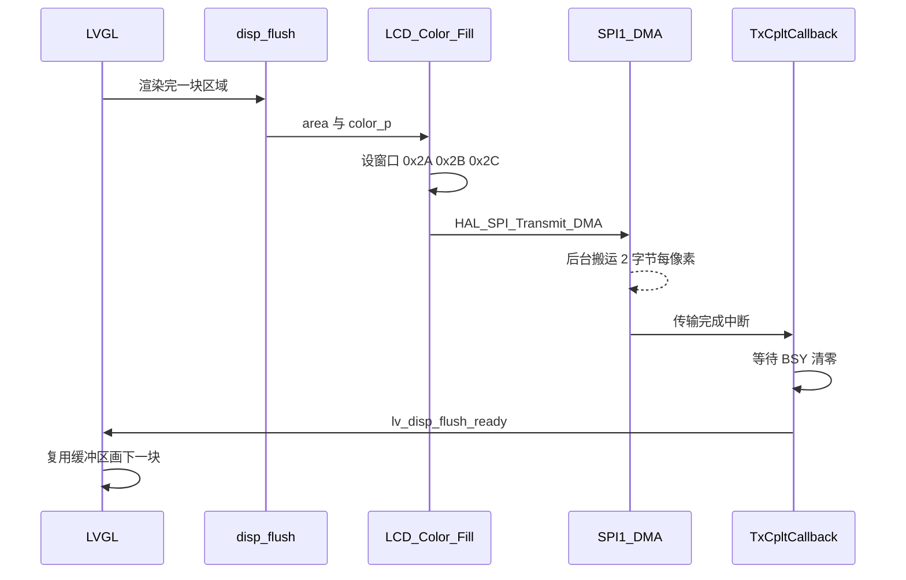

# BSP：ST7789 LCD 与 CST816 触摸

对应源文件：

- `Software/OV_Watch/BSP/LCD/lcd_init.c`（372 行，GBK 编码）
- `Software/OV_Watch/BSP/LCD/lcd.c`（816 行）
- `Software/OV_Watch/BSP/TOUCH/CST816.c`（360 行）
- `Software/OV_Watch/Middlewares/LVGL/GUI/porting/lv_port_disp.c`（201 行，C 级只读）
- `Software/OV_Watch/Middlewares/LVGL/GUI/porting/lv_port_indev.c`（135 行，C 级只读）

## 1. 硬件连接

| 信号 | 引脚 | 说明 |
|---|---|---|
| SCLK | PB3 | SPI1_SCK |
| MOSI | PB5 | SPI1_MOSI |
| RES | PB7 | 低有效复位 |
| CS | PB8 | 片选，软件控制 |
| DC | PB9 | 0=命令，1=数据 |
| BL | TIM3_CH3 | 背光 PWM |
| 触摸 SDA | PB4 | 软件 I2C |
| 触摸 SCL | PB6 | 软件 I2C |
| 触摸 RST | PA15 | 低有效复位 |

屏幕是 240x280 的 IPS（ST7789 控制器），但 ST7789 的显存是 240x320。
模块把可视区放在显存中间，所以驱动里有一个 `OFFSET_Y 20`（`lcd.c:46`），
所有“按矩形刷屏”的函数都要加这个偏移。

SPI1 配置为模式 3（空闲高、第二边沿采样）、8 位、MSB 先发、
`BaudRatePrescaler=2`，APB2=100 MHz 时 SCK=50 MHz（`Core/Src/spi.c:71`）。

## 2. 驱动分层

`lcd_init.c` 只负责“把屏点亮”，`lcd.c` 负责“往上画东西”：

| 层 | 文件 | 关键函数 | 说明 |
|---|---|---|---|
| 字节出口 | lcd_init.c | `LCD_Writ_Bus` | 唯一往 SPI1 写 1 字节的地方 |
| 命令/数据 | lcd_init.c | `LCD_WR_REG` / `LCD_WR_DATA8` / `LCD_WR_DATA` | DC 电平区分 |
| 窗口 | lcd_init.c | `LCD_Address_Set` | 0x2A/0x2B/0x2C |
| 初始化 | lcd_init.c | `LCD_Init` | 复位 + 厂家寄存器表 |
| 背光 | lcd_init.c | `LCD_Set_Light` | TIM3_CH3 占空比 5~100 |
| DMA 刷屏 | lcd.c | `LCD_Color_Fill` | LVGL 的 flush 走这里 |
| 绘图层 | lcd.c | 画点/线/圆/汉字 | 裸机遗留，LVGL 不用 |

### 2.1 命令与数据：DC 的“自动归位”

`LCD_WR_REG` 在发完命令后会把 DC 重新拉高：

```c
void LCD_WR_REG(u8 dat)
{
	LCD_DC_Clr();//写命令
	LCD_Writ_Bus(dat);
	LCD_DC_Set();//写数据
}
```

这样调用处可以写成“命令 + 一串参数”的自然顺序，不用每写一个参数就切一次 DC。
代价是 `LCD_WR_REG` 之后如果忘了跟参数，下一个字节会被当成数据而不是命令。

CS 在 `LCD_Init` 里拉低后就没再拉高（`lcd_init.c:270`），全程选中。
单设备时没问题，但同一 SPI 上再挂别的从机就会冲突。

### 2.2 初始化序列

`LCD_Init`（`lcd_init.c:265`）的顺序不能乱：

| 步骤 | 命令 | 参数 | 作用 |
|---|---|---|---|
| 硬复位 | RES 低 100 ms → 高 100 ms | — | 让控制器回到默认状态 |
| Sleep Out | 0x11 | — | 退出睡眠，之后等 120 ms |
| 方向 | 0x36 | 0x00/0xC0/0x70/0xA0 | MADCTL，按 `USE_HORIZONTAL` 选 |
| 像素格式 | 0x3A | 0x05 | 16 位/像素 RGB565 |
| Porch | 0xB2 | 0C 0C 00 33 33 | 前后肩时序 |
| Gate | 0xB7 | 0x35 | VGH/VGL |
| VCOM | 0xBB | 0x19 | 公共电极电压 |
| LCM | 0xC0 | 0x2C | 驱动能力 |
| VDV/VRH EN | 0xC2 | 0x01 | 电压使能 |
| VRH | 0xC3 | 0x12 | 高压侧基准 |
| VDV | 0xC4 | 0x20 | 低压侧基准 |
| 帧率 | 0xC6 | 0x0F | 约 60 Hz |
| 电源 | 0xD0 | 0xA4 0xA1 | 升压参数 |
| Gamma+ | 0xE0 | 14 字节 | 灰阶曲线 |
| Gamma- | 0xE1 | 14 字节 | 与 0xE0 成对 |
| 反显开 | 0x21 | — | IPS 屏必须开，否则颜色相反 |
| 开显示 | 0x29 | — | 到这一步才真正出画面 |

两个容易踩的点：

1. `0x11` 之后手册要求等 120 ms，`LCD_ST7789_SleepOut()` 里只等了 100 ms，
   靠 `LCD_Init` 里再补一次 120 ms 兜底；
2. `0x36` 的四个值对应四种扫描方向，改横竖屏只改 `USE_HORIZONTAL` 宏，
   不要手改寄存器值。

### 2.3 设窗口：闭区间

```c
void LCD_Address_Set(u16 x1,u16 y1,u16 x2,u16 y2)
{
	LCD_WR_REG(0x2a);//列地址设置
	LCD_WR_DATA(x1);
	LCD_WR_DATA(x2);
	LCD_WR_REG(0x2b);//行地址设置
	LCD_WR_DATA(y1);
	LCD_WR_DATA(y2);
	LCD_WR_REG(0x2c);//储存器写
}
```

`x1/x2/y1/y2` 都是**闭区间**。设完窗口后连续写像素，ST7789 自己在窗口内
按行递增、写满一行自动换行，所以刷一整块只需要设一次窗口。

但 `lcd.c` 里两个刷屏函数的坐标约定不同：

| 函数 | 区间 | 内部处理 |
|---|---|---|
| `LCD_Fill` | 开区间 `[xsta, xend)` | 设窗口时 `xend-1` |
| `LCD_Color_Fill` | 闭区间 `[xsta, xend]` | 直接传 `xend` |

混用会整体错位一行/一列。

## 3. DMA 刷屏：异步与回调

`LCD_Color_Fill`（`lcd.c:86`）只做三件事：算字节数、设窗口、启动 DMA：

```c
	u16 i,j,width,height;
	width = xend-xsta+1;
	height = yend-ysta+1;
	uint32_t pixel_count = width * height;
	uint32_t byte_count = pixel_count * 2U;

	LCD_Address_Set(xsta,ysta+OFFSET_Y,xend,yend+OFFSET_Y);// 闭区间：xend/yend 都包含

	HAL_SPI_Transmit_DMA(&hspi1,(uint8_t*)color_p,byte_count); // 异步：返回时还没发完
```

函数返回时数据还在发。**在 DMA 完成前不能复用 `color_p` 指向的缓冲区**，
否则下一帧会覆盖正在发送的数据，表现为花屏/撕裂。

完成通知走两级回调：

1. `HAL_SPI_TxCpltCallback`（`lcd.c:124`）先死等 `SPI_FLAG_BSY` 清零，
   再调 `lcd_ready_cb`；
2. `lcd_ready_cb` 是 LVGL 移植层注册的 `lcd_flush_ready_callback`
   （`lv_port_disp.c:143`），它调 `lv_disp_flush_ready()` 告诉 LVGL 可以复用缓冲。

为什么要等 BSY：DMA 的“传输完成”只表示数据从内存搬到了 SPI 移位寄存器，
最后一位可能还在线上；此时就让 LVGL 复用缓冲，末尾几个像素会被覆盖。



### 3.1 缓冲区大小与刷屏时间

`lv_port_disp.c` 选的是双缓冲方案 2（`BUFFER_METHOD 2`）：

```c
    static lv_color_t buf_2_1[LCD_W * LCD_H / 10];                        /*A buffer for 10 rows*/
    static lv_color_t buf_2_2[LCD_W * LCD_H / 10];                        /*An other buffer for 10 rows*/
    lv_disp_draw_buf_init(&draw_buf_dsc_2, buf_2_1, buf_2_2, LCD_W * LCD_H / 10);   /*Initialize the display buffer*/
```

- 每块 = 240 × 280 / 10 = 6720 像素 = 13,440 字节；
- 两块共 26,880 字节，全部是静态数组，不占堆；
- 一次 flush 传 13,440 字节，50 MHz SPI 下约 2.15 ms；
- 整屏 240×280 = 67,200 像素 = 134,400 字节，理论 21.5 ms/帧，
  实际受 LVGL 渲染和窗口切换影响，约 25~35 ms（28~40 fps）。

## 4. 触摸 CST816

### 4.1 寄存器

| 地址 | 名称 | 用途 |
|---|---|---|
| 0x02 | FingerNum | 0=无触摸，1=单点，0xFF=睡眠/异常 |
| 0x03 | XposH | X 高 4 位在低半字节 |
| 0x04 | XposL | X 低 8 位 |
| 0x05 | YposH | Y 高 4 位 |
| 0x06 | YposL | Y 低 8 位 |
| 0xA7 | ChipID | 正常约 0xB5 |
| 0xE5 | SleepMode | 0x03=深度睡眠 |
| 0xF9 | AutoSleepTime | 无触摸自动休眠秒数 |

读坐标（`CST816.c:166`）：

```c
	uint8_t DAT[4];
	IIC_Read_Multi_Byte(&CST816_dev,Device_Addr,XposH,4,DAT);
	CST816_Instance.X_Pos=((DAT[0]&0x0F)<<8)|DAT[1];//(temp[0]&0X0F)<<4|
	CST816_Instance.Y_Pos=((DAT[2]&0x0F)<<8)|DAT[3] + TOUCH_OFFSET_Y;//(temp[2]&0X0F)<<4|
```

X/Y 各 12 位，高 4 位在 H 寄存器的低半字节。CST816 的分辨率是 240×280，
和屏幕一一对应，所以**不需要缩放**，只需要可选的 `TOUCH_OFFSET_Y` 平移。

### 4.2 睡眠与唤醒

`CST816_Sleep()` 写 `0xE5=0x03`（深度睡眠），此时芯片不再响应 I2C。
`CST816_Wakeup()` 只能走硬件复位（`CST816.c:280`）：

```c
void CST816_Wakeup(void)
{
	CST816_RESET(); // 睡眠后只能靠硬件复位唤醒
}
```

复位脉冲是 RST 低 10 ms、高 100 ms，100 ms 是等内部固件启动。
复位后所有配置回默认值，如果改过 `AutoSleepTime` 等参数，唤醒后要重配。

### 4.3 接到 LVGL

`lv_port_indev.c` 把触摸注册成 `LV_INDEV_TYPE_POINTER`：

```c
	if(CST816_Get_FingerNum()!=0x00 && CST816_Get_FingerNum()!=0xFF)
	{return true;}
	else
  {return false;}
```

这一段有两个细节：

1. `CST816_Get_FingerNum()` 被调了两次，等于每次判断读两次 I2C；
2. 0xFF 被当作“未按下”，但 0xFF 同时也表示“芯片在睡眠/总线异常”，
   两种情况无法区分——触屏掉线时表现为“怎么点都没反应”，而不是报错。

坐标读取没有做交换/镜像，所以屏幕方向由 `USE_HORIZONTAL` 决定后，
触摸方向必须与之一致；如果改了屏幕方向，这里也要改。


## 5. 陷阱清单

1. **`LCD_Color_Fill` 是异步的**：调用后立刻改 `color_p` 会花屏；
   LVGL 侧必须等 `lv_disp_flush_ready`。
2. **`LCD_Fill` 与 `LCD_Color_Fill` 坐标系不同**：一个开区间、一个闭区间。
3. **`OFFSET_Y` 只加在刷屏函数里**：`LCD_DrawPoint` 等原始绘图函数不加，
   两者混用会差 20 行。
4. **`LCD_Writ_Bus` 的超时只有 1 ms**：总线被占用时 `HAL_SPI_Transmit`
   会直接返回失败，但代码没有检查返回值，表现为“偶尔少几个像素”。
5. **触摸坐标没有校准**：`TOUCH_OFFSET_Y` 目前为 0；如果贴装偏移，
   需要在这里补，或者改 `CST816_Instance.Y_Pos` 的计算。
6. **深度睡眠后不能靠 I2C 唤醒**：`StopEnterTask` 醒来必须调
   `CST816_Wakeup()`，不能只写个寄存器。
7. **背光“关”不是断电**：`LCD_Close_Light()` 只把比较值清 0，
   TIM3 仍在跑；要彻底省电得 `HAL_TIM_PWM_Stop`。

## 6. 相关文档

- `Docs/06-外设驱动详解.md`：ST7789 初始化表与绘图层逐函数
- `Docs/10-UI页面逐页精读.md`：页面如何消费触摸事件
- `Knowledge-Base/ovwatch/GUI_Framework.md`：LVGL 集成与页面生命周期
