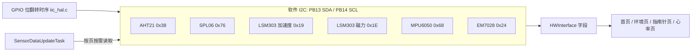
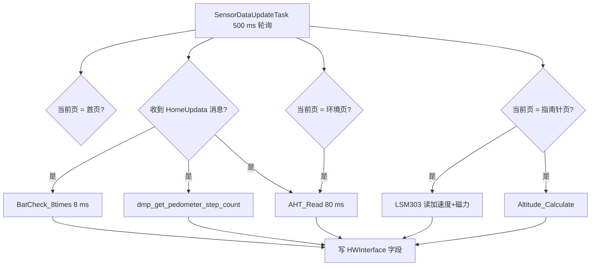

# BSP 传感器组合：AHT21 / SPL06-001 / LSM303DLH / MPU6050

对应源文件：

- `Software/OV_Watch/BSP/AHT21/AHT21.c`（209 行）
- `Software/OV_Watch/BSP/SPL06_001/SPL06_001.c`（427 行）
- `Software/OV_Watch/BSP/LSM303DLH/LSM303.c`（479 行）
- `Software/OV_Watch/BSP/MPU6050/mpu6050.c`（603 行）
- `Software/OV_Watch/User/Tasks/Src/user_SensUpdateTask.c`（243 行）

## 1. 四颗传感器挂在同一条软件 I2C 上

硬件上 PB13/PB14 是传感器 I2C 总线（SDA=PB13、SCL=PB14），
AHT21、SPL06、LSM303、MPU6050、EM7028 全都并在这条总线上，靠不同从机地址区分：

| 器件 | 7 位地址 | 写地址 | 读地址 | 说明 |
|---|---|---|---|---|
| AHT21 | 0x38 | 0x70 | 0x71 | 温湿度，命令式 |
| SPL06-001 | 0x76 | 0xEC | 0xED | 气压/温度，寄存器式 |
| LSM303 加速度计 | 0x19 | 0x32 | 0x33 | 与磁力计共用一颗芯片、两个地址 |
| LSM303 磁力计 | 0x1E | 0x3C | 0x3D | 温度寄存器也在这个地址 |
| MPU6050 | 0x68 | 0xD0 | 0xD1 | AD0 接地 |
| EM7028 | 0x24 | 0x48 | 0x49 | 心率/血氧 |

另外两条独立的软件 I2C 总线：

- 触摸 CST816：SDA=PB4、SCL=PB6，地址 0x15；
- EEPROM BL24C02：SDA=PB11、SCL=PB12，地址 0x50。

所以**每条总线任何时刻只能有一个驱动占用**——这套代码没有互斥量，
靠“所有调用都在同一个任务里串行”来保证。PB13/PB14 这条总线上挂了 5 个器件，
只要都在 `SensorDataUpdateTask` 里按顺序访问，就不会互相打断。

每个驱动在 `Init()` 里都会调一次 `IICInit(&bus)`，重复配置同一组 GPIO
是正常的，不会破坏总线状态（只是把引脚重新设成开漏输出并置高）。



## 2. AHT21：命令式温湿度

### 2.1 一次测量的时序

AHT21 没有“寄存器地址”概念，所有交互都是命令字节：

1. 写 `0xAC 0x33 0x00` 触发测量（`AHT21.c:155`）；
2. 等 80 ms 让内部 ADC 完成转换（`AHT21.c:163`）；
3. 读状态字节，bit7=忙；
4. 读 `0x71`，连续取 6 字节：状态 + 湿度 20 位 + 温度 20 位。

```c
	IICSendByte(&AHT_bus,0xAC);
	IICWaitAck(&AHT_bus);
	IICSendByte(&AHT_bus,0x33);
	IICWaitAck(&AHT_bus);
	IICSendByte(&AHT_bus,0x00);
	IICWaitAck(&AHT_bus);
	IICStop(&AHT_bus);	
	
	delay_ms(80); // 触发命令后至少等 80 ms 让 ADC 完成转换
```

### 2.2 20 位数据怎么拼

6 字节布局（去掉第 1 字节状态）：

| 字节 | 内容 |
|---|---|
| Byte2 | 湿度 [19:12] |
| Byte3 | 湿度 [11:4] |
| Byte4 高半字节 | 湿度 [3:0] |
| Byte4 低半字节 | 温度 [19:16] |
| Byte5 | 温度 [15:8] |
| Byte6 | 温度 [7:0] |

代码先拼 24 位再右移 4 位得到湿度（`AHT21.c:193-198`）：

```c
	RetuData = (RetuData|Byte_2th)<<8;
	RetuData = (RetuData|Byte_3th)<<8;
	RetuData = (RetuData|Byte_4th);
	RetuData =RetuData >>4; // 湿度 20 位：丢掉 Byte4 的低 4 位（那是温度的 bit19:16）
	*humi = (RetuData * 1000 >> 20); // 先乘后移，避免整数除法丢精度
	*humi /= 10;
```

温度则取 Byte4 的低半字节作为高 4 位（`AHT21.c:201-206`）：

```c
	RetuData = 0;
	RetuData = (RetuData|(Byte_4th&0x0f))<<8; // 温度的 bit19:16 藏在 Byte4 低半字节
	RetuData = (RetuData|Byte_5th)<<8;
	RetuData = (RetuData|Byte_6th);
	RetuData = RetuData&0xfffff; // 取 20 位
	*temp = ((RetuData * 2000 >> 20)- 500); // 公式：T = raw*2000/2^20 - 50
	*temp /= 10;
```

换算公式（数据手册）：

- 湿度 `%RH = raw / 2^20 * 100`
- 温度 `℃ = raw / 2^20 * 200 - 50`

代码用“先乘 1000/2000 再右移 20”的整数写法，避免浮点，也避免
`raw / 2^20` 先算成 0。举一个具体值：raw = 524288（2^19）时，
湿度 = 524288*1000>>20 = 500，再 /10 = 50 %RH；温度 = 524288*2000>>20 = 1000，
减 500 再 /10 = 50℃，正好是量程中点，可用来验算。

### 2.3 两个隐藏 bug

- `AHT21.c:166` 的 `while(AHT_Read_Status()&0x80==0x80 && cnt)`：
  `==` 优先级高于 `&`，实际是 `status & 1`，判断的是 bit0 而不是忙标志 bit7。
  因为还有 `cnt` 超时，不会死循环，但“等忙结束”这件事其实没做到。
- `AHT21.c:108` 的 `if(AHT_Read_Status()&&0x08!=0x08)`：
  `0x08!=0x08` 恒为 0，整个条件恒假，`0xBE` 校准初始化命令永远不会发。
  芯片靠出厂校准值工作，读数偏差可能来自这里。

## 3. SPL06-001：24 位原始值 + 9 个校准系数

### 3.1 初始化

`SPL_init()`（`SPL06_001.c:301`）配置四个寄存器：

```c
	SPL_WriteOneReg(SPL_PRS_CFG, 0x01);		// Pressure 2x oversampling

	SPL_WriteOneReg(SPL_TMP_CFG, 0x80);		// External Temperature 1x oversampling

	SPL_WriteOneReg(SPL_MEAS_CFG, 0x07);	// continuous pressure and temperature measurement
```

- `PRS_CFG=0x01`：气压 2 倍过采样 → 标度因子 `KP = 1572864 = 3 * 2^19`；
- `TMP_CFG=0x80`：使用外部温度传感器（其实就是 SPL06 自己），1 倍过采样
  → `KT = 524288 = 2^19`；
- `MEAS_CFG=0x07`：气压+温度连续测量。

过采样倍率和 KP/KT 是绑定的：把 `PRS_CFG` 改成 4 倍过采样，KP 必须改成
`3 * 2^19 * 2` 之类的对应值，否则气压会整体差一个固定倍数。

### 3.2 校准系数的半字节拼接

系数不是字节对齐的，最典型的是 c0/c1 共用 0x11：

```
0x10: c0[11:4]
0x11: c0[3:0] | c1[11:8]
0x12: c1[7:0]
```

所以 `get_c0()` 取 `buff[1] >> 4`，`get_c1()` 取 `buff[0] & 0x0F`。
c00/c10 共用 0x15 的方式相同。所有系数都是有符号数，
最高位为 1 时要手工 `|= 0xF000` / `|= 0xFFF00000` 做符号扩展，
漏掉会得到巨大的正数（温度直接飙到几百度）。

### 3.3 补偿多项式

`Pressure_Calculate()`（`SPL06_001.c:400`）：

```c
	Pcomp = (c00) + Praw_sc * ((c10) + Praw_sc * ((c20) + Praw_sc * (c30))) + Traw_sc * (c01) + Traw_sc * Praw_sc * ((c11) + Praw_sc * (c21)); // 手册补偿多项式（Horner 展开）
```

这就是数据手册的

```
Pcomp = c00 + Praw*(c10 + Praw*(c20 + Praw*c30))
             + Traw*c01 + Traw*Praw*(c11 + Praw*c21)
```

Horner 展开后只需 6 次乘法和 6 次加法，比逐项展开少一半运算。
温度是 `Tcomp = c0*0.5 + c1*Traw_sc`，注意 c0 的 0.5 是手册规定的。

### 3.4 海拔

`Altitude_Calculate()`（`SPL06_001.c:422`）：

```c
	Altitude = 44330 * (1 - powf(Pressure_Calculate()/101325, 0.1903)); // 101325Pa=海平面标准气压
```

国际标准大气公式，`44330 m` 是对应 101325 Pa 的基准高度，`0.1903` 是
`(R*g)/L` 组合出来的指数。两个工程上的注意点：

1. 用的是**绝对气压**，天气变化（±10 hPa）会让海拔漂移 ±80 m，
   所以指南针页显示的海拔只适合看趋势；
2. `powf` 是浮点运算，F411 有 FPU，单次约几微秒，500 ms 调一次完全可接受。

## 4. LSM303DLH：一颗芯片、两个地址

### 4.1 地址选择的 hack

`LSM303.c:67`：

```c
	unsigned char SlaveAddr = (RegAddr>0x19)?LSM303_SlaveAddr_A:LSM303_SlaveAddr_M;
```

寄存器 0x00~0x19 属于磁力计，0x20 以上属于加速度计。用寄存器号判断地址
确实省事，但温度寄存器 0x31 会被误判成加速度计，所以温度单独走
`LSM303_Temp_ReadOneReg()`（强制磁力计地址）。

### 4.2 字节序：加速度小端、磁力大端

`LSM303_ReadMagnetic()`（`LSM303.c:304`）里有两处反直觉：

```c
	temp = buff[0];
	temp <<= 8;
	temp |= buff[1];
	*Xm = temp;
	
	// 注意：磁力数据顺序是 X、Z、Y，buff[2..3] 其实是 Z
	temp = buff[2];
	temp <<= 8;
	temp |= buff[3];
	*Zm = temp;
```

- 磁力输出是大端（高字节在前），加速度是小端（低字节在前），两者相反；
- 磁力的寄存器顺序是 X、**Z**、Y，不是 X、Y、Z，代码里专门换过位置。

另外这颗芯片**不支持连续读**（作者实测），所以 `LSM303_ReadMultiReg`
是一个寄存器一次 Start/Stop 循环读，6 个字节要 6 次传输，比突发读慢很多。

### 4.3 倾斜补偿方位角

`Azimuth_Calculate()`（`LSM303.c:470`）：

```c
	pitch   = atan2f(Xa, sqrtf(Ya * Ya + Za * Za));
	roll    = atan2f(Ya, sqrtf(Xa * Xa + Za * Za));
	Hy      = Ym * cosf(roll) + Xm * sinf(roll) * sinf(pitch) - Zm * cosf(pitch) * sinf(roll);
	Hx      = Xm * cosf(pitch) + Zm * sinf(pitch);
	Azimuth = atan2f(Hy,Hx)*180.0/PI;
```

原理：磁力计测到的是三维磁矢量，表盘倾斜时 Z 分量会混进水平分量。
先用加速度算 pitch/roll，再把磁矢量旋转到水平面，最后 `atan2(Hy,Hx)` 得方位角。
不做补偿的话，一抬腕指针就乱跳。

局限：没有磁偏角修正、没有硬铁/软铁校准，绝对方向有 5~15° 的系统误差。
要做得更准，需要“8 字校准”记录 min/max 再归一化。

## 5. MPU6050：两条初始化路径

工程里同时存在两套 MPU6050 代码：

| 路径 | 入口 | 用途 | 是否被调用 |
|---|---|---|---|
| 自定义低功耗 | `MPU_Init()`（`mpu6050.c:109`） | 计步 + 运动中断 | **没有**（调用处被注释） |
| eMPL DMP | `mpu_dmp_init()` | DMP 计步、姿态 | 是，`HWInterface.IMU.Init` |

`MPU_Init()` 的设计思路值得读：它不是官方 DMP 方案，而是手工配置成
“加速度计 20 Hz 间歇工作 + 运动中断”的低功耗模式（`mpu6050.c:129`）：

```c
		MPU_Write_Byte(MPU_PWR_MGMT1_REG,0X28);	//SET the internal 8MHz,sleep=0,cycle=1,TEMP_DIS=1//low power modes
		MPU_Write_Byte(MPU_PWR_MGMT2_REG,0X87);	//enable accelerometer,disanable gyroscope,set the wake up frequence=20Hz
```

- `0x28` = cycle 模式、温度传感器关闭、内部 8 MHz；
- `0x87` = 只开加速度计、陀螺仪关闭、唤醒频率 20 Hz；
- 运动检测阈值 `0x01`（2 mg/LSB）、持续时间 `0x01`（1 ms），
  中断配置 `0x90`（低有效、50 us 复位）。

这条路径没有启用，所以抬腕判断实际走的是 `MPU_isHorizontal()`
（`mpu6050.c:595`）：读三轴加速度算 roll/pitch，两者都在 ±0.50 弧度内
就认为水平。它只用了加速度，不依赖 DMP，逻辑简单但挥臂时会被线性加速度干扰。

## 6. 与 SensorDataUpdateTask 的接口

`user_SensUpdateTask.c` 按“当前页面”决定读哪颗传感器，避免无谓采样：

| 页面 | 读取的传感器 | 调用的门面函数 | 写入字段 |
|---|---|---|---|
| 首页（收到 HomeUpdata 消息） | 电量、计步、AHT21 | `Power.BatCalculate`、`IMU.GetSteps`、`AHT21.GetHumiTemp` | `power_remain`、`Steps`、`temperature/humidity` |
| 血氧页 | 无（`if(0)` 空实现） | — | `SPO2` 永远是初值 99 |
| 环境页 | AHT21 | `AHT21.GetHumiTemp` | `temperature/humidity` |
| 指南针页 | LSM303 + SPL06 | `LSM303_ReadAcceleration/Magnetic`、`Altitude_Calculate` | `Ecompass.direction`、`Barometer.altitude` |
| 心率页（HRDataUpdateTask） | EM7028 | `HR_Calculate` | `HR_meter.HrRate` |



注意：首页分支是由消息触发的，不是每 500 ms 都跑；消息由
`ScrRenewTask`/`StopEnterTask` 在“回到首页/唤醒”时投递。
环境页和指南针页则是“停在页面上就每 500 ms 读一次”。

## 7. 陷阱与实测建议

1. **AHT21 读一次要 80 ms**：`SensorDataUpdateTask` 的 500 ms 周期里，
   80 ms 是纯阻塞。如果同时还要读 LSM303（6+6 次单字节 I2C）和气压，
   一轮可能接近 100 ms，这段时间任务不响应其它消息。
2. **SPL06 的三次单字节读不是原子快照**：转换刚好在两次读之间完成时，
   会拼出“高字节旧、低字节新”的数据，表现为气压偶发跳变几十 Pa。
   要严谨应读状态寄存器确认“测量完成”后再一次性突发读。
3. **LSM303 的地址判断依赖寄存器号**：新增寄存器读写时先确认它属于
   0x00~0x19 还是 0x20+，否则会写错器件。
4. **MPU6050 的 DMP 与自定义驱动不要混用**：`mpu_dmp_init` 会复位芯片、
   重载 DMP 微码，之后再调 `MPU_Init()` 会把 DMP 配置冲掉。
5. **步数是 uint16**：超过 65535 回绕，且没有跨天清零，UI 显示的
   “今日步数”其实是累计值。
6. **温度字段 uint8**：AHT21 返回负温时强转 `uint8_t` 会变成 200+，
   环境页的 -10~50 量程只对正温有意义。

## 8. 相关文档

`Docs/06-外设驱动详解.md`（逐寄存器）、`Docs/11-传感器与数据算法.md`（原理与融合）、`UserFunc_HWDataAccess.md` 与 `Tasks_SensRunMode.md`（字段与周期）。
