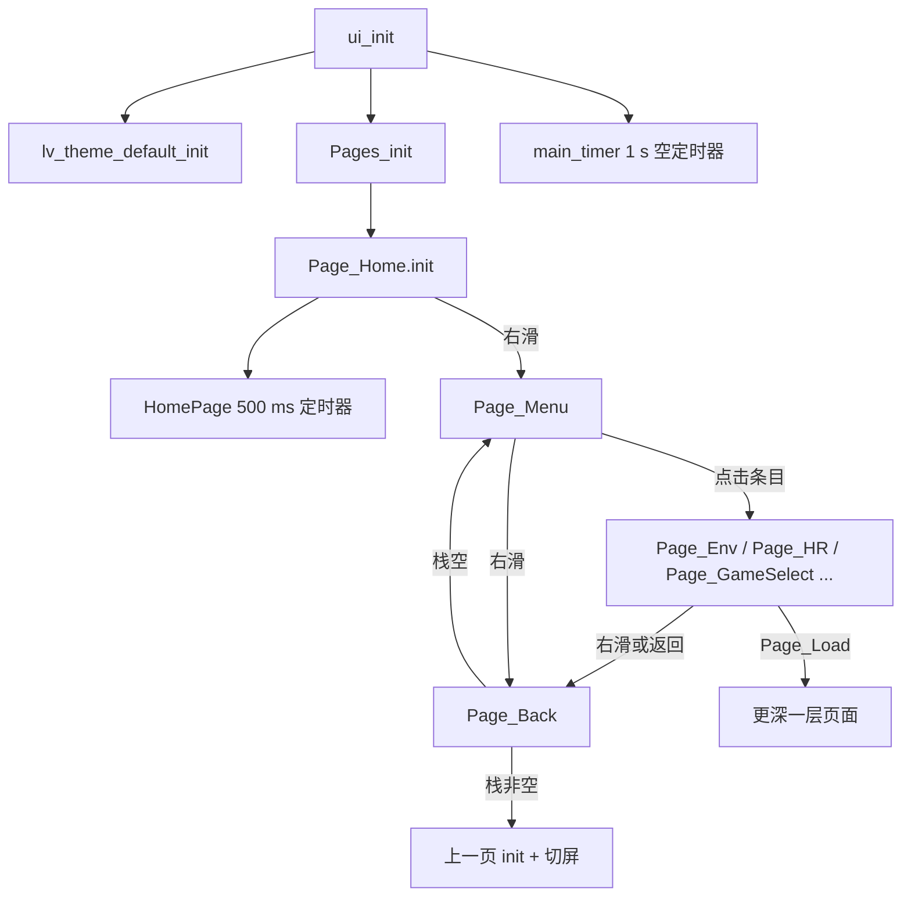

# GUI 框架：ui_helpers + LVGL 集成

对应源文件：

- `Software/OV_Watch/User/GUI_App/ui.c`（51 行）
- `Software/OV_Watch/User/GUI_App/ui_helpers.c`（410 行）
- `Software/OV_Watch/User/GUI_App/ui_helpers.h`（98 行）
- `Software/OV_Watch/User/Func/Src/PageManager.c`（147 行）
- `Software/OV_Watch/User/Func/Inc/PageManager.h`（46 行）
- `Software/OV_Watch/User/GUI_App/Screens/Src/ui_*Page.c`（19 个页面）

## 1. 三层结构

| 层 | 位置 | 职责 |
|---|---|---|
| 启动层 | `ui.c` | 初始化主题、建页面栈、创建 1 s 空定时器 |
| 路由层 | `PageManager.c` | `Page_t` 栈，负责 init/deinit 与切屏动画 |
| 页面层 | `Screens/Src/ui_*Page.c` | 用 LVGL API 建控件树、绑事件、起刷新定时器 |
| 辅助层 | `ui_helpers.c` | SquareLine 生成的属性 setter、动画回调 |



## 2. ui_init：只做三件事

`ui.c:41`：

```c
void ui_init(void)
{

    lv_disp_t * dispp = lv_disp_get_default();
    lv_theme_t * theme = lv_theme_default_init(dispp, lv_palette_main(LV_PALETTE_BLUE), lv_palette_main(LV_PALETTE_RED),
                                               true, LV_FONT_DEFAULT);
    lv_disp_set_theme(dispp, theme);
    Pages_init();
    //timer
    lv_timer_t * ui_MainTimer = lv_timer_create(main_timer, 1000,  NULL);
}
```

- 主题：主色蓝、辅色红、暗色模式（`true`），默认字体 `LV_FONT_DEFAULT`；
- `Pages_init()` 建栈并加载首页；
- `main_timer` 是空函数（`ui.c:33`），1 s 周期，预留给“全局状态刷新”，
  目前只起到“让 LVGL 每秒醒一次”的作用。

文件顶部还有两个编译期断言：

```c
#if LV_COLOR_DEPTH != 16
    #error "LV_COLOR_DEPTH should be 16bit to match SquareLine Studio's settings"
#endif
```

`LV_COLOR_DEPTH` 必须是 16（RGB565），`LV_COLOR_16_SWAP` 必须是 1，
否则与 ST7789 的字节序不匹配，会整屏花。

## 3. Page_t 与路由

`PageManager.h:18` 定义：

```c
typedef struct {
    void (*init)(void); // 指向一个参数为 void，返回值为 void的函数指针，用于初始化页面
    void (*deinit)(void); // 指向一个参数为 void，返回值为 void的函数指针，用于反初始化页面
    lv_obj_t **page_obj; // 写法为 lv_obj_t **page_obj;，表示 page_obj 是一个指向指针的指针，指向一个 lv_obj_t 类型的对象。这个对象通常是页面的根对象，用于在 LVGL 中管理页面的显示和交互。
} Page_t;
```

- `init`：创建控件树、绑事件、起定时器；
- `deinit`：删定时器、释放动态资源；
- `page_obj`：指向页面对象指针的地址（`&ui_XxxPage`），路由层用 `*page_obj`
  取 `lv_obj_t*`。

页面注册是一行宏式初始化，例如 `ui_HomePage.c:104`：

```c
Page_t Page_Home = {ui_HomePage_screen_init, ui_HomePage_screen_deinit, &ui_HomePage};
Page_t Page_Power = {ui_PowerPage_screen_init, ui_PowerPage_screen_deinit, &ui_PowerPage};
```

### 3.1 栈操作

| API | 行为 | 注意 |
|---|---|---|
| `Pages_init()` | 清栈、压 Home、init、`lv_disp_load_scr` | 只在启动时调一次 |
| `Page_Load(p)` | 若栈满返回；否则 deinit 当前页、push、init 新页、切屏 | 栈深上限 `MAX_DEPTH-1 = 5` |
| `Page_Back()` | 弹栈（弹时调 deinit）；栈空则压 Home+Menu | 弹到空会重建菜单 |
| `Page_Back_Bottom()` | 连续弹到只剩栈底，再 init | 充电拔出时用 |
| `Page_Get_NowPage()` | 返回栈顶 `Page_t*` | 页面定时器用它判断“我是否可见” |

`MAX_DEPTH` 是 6（`PageManager.h:15`），但 `Page_Load` 在
`top >= MAX_DEPTH - 1` 时就拒绝，所以实际最多压 5 层。
从首页进菜单、进游戏选择、进 2048 只有 4 层，够用。

### 3.2 生命周期的一个关键假设

`Page_Load` 会先 `deinit` 当前页，再 `init` 新页：

```c
    // 如果堆栈非空，反初始化当前页面
    if (PageStack.top > 0) {
        PageStack.pages[PageStack.top - 1]->deinit();
    }

    // 将新页面推入堆栈
    page_stack_push(&PageStack, newPage);
    newPage->init(); // 初始化新页面
    lv_scr_load_anim(*newPage->page_obj, LV_SCR_LOAD_ANIM_MOVE_RIGHT, 100, 0, true); // 加载并应用动画
```

最后那个 `true` 是 `auto_del`：LVGL 在动画结束后删除旧 screen。
所以 `deinit` 里**不能**再 `lv_obj_del` 页面对象，否则会二次释放。
`ui_HomePage_screen_deinit` 只删定时器，就是这个原因。

## 4. ui_helpers：属性 ID 模式

SquareLine 导出的回调不直接调 LVGL，而是调用属性 setter。下面是调用形式示意
（`target` 是控件指针，80 是目标值）：

```c
_ui_bar_set_property(target, _UI_BAR_PROPERTY_VALUE_WITH_ANIM, 80);
```

`ui_helpers.c` 把整数 id 翻译成具体 API。四类函数：

| 类别 | 代表函数 | 用途 |
|---|---|---|
| set_property | `_ui_bar_set_property`、`_ui_basic_set_property` | 按属性 ID 写值 |
| increment | `_ui_arc_increment`、`_ui_bar_increment` | 相对增减，给 +/- 按钮 |
| flag/state | `_ui_flag_modify`、`_ui_state_modify` | 增删翻转标志/状态 |
| anim_callback | `_ui_anim_callback_set_x` 等 | 作为 `lv_anim` 的执行/取值回调 |

### 4.1 flag 与 state 的三态操作

`ui_helpers.c:183`：

```c
void _ui_flag_modify(lv_obj_t * target, int32_t flag, int value)
{
    if(value == _UI_MODIFY_FLAG_TOGGLE) {
        if(lv_obj_has_flag(target, flag)) lv_obj_clear_flag(target, flag);
        else lv_obj_add_flag(target, flag);
    }
    else if(value == _UI_MODIFY_FLAG_ADD) lv_obj_add_flag(target, flag);
    else lv_obj_clear_flag(target, flag);
}
```

操作码只有三个：ADD=0、REMOVE=1、TOGGLE=2。`else` 兜底当 REMOVE，
所以传错值不会崩，但会静默清标志。

### 4.2 临时字符串缓冲

`ui_helpers.h:19` 定义 `_UI_TEMPORARY_STRING_BUFFER_SIZE 32`。
`_ui_arc_set_text_value` 用它拼 `"50%"` 这类短文本：

```c
void _ui_arc_set_text_value(lv_obj_t * trg, lv_obj_t * src, char * prefix, char * postfix)
{
    char buf[_UI_TEMPORARY_STRING_BUFFER_SIZE];
    lv_snprintf(buf, sizeof(buf), "%s%d%s", prefix, (int)lv_arc_get_value(src), postfix);
    lv_label_set_text(trg, buf);
}
```

32 字节对 `"%d"` 足够；如果 prefix/postfix 是长中文，要自己确认不截断。
`lv_snprintf` 会保证 `\0` 结尾，所以不会越界。

### 4.3 本工程其实很少用 ui_helpers

19 个页面里，事件回调基本都是手写的 `ui_event_*`，直接调
`Page_Load` / `lv_obj_*`；`ui_helpers` 主要由 SquareLine 生成的动画
和属性设置使用。读页面代码时看到 `_ui_*` 调用，基本可以认为是
“SquareLine 自动生成的样板”，不是业务逻辑。

## 5. 页面代码的固定套路

以 `ui_EnvPage.c` 为例，一个页面文件通常包含五段：

下面是结构示意（函数体省略；实际代码见 `ui_EnvPage.c`）：

```c
///////////////////// Page Manager //////////////////
Page_t Page_Env = {ui_EnvPage_screen_init, ui_EnvPage_screen_deinit, &ui_EnvPage};

///////////////////// VARIABLES ////////////////////
lv_obj_t * ui_EnvPage;

/////////////////// private Timer ///////////////////
static void EnvPage_timer_cb(lv_timer_t * timer) { /* ... */ }

///////////////////// SCREEN init ////////////////////
void ui_EnvPage_screen_init(void) { /* ... */ }

/////////////////// SCREEN deinit ////////////////////
void ui_EnvPage_screen_deinit(void) { lv_timer_del(ui_EnvPageTimer); }
```

### 5.1 控件树约定

| 约定 | 原因 |
|---|---|
| 每个页面一个 `lv_obj_create(NULL)` 作为 screen | LVGL 的 screen 没有父对象 |
| 行容器用 `lv_obj_create(page)` + 透明背景 | 整行可点，按下态给灰底 |
| 图标按钮 `lv_btn_create(panel)` 但 `clear_flag(CLICKABLE)` | 让点击落到 Panel，整行响应 |
| 所有事件用 `LV_EVENT_ALL` 绑定 | 回调内部再按 `event_code` 过滤 |
| 尺寸/坐标全部写死像素 | 屏幕固定 240×280，不做自适应 |

### 5.2 颜色与字体

| 用途 | 取值 |
|---|---|
| 主蓝 | `0x0080FF` / `0x3264C8` |
| 成功绿 | `0x19C819` / `0x64C864` |
| 警告橙 | `0xF5A73A` / `0xE18019` |
| 心率红 | `0xE11432` / `0xFF1919` |
| 背景深灰 | `0x323232` |
| 次要文字 | `0x808080` |

字体分两族：

- `ui_font_Cuyuan{18,20,24,30,38,48,80,100}`：中文正文与数字；
- `ui_font_iconfont{16,24,28,30,32,34,45}`：图标字体，用私有码位。

图标字体的字符在源码里通常是不可见/空白，靠码位渲染；
改图标要同时换字体文件和码位，不能只改字符串。

### 5.3 刷新定时器

页面自己管自己的定时器，周期按数据变化速度选：

| 页面 | 周期 | 原因 |
|---|---|---|
| 首页 | 500 ms | 时间/电量/温湿度都按秒级变化 |
| 充电页 | 2000 ms | 只看趋势，省电 |
| 环境页 | 500 ms | 与传感器采样同周期 |
| 指南针页 | 500 ms | 方向变化快，但 2 Hz 足够 |
| 心率页 | 50 ms | 心率算法每 50 ms 出一次值 |
| 血氧页 | 500 ms | 血氧变化慢 |
| 秒表页 | 10 ms | 厘秒显示，且创建后先 pause |

定时器必须在 `deinit` 里 `lv_timer_del`，否则页面切走后回调仍在跑，
访问已释放的 Label 会 HardFault。首页、充电页、环境页、指南针页、
心率页、血氧页都做了；**秒表页漏了**（`ui_TimerPage_screen_deinit` 是空函数），
这是一个已知隐患。

## 6. 事件回调约定

```c
void ui_event_SetButton(lv_event_t * e)
{
    lv_event_code_t event_code = lv_event_get_code(e);
    lv_obj_t * target = lv_event_get_target(e);
    if(event_code == LV_EVENT_CLICKED)
    {
			Page_Load(&Page_Set);
    }
}
```

固定模式：

1. 取 `event_code`；
2. 取 `target`（多数回调用不到，是 SquareLine 模板留下的）；
3. `if` 过滤事件类型；
4. 业务动作（`Page_Load` / `Page_Back` / 写 `HWInterface`）。

手势统一用：

```c
if(lv_indev_get_gesture_dir(lv_indev_get_act()) == LV_DIR_RIGHT)
    Page_Back();
```

即“右滑返回”。只有 2048 页把四个方向都用来移动棋盘，
所以它的页面手势回调里没有 `Page_Back`。

## 7. 内存与性能量化

| 项 | 数值 | 说明 |
|---|---|---|
| 页面 screen 数 | 同时最多 5 个 | 由 `MAX_DEPTH` 限制 |
| 单个页面控件数 | 10~40 个 | 菜单页 12 项 × 3 控件 = 36 |
| LVGL 绘制缓冲 | 2 × 13,440 B | 10 行双缓冲 |
| 首页定时器 | 500 ms | 每次只重写变化的 Label |
| 菜单滚动位置 | 1 个 int16 | `ui_MenuScrollY` |

页面每次进入都重建控件，所以“切页”本身有一次几十毫秒的卡顿；
这是用 Flash/CPU 换 RAM 的取舍——不缓存页面，省下几 KB 堆。

## 8. 陷阱清单

1. **`deinit` 不能删 screen**：`lv_scr_load_anim(..., auto_del=true)` 会删，
   重复删会死机。
2. **定时器必须删**：见秒表页的反例。
3. **页面重建会丢控件状态**：NFC/BLE 开关靠全局 `ui_HomePageNFCEN/BLEEN`
   恢复；抬腕开关靠 `HWInterface.IMU.wrist_is_enabled` 恢复。
4. **不要在定时器里做耗时操作**：AHT21 读一次 80 ms、ADC 8 次 8 ms，
   都会卡住 GUI 任务；这些都在传感器任务里做，页面只读缓存。
5. **`lv_obj_clear_flag(CLICKABLE)` 的对象收不到点击**：想让整行可点，
   要清 Button 的 CLICKABLE，保留 Panel 的。
6. **`LV_EVENT_ALL` 会让回调收到大量事件**：必须自己过滤，
   否则 `DRAW_PART_BEGIN` 这类高频事件也会进业务分支。

## 9. 相关文档

- `Docs/03-页面管理器与GUI架构.md`：PageManager 逐函数
- `Docs/10-UI页面逐页精读.md`：19 个页面的控件树与数据流
- `Knowledge-Base/ovwatch/BSP_LCD_Touch.md`：显示与触摸的底层
