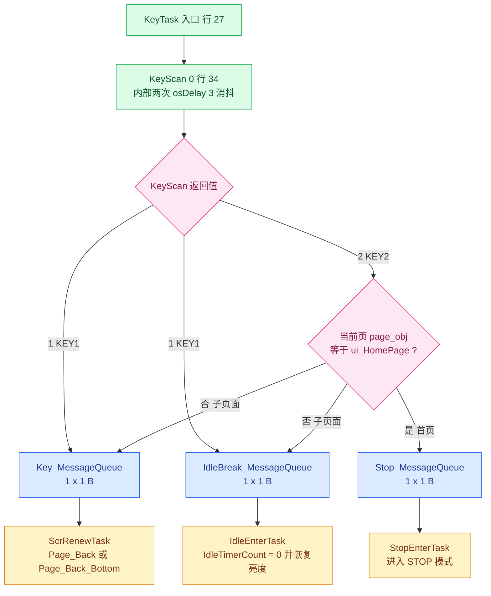
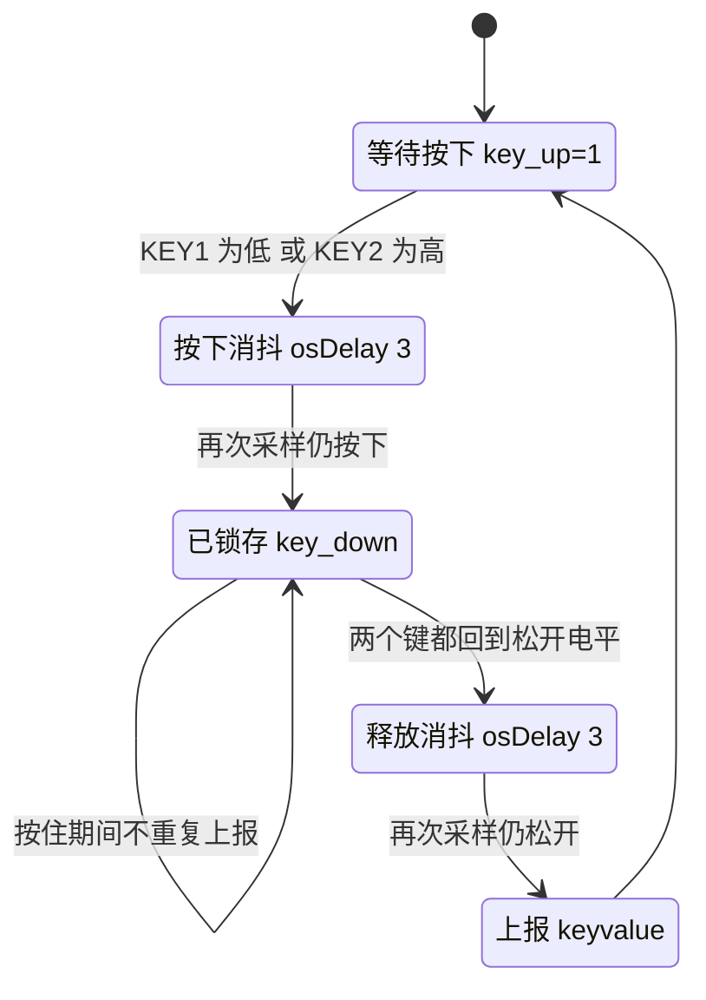
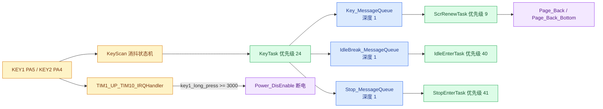

# user_KeyTask.c 深读：按键任务与按键事件分发

> 对应源文件：`Software/OV_Watch/User/Tasks/Src/user_KeyTask.c`（共 57 行）
> 配套文件：
> - `Software/OV_Watch/User/Tasks/Inc/user_KeyTask.h`（20 行，只有函数声明）
> - `Software/OV_Watch/BSP/KEY/key.c`（`KeyScan()` 实现，共 113 行）
> - `Software/OV_Watch/User/Tasks/Src/user_TasksInit.c`（任务与队列创建）
> - `Software/OV_Watch/User/Tasks/Src/user_ScrRenewTask.c`（`Key_MessageQueue` 消费者）
> - `Software/OV_Watch/User/Tasks/Src/user_RunModeTasks.c`（`IdleBreak` / `Stop` 消费者）
> - `Software/OV_Watch/Core/Src/stm32f4xx_it.c`（TIM1 长按关机）
>
> 相关文档：`Docs/02-FreeRTOS任务系统详解.md` 4.6 / 4.8、`Docs/05-中断与通信协议.md` 4.1、
> `Docs/06-外设驱动详解.md` 第 10 节、`Docs/07-低功耗与运行模式.md` 第 2~3 节。

---

## 1. 一句话职责

`KeyTask` 不直接读引脚、也不操作页面。它的职责是**把 `KeyScan()` 的解抖结果翻译成三种消息**：

| 消息 | 目标队列 | 语义 | 消费者 |
|---|---|---|---|
| `keystr = 1` | `Key_MessageQueue` | KEY1 单击，返回上一页 | `ScrRenewTask` |
| `keystr = 2` | `Key_MessageQueue` | KEY2 单击，回首页 | `ScrRenewTask` |
| 任意值（只关心有无） | `IdleBreak_MessageQueue` | 有按键，打断空闲计时 | `IdleEnterTask` |
| 任意值（只关心有无） | `Stop_MessageQueue` | 首页按 KEY2，进入 STOP 休眠 | `StopEnterTask` |

它**不处理长按**。长按 KEY1 3 秒关机是在 `TIM1_UP_TIM10_IRQHandler()` 里独立计数的，
与 `KeyTask` 无关（见第 8 节陷阱 6）。

---

## 2. 任务属性与在系统中的位置

`user_TasksInit.c` 中该任务的创建参数：

| 项目 | 值 | 出处 |
|---|---|---|
| 任务名 | `"KeyTask"` | `user_TasksInit.c:142` |
| 入口函数 | `KeyTask` | `user_TasksInit.c:191` |
| 栈大小 | `128 * 1 = 128 B`（32 words） | `user_TasksInit.c:143` |
| 优先级 | `osPriorityNormal` = 24 | `user_TasksInit.c:144` |
| 周期 | `osDelay(1)`，叠加 `KeyScan()` 内两次 `osDelay(3)` | `user_KeyTask.c:55` |
| 句柄 | `KeyTaskHandle` | `user_TasksInit.c:140` |
| 堆开销 | 128 B 栈 + 约 100 B TCB ≈ 228 B | 16 KB `heap_4` 中分配 |

队列在 `User_Tasks_Init()` 里创建（`user_TasksInit.c:177~183`）：

```c
Key_MessageQueue  = osMessageQueueNew(1, 1, NULL);
Idle_MessageQueue = osMessageQueueNew(1, 1, NULL);
Stop_MessageQueue = osMessageQueueNew(1, 1, NULL);
IdleBreak_MessageQueue = osMessageQueueNew(1, 1, NULL);
HomeUpdata_MessageQueue = osMessageQueueNew(1, 1, NULL);
DataSave_MessageQueue = osMessageQueueNew(2, 1, NULL);
HardIntEventHandle = osEventFlagsNew(NULL);
```

四个与按键相关的对象深度都是 **1**、消息体 **1 字节**。这是“事件通知”而不是“数据传输”：
`keystr`、`Stopstr`、`IdleBreakstr` 的具体数值对消费者没有意义，只有“队列非空”有意义。

**执行流**：



---

## 3. 逐函数表

本文件只实现一个函数，辅助函数在 BSP 层：

| 函数 | 行号 | 职责 | 调用者 | 阻塞点 |
|---|---|---|---|---|
| `KeyTask(void *argument)` | 27~57 | 扫描按键并把事件分发到 3 个队列 | FreeRTOS 调度器（创建于 `user_TasksInit.c:191`） | `osMessageQueuePut` 最多 1 tick；`osDelay(1)` |
| `KeyScan(uint8_t mode)` | `key.c:77~112` | 两段式消抖状态机，松手瞬间返回键值 | 仅 `KeyTask`（`user_KeyTask.c:34`） | 内部 `osDelay(3)` 两次 |

> 全工程只有一处调用 `KeyScan()`，且 `mode` 恒为 0；`mode != 0` 的复位分支从未被使用（见陷阱 7）。

---

## 4. 逐行精读

### 4.1 函数头与局部变量（27~31 行）

```c
void KeyTask(void *argument) // 按键任务函数
{
	uint8_t keystr=0; // 用于存储按键扫描结果的变量，初始值为 0，表示没有按键被按下。
	uint8_t Stopstr=0; // 用于存储停止信号的变量，初始值为 0，表示没有停止信号。
	uint8_t IdleBreakstr=0; // 用于存储空闲中断信号的变量，初始值为 0，表示没有空闲中断信号。
```

- 三个变量都是 `uint8_t`，与队列消息大小 1 字节严格匹配；传 `&keystr` 给
  `osMessageQueuePut()` 时不会发生“按 4 字节拷贝、越界读 3 字节”的问题。
- `argument` 未使用：CMSIS-RTOS2 的任务入口固定签名，参数由 `osThreadNew()` 传入 `NULL`。
- 初值 0 只用于满足“有个地址可传”，消费者不看内容。`Stopstr` 与 `IdleBreakstr`
  在整个函数里从未被重新赋值，始终保持 0。

### 4.2 主循环与扫描（32~34 行）

```c
	while(1)
	{
		switch(KeyScan(0)) // 根据KeyScan返回的keyvalue值去case需要进行的步骤
```

- `while(1)` 无退出路径；任务只能被 `vTaskDelete()` 删除，本工程没有删除它。
- `KeyScan(0)` 的 `mode=0` 表示**不复位内部静态状态**。`key_up`/`key_down` 是
  `key.c:79~80` 的 `static` 变量，跨调用保持，因此“按下”和“松开”可以分两次
  1 ms 轮询完成。
- `switch` 只处理 1 和 2；返回 0（无事件）时直接落到 `osDelay(1)`。

### 4.3 `case 1`：KEY1 单击（36~40 行）

```c
			case 1:
				keystr = 1;
				osMessageQueuePut(Key_MessageQueue, &keystr, 0, 1); // 把 keystr 放入 Key_MessageQueue：通知“按键任务”或相关任务，有按键 1 事件 
				osMessageQueuePut(IdleBreak_MessageQueue, &IdleBreakstr, 0, 1); // 把 IdleBreakstr 放入 IdleBreak_MessageQueue：通知“空闲/待机相关任务”，有事件需要退出空闲状态
				break; // 退出switch不再执行case
```

- 先发页面事件，再发“打断空闲”。顺序不影响正确性：两个队列由不同任务消费，
  且 `IdleEnterTask` 优先级 40 高于 `KeyTask` 的 24，第二条 `put` 返回后可能立刻被抢占。
- `osMessageQueuePut(..., 0, 1)` 的参数是 `(队列, 数据指针, 优先级, 超时 tick)`。
  超时给 **1 tick** 而不是 0：队列满时最多阻塞 1 ms，然后返回 `osErrorTimeout`。
- **返回值没有检查**。深度只有 1，如果 `ScrRenewTask` 还没取走上一条，这次按键
  就被静默丢弃（见陷阱 3）。

### 4.4 `case 2`：KEY2 单击（42~53 行）

```c
			case 2:
				if(Page_Get_NowPage()->page_obj == &ui_HomePage) // 获取当前页面判断是否为主页
				{
					osMessageQueuePut(Stop_MessageQueue, &Stopstr, 0, 1); // 发消息到 Stop_MessageQueue，通常表示“按键 2 在主页被按下，要进入停止/关机/退出流程”。
				}
				else
				{
					keystr = 2;
					osMessageQueuePut(Key_MessageQueue, &keystr, 0, 1); // 发按键值给按键业务任务
					osMessageQueuePut(IdleBreak_MessageQueue, &IdleBreakstr, 0, 1); // 发“打断空闲”信号给空闲管理任务
				}
				break;
```

- 首页按 KEY2 是**特判**：不发 `Key_MessageQueue`，只发 `Stop_MessageQueue`。
  因此首页按 KEY2 不会触发 `Page_Back()`（首页已经在栈底），而是进入 STOP 休眠。
- 子页面按 KEY2：发键值 2，`ScrRenewTask` 收到后执行 `Page_Back_Bottom()`
  （`user_ScrRenewTask.c:54~62`），并让心率/罗盘传感器睡眠。
- `Page_Get_NowPage()` 在 `PageManager.c:58~60` 直接返回 `get_top_page()` 的结果；
  栈空时返回 `NULL`。这里没有判空，属于潜在空指针解引用（见陷阱 2）。
- 首页分支**没有发 `IdleBreak`**。因为马上要睡，清不清空闲计时无所谓；
  `StopEnterTask` 在 `sleep:` 标签处会自己把 `IdleTimerCount` 清零
  （`user_RunModeTasks.c:134`）。

### 4.5 周期与退出（55~56 行）

```c
		osDelay(1);
	}
}
```

- 名义周期 1 ms，但 `KeyScan()` 在“按下沿”和“松开沿”各做一次 `osDelay(3)`，
  所以一次完整按键的扫描耗时约 6~7 个 tick。
- 量化响应延迟：按下 → 3 tick 消抖 → 锁存；松开 → 3 tick 消抖 → 返回键值；
  再叠加 1 ms 轮询相位和 `ScrRenewTask` 的 10 ms 轮询，**从松手到页面动作约 7~20 ms**。
  页面切换动画本身 100 ms，人手感知不到这个延迟。

---

## 5. `KeyScan()` 状态机（`BSP/KEY/key.c`）

`KeyScan()` 的真实实现（`key.c:77~112`，摘录关键段）：

```c
uint8_t KeyScan(uint8_t mode)
{
	static uint8_t key_up = 1;   // 1=空闲等待按下（static：状态跨调用保持）
	static uint8_t key_down = 0; // 0=无键，1=KEY1，2=KEY2（已消抖锁存）
	uint8_t keyvalue = 0;

	if(mode)
	{
		key_up = 1;
		key_down = 0;
	}

	if( key_up && ((!KEY1) || KEY2)) // KEY1 为低 或 KEY2 为高 = 有键按下
	{
		osDelay(3);//ensure the key：3 个节拍消抖（调度器挂起时会忙等）
		if(!KEY1)
			key_down = 1;
		if(KEY2)
			key_down = 2;
		if(key_down)
			key_up = 0;
	}

	if ( key_down && (KEY1 && (!KEY2)) ) // 两个键都回到松开电平才认为释放
	{
		osDelay(3);//ensure the key：释放也要消抖，防抖动脉冲
		if(KEY1 && (!KEY2))
		{
			key_up = 1;
			keyvalue = key_down; // 松手才上报，一次按下只产生一个事件
			key_down = 0;
		}
	}

	return keyvalue;
}
```

电平极性（`key.h:18~24` 的宏定义与 `Docs/00` 管脚表一致）：

| 按键 | 引脚 | 按下电平 | EXTI 边沿 |
|---|---|---|---|
| KEY1 | PA5 | 0（上拉） | 下降沿 |
| KEY2 | PA4 | 1（无上拉） | 上升沿 |

状态机：



要点：

1. **松手才上报**：按下沿只锁存，释放沿才返回键值，所以一次按压只产生一个事件。
2. **两个 `if` 独立**：同时按住 KEY1 和 KEY2 时，`key_down` 先被赋 1 再被赋 2，
   最终上报 **2**（KEY2 覆盖）。
3. **释放条件要求两个键都松开**：`KEY1 && (!KEY2)`。若一直按住其中一个，
   状态机停在 `DOWN`，不会重复上报。
4. **`osDelay(3)` 依赖调度器**：在 `vTaskSuspendAll()` 期间调用会退化成忙等；
   `KeyTask` 本身在调度器运行后才启动，正常路径不受影响。

---

## 6. 与其他任务/队列的关系

**数据流**：



逐条说明：

| 关系 | 机制 | 关键代码 |
|---|---|---|
| KeyTask → ScrRenewTask | `Key_MessageQueue` 深度 1，消息 1 字节 | 生产 `user_KeyTask.c:38/50`，消费 `user_ScrRenewTask.c:37` |
| KeyTask → IdleEnterTask | `IdleBreak_MessageQueue`，消费者据此清零 `IdleTimerCount` 并恢复亮度 | 生产 `user_KeyTask.c:39/51`，消费 `user_RunModeTasks.c:82~87` |
| KeyTask → StopEnterTask | `Stop_MessageQueue`，消费者进入 STOP | 生产 `user_KeyTask.c:45`，消费 `user_RunModeTasks.c:128` |
| KeyTask → PageManager | 只读调用 `Page_Get_NowPage()` 判断是否首页 | `user_KeyTask.c:43`，实现 `PageManager.c:58~60` |
| TIM1 ISR → 电源 | 独立长按计数，不经过任何任务 | `stm32f4xx_it.c:228~244` |

**优先级带来的时序**：`KeyTask` 24 高于 `ScrRenewTask` 9，按键事件会立即入队；
但 `ScrRenewTask` 要等所有更高优先级任务（WDOG 42、Stop 41、Idle 40、default/Key 24）
让出 CPU 后才运行。所以“入队”很快，“页面动作”要等。

---

## 7. 设计意图

1. **中断只负责唤醒，扫描放在任务里**：`key.c` 的 EXTI 初始化只配了边沿和 NVIC，
   `EXTI4_IRQHandler`/`EXTI9_5_IRQHandler` 只清标志。消抖需要 `osDelay`，
   不能在 ISR 里做，所以统一由 1 ms 任务轮询；EXTI 真正的作用是唤醒 STOP。
2. **三个队列而不是一个“按键结构体”**：页面返回、空闲打断、休眠是三种不同语义，
   分开后每个消费者只关心自己的队列，不需要解析“这个键值归谁”。
3. **首页 KEY2 特判**：手表只有一个返回键和一个功能键，首页没有“上一页”，
   把 KEY2 复用为“一键休眠”比长按更省事。
4. **不在 KeyTask 里调页面 API**：`Page_Back()` 会操作 LVGL 对象，必须在
   LVGL 任务上下文串行执行，所以通过 `ScrRenewTask` 中转（`Docs/03` 第 8 节）。
5. **消息体 1 字节**：RAM 与拷贝成本最低；事件语义下不需要携带更多信息。

---

## 8. 陷阱与实测建议

1. **文件头导读与实现不符**（`user_KeyTask.c:2~4`）：导读写“消抖后把单击/长按事件
   经 pubsub 发给页面管理器”。实际是**三个消息队列**，没有 pubsub，也没有长按。
   `pubsub` 只在 PC 模拟器里用于 SDL 按键分发（`Docs/04` 第 6 节）。读代码以
   27~56 行为准。
2. **`Page_Get_NowPage()` 可能返回 NULL**（`user_KeyTask.c:43`）：页面栈未初始化
   时返回 NULL，紧接着的 `->page_obj` 会 HardFault。当前启动顺序
   （`ui_init()` → `Pages_init()` 完成后 `KeyTask` 才运行）保证了安全。
3. **队列深度 1 + 忽略 `osMessageQueuePut` 返回值**（38/39/45/50/51 行）：
   连续快速按键时，上一次消息未被消费则本次静默丢失。量化：`KeyTask` 1 ms 生产、
   `ScrRenewTask` 10 ms 消费，理论上最多积压 10 条，深度 1 只能留 1 条。
   实测表现为“快速连按只认第一下”。若要改，至少检查返回值或把深度加到 4。
4. **首页 KEY2 只发 Stop，不发 IdleBreak**（42~46 行）：Stop 队列深度 1，满时按键丢失。
5. **`osDelay(3)` 在调度器挂起时忙等**：`KeyScan()` 的消抖依赖 SysTick 与调度器。
   如果将来在 `HardwareInitTask` 的 `vTaskSuspendAll()` 区间里调用 `KeyScan()`，
   3 tick 会变成忙等（`Docs/02` 4.1、`Docs/06` 10.2）。
6. **长按不在本任务**：`TIM1_UP_TIM10_IRQHandler()`（`stm32f4xx_it.c:228~244`）
   用 `static uint16_t key1_long_press` 每 1 ms 加 1，≥3000 调 `Power_DisEnable()`。
   注意 `Docs/06` 11.3 写“首页按 KEY2 也会断电”，与源码不一致：首页 KEY2 走的是
   `Stop_MessageQueue` → STOP 休眠，以 `user_KeyTask.c:45` 为准。
7. **`KeyScan(0)` 从不清状态**：全工程没有 `KeyScan(1)` 调用。STOP 唤醒后如果按键
   仍被按住，`key_up`/`key_down` 可能保留睡眠前的状态，松手时补发一次事件。
   稳妥做法是在 `StopEnterTask` 唤醒后调用 `KeyScan(1)` 复位（当前未实现）。
8. **同时按两键上报 2**：`key.c:92~95` 两个独立 `if`，KEY2 覆盖 KEY1。这不是 bug，
   但做组合键功能时要注意。
9. **128 B 栈的余量**：`KeyTask` 栈只有 32 words，加一行 `printf` 就可能把栈打穿
   （`fputc` → `HAL_UART_Transmit` 调用链较深）；调试按键建议用全局变量 + 调试器 Watch。
10. **按键响应延迟的量化**：按下消抖 3 tick + 释放消抖 3 tick + 轮询 1 ms +
    `ScrRenewTask` 10 ms 轮询 ≈ **7~20 ms**，页面动画 100 ms，主观无感。

---

## 9. 如果要改（建议，不在本次任务实施）

| 目标 | 最小改动 | 风险 |
|---|---|---|
| 不丢键 | 检查 `osMessageQueuePut` 返回值；或深度 1 → 4 | 堆增加约 3 字节消息 + 队列控制块不变 |
| 防空指针 | `Page_t *p = Page_Get_NowPage(); if (p && p->page_obj == &ui_HomePage)` | 无 |
| 唤醒后清按键状态 | `StopEnterTask` 恢复段调用 `KeyScan(1)` | 需要 `key.h` 已包含（已包含） |
| 统一“关机/休眠”语义 | 明确首页 KEY2 是休眠还是断电，同步改文档与代码 | 改代码超出本任务范围 |

---

## 10. 互链

- 任务全景、堆预算、优先级：[`Docs/02-FreeRTOS任务系统详解.md`](../../../references/firmware/OV-Watch/Docs/02-FreeRTOS任务系统详解.md) 第 1、2、4.6 节
- 中断与 EXTI 分工：[`Docs/05-中断与通信协议.md`](../../../references/firmware/OV-Watch/Docs/05-中断与通信协议.md) 第 4.1 节
- 按键驱动与 `KeyScan`：[`Docs/06-外设驱动详解.md`](../../../references/firmware/OV-Watch/Docs/06-外设驱动详解.md) 第 10 节
- 空闲/STOP 与唤醒：[`Docs/07-低功耗与运行模式.md`](../../../references/firmware/OV-Watch/Docs/07-低功耗与运行模式.md) 第 2、3 节
- 页面栈与本任务的关系：[`Docs/03-页面管理器与GUI架构.md`](../../../references/firmware/OV-Watch/Docs/03-页面管理器与GUI架构.md) 第 8 节
- 同目录 KB：`TasksSrcuser_TasksInit.md`（队列创建）、`SrcPageManager.md`（`Page_Back` 语义）、
  `TasksSrcuser_HardwareInitTask.md`（启动顺序）、`CoreSrcmain.md`（`SCB`/启动）
