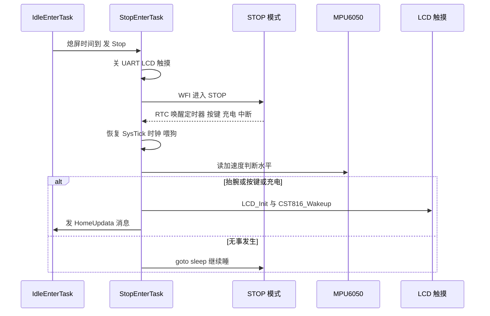

# SensorDataUpdateTask 与 RunModeTasks：周期、依赖与联动

对应源文件：

- `Software/OV_Watch/User/Tasks/Src/user_SensUpdateTask.c`（243 行）
- `Software/OV_Watch/User/Tasks/Src/user_RunModeTasks.c`（247 行）
- `Software/OV_Watch/User/Tasks/Src/user_TasksInit.c`（任务/队列总装）
- `Software/OV_Watch/User/Tasks/Src/user_KeyTask.c`（按键发消息）

## 1. 六个相关任务

| 任务 | 入口 | 栈（字节） | 优先级 | 周期/触发 | 主要阻塞对象 |
|---|---|---|---|---|---|
| `SensorDataUpdateTask` | `user_SensUpdateTask.c:123` | 640 | 9（Low1） | 500 ms + 消息 | `osDelay(500)`、`HomeUpdata_MessageQueue` |
| `HRDataUpdateTask` | `user_SensUpdateTask.c:88` | 640 | 9（Low1） | 50 ms | `osDelay(50)` |
| `MPUCheckTask` | `user_SensUpdateTask.c:53` | 384 | 10（Low2） | 300 ms | `osDelay(300)` |
| `IdleEnterTask` | `user_RunModeTasks.c:66` | 128 | 40（High） | 10 ms | `osDelay(10)` |
| `StopEnterTask` | `user_RunModeTasks.c:120` | 2048 | 41（High1） | 100 ms + 队列 | `Stop_MessageQueue` |
| `ChargPageEnterTask` | `user_ChargCheckTask.c` | 1280 | 9（Low1） | 事件 | `HardIntEventHandle` |

优先级分层很明显：STOP 相关任务用 High 段（40/41），保证“到点必须睡”；
传感器任务用 Low1/Low2，让 GUI 和按键永远先跑。

## 2. SensorDataUpdateTask：按页采样

### 2.1 主循环骨架

```c
	while(1)
	{
		// Update the sens data showed in Home
		uint8_t HomeUpdataStr;
		if(osMessageQueueGet(HomeUpdata_MessageQueue, &HomeUpdataStr, NULL, 0)==osOK) // 如果函数完成没有发生错误事件
		{
			//bat battery电池
```

注意 `osMessageQueueGet` 的超时是 0：不阻塞，拿不到就跳过。
真正的节奏由循环末尾的 `osDelay(500)` 决定。

### 2.2 首页分支：消息驱动

首页数据不是每 500 ms 都刷，而是先看 `HomeUpdata_MessageQueue` 有没有消息。
消息由两处投递：

- `TaskTickHook` 之前的 `StartDefaultTask` 初始化段（`user_TasksInit.c:205`）；
- `StopEnterTask` 唤醒后（`user_RunModeTasks.c:240`）。

拿到消息后依次做：

| 步骤 | 代码 | 耗时 |
|---|---|---|
| 电量 | `BatCalculate()` → 8 次 ADC | ~8 ms |
| 步数 | `GetSteps()` → DMP I2C 读 | <1 ms |
| 温湿度 | `GetHumiTemp()` → AHT21 测量 | **80 ms** |
| 通知保存 | `osMessageQueuePut(DataSave_MessageQueue, 3)` | 微秒级 |

所以一次首页刷新最坏约 90 ms，这期间任务不响应其它消息。

### 2.3 页面分支：停在页面上就采

三个 `else if` 分支互斥：

| 当前页 | 动作 | 写入 |
|---|---|---|
| `ui_SPO2Page` | `if(0)` 空实现 | 无（SPO2 恒 99） |
| `ui_EnvPage` | 读 AHT21，范围检查 `-10<temp<50 && 0<humi<100` | `temperature/humidity`（强转 int8） |
| `ui_CompassPage` | `LSM303DLH_Wakeup` + 读加速度/磁力 + `Azimuth_Calculate` + `Altitude_Calculate` | `direction`、`altitude` |

指南针分支还会顺带读气压计，因为海拔显示就在指南针页上。
`LSM303DLH_Wakeup()` 每 500 ms 调一次是冗余的（写两个寄存器），
但代价很小，作者没有做“只唤醒一次”的状态管理。

### 2.4 两处精度差异

同一个 AHT21，在首页分支和环境页分支的写法不一样：

- 首页：`HWInterface.AHT21.humidity = humi;`（float 隐式转 uint8）；
- 环境页：`= (int8_t)humi;`（显式转 int8 再转 uint8）。

两者最终都存进 `uint8_t`，负温都会回绕；区别只是编译器告警。
这是历史遗留的不一致，不影响功能。

## 3. HRDataUpdateTask：50 ms 心率

```c
		if(Page_Get_NowPage()->page_obj == &ui_HRPage) // 如果当前页面是心率的ui界面
		{
			osMessageQueuePut(IdleBreak_MessageQueue, &IdleBreakstr, 0, 1); // 唤醒心率传感器
			//sensor wake up
			EM7028_hrs_Enable(); // 初始化心率传感器
```

三个关键点：

1. **只在心率页工作**：不在页面就 `osDelay(50)` 空转，不碰传感器；
2. **每次循环都 Enable**：`EM7028_hrs_Enable()` 是幂等的寄存器写，
   但每 50 ms 写一次 I2C 也是开销；
3. **计算用 `vTaskSuspendAll` 保护**：

```c
				vTaskSuspendAll(); // 挂起调度器,作用：保证 HR_Calculate(EM7028_Get_HRS1(), user_HR_timecount) 执行期间不会发生任务切换，避免计算过程被其他任务打断导致数据不一致。
				hr_temp = HR_Calculate(EM7028_Get_HRS1(),user_HR_timecount); // hr_temp重新赋值
				xTaskResumeAll(); // 恢复调度器，并处理挂起期间积压的事件（被中断唤醒的任务、错过的 tick），必要时触发一次任务切换。
```

`HR_Calculate` 内部要读全局的采样缓冲，挂起调度器防止被其它任务打断。
代价是这几十微秒内整个系统不能切换任务（包括高优先级任务）。

结果还有一层范围过滤：

```c
				if(HWInterface.HR_meter.HrRate != hr_temp && hr_temp>50 && hr_temp<120) // 心率判断
```

只接受 50~120 次/分，超出认为是算法噪声，不更新。
这能挡住大部分误判，但也会把真实的高心率（>120）滤掉。

## 4. MPUCheckTask：抬腕 → 发 Stop

```c
		if(HWInterface.IMU.wrist_is_enabled) // 如果抬腕up
		{
			if(MPU_isHorizontal()) // 如果设备水平
			{
				HWInterface.IMU.wrist_state = WRIST_UP; // 当前手表抬起
			}
			else // 如果设备不水平
			{
				if(WRIST_UP == HWInterface.IMU.wrist_state) // 之前的状态是抬腕up
				{
					HWInterface.IMU.wrist_state = WRIST_DOWN; // 将状态改为down
					if( Page_Get_NowPage()->page_obj == &ui_HomePage ||
```

逻辑是“状态机 + 页面白名单”：

- 水平 → `WRIST_UP`；
- 从水平变成不水平（放下）→ `WRIST_DOWN`，并且如果当前在首页/菜单/设置页，
  发一条 Stop 消息让系统尽快熄屏；
- 无论之前什么状态，只要不水平就兜底写 `WRIST_DOWN`。

白名单的意义：在心率页、指南针页时手表的姿态本来就可能是斜的，
不应该因为“放下”就熄屏。

## 5. IdleEnterTask：两级超时

```c
		if(osMessageQueueGet(Idle_MessageQueue,&Idlestr,NULL,1)==osOK)
		{
			LCD_Set_Light(5);
			light_off_sent = 1;
		}
```

两级阈值来自设置页：

| 阈值 | 变量 | 默认 | 动作 |
|---|---|---|---|
| 常亮时间 | `ui_LTimeValue` | 10 s | 背光降到 5%（不全灭） |
| 熄屏时间 | `ui_TTimeValue` | 15 s | 发 Stop，进 STOP 模式 |

`light_off_sent` 保证“变暗”只发一次，不会每 10 ms 重复写 PWM。

`IdleBreak` 消息会：

1. `IdleTimerCount = 0`；
2. `light_off_sent = 0`；
3. `LCD_Set_Light(ui_LightSliderValue)` 恢复用户亮度。

谁会发 IdleBreak：

| 来源 | 场景 |
|---|---|
| `KeyTask` | 任意按键 |
| `LvHandlerTask` | `lv_disp_get_inactive_time() < 1000`，即 1 s 内有触摸 |
| `MessageSendTask` | 串口收到数据 |
| `SensorDataUpdateTask` | 进入心率/血氧/环境/指南针页 |
| `TaskTickHook` | 秒表运行时把 `IdleTimerCount` 清零 |

## 6. StopEnterTask：全项目最危险的函数

### 6.1 进入睡眠

```c
			sleep:
			IdleTimerCount = 0;

			//sensors
			//usart
			HAL_UART_MspDeInit(&huart1);

			//lcd
			LCD_RES_Clr();
			LCD_Close_Light();
			//touch
			CST816_Sleep();
```

顺序很重要：先关外设，再挂调度器，最后 WFI。

```c
			vTaskSuspendAll();
			WDOG_Disnable();
			CLEAR_BIT(SysTick->CTRL, SysTick_CTRL_TICKINT_Msk);
			HAL_PWR_EnterSTOPMode(PWR_MAINREGULATOR_ON,PWR_STOPENTRY_WFI);
```

- `vTaskSuspendAll`：睡眠期间不能有任务切换；
- `WDOG_Disnable`：外部看门狗没人喂，必须先禁用；
- 关 SysTick 中断：STOP 会停掉 SysTick 时钟；
- WFI：等中断唤醒，SRAM/寄存器内容保留。

### 6.2 唤醒后恢复

```c
			SET_BIT(SysTick->CTRL, SysTick_CTRL_TICKINT_Msk);
			HAL_SYSTICK_Config(SystemCoreClock / (1000U / uwTickFreq));
			SystemClock_Config();
			WDOG_Feed();          // 醒来立刻喂狗
			xTaskResumeAll();     // 恢复调度（与上面的 SuspendAll 配对）
```

STOP 唤醒后时钟回到 HSI 16 MHz，必须 `SystemClock_Config()` 重新升到 100 MHz，
否则串口波特率、SPI 时序、`delay_ms` 全部错。

### 6.3 判断“为什么醒”

```c
			if(HWInterface.IMU.wrist_is_enabled)
			{
				uint8_t hor;
				hor = MPU_isHorizontal();   // roll/pitch 都在 ±0.5rad 内 → 水平
				if(hor && HWInterface.IMU.wrist_state == WRIST_DOWN)
				{
					HWInterface.IMU.wrist_state = WRIST_UP;
					Wrist_Flag = 1;         // 抬腕：允许真正唤醒
```

判断树：

1. 抬腕（从 DOWN 变水平）→ `Wrist_Flag=1`，继续；
2. 抬腕后又放下 → `goto sleep`；
3. 否则看 `KEY1`、`KEY2`、`ChargeCheck()`、`Wrist_Flag`，
   任一为真才真正唤醒；
4. 都不满足 → `goto sleep`。

`goto sleep` 会重新执行睡前动作（关外设、挂调度器、WFI），
所以每次“继续睡”都是一次完整的睡眠周期。

### 6.4 唤醒后的外设恢复

```c
			HAL_UART_MspInit(&huart1);
			//lcd
			LCD_Init();
			LCD_Set_Light(ui_LightSliderValue);
			//touch
			CST816_Wakeup();          // 复位唤醒触摸
```

已知隐患：只调了 `HAL_UART_MspInit`，没有再 `HAL_UART_Receive_DMA`，
睡眠后串口接收可能失效（详见 `Docs/07` 第 4.6 节）。



## 7. 信号与队列总表

| 队列 | 深度 | 生产者 | 消费者 | 语义 |
|---|---|---|---|---|
| `Stop_MessageQueue` | 1 | IdleEnterTask、MPUCheckTask、KeyTask | StopEnterTask | 请求进入 STOP |
| `Idle_MessageQueue` | 1 | IdleEnterTask（自己） | IdleEnterTask | 背光变暗 |
| `IdleBreak_MessageQueue` | 1 | KeyTask、LvHandlerTask、MessageSendTask、Sens/HR 任务 | IdleEnterTask | 有活动，重新计时 |
| `HomeUpdata_MessageQueue` | 1 | StartDefaultTask、StopEnterTask | SensorDataUpdateTask | 刷新首页数据 |
| `DataSave_MessageQueue` | 1 | SensorDataUpdateTask | DataSaveTask | 保存步数/电量 |

队列深度都是 1，意味着“消息会覆盖/丢弃”：

- `osMessageQueuePut(..., timeout=0/1)` 在队列满时直接失败；
- 短时间内多次按键，只有第一条 IdleBreak 有效——对本项目够用。

## 8. 并发与风险

| 风险 | 场景 | 现状 |
|---|---|---|
| `wrist_state` 双写 | SensUpdateTask 与 RunModeTasks 都写 | 无锁，极端情况闪屏 |
| `vTaskSuspendAll` 过长 | `HR_Calculate` 内部 | 几十微秒，可接受 |
| 传感器读阻塞 | AHT21 80 ms | 阻塞的是 Low1 任务，不影响 GUI |
| 队列满丢消息 | 连续按键 | 只影响一次空闲重置 |
| 串口唤醒后收不到 | `HAL_UART_MspInit` 没重挂 DMA | 已知隐患 |

## 9. 陷阱清单

1. **秒表运行时 `IdleTimerCount` 被清零**：`TaskTickHook` 里
   `if(ui_TimerPageFlag)` 会把空闲计时清零，所以秒表开着永远不会熄屏。
   这是有意的（看秒表时不该黑屏），但也会让功耗升高。
2. **`StopEnterTask` 的 `goto sleep` 会跳过 `osDelay(100)`**：
   继续睡时直接在循环内跳转，不会让出 CPU，靠 WFI 本身阻塞。
3. **`HAL_PWR_EnterSTOPMode` 之前必须关 SysTick**：不关的话
   SysTick 中断会在 STOP 期间不断把 MCU 唤醒，功耗降不下来。
4. **唤醒后必须重新 `SystemClock_Config`**：否则串口全是乱码。
5. **MPUCheckTask 的白名单只有首页/菜单/设置**：在其它页面“放下手腕”
   不会主动熄屏，要等 IdleEnterTask 的超时。
6. **心率范围过滤 50~120**：真实高心率会被丢弃，运动场景下显示会偏低。

## 10. 相关文档

- `Docs/02-FreeRTOS任务系统详解.md`：14 个任务的栈/优先级全景
- `Docs/07-低功耗与运行模式.md`：STOP 流程逐行
- `Knowledge-Base/ovwatch/BSP_Sensors.md`：传感器读取细节
- `Knowledge-Base/ovwatch/UserFunc_Power_RTC.md`：电源与 RTC
