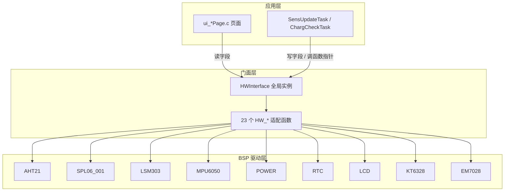

# HWDataAccess：硬件门面与全局数据总线

对应源文件：`Software/OV_Watch/User/Func/Src/HWDataAccess.c`（717 行）、
`Software/OV_Watch/User/Func/Inc/HWDataAccess.h`（310 行）

## 1. 它在系统里的位置

OV-Watch 的分层是“BSP 驱动 → HWDataAccess 门面 → 任务/UI”：

- BSP 层每个外设一个 `.c`，函数名各不相同（`AHT_Read`、`SPL_init`、`LSM303DLH_Init`…）；
- 门面层把它们统一成 `HWInterface.<外设>.<动词>()` 这一种调用形式；
- UI 层只 `#include "HWDataAccess.h"`，不接触任何 `stm32f4xx_hal.h` 或 BSP 头文件。

这样做的直接收益是“换传感器不改 UI”：把 AHT21 换成 SHT30，只需重写
`HW_AHT21_*` 五个适配函数，页面代码一行不动。工程里还留了 `HW_USE_HARDWARE`
总开关，置 0 后所有 `HW_USE_*` 都不定义，所有适配函数退化成空实现/固定返回值，
可以在 PC 上只跑 LVGL 调界面。



## 2. 全景：1 个实例 + 23 个适配函数

`HWDataAccess.c` 里没有算法，只有“转发”。23 个适配函数按外设分组：

| 组 | 适配函数 | 实际调用 | 返回约定 |
|---|---|---|---|
| RTC | `HW_RTC_Get_TimeDate` | `HAL_RTC_GetTime/GetDate` | 无（输出参数） |
| RTC | `HW_RTC_Set_Date` | `RTC_SetDate` | 无 |
| RTC | `HW_RTC_Set_Time` | `RTC_SetTime` | 无 |
| RTC | `HW_weekday_calculate` | 本地蔡勒公式 | 1~7，7=周日 |
| Power | `HW_Power_Init` | `Power_Init` | 无 |
| Power | `HW_Power_Shutdown` | `Power_DisEnable` | 无（断电不返回） |
| Power | `HW_Power_BatCalculate` | `PowerCalculate` | 0~100 |
| BLE | `HW_BLE_Init` | `KT6328_GPIO_Init` | 无 |
| BLE | `HW_BLE_Enable` | `KT6328_Enable` | 无 |
| BLE | `HW_BLE_Disable` | `KT6328_Disable` | 无 |
| LCD | `HW_LCD_Set_Light` | `LCD_Set_Light` | 无 |
| IMU | `HW_MPU_Init` | `mpu_dmp_init` | 0 成功 / -1 |
| IMU | `HW_MPU_Wrist_Enable` | 置 `wrist_is_enabled=1` | 无 |
| IMU | `HW_MPU_Wrist_Disable` | 置 `wrist_is_enabled=0` | 无 |
| IMU | `HW_MPU_Get_Steps` | `dmp_get_pedometer_step_count` | 0~65535 |
| IMU | `HW_MPU_Set_Steps` | `dmp_set_pedometer_step_count` | 0 / -1 |
| AHT21 | `HW_AHT21_Init` | `AHT_Init` | 0 / -1 |
| AHT21 | `HW_AHT21_Get_Humi_Temp` | `AHT_Read` | 无（输出参数） |
| Barometer | `HW_Barometer_Init` | `SPL_init` | 0 / -1 |
| Ecompass | `HW_Ecompass_Init` | `LSM303DLH_Init` | 0 / -1 |
| Ecompass | `HW_Ecompass_Sleep` | `LSM303DLH_Sleep` | 无 |
| HR | `HW_HRmeter_Init` | `EM7028_hrs_init` | 0 / -1 |
| HR | `HW_HRmeter_Sleep` | `EM7028_hrs_DisEnable` | 无 |

注意两件事：

1. `HW_Power_BatCalculate` 每次调用都会真的做 8 次 ADC 采样（约 8 ms），
   不是读缓存；
2. `HW_MPU_Get_Steps` 在 `ConnectionError != 0` 时直接返回 0，不会去碰 I2C，
   这是防止传感器掉线时总线卡死的保护。

## 3. HWInterface 全字段表

`HW_InterfaceTypeDef` 定义在 `HWDataAccess.h:279`，由 9 个子结构组成。
字段、类型、初值、语义如下：

| 子结构 | 字段 | 类型 | 初值 | 语义 |
|---|---|---|---|---|
| `RealTimeClock` | 4 个函数指针 | — | 绑定 | 无数据字段 |
| `BLE` | 3 个函数指针 | — | 绑定 | 无数据字段 |
| `Power` | `power_remain` | `uint8_t` | 0 | 剩余电量 0~100 |
| `LCD` | `SetLight` | 函数指针 | 绑定 | 背光 0~255 |
| `IMU` | `ConnectionError` | `uint8_t` | 1 | 0=在线 |
| `IMU` | `Steps` | `uint16_t` | 0 | 累计步数（会回绕） |
| `IMU` | `wrist_state` | `uint8_t` | `WRIST_UP` | 当前抬腕状态 |
| `IMU` | `wrist_is_enabled` | `uint8_t` | 0 | 抬腕检测开关 |
| `AHT21` | `ConnectionError` | `uint8_t` | 1 | 0=在线 |
| `AHT21` | `temperature` | `uint8_t` | 26 | 温度 ℃（无符号！） |
| `AHT21` | `humidity` | `uint8_t` | 67 | 湿度 %RH |
| `Barometer` | `ConnectionError` | `uint8_t` | 1 | 0=在线 |
| `Barometer` | `altitude` | `uint16_t` | 19 | 海拔 m |
| `Ecompass` | `ConnectionError` | `uint8_t` | 1 | 0=在线 |
| `Ecompass` | `direction` | `uint16_t` | 45 | 方位角 0~359 |
| `HR_meter` | `ConnectionError` | `uint8_t` | 1 | 0=在线 |
| `HR_meter` | `HrRate` | `uint8_t` | 0 | 心率 次/分 |
| `HR_meter` | `SPO2` | `uint8_t` | 99 | 血氧 % |

两个“看起来奇怪但有意为之”的初值：

- `ConnectionError` 全部初始化为 1：表示“还没初始化”。任务层看到 1 就跳过采样，
  避免在 I2C 还没配好时访问总线。
- 温度 26℃ / 湿度 67% / 海拔 19 m / 方向 45° 是写死的占位值，让 UI 在第一次
  采样前也有东西可显示（不然首页会出现 0℃ / 0%）。

## 4. 谁写、谁读：字段读写者矩阵

| 字段 | 写入者（文件:行） | 读取者 |
|---|---|---|
| `Power.power_remain` | `user_SensUpdateTask.c:136`（`BatCalculate`） | `ui_HomePage.c` 定时器、`ui_ChargPage.c` 定时器 |
| `IMU.Steps` | `user_SensUpdateTask.c:145`（`GetSteps`） | `ui_HomePage.c` 定时器 |
| `IMU.wrist_state` | `user_SensUpdateTask.c:61/67/76`、`user_RunModeTasks.c:198/204` | 同两个任务 |
| `IMU.wrist_is_enabled` | `HWDataAccess.c:284/301`、`user_HardwareInitTask.c:132/137` | `SensUpdateTask`、`RunModeTasks`、`ui_SetPage.c` |
| `AHT21.temperature/humidity` | `user_SensUpdateTask.c:160-161/198-199` | `ui_HomePage.c`、`ui_EnvPage.c` |
| `Ecompass.direction` | `user_SensUpdateTask.c:225` | `ui_CompassPage.c` 定时器 |
| `Barometer.altitude` | `user_SensUpdateTask.c:236` | `ui_CompassPage.c` 定时器 |
| `HR_meter.HrRate` | `user_SensUpdateTask.c:109` | `ui_HomePage.c`、`ui_HRPage.c` |
| `HR_meter.SPO2` | 当前无写入者（恒为初值 99） | `ui_SPO2Page.c` |

“无写入者”的字段值得警惕：`SPO2` 在 `SensUpdateTask` 的血氧分支里是
`if(0) { }`（`user_SensUpdateTask.c:179`），也就是说血氧页永远显示 99%。
这不是门面层的问题，而是上层功能未完成。

## 5. 关键实现逐段

### 5.1 读 RTC：为什么先 GetTime 再 GetDate

`HWDataAccess.c:63`：

```c
void HW_RTC_Get_TimeDate(HW_DateTimeTypeDef * nowdatetime)
{

	#if HW_USE_RTC
		if (nowdatetime != NULL)
		{
            RTC_DateTypeDef nowdate;
            RTC_TimeTypeDef nowtime;
			HAL_RTC_GetTime(&hrtc, &nowtime, RTC_FORMAT_BIN);
			HAL_RTC_GetDate(&hrtc, &nowdate, RTC_FORMAT_BIN);
```

STM32 的 RTC 有一组“影子寄存器”：读 `RTC_TR` 会把当前时间锁存，读 `RTC_DR`
才解锁。所以必须先读时间、再读日期；顺序反了会读到下一秒的时间配上一秒的日期
（跨秒撕裂）。这里用 `RTC_FORMAT_BIN` 让 HAL 把 BCD 转成二进制，UI 侧不用再转换。

`WeekDay` 不是从 RTC 读的（硬件不存星期），而是 `HWDataAccess.c:78` 现算：

```c
			nowdatetime->WeekDay = weekday_calculate(nowdatetime->Year, nowdatetime->Month, nowdatetime->Date, 20);
```

世纪固定传 20，意味着这套代码只对 2000~2099 年正确。对一块 2024 年发布的手表
来说够用，但不是一个可移植的设计。

### 5.2 蔡勒公式：0 为什么变成 7

`HWDataAccess.c:162` 的实现：

```c
uint8_t HW_weekday_calculate(uint8_t setyear, uint8_t setmonth, uint8_t setday, uint8_t century)
{
	int w;
	if (setmonth == 1 || setmonth == 2)
	{setyear--, setmonth += 12;}
	w = setyear + setyear / 4 + century / 4  + 26*(setmonth + 1)/10 + setday - 1 - 2 * century;
	while(w<0)
		w+=7;
	w%=7;
	w=(w==0)?7:w;
	return w;
}
```

推导要点：

- 1 月、2 月按上一年的 13、14 月算，所以先 `setyear--`、`setmonth += 12`；
- `26*(m+1)/10` 是蔡勒公式里的月份修正项（整数除法，等价于向下取整）；
- 取模结果 0 对应周日，但 UI 的 `ui_Days[]` 是 `Mon.` 开头、用 `WeekDay-1` 取下标，
  所以把 0 映射成 7，正好落在 `Sun.`。

验算 2024-06-23（周日）：`24 + 6 + 5 + 18 + 23 - 1 - 40 = 35`，`35 % 7 = 0 → 7`，
`ui_Days[6] = "Sun."`，正确。

### 5.3 计步：32 位转 16 位的截断

`HWDataAccess.c:425`：

```c
uint16_t HW_MPU_Get_Steps(void)
{
	#if HW_USE_IMU
		unsigned long STEPS = 0;
		if(!HWInterface.IMU.ConnectionError)
			dmp_get_pedometer_step_count(&STEPS);
		return (uint16_t)STEPS;
	#endif
		return 0;
}
```

DMP 内部是 32 位计步器，这里强转 `uint16_t`，超过 65535 会回绕。
按每天 1 万步算，6 天半就会归零。当前 UI 只显示“今日步数”，
而代码并没有做“跨天清零”，所以实际显示的是上电以来的累计值对 65536 取模。

### 5.4 函数指针表：唯一实例

`HWDataAccess.c:649` 的初始化器把 23 个函数按外设分组绑定：

```c
HW_InterfaceTypeDef HWInterface = {
    .RealTimeClock = {
        .GetTimeDate = HW_RTC_Get_TimeDate,
        .SetDate = HW_RTC_Set_Date,
        .SetTime = HW_RTC_Set_Time,
        .CalculateWeekday = HW_weekday_calculate
    },
```

使用 designated initializer 的好处是：字段顺序可以随头文件调整而不影响绑定，
未列出的字段自动清零（所以 `ConnectionError` 若不显式写就是 0=在线，
这里特意写成 1）。

## 6. 并发与一致性：没有锁的共享内存

这套设计的并发模型是“单写者、多读者、无锁”：

- `Power.power_remain`、`IMU.Steps`、`AHT21.*`、`Ecompass.direction`、
  `Barometer.altitude` 只由 `SensorDataUpdateTask` 写；
- `HR_meter.HrRate` 只由 `HRDataUpdateTask` 写；
- `IMU.wrist_state` 由 `SensUpdateTask` 和 `RunModeTasks` 两个任务写（唯一的双写者）；
- 所有 UI 页面只读。

安全性分析：

| 风险 | 是否成立 | 原因 |
|---|---|---|
| 8 位字段读写撕裂 | 否 | Cortex-M4 单字节访问原子 |
| 16 位字段读写撕裂 | 否 | 半字对齐访问原子 |
| 多字段一致性 | **是** | 时间 7 字段分 7 次写，可能跨秒 |
| 读-改-写竞争 | **是** | `wrist_state` 两个任务都写 |
| 指针表被改写 | 否 | 只在静态初始化时赋值 |

跨秒撕裂的实际影响：首页 `HomePage_timer_cb` 一次 `GetTimeDate` 拿全 7 字段，
然后分别比较时/分/日/月。如果这次读发生在 23:59:59.999，可能得到
“23:59:59 + 新日期”，界面会先跳日期、下一秒再跳时间。概率极低，肉眼几乎看不到。

真正需要注意的是 `wrist_state`：`SensUpdateTask` 每 300 ms 判一次水平，
`RunModeTasks` 在唤醒后又判一次，两者都做“读-比较-写”，没有临界区。
极端情况下可能连续触发两次“抬腕→放下”，表现为屏幕闪一下。当前没有加锁，
因为加锁会让 STOP 流程更复杂；这是一个明确的取舍。

## 7. HW_USE_* 移植开关

`HWDataAccess.h:41` 开始是一组嵌套宏：

```c
#define HW_USE_HARDWARE 1	// 总开关：1 使用真实硬件，0 全部走仿真桩

#if HW_USE_HARDWARE
  #define HW_USE_RTC    1	// 使用真实 RTC
  #define HW_USE_BLE    1	// 使用 KT6328 蓝牙/充电控制
  #define HW_USE_BAT    1	// 使用电池检测
  #define HW_USE_LCD    1	// 使用 LCD 背光控制
  #define HW_USE_IMU    1	// 使用 MPU6050 六轴传感器
  #define HW_USE_AHT21  1	// 使用 AHT21 温湿度传感器
  #define HW_USE_SPL06  1	// 使用 SPL06-001 气压计
  #define HW_USE_LSM303 1	// 使用 LSM303 电子罗盘
  #define HW_USE_EM7028 1	// 使用 EM7028 心率/血氧传感器
#endif
```

置 0 后的行为差异：

| 开关 | 置 0 后 |
|---|---|
| `HW_USE_RTC` | 返回固定时间 2024-06-23 11:59:55，星期 7 |
| `HW_USE_BAT` | `BatCalculate` 返回 0，`Init/Shutdown` 空实现 |
| `HW_USE_IMU` | `Init` 返回 -1，`GetSteps` 返回 0 |
| `HW_USE_AHT21` | `Init` 返回 -1，`GetHumiTemp` 不写输出参数 |
| `HW_USE_SPL06` | `Init` 返回 -1，海拔保持初值 |
| `HW_USE_LSM303` | `Init` 返回 -1，方向保持初值 |
| `HW_USE_EM7028` | `Init` 返回 -1，心率保持 0 |

注意 `HW_USE_HARDWARE=0` 时，`HW_USE_*` 全部未定义，`#if HW_USE_RTC`
会把未定义标识符当 0，所以能正常编译——这是 C 预处理器的经典用法，
但也会让“拼错开关名”这种错误静默通过。

## 8. 陷阱清单

1. **`HW_Power_BatCalculate` 有副作用**：8 次 ADC + 8 ms 延时，
   不要在 GUI 定时器里高频调用。首页读的是缓存字段，只有充电页每 2 s 调一次。
2. **`HW_MPU_Init` 很慢**：`mpu_dmp_init` 要下载 DMP 微码并自检，
   只能在 `HardwareInitTask` 里调一次，重复调用会重启 DMP 并丢掉当前步数。
3. **`HW_Power_Shutdown` 不返回**：拉低 PA3 后整机断电，后面的代码不会执行。
4. **温度字段是无符号的**：`uint8_t temperature` 存不了负温，
   `ui_EnvPage.c` 里 bar 的 -10~50 量程实际上永远用不到负半轴。
5. **`HW_AHT21_Get_Humi_Temp` 失败时不写输出参数**：调用方必须先看
   `ConnectionError`，并给 `humi/temp` 一个合理初值，否则会用栈上的垃圾值。
6. **函数指针表没有空指针保护**：如果某个 `HW_USE_*` 关掉，对应的函数指针
   仍然被绑定（函数体是空的），不会出现 NULL 调用；但如果有人手工删掉绑定，
   调用处会直接 HardFault。

## 9. 读码路径

1. 先看 `HWDataAccess.h:279` 的 `HW_InterfaceTypeDef`，建立“有哪些外设”的地图；
2. 再看 `HWDataAccess.c:649` 的初始化器，确认每个函数指针指向谁；
3. 按外设挑一个适配函数读（都很短），再跳到对应 BSP 驱动；
4. 最后回到 `user_SensUpdateTask.c` 看字段是何时被写的。

相关文档：`Docs/04-数据流与发布订阅.md`（数据流全景）、
`Docs/06-外设驱动详解.md`（各驱动寄存器细节）、
`Docs/11-传感器与数据算法.md`（换算与融合）。
