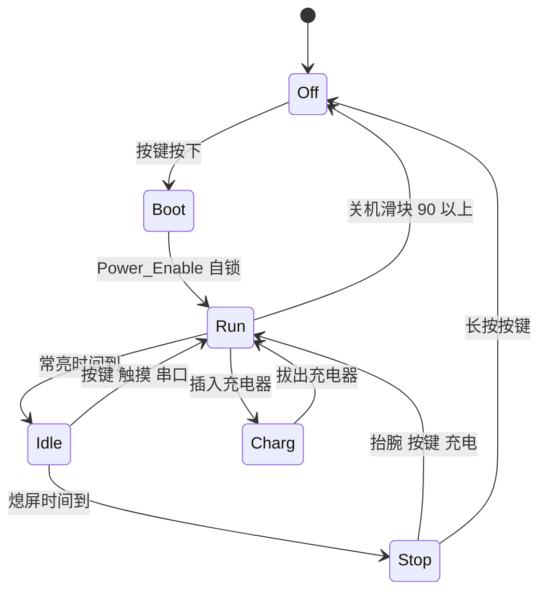
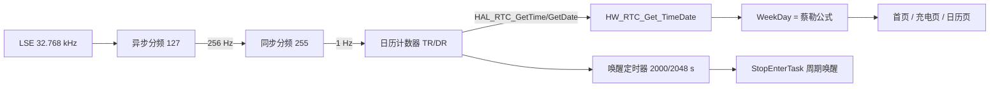

# 电源管理与 RTC

对应源文件：

- `Software/OV_Watch/BSP/POWER/power.c`（207 行）
- `Software/OV_Watch/Core/Src/rtc.c`（268 行，GBK 编码）
- `Software/OV_Watch/User/Tasks/Src/user_ChargCheckTask.c`（68 行）
- `Software/OV_Watch/User/Tasks/Src/user_RunModeTasks.c`（247 行）

## 1. 电源拓扑

这块表没有独立的 PMIC，电源管理靠三根 GPIO + 一颗 TPS63020：

| 信号 | 引脚 | 方向 | 含义 |
|---|---|---|---|
| POWER_EN | PA3 | 输出 | 高=维持 3V3，低=整机断电 |
| CHARGE | PA2 | 输入 | 1=正在充电 |
| BAT_ADC | PA1 | 模拟 | 电池分压（1/2） |

按键是“点动”的：按下时给 TPS63020 一个使能脉冲，MCU 上电后必须
**尽快把 PA3 拉高自锁**，否则松手就掉电。`Power_Init()` 就是干这个的：

```c
void Power_Init(void)
{
	Power_Pins_Init();
	Power_Enable();
}
```

`Power_Pins_Init` 里有一个细节：先写 `ODR=0` 再 `HAL_GPIO_Init`，
保证引脚“变成输出”的瞬间就是低电平，不会出现上电毛刺把电源误打开。

关机就是反过来拉低 PA3：

```c
void Power_DisEnable()
{
	HAL_GPIO_WritePin(POWER_PORT,POWER_PIN,GPIO_PIN_RESET);
}
```

调用后电源立刻消失，**函数不会返回**。首页下拉面板的关机滑块
（`ui_event_PowerSlider`）滑到 >=90 就调 `HWInterface.Power.Shutdown()`，
之后只能靠按键或插充电器重新上电。

## 2. 充电检测与充电页

CHARGE 脚配成双边沿中断（EXTI2，优先级 5）：

```c
  GPIO_InitStruct.Pin = CHARGE_PIN;
  GPIO_InitStruct.Mode = GPIO_MODE_IT_RISING_FALLING;
  GPIO_InitStruct.Pull = GPIO_NOPULL;
  HAL_GPIO_Init(CHARGE_PORT, &GPIO_InitStruct);
```

中断服务只清标志，具体处理在 `ChargPageEnterTask`：

- `ChargeCheck()` 为真且当前不在充电页 → `Page_Load(&Page_Charg)`；
- `ChargeCheck()` 为假且当前在充电页 → `Page_Back_Bottom()` 回首页。

`Page_Back_Bottom()` 而不是 `Page_Back()`，是因为充电页可能是从任意页面
被“强插”进来的，直接弹到栈底更安全。



## 3. 电量计：8 次平均 + 分段查表

### 3.1 电压换算

`BatCheck()`（`power.c:113`）：

```c
	HAL_ADC_Start(&hadc1);
	HAL_ADC_PollForConversion(&hadc1,5);
	dat = HAL_ADC_GetValue(&hadc1);
	HAL_ADC_Stop(&hadc1);
	BatVoltage = dat *2 *3.3 /4096;
```

- 12 位 ADC，参考 3.3 V；
- 硬件 1/2 分压，所以乘 2；
- 除以 4096（2^12）而不是 4095，满量程略微偏低，属可接受误差；
- 1 LSB ≈ 3.3/4096 ≈ 0.806 mV，乘 2 后电池侧约 1.61 mV/LSB。

`BatCheck_8times()` 连续采 8 次取平均，每次之间 `delay_ms(1)`，
总耗时约 8 ms。8 次平均能把白噪声压到 1/√8 ≈ 35%，但压不掉
负载突变（亮屏瞬间的电压跌落）。

### 3.2 充电补偿

充电时电流在电池内阻上产生压升，读数会虚高。代码先减掉 0.128 V：

```c
	if(ChargeCheck())
	{voltage -= INTERNAL_RES * CHARGING_CUR;} // 扣除充电电流在内阻上的压升
```

`INTERNAL_RES=0.128`（Ω）、`CHARGING_CUR=1`（A），乘积 0.128 V。
这个值像是实测凑出来的：不同电池内阻不同，换电池后要重新标定。

### 3.3 分段表

| 电压区间（V） | 电量（%） |
|---|---|
| >= 4.20 | 100 |
| 4.06 ~ 4.20 | 90 |
| 3.98 ~ 4.06 | 80 |
| 3.92 ~ 3.98 | 70 |
| 3.87 ~ 3.92 | 60 |
| 3.82 ~ 3.87 | 50 |
| 3.79 ~ 3.82 | 40 |
| 3.77 ~ 3.79 | 30 |
| 3.74 ~ 3.77 | 20 |
| 3.68 ~ 3.74 | 10 |
| 3.45 ~ 3.68 | 5 |

锂电池放电曲线中段平缓、两端陡峭，所以区间宽度不均匀：
3.92~3.98 只差 10%，3.45~3.68 也只有 5%。

**已知 bug**：`voltage < 3.45` 时没有任何分支给 `power` 赋值，
函数返回未初始化的栈变量。表现为电池过放/ADC 异常时电量乱跳。
正确做法是补一个 `else { power = 0; }`。

## 4. RTC：LSE + 备份域

### 4.1 时钟链

```c
  hrtc.Init.AsynchPrediv = 127;                 // 异步分频（7 位）：LSE 32768Hz / (127+1) = 256Hz，作为 ck_spre 的输入
  hrtc.Init.SynchPrediv = 255;                  // 同步分频（15 位）：256Hz / (255+1) = 1Hz，正好一秒加一，即日历时基
```

- 时钟源 LSE（外部 32.768 kHz 晶振），精度取决于晶振，典型 ±20 ppm
  ≈ 每月 ±52 秒；
- 异步分频 7 位、同步分频 15 位，两级分频是 STM32 RTC 的固定结构；
- 最终 1 Hz 驱动日历计数器。

### 4.2 备份域与“是否第一次上电”

`rtc.c:84`：

```c
	if(HAL_RTCEx_BKUPRead(&hrtc,RTC_BKP_DR0)!=0X5050)//是否第一次配置
```

BKP_DR0 在备份域，由 VBAT 供电，主电源掉电不丢。写入 `0x5050` 表示
“已对过时”。再次上电读到标记就跳过默认时间，保留用户调好的日期；
读不到（第一次上电/换电池/备份域被复位）才写默认 2023-05-21 11:59:55。

默认时间用的是 BCD 写法：`sTime.Hours = 0x11` 表示 11 点，
`0x59` 表示 59 分。如果误写成十进制 17，RTC 会把它当 BCD 的 17（非法）。
`RTC_SetTime` 用 `RTC_FORMAT_BIN`，HAL 内部自动转 BCD，所以上层只写十进制。

### 4.3 设置时间/日期

`rtc.c:231`：

```c
void RTC_SetTime(uint8_t hours, uint8_t minutes, uint8_t seconds)
{
	RTC_TimeTypeDef time={0};//不设置为{0}时间就会离谱
	time.Hours=hours;
	time.Minutes=minutes;
	time.Seconds=seconds;
	if (HAL_RTC_SetTime(&hrtc, &time, RTC_FORMAT_BIN) != HAL_OK)
  {
    Error_Handler();
  }
}
```

`={0}` 不能省：`HAL_RTC_SetTime` 会把结构体所有字段（含
`DayLightSaving`、`StoreOperation`）写进寄存器，不初始化就是栈上的随机值。
原作者的注释“不设置为{0}时间就会离谱”说的就是这个坑。

`RTC_SetDate` 同理，并且星期不是用户输入，而是 `weekday_calculate` 现算
（`rtc.c:261`），世纪固定 20，所以只支持 2000~2099 年。

### 4.4 唤醒定时器

```c
  if (HAL_RTCEx_SetWakeUpTimer_IT(&hrtc, 2000, RTC_WAKEUPCLOCK_RTCCLK_DIV16) != HAL_OK)
```

RTCCLK/16 = 2048 Hz，计 2000 个数约 0.976 s 触发一次 `RTC_WKUP` 中断。
本工程没有实现 `HAL_RTCEx_WakeUpTimerEventCallback`，所以这个中断目前
只是“醒来清个标志”，没有业务作用。`HardwareInitTask` 会再调一次
`MX_RTC_Init` 刷新周期，属于保险动作。



## 5. 低功耗联动

电源管理与运行模式是同一件事的两面：

| 阶段 | 电源动作 | RTC 动作 |
|---|---|---|
| 上电 | `Power_Enable` 自锁 | `MX_RTC_Init` 判断是否首次 |
| 正常运行 | 保持 PA3 高 | 日历走时，1 Hz |
| 空闲 | 背光降到 5% | 不变 |
| STOP | 屏复位、背光 0、触摸睡眠、UART 关 | RTC 继续走，唤醒定时器工作 |
| 唤醒 | 重新初始化外设、恢复背光 | `SystemClock_Config` 重配时钟 |
| 关机 | PA3 拉低，整机断电 | VBAT 维持备份域 |

注意 STOP 模式下 RTC 仍在跑，这是“关机后时间不丢”的基础；
但 STOP 会停掉 PLL 和 SysTick，唤醒后必须重新 `SystemClock_Config()`，
否则串口波特率和 SPI 时序全错（详见 `Docs/07-低功耗与运行模式.md`）。

## 6. 陷阱清单

1. **`PowerCalculate` 在 3.45 V 以下返回未初始化值**：必须补 `else`。
2. **`BatCheck` 的 ADC 超时只有 5 ms 且不检查返回值**：ADC 没就绪时
   读到的是上一次的旧值。
3. **`Power_DisEnable` 不返回**：不要在后面写“关机后保存数据”的代码，
   要保存得在调用前做。
4. **RTC 结构体必须 `={0}`**：否则 DayLightSaving 等字段是随机值。
5. **读时间必须先 GetTime 再 GetDate**：顺序反了会跨秒撕裂。
6. **备份域标记 0x5050 不是万能的**：VBAT 也掉电（换电池）后会丢，
   时间退回 2023-05-21。
7. **充电补偿 0.128 V 是经验值**：换电池/改充电电流后要重新标定，
   否则充满后可能显示 90% 或一插充电器就 100%。

## 7. 相关文档

- `Docs/07-低功耗与运行模式.md`：STOP 进出全流程
- `Docs/08-数据存储与IAP升级.md`：设置项如何落 EEPROM
- `Knowledge-Base/ovwatch/UserFunc_HWDataAccess.md`：电源字段的读写者
