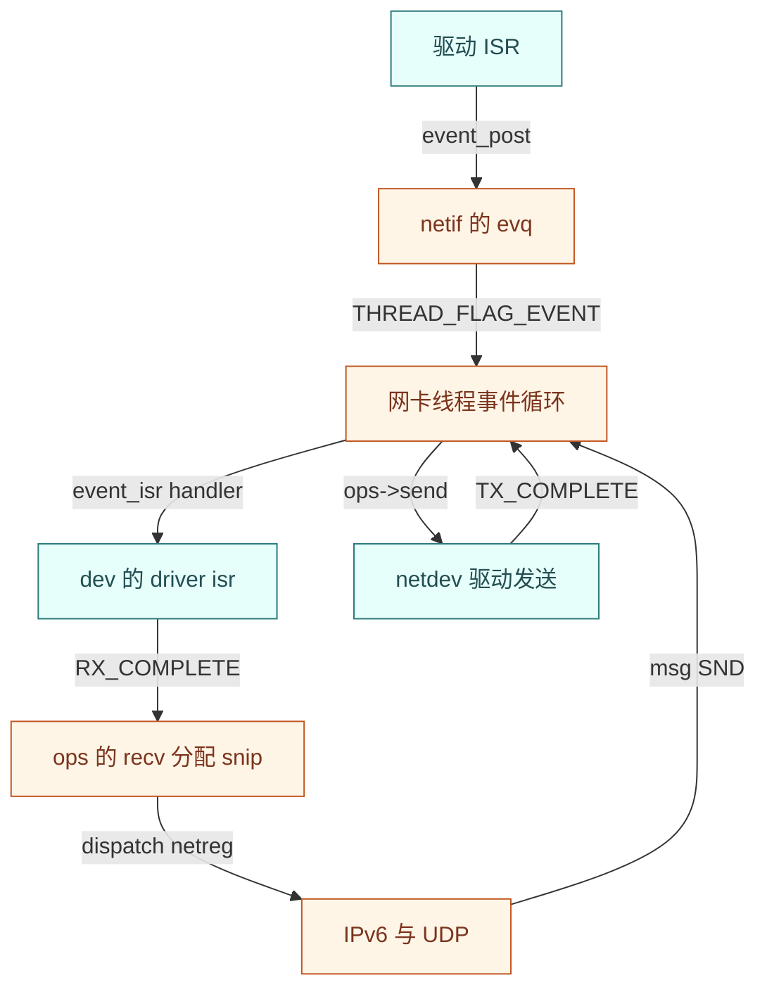
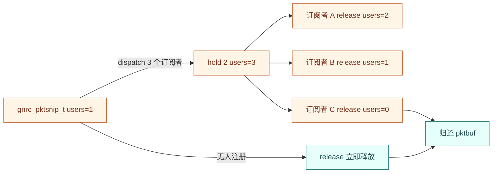

# gnrc_netif.c —— GNRC 网卡线程与收发包主路径

> 对应源文件：`sys/net/gnrc/netif/gnrc_netif.c`（共 2218 行）
> 关联头文件：`sys/include/net/gnrc/netif.h`、`sys/include/net/gnrc/netif/conf.h`
> 关联源文件：`sys/net/gnrc/netreg/gnrc_netreg.c`、`sys/net/gnrc/netapi/gnrc_netapi.c`、`sys/net/gnrc/pktbuf/gnrc_pktbuf.c`
> 关联文档：[06-网络栈与GNRC.md](../../../references/rtos/RIOT/Docs/06-网络栈与GNRC.md)

---

## 1. 一句话职责

每个网络接口一个 `gnrc_netif` 线程：它把 `netdev` 驱动的中断事件、上层协议的发送消息、`netopt` 读写请求统一到一个消息/事件循环里，是**驱动与协议栈之间的唯一适配层**。

---

## 2. 文件全景

| 行号 | 内容 |
|---|---|
| 1-56 | SPDX、include、前置声明 |
| 58-62 | `_netif_ctx_t`（创建握手用） |
| 64-104 | `gnrc_netif_create()` |
| 106-167 | `gnrc_netif_dev_is_6lo` / `numof` / `iter` / `get_by_type` |
| 169-507 | `get_from_netdev` / `set_from_netdev`（netopt 转发） |
| 507-533 | `get_by_pid` / `acquire` / `release` |
| 534-1035 | IPv6 地址管理（add/remove/match/best_src） |
| 1037-1508 | 地址选择、分组加入、前缀处理 |
| 1510-1686 | `_update_l2addr_from_dev` / `_init_from_device` / `_check_netdev_capabilities` / `_test_options` |
| 1687-1714 | `gnrc_netif_default_init()` |
| 1716-1898 | `_send` 辅助、`_tx_done` |
| 1900-1918 | `_event_handler_tx_done` |
| 1920-2005 | `_send()` |
| 2007-2107 | `_gnrc_netif_thread()` 主循环 |
| 2109-2118 | `_pass_on_packet()` |
| 2120-2217 | `_event_cb()` |

---

## 3. 核心结构

`gnrc_netif_t`（`sys/include/net/gnrc/netif.h`）关键字段：

| 字段 | 行号 | 作用 |
|---|---|---|
| `netif` | 嵌入 | 通用 netif 信息（MTU/标志） |
| `dev` | — | `netdev_t *` 驱动 |
| `ops` | — | `gnrc_netif_ops_t *` 虚表 |
| `mutex` | — | `rmutex_t`，保护结构 |
| `bus[]` | 152 | 事件消息总线 |
| `flags` | 159 | `GNRC_NETIF_FLAGS_*` |
| `evq[]` | 163 | 事件队列（分级） |
| `event_isr` | 167 | ISR 事件节点 |
| `event_tx_done` | 174 | 发送完成事件 |
| `tx_pkt` | 182 | 正在发送的包 |
| `l2addr[]` | 191 | 链路层地址 |
| `msg_queue[]` | 222 | 线程消息队列（16 条） |
| `cur_hl` | 223 | 当前 hop limit |
| `device_type` | 224 | `NETDEV_TYPE_*` |
| `pid` | 225 | 线程 PID |

`gnrc_netif_ops_t`（`netif.h:280-388`）：

| 方法 | 作用 |
|---|---|
| `init` | 初始化驱动并注册 netif |
| `send` | 发送 snip 链表 |
| `recv` | 接收一帧并转 snip |
| `get` | 读 netopt |
| `set` | 写 netopt |
| `msg_handler` | 处理额外消息（MAC 层） |

---

## 4. 逐函数表（主路径）

| 函数 | 行号 | 职责 |
|---|---|---|
| `gnrc_netif_create` | 64-104 | 创建线程并等待驱动 init |
| `gnrc_netif_default_init` | 1687-1714 | 注册 event callback、`netif_register`、NIB 初始化 |
| `_gnrc_netif_thread` | 2007-2107 | 线程主循环 |
| `_process_events_await_msg` | 1771-1794 | 事件优先、消息其次的阻塞 |
| `_gnrc_netif_fetch_event` | 1750-1760 | 按优先级取事件 |
| `_event_handler_isr` | 1723-1727 | 调驱动 `isr()` |
| `_event_cb` | 2120-2217 | 驱动事件回调（ISR 上下文） |
| `_pass_on_packet` | 2109-2118 | 分发收到的包 |
| `_send` | 1920-2005 | 发送主逻辑 |
| `_tx_done` | 1820-1898 | 发送完成/失败处理 |
| `_event_handler_tx_done` | 1906-1917 | new API 的发送完成事件 |
| `_send_queued_pkt` | 1796-1807 | 从 pktq 取包发送 |
| `_process_receive_stats` | 1729-1748 | 邻居统计 |

---

## 5. 逐字摘录

### 5.1 创建：mutex 握手

```c
/* sys/net/gnrc/netif/gnrc_netif.c:90-103 */
    /* prepare thread context */
    ctx.netif = netif;
    mutex_init(&ctx.init_done);
    mutex_lock(&ctx.init_done);

    res = thread_create(stack, stacksize, priority, 0,
                        _gnrc_netif_thread, &ctx, name);
    assert(res > 0);
    (void)res;

    /* wait for result of driver init */
    mutex_lock(&ctx.init_done);

    return ctx.result;
```

`ctx` 是调用者栈上的 `_netif_ctx_t`（行 58-62）：

```c
typedef struct {
    gnrc_netif_t *netif;
    mutex_t init_done;
    int result;
} _netif_ctx_t;
```

时序：

1. `mutex_init` 后立即 `mutex_lock` → 锁被占用；
2. 创建线程，子线程在 `gnrc_netif.c:2032` `mutex_unlock(&ctx->init_done)`；
3. 父线程第二次 `mutex_lock` 阻塞到子线程初始化完成；
4. 读 `ctx.result` 返回。

**这是"一次性完成信号"**，比条件变量轻。风险是 `ctx` 悬空：子线程解锁后只再读一次 `ctx->result`（行 2033），之后不再碰 `ctx`。

### 5.2 线程主循环

```c
/* sys/net/gnrc/netif/gnrc_netif.c:2043-2061 */
    while (1) {
        msg_t msg;
        /* msg will be filled by _process_events_await_msg.
         * The function will not return until a message has been received. */
        _process_events_await_msg(netif, &msg);

        /* dispatch netdev, MAC and gnrc_netapi messages */
        DEBUG("gnrc_netif: message %u\n", (unsigned)msg.type);
        switch (msg.type) {
#if IS_USED(MODULE_GNRC_NETIF_PKTQ)
            case GNRC_NETIF_PKTQ_DEQUEUE_MSG:
                DEBUG("gnrc_netif: send from packet send queue\n");
                _send_queued_pkt(netif);
                break;
#endif  /* IS_USED(MODULE_GNRC_NETIF_PKTQ) */
            case GNRC_NETAPI_MSG_TYPE_SND:
                DEBUG("gnrc_netif: GNRC_NETDEV_MSG_TYPE_SND received\n");
                _send(netif, msg.content.ptr, false);
                break;
```

消息类型：

| 类型 | 来源 | 处理 |
|---|---|---|
| `GNRC_NETAPI_MSG_TYPE_SND` | 上层协议 | `_send()` |
| `GNRC_NETAPI_MSG_TYPE_SET` | shell/应用 | `ops->set()` + `msg_reply()` |
| `GNRC_NETAPI_MSG_TYPE_GET` | shell/应用 | `ops->get()` + `msg_reply()` |
| `GNRC_NETIF_PKTQ_DEQUEUE_MSG` | 定时器 | 从 pktq 取包 |
| 其他 | MAC | `ops->msg_handler()` |

### 5.3 事件循环

```c
/* sys/net/gnrc/netif/gnrc_netif.c:1771-1794 */
static void _process_events_await_msg(gnrc_netif_t *netif, msg_t *msg)
{
    while (1) {
        /* Using messages for external IPC, and events for internal events */

        /* First drain the queues before blocking the thread */
        /* Events will be handled before messages */
        event_t *evp;
        /* We can not use event_loop() or event_wait() because then we would not
         * wake up when a message arrives */
        while ((evp = _gnrc_netif_fetch_event(netif))) {
            if (evp->handler) {
                evp->handler(evp);
            }
        }
        /* non-blocking msg check */
        int msg_waiting = msg_try_receive(msg);
        if (msg_waiting > 0) {
            return;
        }
        /* Block the thread until something interesting happens */
        thread_flags_wait_any(THREAD_FLAG_MSG_WAITING | THREAD_FLAG_EVENT);
    }
}
```

为什么不用 `event_loop()`：`event_loop()` 只等事件，不等消息。网卡线程要同时处理"驱动事件"和"上层消息"，所以用 `thread_flags_wait_any(MSG_WAITING | EVENT)` 把两者合并到一个阻塞点。

### 5.4 收包

```c
/* sys/net/gnrc/netif/gnrc_netif.c:2120-2162 */
static void _event_cb(netdev_t *dev, netdev_event_t event)
{
    gnrc_netif_t *netif = (gnrc_netif_t *)dev->context;

    if (event == NETDEV_EVENT_ISR) {
        event_post(&netif->evq[GNRC_NETIF_EVQ_INDEX_PRIO_LOW], &netif->event_isr);
    }
#if IS_USED(MODULE_NETDEV_NEW_API)
    else if (gnrc_netif_netdev_new_api(netif)
             && (event == NETDEV_EVENT_TX_COMPLETE)) {
        event_post(&netif->evq[GNRC_NETIF_EVQ_INDEX_PRIO_LOW],
                   &netif->event_tx_done);
    }
#endif
    else {
        DEBUG("gnrc_netif: event triggered -> %i\n", event);
        gnrc_pktsnip_t *pkt = NULL;
        switch (event) {
            case NETDEV_EVENT_LINK_UP:
                if (IS_USED(MODULE_GNRC_IPV6)) {
                    msg_t msg = { .type = GNRC_IPV6_NIB_IFACE_UP, .content = { .ptr = netif } };

                    msg_send(&msg, gnrc_ipv6_pid);
                }
                break;
            case NETDEV_EVENT_LINK_DOWN:
                if (IS_USED(MODULE_GNRC_IPV6)) {
                    msg_t msg = { .type = GNRC_IPV6_NIB_IFACE_DOWN, .content = { .ptr = netif } };

                    msg_send(&msg, gnrc_ipv6_pid);
                }
                break;
            case NETDEV_EVENT_RX_COMPLETE:
                pkt = netif->ops->recv(netif);
                /* send packet previously queued within netif due to the lower
                 * layer being busy.
                 * Further packets will be sent on later TX_COMPLETE */
                _send_queued_pkt(netif);
                if (pkt) {
                    _process_receive_stats(netif, pkt);
                    _pass_on_packet(pkt);
                }
                break;
```

两阶段收包：

1. **硬中断**：`NETDEV_EVENT_ISR` → `event_post()`，只入队，不碰包。
2. **网卡线程**：处理 `event_isr` → `dev->driver->isr()` → 驱动触发 `RX_COMPLETE` → `ops->recv()` 分配 snip。
3. **分发**：`_pass_on_packet()` → `gnrc_netapi_dispatch_receive()`；没人注册则 `gnrc_pktbuf_release()`。

### 5.5 分发

```c
/* sys/net/gnrc/netapi/gnrc_netapi.c:123-148 */
int gnrc_netapi_dispatch(gnrc_nettype_t type, uint32_t demux_ctx,
                         uint16_t cmd, gnrc_pktsnip_t *pkt)
{
    gnrc_netreg_acquire_shared();

    int numof = gnrc_netreg_num(type, demux_ctx);

    if (numof != 0) {
        gnrc_netreg_entry_t *sendto = gnrc_netreg_lookup(type, demux_ctx);

        /* the packet is replicated over all interfaces that it's being sent on */
        gnrc_pktbuf_hold(pkt, numof - 1);

        while (sendto) {
            int status = _dispatch_single(sendto, cmd, pkt);
            if (status < 0) {
                gnrc_pktbuf_release_error(pkt, status);
            }
            sendto = gnrc_netreg_getnext(sendto);
        }
    }

    gnrc_netreg_release_shared();

    return numof;
}
```

`gnrc_pktbuf_hold(pkt, numof - 1)` 把引用计数加到订阅者数量。每个订阅者消费一份，最后一个 release 释放内存。

---

## 6. 收发包流程





---

## 7. 关键常量

| 常量 | 值 | 出处 |
|---|---|---|
| `GNRC_NETIF_PRIO` | `THREAD_PRIORITY_MAIN - 5` = 2 | `conf.h:35-37` |
| `CONFIG_GNRC_NETIF_MSG_QUEUE_SIZE_EXP` | 4（16 条） | `conf.h:49-51` |
| `CONFIG_GNRC_NETIF_PKTQ_POOL_SIZE` | 16 | `conf.h:58-60` |
| `CONFIG_GNRC_PKTBUF_SIZE` | 6144 | `pktbuf.h:78-80` |
| `GNRC_NETIF_EVQ_NUMOF` | 实现定义（通常 2） | `netif.h` |

---

## 8. 陷阱与读码建议

### 8.1 创建后必须等 `init_done`

`gnrc_netif_create()` 返回后驱动才可用。如果直接 `gnrc_netif_send()`，可能 `ops->send` 还是 NULL。

### 8.2 `ctx` 生命周期

`_netif_ctx_t ctx` 在调用者栈上（行 69）。子线程在 `mutex_unlock` 后只允许读一次 `ctx->result`。**不要在子线程里保存 `ctx` 指针**。

### 8.3 事件优先于消息

`_process_events_await_msg()` 先排空 event 队列，再收 msg。如果事件处理函数里又 `msg_send()` 给自己，消息要等下一轮。**不要在事件 handler 里等消息回复**。

### 8.4 `tx_pkt` 非空时 `_send()` 返回 -EBUSY

new netdev API 下，上一帧还没发完（`TX_COMPLETE` 未到），新的 `_send()` 会 `_tx_done(..., -EBUSY, ...)`。如果开了 `gnrc_netif_pktq`，包会排队；否则被丢弃。

### 8.5 `ops->send` 会释放 pkt

`netif.h:309-312` 明确说 `send` "releases the packet before returning"。调用者不要重复 `gnrc_pktbuf_release()`。

### 8.6 legacy 与 new netdev 的差异

| API | 发送 | 释放时机 |
|---|---|---|
| legacy | 阻塞，返回即完成 | `_send()` 返回前 |
| new | 异步，返回 0 表示已排队 | `TX_COMPLETE` 事件 |

混用会 double-free 或泄漏。

### 8.7 读码顺序

1. `sys/include/net/gnrc/netif.h:219-226`（尾部字段）
2. `gnrc_netif.c:64-104`（创建）
3. `gnrc_netif.c:2007-2107`（主循环）
4. `gnrc_netif.c:1771-1794`（事件循环）
5. `gnrc_netif.c:2120-2217`（事件回调）
6. `gnrc_netif.c:1920-2005`（发送）
7. `gnrc_netreg.c:129-210`（注册/查找）
8. `gnrc_netapi.c:123-148`（分发）
9. `pkt.h:105-122`（snip）
10. `pktbuf.c:85-130`（释放）
