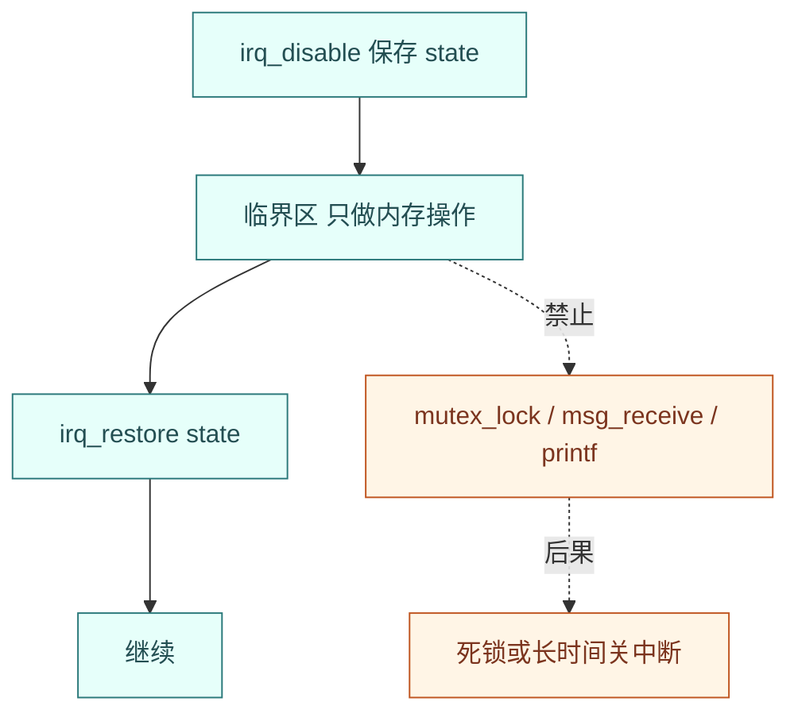
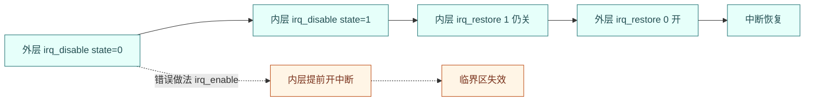

# irq —— RIOT 中断控制与原子操作基础

> 对应源文件：`core/lib/include/irq.h`（共 101 行）；`cpu/cortexm_common/include/irq_arch.h`（129 行）；`cpu/native/irq.c`；`core/lib/atomic_sync.c`（240 行）
> 关联头文件：`sys/include/atomic_utils.h`、`core/lib/include/irq.h`
> 关联文档：[05-中断处理与原子操作.md](../../../references/rtos/RIOT/Docs/05-中断处理与原子操作.md)

---

## 1. 一句话职责

RIOT 的中断抽象只有 **5 个函数**：`irq_disable()`、`irq_enable()`、`irq_restore()`、`irq_is_enabled()`、`irq_is_in()`。它们由各架构的 `irq_arch.h` 内联实现；所有临界区、原子操作都建立在这 5 个函数上。

---

## 2. 接口契约

```c
/* core/lib/include/irq.h:30-46 */
#ifdef IRQ_API_INLINED
#  define MAYBE_INLINE static inline __attribute__((always_inline))
#else
#  define MAYBE_INLINE
#endif /* IRQ_API_INLINED */

#ifndef IRQ_API_INLINED
/**
 * @brief   This function sets the IRQ disable bit in the status register
 *
 * @return  Previous value of status register. The return value should not be
 *          interpreted as a boolean value. The actual value is only
 *          significant for irq_restore().
 *
 * @see     irq_restore
 */
MAYBE_INLINE unsigned irq_disable(void);
```

`IRQ_API_INLINED` 为真时，`irq.h` 直接包含架构头文件，把实现内联。这样 `irq_disable()` 在 Cortex-M 上是两条指令，没有函数调用开销。

| 函数 | 返回值 | 语义 |
|---|---|---|
| `irq_disable()` | 旧状态 | 关中断，返回调用前的状态 |
| `irq_enable()` | 旧状态 | 开中断（**不推荐**，破坏嵌套） |
| `irq_restore(state)` | 无 | 恢复 `irq_disable()` 返回的状态 |
| `irq_is_enabled()` | bool | 当前是否开中断（只能在线程上下文用） |
| `irq_is_in()` | bool | 当前是否在 ISR |

---

## 3. 逐函数表

### 3.1 架构无关层（irq.h）

| 声明 | 行号 | 说明 |
|---|---|---|
| `irq_disable` | 46 | 文档说明返回值不是 bool |
| `irq_enable` | 62 | 警告只用于内部/Arduino 兼容 |
| `irq_restore` | 72 | 恢复状态 |
| `irq_is_enabled` | 83 | 线程上下文专用 |
| `irq_is_in` | 89 | ISR 判断 |

### 3.2 Cortex-M（irq_arch.h）

| 函数 | 行号 | 实现 |
|---|---|---|
| `_irq_debug_start_count` | 31-36 | 启动 SysTick 测量关中断时长 |
| `_irq_debug_stop_count` | 41-46 | 停止并返回 tick 数 |
| `irq_disable` | 51-62 | 读 PRIMASK + `__disable_irq()` |
| `irq_enable` | 67-74 | 读 PRIMASK + `__enable_irq()` |
| `irq_restore` | 79-84 | `__set_PRIMASK(state)` |
| `_irq_restore` | 86-99 | DEBUG 版本，打印关中断时长 |
| `irq_is_enabled` | 106-113 | `PRIMASK == 0` |
| `irq_is_in` | 118-122 | `IPSR & 0xFF` |

### 3.3 native（irq.c）

| 函数 | 行号 | 实现 |
|---|---|---|
| `irq_disable` | — | 屏蔽信号 + `_native_interrupts_enabled = false` |
| `irq_restore` | — | 恢复 `sigprocmask` |
| `irq_is_in` | 228 | 读 `_native_in_isr` |

---

## 4. 逐字摘录

### 4.1 Cortex-M 的 `irq_disable`

```c
/* cpu/cortexm_common/include/irq_arch.h:51-62 */
static inline __attribute__((always_inline))
unsigned int irq_disable(void)
{
    uint32_t mask = __get_PRIMASK();

    if ((mask == 0) && IS_USED(MODULE_DEBUG_IRQ_DISABLE)) {
        _irq_debug_start_count();
    }

    __disable_irq();
    return mask;
}
```

- `__get_PRIMASK()` 读 PRIMASK 寄存器（0 = 中断开，1 = 关）。
- `__disable_irq()` 是 CMSIS 内建，编译成 `CPSID i`。
- 返回旧值，供 `irq_restore()` 恢复。
- `MODULE_DEBUG_IRQ_DISABLE` 打开时，用 SysTick 测关中断时长，超过阈值打印警告。

### 4.2 `irq_restore`

```c
/* cpu/cortexm_common/include/irq_arch.h:79-84 */
static inline __attribute__((always_inline))
#if !IS_USED(MODULE_DEBUG_IRQ_DISABLE)
void irq_restore(unsigned int state)
{
    __set_PRIMASK(state);
}
```

DEBUG 版本（`irq_arch.h:86-101`）会先算 tick 差，再 `__set_PRIMASK(state)`，最后打印。**无论哪个版本，语义都是"写回旧状态"，不是"开中断"。**

### 4.3 ISR 判断

```c
/* cpu/cortexm_common/include/irq_arch.h:118-122 */
static inline __attribute__((always_inline))
bool irq_is_in(void)
{
    return (__get_IPSR() & 0xFF);
}
```

IPSR 低 8 位是异常号：

| 值 | 含义 |
|---|---|
| 0 | 线程模式 |
| 2 | NMI |
| 3 | HardFault |
| 11 | SVCall |
| 14 | PendSV |
| 15 | SysTick |
| 16+ | 外设中断 |

**只有读硬件寄存器才能可靠判断"是否在 ISR"**，软件标志会被中断打断。

### 4.4 原子操作模板

```c
/* core/lib/atomic_sync.c:89-102 */
#define TEMPLATE_SYNC_BOOL_COMPARE_AND_SWAP_N(n) \
    bool __sync_bool_compare_and_swap_##n (I##n *ptr, I##n expected, I##n desired) \
    { \
        unsigned int mask = irq_disable(); \
        I##n cur = *ptr;                   \
        if (cur != expected) {             \
            irq_restore(mask);             \
            return false;                  \
        }                                  \
                                           \
        *ptr = desired;                    \
        irq_restore(mask);                 \
        return true;                       \
    }
```

所有 `__sync_*` 函数都是"关中断 → 读改写 → 恢复中断"。这保证**相对于中断的原子性**，但不保证相对于其他 CPU 核。多核平台需要 `HAVE_C11_SYNC` 走硬件指令。

---

## 5. 临界区模式





---

## 6. 各架构实现差异

| 架构 | 关中断方式 | 状态寄存器 | 文件 |
|---|---|---|---|
| Cortex-M | `CPSID i` | PRIMASK | `cpu/cortexm_common/include/irq_arch.h` |
| RISC-V | 清 `mstatus.MIE` | mstatus | `cpu/riscv_common/include/irq_arch.h` |
| AVR | 清 `SREG.I` | SREG | `cpu/avr8_common/include/irq_arch.h` |
| native | `sigprocmask` | 信号掩码 | `cpu/native/irq.c` |

**共同点**：`irq_disable()` 返回旧状态，`irq_restore()` 写回。这是跨平台代码能工作的前提。

---

## 7. 陷阱与读码建议

### 7.1 返回值不是 bool

```c
/* 正确 */
unsigned state = irq_disable();
/* 临界区 */
irq_restore(state);

/* 错误 */
if (irq_disable()) { /* ... */ }   /* 第一次调用返回 0，条件为假 */
```

### 7.2 不要用 `irq_enable()` 替代 `irq_restore()`

`irq.h:55-61` 明确警告：`irq_enable()` 会无条件开中断，破坏外层临界区。**只有确定没有嵌套时才用。**

### 7.3 临界区越短越好

Cortex-M 上单次关中断建议 < 几微秒。`printf`、`LOG_*`、浮点运算、长循环都不要放进去。

### 7.4 `irq_is_enabled()` 只能在线程上下文用

`irq.h:77-79` 警告：在 ISR 里返回值可能不正确，因为异常处理默认屏蔽同级/更低优先级中断，PRIMASK 却不一定是 1。

### 7.5 原子操作不跨核

`atomic_sync.c` 的实现是关中断，不是硬件 CAS。多核平台必须用 `__atomic_*` 内建或 LDREX/STREX。

### 7.6 读码顺序

1. `core/lib/include/irq.h:36-93`（API 契约）
2. `cpu/cortexm_common/include/irq_arch.h:51-122`（PRIMASK/IPSR）
3. `cpu/native/irq.c:228`（native 的 `irq_is_in`）
4. `core/lib/atomic_sync.c:59-156`（关中断模板）
5. `core/sched.c:289-313`（ISR 延迟切换）
