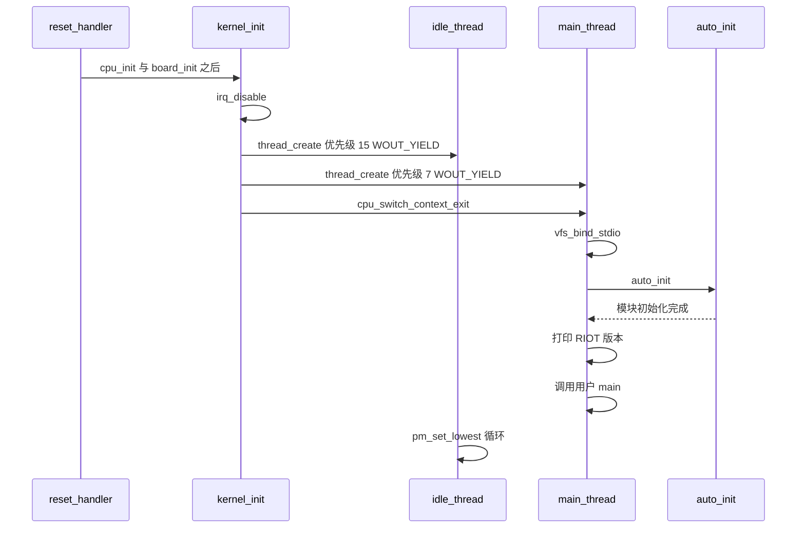

# kernel_init.c —— RIOT 内核启动与 main/idle 线程创建

> 对应源文件：`core/lib/init.c`（共 140 行）
> 关联头文件：`core/lib/include/kernel_init.h`（启动接口声明）、`core/include/thread.h`（线程配置宏）
> 关联文档：[01-启动流程与初始化.md](../../../references/rtos/RIOT/Docs/01-启动流程与初始化.md)

---

## 1. 一句话职责

`kernel_init()` 是**启动代码与调度器之间的唯一入口**：它在关中断状态下创建 idle 和 main 两个线程，然后通过 `cpu_switch_context_exit()` 永远离开启动上下文，把 CPU 交给调度器。

注意：上游 RIOT 早期版本把这段代码放在 `core/kernel_init.c`，本仓库已合并到 `core/lib/init.c`。**不要去找 `core/kernel_init.c`，它不存在。**

---

## 2. 文件全景

| 行号 | 内容 | 说明 |
|---|---|---|
| 1-17 | SPDX 头 + Doxygen 文件注释 | 平台无关的内核初始化 |
| 19-33 | include | `auto_init.h`、`irq.h`、`kernel_init.h`、`pm.h`、`thread.h` |
| 35-41 | `ENABLE_DEBUG`、启动横幅默认值 | `CONFIG_BOOT_MSG_STRING` |
| 43 | `extern int main(void);` | 用户入口 |
| 45-46 | `main_stack` / `idle_stack` | 两个静态栈 |
| 48-90 | `main_trampoline()` | main 线程的真正入口 |
| 92-103 | `idle_thread()` | 最低优先级循环 |
| 105-129 | `kernel_init()` | 创建线程并切栈 |
| 131-140 | `early_init()` | LED + stdio |

全局/静态对象：

| 对象 | 行号 | 大小（Cortex-M） | 作用 |
|---|---|---|---|
| `main_stack[]` | 45 | 1536 B | main 线程栈（含 TCB） |
| `idle_stack[]` | 46 | 256 B | idle 线程栈（含 TCB） |
| `CONFIG_BOOT_MSG_STRING` | 38-41 | 字符串常量 | 启动横幅 |

---

## 3. 逐函数表

| 函数 | 行号 | 签名 | 职责 | 调用者 |
|---|---|---|---|---|
| `main_trampoline` | 48-90 | `static void *(void *arg)` | main 线程入口：VFS 绑定、auto_init、打印横幅、调用 `main()` | 线程调度 |
| `idle_thread` | 92-103 | `static void *(void *arg)` | 无限循环调用 `pm_set_lowest()` | 线程调度 |
| `kernel_init` | 105-129 | `void(void)` | 创建 idle/main，切上下文 | `reset_handler_default()` |
| `early_init` | 131-140 | `void(void)` | 初始化 LED 和 stdio | 各 CPU 的 `cpu_init()` |

---

## 4. 逐字摘录与解读

### 4.1 `kernel_init()`：25 行决定系统形态

```c
/* core/lib/init.c:105-129 */
void kernel_init(void)
{
    if (!IS_USED(MODULE_CORE_THREAD)) {
        /* RIOT without threads */
        main_trampoline(NULL);
        while (1) {}
        return;
    }

    irq_disable();

    if (IS_USED(MODULE_CORE_IDLE_THREAD)) {
        thread_create(idle_stack, sizeof(idle_stack),
                      THREAD_PRIORITY_IDLE,
                      THREAD_CREATE_WOUT_YIELD,
                      idle_thread, NULL, "idle");
    }

    thread_create(main_stack, sizeof(main_stack),
                  THREAD_PRIORITY_MAIN,
                  THREAD_CREATE_WOUT_YIELD,
                  main_trampoline, NULL, "main");

    cpu_switch_context_exit();
}
```

逐行：

| 行 | 解释 |
|---|---|
| 107 | `IS_USED` 是编译期常量；无线程配置下整段被裁掉 |
| 109 | 直接调用 `main_trampoline(NULL)`，不创建线程 |
| 110 | 死循环防止返回启动代码 |
| 114 | 关中断：接下来要改 `sched_threads[]` |
| 116 | idle 线程可选（`MODULE_CORE_IDLE_THREAD`） |
| 117-120 | 优先级 15、`WOUT_YIELD`、栈 256 B |
| 123-126 | main 线程优先级 7、`WOUT_YIELD`、栈 1536 B |
| 128 | 切到第一个线程，**不返回** |

**为什么两个线程都用 `THREAD_CREATE_WOUT_YIELD`？**

`thread_create()` 默认会在入队后调用 `sched_switch(priority)`（`core/thread.c:373-377`）。但此时 `sched_active_thread` 还是 NULL，`sched_switch()` 会解引用空指针。`WOUT_YIELD` 跳过这次调度，等两个线程都建好后，用 `cpu_switch_context_exit()` 统一进入调度。

### 4.2 `main_trampoline()`：main 线程的壳

```c
/* core/lib/init.c:48-90 */
static void *main_trampoline(void *arg)
{
    (void)arg;

#if MODULE_VFS
    vfs_bind_stdio();
#endif

    if (IS_USED(MODULE_AUTO_INIT)) {
        auto_init();
    }

    if (!IS_ACTIVE(CONFIG_SKIP_BOOT_MSG) && !IS_USED(MODULE_STDIO_NULL)) {
        LOG_INFO(CONFIG_BOOT_MSG_STRING "\n");
    }

    int res = main();

    if (IS_USED(MODULE_TEST_UTILS_MAIN_EXIT_CB)) {
        void test_utils_main_exit_cb(int res);
        test_utils_main_exit_cb(res);
    }

#ifdef MODULE_TEST_UTILS_PRINT_STACK_USAGE
    void print_stack_usage_metric(const char *name, void *stack, unsigned max_size);
    if (IS_USED(MODULE_CORE_IDLE_THREAD)) {
        print_stack_usage_metric("idle", idle_stack, THREAD_STACKSIZE_IDLE);
    }
#endif

#ifdef CPU_NATIVE
    extern unsigned _native_retval;
    if (!_native_retval) {
        _native_retval = res;
    }
#endif

    if (IS_ACTIVE(CONFIG_CORE_EXIT_WITH_MAIN) && IS_USED(MODULE_PERIPH_PM)) {
        pm_off();
    }

    return NULL;
}
```

执行顺序的设计意图：

1. **`vfs_bind_stdio()` 最早**：如果 stdio 走 VFS（例如 SD 卡日志），必须先绑定，否则后续所有 printf 丢失。
2. **`auto_init()` 在 `main()` 前**：ztimer、GNRC、SAUL、shell 都在这里初始化。`main()` 里可以直接用 `ztimer_now()`、`gnrc_netif`。
3. **横幅在 auto_init 后**：避免被模块初始化日志淹没；`CONFIG_SKIP_BOOT_MSG` 可关。
4. **`main()` 返回值**：native 板把它存到 `_native_retval` 作为进程退出码；其他平台忽略。
5. **`CONFIG_CORE_EXIT_WITH_MAIN`**：打开后 `main()` 返回即 `pm_off()` 关机，适合电池设备。

### 4.3 `idle_thread()`：低功耗的实现

```c
/* core/lib/init.c:92-103 */
static void *idle_thread(void *arg)
{
    (void)arg;

    while (1) {
        if (IS_USED(MODULE_PERIPH_PM)) {
            pm_set_lowest();
        }
    }

    return NULL;
}
```

`pm_set_lowest()` 在 Cortex-M 上通常执行 `WFI`（Wait For Interrupt）：

- 没有中断时 CPU 停在低功耗模式；
- 中断到来唤醒，处理完继续 `WFI`；
- 如果裁剪掉 `MODULE_PERIPH_PM`，这个循环变成纯忙等，功耗从 µA 涨到 mA。

**idle 线程永远是 `PENDING` 状态**，因为它的 `while(1)` 从不阻塞。调度器在没有其他线程时选它，这是"系统空闲"的定义。

### 4.4 `early_init()`：只做两件事

```c
/* core/lib/init.c:131-140 */
void early_init(void)
{
    /* initialize leds */
    if (IS_USED(MODULE_PERIPH_INIT_LEDS)) {
        extern void led_init(void);
        led_init();
    }

    stdio_init();
}
```

调用时机在 `cpu_init()` 里（例如 `cpu/samd21/cpu.c:280`），**早于 `periph_init()`**。原因：`periph_init()` 里的驱动可能用 `DEBUG()` 打印，而 `DEBUG` 依赖 stdio 已经初始化。

---

## 5. 启动时序




---

## 6. 栈大小的量化

Cortex-M 默认值（`cpu/cortexm_common/include/cpu_conf_common.h:35-51`）：

```
THREAD_EXTRA_STACKSIZE_PRINTF = 512
THREAD_STACKSIZE_DEFAULT      = 1024
THREAD_STACKSIZE_IDLE         = 256
ISR_STACKSIZE                 = 512
```

`THREAD_STACKSIZE_MAIN` 的推导（`core/lib/include/thread_config.h:74-77`）：

```c
#ifndef THREAD_STACKSIZE_MAIN
#define THREAD_STACKSIZE_MAIN      (THREAD_STACKSIZE_DEFAULT + \
                                    THREAD_EXTRA_STACKSIZE_PRINTF)
#endif
```

所以：

```
main_stack = 1024 + 512 = 1536 B
idle_stack = 256 B
固定开销 = 1536 + 256 = 1792 B RAM
```

再加上 ISR 栈 512 B（链接脚本分配），**内核启动的最低 RAM 需求约 2304 B**。

---

## 7. 陷阱与读码建议

### 7.1 `kernel_init()` 不返回

它的最后一行是 `cpu_switch_context_exit()`，Cortex-M 版本标记了 `NORETURN`（`cpu/cortexm_common/thread_arch.c:290`）。**不要在它后面写代码**，编译器可能警告 unreachable。

### 7.2 无线程配置下 `main_trampoline` 仍在启动栈上跑

`!IS_USED(MODULE_CORE_THREAD)` 分支直接调用 `main_trampoline(NULL)`，此时没有 PSP，所有代码跑在 MSP 上。`main()` 里的阻塞 API（`mutex_lock`、`msg_receive`）会崩溃。**无线程配置只适合纯裸机循环。**

### 7.3 `auto_init()` 失败是静默的

`_auto_init_module()` 不检查返回值（`sys/auto_init/auto_init.c:33-39`）。如果 GNRC 网卡初始化失败，`main()` 照常运行，只是没网络。调试时打开：

```make
CFLAGS += -DCONFIG_AUTO_INIT_ENABLE_DEBUG=1
```

### 7.4 不要手动调用 `kernel_init()`

它由启动代码调用一次。重复调用会创建第二组 main/idle 线程，PID 冲突、栈冲突，行为未定义。

### 7.5 读码顺序

1. `core/lib/init.c:105-129`（`kernel_init`）
2. `core/lib/init.c:48-90`（`main_trampoline`）
3. `core/lib/init.c:92-103`（`idle_thread`）
4. `core/lib/init.c:131-140`（`early_init`）
5. `cpu/cortexm_common/vectors_cortexm.c:198-215`（调用点）
6. `cpu/cortexm_common/thread_arch.c:290-308`（切栈）
