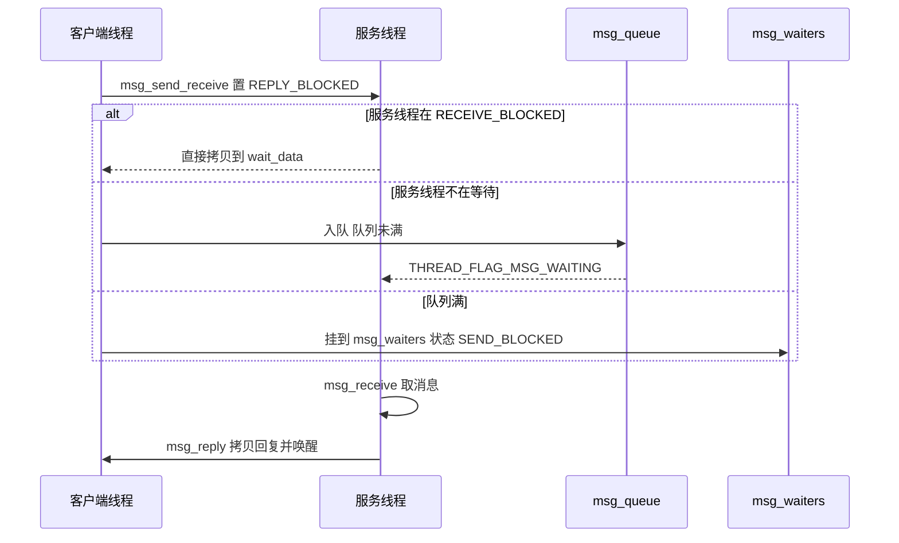
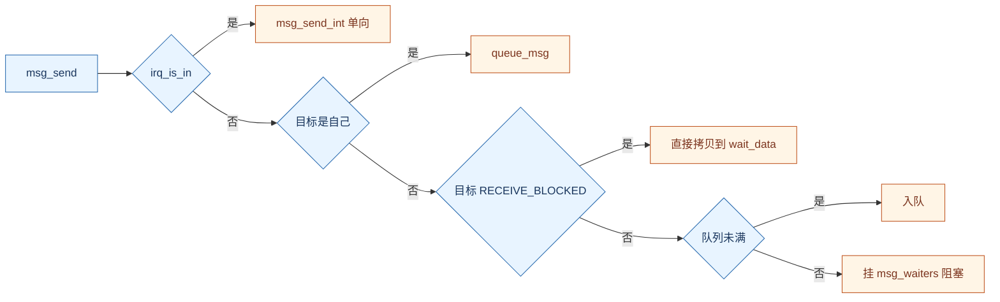

# msg.c / msg_bus.c —— RIOT 消息机制与发布订阅总线

> 对应源文件：`core/msg.c`（共 569 行）、`core/msg_bus.c`（共 70 行）
> 关联头文件：`core/include/msg.h`（436 行）、`core/include/msg_bus.h`（263 行）
> 关联文档：[03-线程同步原语.md](../../../references/rtos/RIOT/Docs/03-线程同步原语.md)

---

## 1. 一句话职责

`msg.c` 是 RIOT 的**核心 IPC**：把 8 字节的 `msg_t` 在线程之间传递，支持阻塞/非阻塞发送、同步请求-应答、ISR 单向投递；`msg_bus.c` 在它之上提供一对多的发布订阅。

---

## 2. `msg_t` 与队列

```c
/* core/include/msg.h:193-201 */
typedef struct {
    kernel_pid_t sender_pid;    /**< PID of sending thread. Will be filled in
                                     by msg_send. */
    uint16_t type;              /**< Type field. */
    union {
        void *ptr;              /**< Pointer content field. */
        uint32_t value;         /**< Value content field. */
    } content;                  /**< Content of the message. */
} msg_t;
```

`sizeof(msg_t) == 8`（32 位），是 RIOT 里最小的通信单元。

每个线程可以有一个消息队列：

| 字段 | 类型 | 作用 |
|---|---|---|
| `thread->msg_array` | `msg_t *` | 队列存储，调用者分配 |
| `thread->msg_queue` | `cib_t` | 环形索引（`read_count`、`write_count`、`mask`） |
| `thread->msg_waiters` | `list_node_t` | 阻塞的发送者链表 |
| `thread->wait_data` | `void *` | 接收阻塞时指向接收缓冲 |

`cib_t` 定义在 `core/lib/include/cib.h:41-45`，只有 `read_count`、`write_count`、`mask` 三个 `unsigned int`。

**队列大小必须是 2 的幂**，否则 `mask` 不能做位与取模。

---

## 3. 逐函数表

| 函数 | 行号 | 职责 | 阻塞 |
|---|---|---|---|
| `queue_msg` | 49-67 | 入队 + 置 `MSG_WAITING` | 否 |
| `msg_send` | 69-78 | 分派：ISR/ self / 普通 | 是 |
| `msg_try_send` | 80-89 | 非阻塞发送 | 否 |
| `_msg_send` | 91-179 | 发送主逻辑 | 视 `block` |
| `msg_send_to_self` | 181-190 | 发给自己 | 否 |
| `_msg_send_oneway` | 192-221 | 单向投递（ISR 用） | 否 |
| `msg_send_int` | 223-232 | ISR 发送入口 | 否 |
| `msg_send_bus` | 234-264 | 总线广播 | 否 |
| `msg_send_receive` | 266-301 | 同步请求 | 是 |
| `msg_reply` | 303-332 | 回复并可能抢占 | 否 |
| `msg_reply_int` | 334-354 | ISR 回复 | 否 |
| `msg_try_receive` | 356-359 | 非阻塞收 | 否 |
| `msg_receive` | 361-364 | 阻塞收 | 是 |
| `_msg_receive` | 366-453 | 接收主逻辑 | 视 `block` |
| `msg_avail_thread` | 469-480 | 查询指定线程队列长度 | 否 |
| `msg_avail` | 482-488 | 查询当前线程 | 否 |
| `msg_queue_capacity` | 490-508 | 查询队列容量 | 否 |
| `msg_init_queue` | 510-516 | 初始化队列 | 否 |
| `msg_queue_print` | 518-569 | 打印队列（shell） | 否 |

`msg_bus.c`：

| 函数 | 行号 | 职责 |
|---|---|---|
| `msg_bus_init` | 23-29 | 初始化总线，分配全局 id |
| `msg_bus_attach` | 31-42 | 订阅 |
| `msg_bus_detach` | 44-51 | 退订 |
| `msg_bus_get_entry` | 53-70 | 查找当前线程的订阅项 |

---

## 4. 逐字摘录

### 4.1 入队

```c
/* core/msg.c:49-67 */
static int queue_msg(thread_t *target, const msg_t *m)
{
    int n = cib_put(&(target->msg_queue));

    if (n < 0) {
        DEBUG("queue_msg(): message queue of thread %" PRIkernel_pid
              " is full (or there is none)\n", target->pid);
        return 0;
    }

    DEBUG("queue_msg(): queuing message\n");
    msg_t *dest = &target->msg_array[n];

    *dest = *m;
#if MODULE_CORE_THREAD_FLAGS
    thread_flags_set_internal(target, THREAD_FLAG_MSG_WAITING);
#endif
    return 1;
}
```

三个失败点：

1. 队列未初始化：`mask = 0`，`cib_put` 返回 -1；
2. 队列满：`write_count - read_count == mask + 1`；
3. `msg_array == NULL`：解引用崩溃（但 `cib_put` 会先失败）。

### 4.2 发送的三条路径

```c
/* core/msg.c:69-78 */
int msg_send(msg_t *m, kernel_pid_t target_pid)
{
    if (irq_is_in()) {
        return msg_send_int(m, target_pid);
    }
    if (thread_getpid() == target_pid) {
        return msg_send_to_self(m);
    }
    return _msg_send(m, target_pid, true, irq_disable());
}
```

| 场景 | 路径 | 原因 |
|---|---|---|
| ISR | `msg_send_int()` | 不能阻塞 |
| 自己发自己 | `msg_send_to_self()` | 否则会挂到自己的 `msg_waiters` 死锁 |
| 普通 | `_msg_send(block=true)` | 可阻塞 |

### 4.3 直接投递 vs 入队

```c
/* core/msg.c:111-176 */
    if (target->status != STATUS_RECEIVE_BLOCKED) {
        DEBUG(
            "msg_send() %s:%i: Target %" PRIkernel_pid " is not RECEIVE_BLOCKED.\n",
            __FILE__, __LINE__, target_pid);

        if (queue_msg(target, m)) {
            DEBUG("msg_send() %s:%i: Target %" PRIkernel_pid
                  " has a msg_queue. Queueing message.\n", __FILE__,
                  __LINE__, target_pid);
            irq_restore(state);
            if (me->status == STATUS_REPLY_BLOCKED
                || (IS_USED(MODULE_CORE_THREAD_FLAGS) &&
                    sched_context_switch_request)
                ) {
                thread_yield_higher();
            }
            return 1;
        }

        if (!block) {
            DEBUG("msg_send: %" PRIkernel_pid ": Receiver not waiting, "
                  "block=%d\n", me->pid, block);
            irq_restore(state);
            return 0;
        }

        DEBUG("msg_send: %" PRIkernel_pid ": going send blocked.\n",
              me->pid);

        me->wait_data = m;

        int newstatus;

        if (me->status == STATUS_REPLY_BLOCKED) {
            newstatus = STATUS_REPLY_BLOCKED;
        }
        else {
            newstatus = STATUS_SEND_BLOCKED;
        }

        sched_set_status(me, newstatus);

        thread_add_to_list(&(target->msg_waiters), me);

#if MODULE_CORE_THREAD_FLAGS
        thread_flags_set_internal(target, THREAD_FLAG_MSG_WAITING);
#endif

        irq_restore(state);
        thread_yield_higher();

        DEBUG("msg_send: %" PRIkernel_pid ": Back from send block.\n",
              me->pid);
    }
    else {
        DEBUG("msg_send: %" PRIkernel_pid ": Direct msg copy from %"
              PRIkernel_pid " to %" PRIkernel_pid ".\n",
              me->pid, thread_getpid(), target_pid);
        /* copy msg to target */
        msg_t *target_message = target->wait_data;
        *target_message = *m;
        sched_set_status(target, STATUS_PENDING);

        irq_restore(state);
        thread_yield_higher();
    }
```

关键分支：

- **目标不在 `RECEIVE_BLOCKED`**：先尝试入队。队列满且 `block=true`，发送者挂到 `msg_waiters`，状态变 `SEND_BLOCKED`。
- **目标在 `RECEIVE_BLOCKED`**：直接拷贝到 `target->wait_data`，唤醒目标。**不经过队列**，这是零拷贝路径。

### 4.4 接收的四组合

```c
/* core/msg.c:396-424 */
    list_node_t *next = list_remove_head(&me->msg_waiters);

    if (next == NULL) {
        DEBUG("_msg_receive: %" PRIkernel_pid ": _msg_receive(): No thread in "
              "waiting list.\n", thread_getpid());

        if (queue_index < 0) {
            DEBUG("_msg_receive(): %" PRIkernel_pid ": No msg in queue. Going "
                  "blocked.\n", thread_getpid());
            sched_set_status(me, STATUS_RECEIVE_BLOCKED);

            irq_restore(state);
            thread_yield_higher();

            /* sender copied message */
            assert(thread_get_active()->status != STATUS_RECEIVE_BLOCKED);
        }
        else {
            irq_restore(state);
        }

        return 1;
    }
    else {
        DEBUG("_msg_receive: %" PRIkernel_pid ": _msg_receive(): Waking up "
              "waiting thread.\n", thread_getpid());

        thread_t *sender =
            container_of((clist_node_t *)next, thread_t, rq_entry);
```

| 队列有消息 | 有阻塞发送者 | 行为 |
|---|---|---|
| 是 | 否 | 取队列消息 |
| 是 | 是 | 取队首，发送者的消息填入队尾空位 |
| 否 | 是 | 直接拷贝发送者消息 |
| 否 | 否 | 阻塞或返回 -1 |

"队列有消息 + 有发送者"这一格保证**消息顺序**：不会因为发送者插队而乱序。

### 4.5 同步请求-应答

```c
/* core/msg.c:274-285 */
    unsigned state = irq_disable();
    thread_t *me = thread_get_active();

    thread_status_t prev_status = thread_get_status(me);
    sched_set_status(me, STATUS_REPLY_BLOCKED);
    me->wait_data = reply;

    /* we reuse (abuse) reply for sending, because wait_data might be
     * overwritten if the target is not in RECEIVE_BLOCKED */
    *reply = *m;
    /* _msg_send blocks until reply received (except there is an error while sending) */
    int res = _msg_send(reply, target_pid, true, state);
```

`reply` 同时充当"发送缓冲"和"接收回复缓冲"。`me->wait_data` 在 `_msg_send` 里可能被改写（当目标不 waiting 时，`wait_data` 指向发送消息），所以不能直接用它收回复。

### 4.6 总线

```c
/* core/msg.c:234-241 */
int msg_send_bus(msg_t *m, msg_bus_t *bus)
{
    const bool in_irq = irq_is_in();
    const uint32_t event_mask = (1UL << (m->type & 0x1F));
    int count = 0;

    m->sender_pid = (in_irq ? KERNEL_PID_ISR : thread_getpid())
                    | MSB_BUS_PID_FLAG;
```

- `event_mask` 只有 **32 位**，`type & 0x1F` 限制事件号 0-31。
- `MSB_BUS_PID_FLAG` 标记消息来自总线，接收者据此判断是否需要 reply。
- 每个订阅者收到**同一份消息的拷贝**（`_msg_send_oneway` 里 `*target_message = *m`）。

---

## 5. 消息流





---

## 6. 陷阱与读码建议

### 6.1 `msg_send()` 返回 0 是"没发出去"

| 返回值 | 含义 |
|---|---|
| 1 | 已投递（直接或入队） |
| 0 | 目标不在等且队列满（只有 try/ISR 会返回） |
| -1 | PID 无效 |

阻塞版 `msg_send()` 在队列满时会阻塞，不返回 0；但 `msg_try_send()` 和 `msg_send_int()` 会。

### 6.2 `msg_init_queue()` 的数组必须长期有效

```c
/* core/msg.c:510-516 */
void msg_init_queue(msg_t *array, int num)
{
    thread_t *me = thread_get_active();

    me->msg_array = array;
    cib_init(&(me->msg_queue), num);
}
```

`array` 如果是函数局部变量，函数返回后队列就悬空了。**必须 `static` 或全局。**

### 6.3 `msg_send_receive()` 不能发给自己

```c
/* core/msg.c:268-272 */
    assert(thread_getpid() != target_pid);
    if (thread_getpid() == target_pid) {
        DEBUG("msg_send_receive(): Cannot send and receive on the same thread\n");
        return -1;
    }
```

自己给自己发同步请求会永远等不到回复（自己在阻塞，没人处理）。

### 6.4 `msg_reply()` 只能回复 `REPLY_BLOCKED`

```c
/* core/msg.c:311-317 */
    if (target->status != STATUS_REPLY_BLOCKED) {
        DEBUG("msg_reply(): %" PRIkernel_pid ": Target \"%" PRIkernel_pid
              "\" not waiting for reply.", thread_getpid(),
              target->pid);
        irq_restore(state);
        return -1;
    }
```

请求者已超时/取消时 `msg_reply()` 返回 -1。**服务端要检查返回值**，否则会往已释放的 `wait_data` 写数据。

### 6.5 读码顺序

1. `core/include/msg.h:193-201`（`msg_t`）
2. `core/msg.c:49-67`（入队）
3. `core/msg.c:69-179`（发送）
4. `core/msg.c:366-453`（接收）
