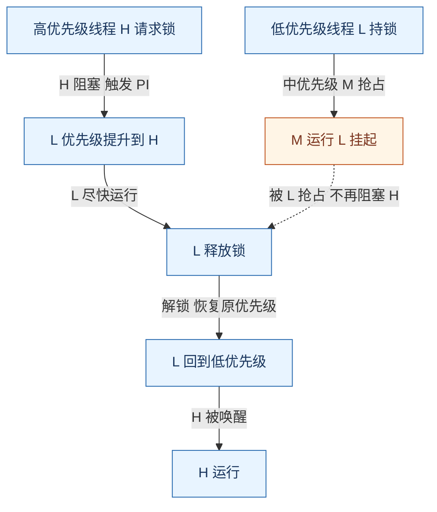

# mutex.c —— RIOT 互斥量与优先级继承

> 对应源文件：`core/mutex.c`（共 302 行）
> 关联头文件：`core/include/mutex.h`（348 行）
> 关联文档：[03-线程同步原语.md](../../../references/rtos/RIOT/Docs/03-线程同步原语.md)

---

## 1. 一句话职责

`mutex.c` 实现**二值互斥锁**：一个等待链表 + 一个哨兵值表示锁状态，可选优先级继承（PI）。它不提供递归锁（用 `rmutex`）、不提供超时（用 `ztimer_mutex_lock_timeout`）。

---

## 2. `mutex_t` 结构

```c
/* core/include/mutex.h:36-74 */
typedef struct {
    /**
     * @brief   The process waiting queue of the mutex. **Must never be changed
     *          by the user.**
     * @internal
     */
    list_node_t queue;
#if defined(DOXYGEN) || defined(MODULE_CORE_MUTEX_PRIORITY_INHERITANCE) \
    || defined(MODULE_CORE_MUTEX_DEBUG)
    /**
     * @brief   The current owner of the mutex or `NULL`
     * @note    Only available if module core_mutex_priority_inheritance
     *          is used.
     *
     * If either the mutex is not locked or the mutex is not locked by a thread
     * (e.g. because it is used to synchronize a thread with an ISR completion),
     * this will have the value of `NULL`.
     */
    kernel_pid_t owner;
#endif
#if defined(DOXYGEN) || defined(MODULE_CORE_MUTEX_DEBUG)
    /**
     * @brief   Program counter of the call to @ref mutex_lock that most
     *          recently acquired this mutex
     *
     * This is used when the module `core_mutex_debug` is used to debug
     * deadlocks and is non-existing otherwise
     */
    uinttxtptr_t owner_calling_pc;
#endif
#if defined(DOXYGEN) || defined(MODULE_CORE_MUTEX_PRIORITY_INHERITANCE)
    /**
     * @brief   Original priority of the owner
     * @note    Only available if module core_mutex_priority_inheritance
     *          is used.
     */
    uint8_t owner_original_priority;
#endif
} mutex_t;
```

| 字段 | 条件 | 大小 | 作用 |
|---|---|---|---|
| `queue` |  always | 4 B | 等待链表；`NULL`/`-1`/指针三态 |
| `owner` | PI 或 DEBUG | 2 B | 当前持有者 PID |
| `owner_calling_pc` | DEBUG | 4 B | 加锁调用点，死锁调试 |
| `owner_original_priority` | PI | 1 B | 提升前的优先级，解锁时恢复 |

默认配置（无 PI、无 DEBUG）下 `mutex_t` 只有 **4 B**。

### 2.1 三态哨兵

```c
/* core/include/mutex.h:130 */
#define MUTEX_LOCKED ((list_node_t *)-1)
```

| `queue.next` | 含义 |
|---|---|
| `NULL` | 未加锁 |
| `MUTEX_LOCKED`（0xFFFFFFFF） | 已加锁，无等待者 |
| 其他指针 | 已加锁，指向等待链表头 |

用一个指针同时编码"锁状态"和"等待队列"，省掉 `locked` 字段。

---

## 3. 逐函数表

| 函数 | 行号 | 职责 |
|---|---|---|
| `_block` | 53-98 | 阻塞等待，可选 PI |
| `mutex_lock_internal` | 100-138 | 加锁主逻辑 |
| `mutex_lock_cancelable` | 140-187 | 可取消加锁（超时用） |
| `mutex_unlock` | 189-236 | 解锁并移交 |
| `mutex_unlock_and_sleep` | 238-266 | 解锁 + 睡眠原子操作 |
| `mutex_cancel` | 268-298 | 取消等待 |

`MAXTHREADS <= 1` 时整个文件退化为空（行 300-302），因为单线程不需要锁。

---

## 4. 逐字摘录

### 4.1 加锁

```c
/* core/mutex.c:100-138 */
bool mutex_lock_internal(mutex_t *mutex, bool block)
{
    uinttxtptr_t pc = 0;
#if IS_USED(MODULE_CORE_MUTEX_DEBUG)
    pc = cpu_get_caller_pc();
#endif
    unsigned irq_state = irq_disable();

    DEBUG("PID[%" PRIkernel_pid "] mutex_lock_internal(block=%u).\n",
          thread_getpid(), (unsigned)block);

    if (mutex->queue.next == NULL) {
        /* mutex is unlocked. */
        mutex->queue.next = MUTEX_LOCKED;
#if IS_USED(MODULE_CORE_MUTEX_PRIORITY_INHERITANCE) \
        || IS_USED(MODULE_CORE_MUTEX_DEBUG)
        thread_t *me = thread_get_active();
        mutex->owner = me ? me->pid : KERNEL_PID_UNDEF;
#endif
#if IS_USED(MODULE_CORE_MUTEX_DEBUG)
        mutex->owner_calling_pc = pc;
#endif
#if IS_USED(MODULE_CORE_MUTEX_PRIORITY_INHERITANCE)
        mutex->owner_original_priority = me->priority;
#endif
        DEBUG("PID[%" PRIkernel_pid "] mutex_lock(): early out.\n",
              thread_getpid());
        irq_restore(irq_state);
    }
    else {
        if (!block) {
            irq_restore(irq_state);
            return false;
        }
        _block(mutex, irq_state, pc);
    }

    return true;
}
```

快路径（未加锁）：置 `MUTEX_LOCKED`，记录 owner，恢复中断，返回。**只有 4 条内存操作 + 2 条中断指令**。

慢路径：调用 `_block()`，它负责挂链表、PI、切上下文。

### 4.2 阻塞与优先级继承

```c
/* core/mutex.c:65-93 */
    thread_t *me = thread_get_active();

    /* Fail visibly even if a blocking action is called from somewhere where
     * it's subtly not allowed, eg. board_init */
    assert(me != NULL);
    DEBUG("PID[%" PRIkernel_pid "] mutex_lock() Adding node to mutex queue: "
          "prio: %" PRIu32 "\n", thread_getpid(), (uint32_t)me->priority);
    sched_set_status(me, STATUS_MUTEX_BLOCKED);
    if (mutex->queue.next == MUTEX_LOCKED) {
        mutex->queue.next = (list_node_t *)&me->rq_entry;
        mutex->queue.next->next = NULL;
    }
    else {
        thread_add_to_list(&mutex->queue, me);
    }

#ifdef MODULE_CORE_MUTEX_PRIORITY_INHERITANCE
    thread_t *owner = thread_get(mutex->owner);
    if ((owner) && (owner->priority > me->priority)) {
        DEBUG("PID[%" PRIkernel_pid "] prio of %" PRIkernel_pid
              ": %u --> %u\n",
              thread_getpid(), mutex->owner,
              (unsigned)owner->priority, (unsigned)me->priority);
        sched_change_priority(owner, me->priority);
    }
#endif

    irq_restore(irq_state);
    thread_yield_higher();
```

三个动作：

1. **状态改 `MUTEX_BLOCKED`**：`sched_set_status` 会把线程从 runqueue 摘除。
2. **挂等待链表**：
   - 如果锁是"无等待者"（`MUTEX_LOCKED`），直接把 `queue.next` 指向自己，`next = NULL`；
   - 否则 `thread_add_to_list()` 按优先级插入。
3. **PI 提升**：如果持有者优先级低于等待者，把持有者提到等待者级别。

**注意 `thread_add_to_list()` 的前提是 `thread->status < STATUS_ON_RUNQUEUE`**（`thread.c:194` 的 assert）。这里先改状态再挂链表，顺序正确。

### 4.3 解锁与移交

```c
/* core/mutex.c:196-229 */
    if (mutex->queue.next == NULL) {
        /* the mutex was not locked */
        irq_restore(irqstate);
        return;
    }

    if (mutex->queue.next == MUTEX_LOCKED) {
        mutex->queue.next = NULL;
        /* the mutex was locked and no thread was waiting for it */
        irq_restore(irqstate);
        return;
    }

    list_node_t *next = list_remove_head(&mutex->queue);

    thread_t *process = container_of((clist_node_t *)next, thread_t, rq_entry);

    DEBUG("PID[%" PRIkernel_pid "] mutex_unlock(): waking up waiting thread %"
          PRIkernel_pid "\n", thread_getpid(),  process->pid);
    sched_set_status(process, STATUS_PENDING);

    if (!mutex->queue.next) {
        mutex->queue.next = MUTEX_LOCKED;
    }

#if IS_USED(MODULE_CORE_MUTEX_PRIORITY_INHERITANCE)
    thread_t *owner = thread_get(mutex->owner);
    if ((owner) && (owner->priority != mutex->owner_original_priority)) {
        DEBUG("PID[%" PRIkernel_pid "] prio %u --> %u\n",
              owner->pid, (unsigned)owner->priority,
              (unsigned)mutex->owner_original_priority);
        sched_change_priority(owner, mutex->owner_original_priority);
    }
#endif
```

三个分支：

| `queue.next` | 含义 | 动作 |
|---|---|---|
| `NULL` | 未加锁 | 直接返回（解锁未加锁的 mutex 是 no-op） |
| `MUTEX_LOCKED` | 已加锁无等待者 | 置 `NULL` |
| 指针 | 有等待者 | 摘队首，置 PENDING，锁直接移交 |

**锁是"移交给下一个等待者"，不是"释放后重新竞争"**。被唤醒者从 `mutex_lock()` 返回时已经持有锁，不需要重试。

### 4.4 解锁并睡眠

```c
/* core/mutex.c:238-266 */
void mutex_unlock_and_sleep(mutex_t *mutex)
{
    DEBUG("PID[%" PRIkernel_pid "] mutex_unlock_and_sleep(): queue.next: %p\n",
          thread_getpid(), (void *)mutex->queue.next);
    unsigned irqstate = irq_disable();

    if (mutex->queue.next) {
        if (mutex->queue.next == MUTEX_LOCKED) {
            mutex->queue.next = NULL;
        }
        else {
            list_node_t *next = list_remove_head(&mutex->queue);
            thread_t *process = container_of((clist_node_t *)next, thread_t,
                                             rq_entry);
            DEBUG("PID[%" PRIkernel_pid "] mutex_unlock_and_sleep(): waking up "
                  "waiter.\n", process->pid);
            sched_set_status(process, STATUS_PENDING);
            if (!mutex->queue.next) {
                mutex->queue.next = MUTEX_LOCKED;
            }
        }
    }

    DEBUG("PID[%" PRIkernel_pid "] mutex_unlock_and_sleep(): going to sleep.\n",
          thread_getpid());
    sched_set_status(thread_get_active(), STATUS_SLEEPING);
    irq_restore(irqstate);
    thread_yield_higher();
}
```

**解锁和睡眠在同一个临界区**。如果拆成两步，可能在这两步之间错过唤醒（`thread_wakeup()` 看到线程还在运行，不会置 PENDING），导致永久睡眠。

---

## 5. 优先级继承



**没有 PI 的后果**（优先级反转）：

```
L 持锁（优先级 10）
M 就绪（优先级 5）→ 抢占 L
H 请求锁（优先级 2）→ 阻塞
M 一直运行（优先级 5 > L 的 10）→ L 永远拿不到 CPU → H 永远等
```

**有 PI**：H 阻塞时把 L 提到 2，L 抢占 M，释放锁，H 继续。

限制：

- 只支持**单层继承**，不支持链式（mutex A 等 mutex B）。
- `owner_original_priority` 只存一个值，嵌套加锁会丢失原始优先级。
- 默认不开，需要 `USEMODULE += core_mutex_priority_inheritance`。

---

## 6. 取消等待

```c
/* core/mutex.c:268-277 */
void mutex_cancel(mutex_cancel_t *mc)
{
    unsigned irq_state = irq_disable();

    mc->cancelled = 1;

    mutex_t *mutex = mc->mutex;
    thread_t *thread = mc->thread;

    if (thread_is_active(thread)) {
```

`mutex_cancel()` 是 `ztimer_mutex_lock_timeout()` 的基础：

1. 置 `cancelled = 1`；
2. 如果线程还在运行/即将运行，它会在 `_block()` 返回后检查 `mc->cancelled`；
3. 如果线程已经在等待链表里，直接摘除并唤醒，返回 `-ECANCELED`。

**注意**：取消后线程拿到的是"没拿到锁"的结果，调用者必须检查返回值。

---

## 7. 陷阱与读码建议

### 7.1 不能在 ISR 里 `mutex_lock()`

阻塞后没有中断能唤醒它。`mutex.h:299` 只保证 `mutex_cancel()` 可以在 ISR 里调用，不是 `mutex_lock()`。

### 7.2 不能递归加锁

同一线程第二次 `mutex_lock()` 会把自己挂到自己的等待链表后面，永久阻塞。需要递归用 `rmutex`（`core/lib/rmutex.c`），它在 `mutex` 外套了 owner + refcount。

### 7.3 解锁未加锁的 mutex 是静默 no-op

```c
/* core/mutex.c:196-200 */
    if (mutex->queue.next == NULL) {
        /* the mutex was not locked */
        irq_restore(irqstate);
        return;
    }
```

这掩盖了 bug。**解锁前确保自己持有锁**，必要时用 `mutex_trylock()` 或断言。

### 7.4 `MUTEX_INIT` 与 `MUTEX_INIT_LOCKED`

```c
/* core/include/mutex.h:114-122 */
#  define MUTEX_INIT { .queue = { .next = NULL } }

/**
 * @brief Static initializer for mutex_t with a locked mutex
 */
#  define MUTEX_INIT_LOCKED { .queue = { .next = MUTEX_LOCKED } }
#else
#  define MUTEX_INIT {}
#  define MUTEX_INIT_LOCKED { { MUTEX_LOCKED } }
```

静态初始化用宏，不要手动写 `{0}`——字段布局可能随模块变化。

### 7.5 `mutex_t` 大小随模块变化

默认 4 B，开 PI 后 8 B，开 DEBUG 后 12 B。**在结构体里嵌 mutex 时要注意对齐和总大小**。

### 7.6 读码顺序

1. `core/include/mutex.h:36-74`（结构）
2. `core/include/mutex.h:114-130`（初始化与哨兵）
3. `core/mutex.c:100-138`（加锁）
4. `core/mutex.c:53-98`（阻塞 + PI）
5. `core/mutex.c:189-236`（解锁）
6. `core/mutex.c:268-298`（取消）
