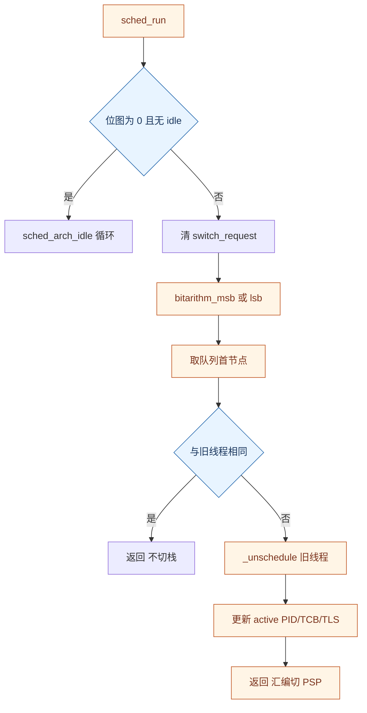
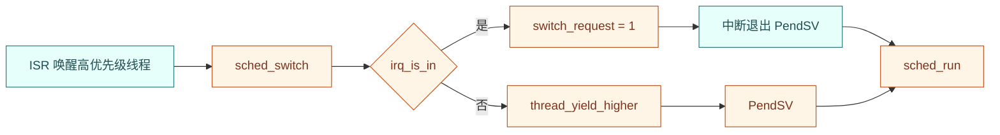

# sched.c —— RIOT 调度器：位图、运行队列与上下文切换决策

> 对应源文件：`core/sched.c`（共 385 行）
> 关联头文件：`core/include/sched.h`（394 行）、`cpu/cortexm_common/thread_arch.c`（PendSV 汇编）
> 关联文档：[02-线程与调度器.md](../../../references/rtos/RIOT/Docs/02-线程与调度器.md)

---

## 1. 一句话职责

`sched.c` 实现"**下一个该谁跑**"的全部规则：16 条按优先级组织的 runqueue、一个 32 位位图、状态迁移、抢占判断、线程退出。

它不保存/恢复寄存器——那是 `cpu/<arch>/thread_arch.c` 的事。`sched.c` 只负责**选出 `thread_t *`**，汇编负责把它的 `sp` 装进 PSP。

---

## 2. 全局对象

| 对象 | 行号 | 类型 | 作用 |
|---|---|---|---|
| `sched_active_pid` | 67 | `volatile kernel_pid_t` | 当前运行线程 PID，OpenOCD 也读它 |
| `sched_threads[]` | 68 | `volatile thread_t *[MAXTHREADS+1]` | PID → TCB 映射，NULL 表示空闲槽 |
| `sched_num_threads` | 69 | `volatile int` | 当前线程总数 |
| `max_threads` | 74 | `const uint8_t` | `ARRAY_SIZE(sched_threads)`，给 OpenOCD |
| `_tcb_name_offset` | 80 | `const uint8_t` | `offsetof(thread_t, name)`，给 OpenOCD |
| `sched_active_thread` | 84 | `volatile thread_t *` | 当前 TCB 指针 |
| `sched_context_switch_request` | 85 | `volatile unsigned int` | ISR 里请求切换的标记 |
| `sched_runqueues[]` | 87 | `clist_node_t[SCHED_PRIO_LEVELS]` | 每优先级一条循环链表 |
| `runqueue_bitcache` | 88 | `static uint32_t` | 位图：bit 表示队列非空 |
| `sched_cb` | 91 | 函数指针 | 可选调度回调 |

`static_assert(SCHED_PRIO_LEVELS <= 32, ...)`（行 71）是位图能工作的前提。

---

## 3. 逐函数表

| 函数 | 行号 | 职责 | 复杂度 |
|---|---|---|---|
| `_set_runqueue_bit` | 102-109 | 置位图 | O(1) |
| `_clear_runqueue_bit` | 111-118 | 清位图 | O(1) |
| `_get_prio_queue_from_runqueue` | 120-127 | 位图 → 最高优先级号 | O(1) |
| `_unschedule` | 129-153 | 把 RUNNING 改 PENDING，栈溢出检查，回调 | O(1) |
| `sched_run` | 155-233 | 选下一个线程，更新 active | O(1) + O(n) 出队 |
| `_runqueue_push` | 238-254 | 尾插入队 + 置位 | O(1) |
| `_runqueue_pop` | 259-271 | 从队列删除 + 可能清位 | O(n) |
| `sched_set_status` | 273-287 | 状态迁移唯一入口 | O(1)/O(n) |
| `sched_switch` | 289-313 | 判断是否需要让出 | O(1) |
| `sched_task_exit` | 315-334 | 线程退出，清 PID，切上下文 | O(1) |
| `sched_register_cb` | 337-341 | 注册调度回调 | O(1) |
| `sched_change_priority` | 343-378 | 改优先级并重排队列 | O(n) |
| `sched_yield` | 381-385 | POSIX 兼容的 yield | O(1) |

---

## 4. 逐字摘录

### 4.1 位图的两种位序

```c
/* core/sched.c:102-127 */
static inline void _set_runqueue_bit(uint8_t priority)
{
#if defined(BITARITHM_HAS_CLZ)
    runqueue_bitcache |= BIT31 >> priority;
#else
    runqueue_bitcache |= 1UL << priority;
#endif
}

static inline void _clear_runqueue_bit(uint8_t priority)
{
#if defined(BITARITHM_HAS_CLZ)
    runqueue_bitcache &= ~(BIT31 >> priority);
#else
    runqueue_bitcache &= ~(1UL << priority);
#endif
}

static inline unsigned _get_prio_queue_from_runqueue(void)
{
#if defined(BITARITHM_HAS_CLZ)
    return 31 - bitarithm_msb(runqueue_bitcache);
#else
    return bitarithm_lsb(runqueue_bitcache);
#endif
}
```

| 配置 | 优先级 0 存在哪 | 找最高优先级 |
|---|---|---|
| 有 CLZ | bit 31 | `31 - msb()` = `__clz()` |
| 无 CLZ | bit 0 | `lsb()` = `__builtin_ctz` |

两种编码语义相同：**返回数值最小的非空队列号**。`BIT31` 是 `0x80000000`，`1UL` 在 32 位平台是 `0x00000001`。

### 4.2 `sched_run()`：选队

```c
/* core/sched.c:155-175 */
thread_t *__attribute__((used)) sched_run(void)
{
    thread_t *active_thread = thread_get_active();
    thread_t *previous_thread = active_thread;

    if (!IS_USED(MODULE_CORE_IDLE_THREAD) && !runqueue_bitcache) {
        if (active_thread) {
            _unschedule(active_thread);
            active_thread = NULL;
        }

        do {
            sched_arch_idle();
        } while (!runqueue_bitcache);
    }

    sched_context_switch_request = 0;

    unsigned nextrq = _get_prio_queue_from_runqueue();
    thread_t *next_thread = container_of(sched_runqueues[nextrq].next->next,
                                         thread_t, rq_entry);
```

- 无 idle 且全空：`sched_arch_idle()` 通常执行 `WFI`，直到中断唤醒。
- `sched_runqueues[nextrq]` 是哨兵。RIOT 的 `clist` 是**环形**的：哨兵的 `next` 指向**尾节点**，尾节点的 `next` 指向**头节点**。`clist_rpush()`（`core/lib/include/clist.h:129-139`）把新节点插到尾部，并让 `list->next` 指向它。因此 `sched_runqueues[nextrq].next->next` 是**最早入队的头节点**，`container_of` 取出来的就是它。

> 这段看起来像"取第二个"，实际是取头节点。读之前先看 `core/lib/include/clist.h:120-205` 的 `clist_rpush` / `clist_lpop` / `clist_lpoprpush`，否则会被指针绕晕。

### 4.3 状态迁移

```c
/* core/sched.c:273-287 */
void sched_set_status(thread_t *process, thread_status_t status)
{
    if (status >= STATUS_ON_RUNQUEUE) {
        if (!(process->status >= STATUS_ON_RUNQUEUE)) {
            _runqueue_push(process, process->priority);
        }
    }
    else {
        if (process->status >= STATUS_ON_RUNQUEUE) {
            _runqueue_pop(process);
        }
    }

    process->status = status;
}
```

四种情况：

| 旧状态 | 新状态 | 队列操作 |
|---|---|---|
| 阻塞 | PENDING/RUNNING | push |
| PENDING/RUNNING | 阻塞 | pop |
| PENDING | RUNNING | 无 |
| 阻塞 | 阻塞 | 无 |

`STATUS_ON_RUNQUEUE == STATUS_RUNNING`，所以 `>=` 判断把 `RUNNING`、`PENDING` 都算"在队列上"。

### 4.4 抢占判断

```c
/* core/sched.c:289-313 */
void sched_switch(uint16_t other_prio)
{
    thread_t *active_thread = thread_get_active();
    uint16_t current_prio = active_thread->priority;
    int on_runqueue = (active_thread->status >= STATUS_ON_RUNQUEUE);

    DEBUG("sched_switch: active pid=%" PRIkernel_pid " prio=%" PRIu16 " on_runqueue=%i "
          ", other_prio=%" PRIu16 "\n",
          active_thread->pid, current_prio, on_runqueue,
          other_prio);

    if (!on_runqueue || (current_prio > other_prio)) {
        if (irq_is_in()) {
            DEBUG("sched_switch: setting sched_context_switch_request.\n");
            sched_context_switch_request = 1;
        }
        else {
            DEBUG("sched_switch: yielding immediately.\n");
            thread_yield_higher();
        }
    }
    else {
        DEBUG("sched_switch: continuing without yield.\n");
    }
}
```

**数值大 = 优先级低**。`current_prio > other_prio` 表示"当前线程优先级低于被唤醒者"，需要让出。

### 4.5 线程退出

```c
/* core/sched.c:315-334 */
NORETURN void sched_task_exit(void)
{
    DEBUG("sched_task_exit: ending thread %" PRIkernel_pid "...\n",
          thread_getpid());

#if defined(MODULE_TEST_UTILS_PRINT_STACK_USAGE) && defined(DEVELHELP)
    void print_stack_usage_metric(const char *name, void *stack, unsigned max_size);
    thread_t *me = thread_get_active();
    print_stack_usage_metric(me->name, me->stack_start, me->stack_size);
#endif

    (void)irq_disable();
    sched_threads[thread_getpid()] = NULL;
    sched_num_threads--;

    sched_set_status(thread_get_active(), STATUS_STOPPED);

    sched_active_thread = NULL;
    cpu_switch_context_exit();
}
```

注意 `sched_active_thread = NULL` 后调用 `cpu_switch_context_exit()`：PendSV 汇编检测到 NULL 会跳过保存旧上下文（线程已经死了，没栈可存），直接恢复新线程。

---

## 5. 调度流程





---

## 6. 优先级与数值

```
SCHED_PRIO_LEVELS = 16
THREAD_PRIORITY_MIN  = 15
THREAD_PRIORITY_IDLE = 15
THREAD_PRIORITY_MAIN = 7
GNRC_NETIF_PRIO      = 2
```

线程优先级在 `thread_create()` 里检查：

```c
/* core/thread.c:245-247 */
    if (priority >= SCHED_PRIO_LEVELS) {
        return -EINVAL;
    }
```

**优先级 0 是最高**，但不能给普通线程——它常用于"不可被抢占的软实时任务"。

---

## 7. 陷阱与读码建议

### 7.1 `sched_run()` 假设位图非零

如果 `MODULE_CORE_IDLE_THREAD` 打开但 idle 线程被误杀，位图可能为 0，`_get_prio_queue_from_runqueue()` 对 0 调用 `bitarithm_msb(0)` 是未定义行为。**不要手动删除 idle 线程。**

### 7.2 `_runqueue_pop()` 是 O(n)

`clist_remove()` 要遍历找前驱。同优先级线程越多，出队越慢。**不要创建大量同优先级线程**，这不是 RIOT 擅长的场景。

### 7.3 `sched_change_priority()` 会重排队列

```c
/* core/sched.c:351-359 */
    unsigned irq_state = irq_disable();

    if (thread_is_active(thread)) {
        _runqueue_pop(thread);
        _runqueue_push(thread, priority);
    }
    thread->priority = priority;

    irq_restore(irq_state);
```

先 pop 再 push，**线程会跑到新优先级队列的尾部**。如果依赖"同优先级 FIFO 顺序"，改优先级会破坏它。

### 7.4 栈溢出检查只在换出时做

```c
/* core/sched.c:135-147 */
#if IS_ACTIVE(SCHED_TEST_STACK)
    /* All platforms align the stack to word boundaries (possible wasting one
     * word of RAM), so this access is not unaligned. Using an intermediate
     * cast to uintptr_t to silence -Wcast-align
     */
    if (*((uintptr_t *)(uintptr_t)active_thread->stack_start) !=
        (uintptr_t)active_thread->stack_start) {
        LOG_ERROR(
            "scheduler(): stack overflow detected, pid=%" PRIkernel_pid "\n",
            active_thread->pid);
        core_panic(PANIC_STACK_OVERFLOW, "STACK OVERFLOW");
    }
#endif
```

线程一直运行不切换时，溢出不会被发现。生产环境建议加 MPU 栈保护。

### 7.5 `sched_active_thread` 是 `volatile`

它不是给多核用的，而是防止编译器把多次读取优化成一次——ISR 可能在两次读之间改变它。**不要去掉 `volatile`**。

### 7.6 读码顺序

1. `core/sched.c:67-88`（全局对象）
2. `core/sched.c:102-127`（位图）
3. `core/sched.c:273-287`（状态迁移）
4. `core/sched.c:155-233`（选队）
5. `core/sched.c:289-313`（抢占）
6. `core/sched.c:315-334`（退出）
7. `cpu/cortexm_common/thread_arch.c:318-380`（PendSV）
