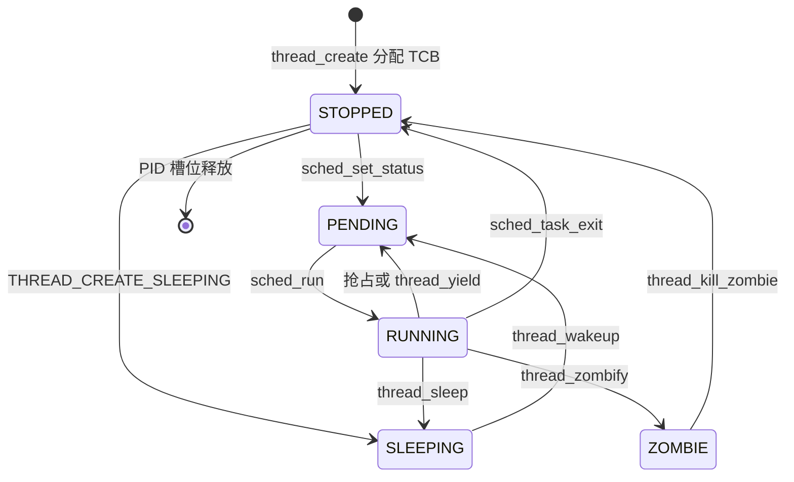
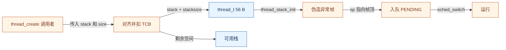

# thread.c —— 线程创建、栈布局与生命周期

> 对应源文件：`core/thread.c`（共 415 行）
> 关联头文件：`core/include/thread.h`（711 行）、`core/include/sched.h`（394 行）
> 关联文档：[02-线程与调度器.md](../../../references/rtos/RIOT/Docs/02-线程与调度器.md)

---

## 1. 一句话职责

`thread.c` 负责**线程的一生**：在一块调用者提供的连续内存里切出 `thread_t` 和栈、伪造初始异常帧、分配 PID、入队；以及睡眠、唤醒、退出、栈用量测量。

它不决定"谁运行"（那是 `sched.c`），只负责"线程怎么被造出来、怎么被销毁"。

---

## 2. 文件全景

| 行号 | 内容 |
|---|---|
| 1-38 | 中文导读头 + SPDX + include |
| 40-51 | Valgrind 兼容宏 |
| 53-58 | `thread_getstatus()` |
| 60-69 | `thread_getname()` |
| 71-84 | `thread_zombify()` |
| 86-112 | `thread_kill_zombie()` |
| 114-125 | `thread_sleep()` |
| 127-154 | `thread_wakeup()` |
| 156-167 | `thread_yield()` |
| 192-210 | `thread_add_to_list()`（按优先级插入） |
| 212-239 | `measure_stack_free_internal()` |
| 241-383 | `thread_create()` |
| 385-399 | `state_names[]` 表 |
| 403-415 | `thread_state_to_string()` |

---

## 3. 核心结构

`thread_t` 定义在 `core/include/thread.h:167-208`，字段与大小（32 位、全模块）：

| 字段 | 行号 | 大小 | 含义 |
|---|---|---|---|
| `sp` | 168 | 4 | 栈指针，上下文切换的核心 |
| `status` | 169 | 4 | 13 种状态之一 |
| `priority` | 170 | 1 | 0 最高、15 最低 |
| `pid` | 172 | 2 | 1..32 |
| `flags` | 175 | 2 | 16 位线程标志 |
| `rq_entry` | 178 | 4 | runqueue 链表节点 |
| `wait_data` | 182 | 4 | 阻塞时存放等待对象 |
| `msg_waiters` | 186 | 4 | 等待发送者链表 |
| `msg_queue` | 189 | 12 | 环形队列索引 |
| `msg_array` | 191 | 4 | 消息数组 |
| `stack_start` | 196 | 4 | 栈底（溢出检测） |
| `name` | 199 | 4 | 线程名 |
| `stack_size` | 202 | 4 | 原始栈大小 |
| **合计** | | **56** | 对齐到 4 B |

条件编译会让字段消失：没有 `MODULE_CORE_MSG` 就没有 `msg_waiters/msg_queue/msg_array`，没有 `DEVELHELP` 就没有 `stack_start/stack_size`。**计算内存时必须按目标配置重新 `sizeof`。**

---

## 4. 逐函数表

| 函数 | 行号 | 职责 | 备注 |
|---|---|---|---|
| `thread_getstatus` | 53-58 | PID → 状态 | 不存在返回 `STATUS_NOT_FOUND` |
| `thread_getname` | 60-69 | PID → 名字 | 未开 `CONFIG_THREAD_NAMES` 返回 NULL |
| `thread_zombify` | 71-84 | 当前线程变僵尸 | ISR 里直接返回 |
| `thread_kill_zombie` | 86-112 | 回收僵尸线程 | 清 `sched_threads[pid]` |
| `thread_sleep` | 114-125 | 当前线程睡眠 | 必须外部唤醒 |
| `thread_wakeup` | 127-154 | 唤醒睡眠线程 | 不是 SLEEPING 返回 -1 |
| `thread_yield` | 156-167 | 让出同优先级 | 先移到队尾 |
| `thread_add_to_list` | 192-210 | 按优先级插入链表 | 用于 mutex/cond/msg 等待队列 |
| `measure_stack_free_internal` | 212-239 | 扫描栈哨兵算空闲 | 假设栈向下增长 |
| `thread_create` | 241-383 | 创建线程 | 核心函数 |
| `thread_state_to_string` | 403-415 | 状态 → 字符串 | 调试/shell 用 |

---

## 5. 逐字摘录

### 5.1 `thread_create()`：栈的切法

```c
/* core/thread.c:256-277 */
    /* align the stack on a 16/32bit boundary */
    uintptr_t misalignment = (uintptr_t)stack % alignof(void *);
    if (misalignment) {
        misalignment = alignof(void *) - misalignment;
        stack += misalignment;
        stacksize -= misalignment;
    }

    /* make room for the thread control block */
    stacksize -= sizeof(thread_t);

    /* round down the stacksize to a multiple of thread_t alignments (usually 16/32bit) */
    stacksize -= stacksize % alignof(thread_t);

    if (stacksize < 0) {
        DEBUG("thread_create: stacksize is too small!\n");
        return -EINVAL;
    }
    /* allocate our thread control block at the top of our stackspace. Cast to
     * (uintptr_t) intermediately to silence -Wcast-align. (We manually made
     * sure alignment is correct above.) */
    thread_t *thread = (thread_t *)(uintptr_t)(stack + stacksize);
```

四步：

1. **对齐栈底**：`alignof(void *)` 在 32 位是 4，64 位是 8。
2. **扣掉 TCB**：`stacksize -= sizeof(thread_t)`，默认 56 B。
3. **向下取整到 `alignof(thread_t)`**：保证 TCB 对齐。
4. **TCB 放在 `stack + stacksize`**：即"可用栈的顶部"，TCB 之后是栈空间。

内存布局：

```
高地址  stack + stacksize + sizeof(thread_t)
        +------------------+
        | thread_t 56 B    |
        +------------------+  stack + stacksize
        |                  |
        | 可用栈            |
        |                  |
        +------------------+  stack
低地址
```

### 5.2 PID 分配

```c
/* core/thread.c:316-331 */
    unsigned state = irq_disable();

    kernel_pid_t pid = KERNEL_PID_UNDEF;
    for (kernel_pid_t i = KERNEL_PID_FIRST; i <= KERNEL_PID_LAST; ++i) {
        if (sched_threads[i] == NULL) {
            pid = i;
            break;
        }
    }
    if (pid == KERNEL_PID_UNDEF) {
        DEBUG("thread_create(): too many threads!\n");

        irq_restore(state);

        return -EOVERFLOW;
    }
```

线性扫描 1..32，O(32)。PID 会回收：`sched_task_exit()` 把 `sched_threads[pid] = NULL`。**所以 PID 不是长期唯一标识**，不能拿来当对象 ID 存到文件里。

### 5.3 初始化 TCB

```c
/* core/thread.c:333-353 */
    sched_threads[pid] = thread;

    thread->pid = pid;
    thread->sp = thread_stack_init(function, arg, stack, stacksize);

#if defined(DEVELHELP) || IS_ACTIVE(SCHED_TEST_STACK) || \
    defined(MODULE_MPU_STACK_GUARD) || defined(MODULE_CORTEXM_STACK_LIMIT)
    thread->stack_start = stack;
#endif

#ifdef DEVELHELP
    thread->stack_size = total_stacksize;
#endif
#ifdef CONFIG_THREAD_NAMES
    thread->name = name;
#endif

    thread->priority = priority;
    thread->status = STATUS_STOPPED;

    thread->rq_entry.next = NULL;
```

注意顺序：

- `sched_threads[pid] = thread` **在初始化之前**。如果此时发生中断并调度，调度器可能看到一个半初始化的 TCB。但整段在 `irq_disable()` 保护下（行 316），所以安全。
- `thread->status = STATUS_STOPPED` 是临时值，随后 `sched_set_status()` 改成 PENDING/SLEEPING。
- `rq_entry.next = NULL` 必须清零，否则 `clist_rpush` 会把垃圾指针链进队列。

### 5.4 创建后的调度

```c
/* core/thread.c:367-378 */
    if (flags & THREAD_CREATE_SLEEPING) {
        sched_set_status(thread, STATUS_SLEEPING);
    }
    else {
        sched_set_status(thread, STATUS_PENDING);

        if (!(flags & THREAD_CREATE_WOUT_YIELD)) {
            irq_restore(state);
            sched_switch(priority);
            return pid;
        }
    }
```

| flags | 结果 |
|---|---|
| 0 | 入队 + `sched_switch(priority)`，可能立即抢占创建者 |
| `THREAD_CREATE_WOUT_YIELD` | 只入队，等下一次调度点 |
| `THREAD_CREATE_SLEEPING` | 不入队，等 `thread_wakeup()` |
| `THREAD_CREATE_NO_STACKTEST` | 不在栈上写哨兵 |

**默认会立即切换**，所以 `thread_create()` 返回时新线程可能已经跑过一轮。不要在创建后假设新线程还没执行。

### 5.5 状态名表

```c
/* core/thread.c:385-399 */
static const char *state_names[STATUS_NUMOF] = {
    [STATUS_STOPPED] = "stopped",
    [STATUS_ZOMBIE] = "zombie",
    [STATUS_SLEEPING] = "sleeping",
    [STATUS_MUTEX_BLOCKED] = "bl mutex",
    [STATUS_RECEIVE_BLOCKED] = "bl rx",
    [STATUS_SEND_BLOCKED] = "bl send",
    [STATUS_REPLY_BLOCKED] = "bl reply",
    [STATUS_FLAG_BLOCKED_ANY] = "bl anyfl",
    [STATUS_FLAG_BLOCKED_ALL] = "bl allfl",
    [STATUS_MBOX_BLOCKED] = "bl mbox",
    [STATUS_COND_BLOCKED] = "bl cond",
    [STATUS_RUNNING] = "running",
    [STATUS_PENDING] = "pending",
};
```

这是 `ps` 命令显示的状态字符串。**新增状态时必须同步加表项**，否则 `thread_state_to_string()` 的 `assert(name != NULL)` 会触发（行 412）。

---

## 6. 线程生命周期





---

## 7. 栈用量测量

```c
/* core/thread.c:212-239 */
uintptr_t measure_stack_free_internal(const char *stack, size_t size)
{
    /* Alignment of stack has been fixed (if needed) by thread_create(), so
     * we can silence -Wcast-align here */
    uintptr_t *stackp = (uintptr_t *)(uintptr_t)stack;
    uintptr_t end = (uintptr_t)stack + size;

    /* HACK: This will affect native32/native64 only.
     *
     * The dark magic used here is frowned upon by valgrind. E.g. valgrind may
     * deduce that a specific value was at some point allocated on the stack,
     * but has gone out of scope. When that value is now read again to
     * estimate stack usage, it does look a lot like someone passed a pointer
     * to a stack allocated value, and that pointer is referenced after that
     * value has gone out of scope. */
    VALGRIND_DISABLE_ERROR_REPORTING;

    /* assume that the stack grows "downwards" */
    while (((uintptr_t)stackp < end) && (*stackp == (uintptr_t)stackp)) {
        stackp++;
    }

    VALGRIND_ENABLE_ERROR_REPORTING;

    uintptr_t space_free = (uintptr_t)stackp - (uintptr_t)stack;

    return space_free;
}
```

原理：`thread_create()` 在栈上写入"每个字 = 自己的地址"（`thread.c:303-313`）。线程运行后，被覆盖的区域就是实际用过的栈；从头扫描，第一个不等于自身地址的字就是"栈水位"。

`used = size - space_free`，`ps` 命令的 `stack (used)` 列就是这个。

**限制**：只有 `DEVELHELP` 或 `SCHED_TEST_STACK` 打开时才写哨兵。生产固件关掉后没有栈用量数据。

---

## 8. 陷阱与读码建议

### 8.1 栈参数包含 TCB

传 1024 时实际可用 `1024 - 56 - 对齐损失`。深调用链 + printf 很容易溢出。**建议用 `THREAD_STACKSIZE_DEFAULT + THREAD_EXTRA_STACKSIZE_PRINTF` 给会打印的线程。**

### 8.2 `thread_add_to_list()` 按优先级排序

```c
/* core/thread.c:199-206 */
    while (list->next) {
        thread_t *list_entry = container_of((clist_node_t *)list->next,
                                            thread_t, rq_entry);
        if (list_entry->priority > my_prio) {
            break;
        }
        list = list->next;
    }
```

等待队列是**按优先级降序**（数值小的在前）排列的。mutex 解锁时取队首，就是最高优先级的等待者。

### 8.3 `thread_wakeup()` 只能唤醒 SLEEPING

```c
/* core/thread.c:138-147 */
    else if (thread->status == STATUS_SLEEPING) {
        DEBUG("thread_wakeup: Thread is sleeping.\n");

        sched_set_status(thread, STATUS_PENDING);

        irq_restore(old_state);
        sched_switch(thread->priority);

        return 1;
    }
```

如果线程在 `MUTEX_BLOCKED`、`RECEIVE_BLOCKED` 等其他阻塞状态，`thread_wakeup()` 返回 -1，不会唤醒。**不同阻塞状态要用对应的唤醒 API**（`mutex_unlock`、`msg_send`、`thread_flags_set`）。

### 8.4 `thread_zombify()` 在 ISR 里是空操作

```c
/* core/thread.c:71-75 */
void thread_zombify(void)
{
    if (irq_is_in()) {
        return;
    }
```

ISR 不能"杀死当前线程"——当前根本没有线程上下文。需要在 ISR 里结束线程，只能发消息让线程自己调用。

### 8.5 僵尸线程不会自动回收

`thread_zombify()` 把线程置 `STATUS_ZOMBIE`，但 **TCB 和栈仍然占着**。必须另一个线程调用 `thread_kill_zombie(pid)` 才释放 PID 槽位。RIOT 没有垃圾回收线程。

### 8.6 读码顺序

1. `core/include/thread.h:167-208`（TCB 字段）
2. `core/thread.c:241-383`（`thread_create`）
3. `core/thread.c:256-277`（栈切分）
4. `core/thread.c:333-378`（TCB 初始化与调度）
5. `core/thread.c:192-210`（优先级插入）
6. `core/thread.c:212-239`（栈测量）
7. `cpu/cortexm_common/thread_arch.c:142-236`（初始栈帧）
