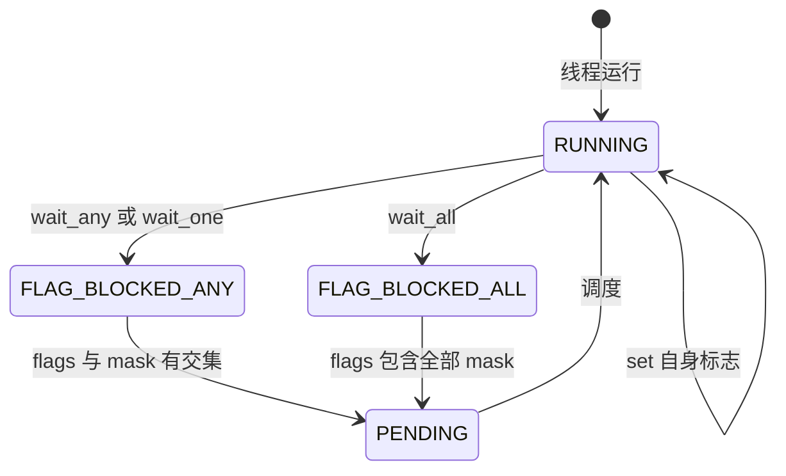
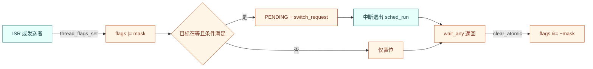

# thread_flags.c —— 16 位线程标志与 ISR 事件通知

> 对应源文件：`core/thread_flags.c`（共 162 行）
> 关联头文件：`core/include/thread_flags.h`（207 行）
> 关联文档：[05-中断处理与原子操作.md](../../../references/rtos/RIOT/Docs/05-中断处理与原子操作.md)

---

## 1. 一句话职责

`thread_flags.c` 给每个线程提供 **16 个布尔标志**，支持"等任一/等全部/等一个"，可在 ISR、其他线程或线程自身置位。它是 RIOT 里**唯一不会失败的线程通知机制**。

---

## 2. 核心概念

| 概念 | 说明 |
|---|---|
| 标志宽度 | 16 位（`thread_flags_t` = `uint16_t`） |
| 保留位 | bit 15 `MSG_WAITING`、bit 14 `TIMEOUT` |
| 用户位 | bit 0-13，共 14 个 |
| 等待状态 | `STATUS_FLAG_BLOCKED_ANY` / `STATUS_FLAG_BLOCKED_ALL` |
| 等待掩码 | 存在 `thread->wait_data`（`void *` 强转） |
| 语义 | **电平**，不是计数；重复置位只算一次 |

保留位定义（`core/include/thread_flags.h:93-112`）：

```c
/* core/include/thread_flags.h:93-112 */
#define THREAD_FLAG_MSG_WAITING     (1u << 15)
/**
 * @brief Set by @ref xtimer_set_timeout_flag() when the timer expires
 *
 * @see xtimer_set_timeout_flag
 */
#define THREAD_FLAG_TIMEOUT         (1u << 14)

/**
 * @brief Comprehensive set of all predefined flags
 *
 * This bit mask is set for all thread flag bits that are predefined in RIOT.
 * Flags within this set may be set on a thread by the operating system without
 * the thread soliciting them (though not all are; for example, @ref
 * THREAD_FLAG_TIMEOUT is not).
 *
 * When using custom flags, asserting that they are not in this set can help
 * avoid conflict with future additions to the predefined flags.
 */
#define THREAD_FLAG_PREDEFINED_MASK (THREAD_FLAG_MSG_WAITING | THREAD_FLAG_TIMEOUT)
```

`MSG_WAITING` 由 `queue_msg()` 自动置位（`core/msg.c:64`），`TIMEOUT` 由 xtimer 的超时回调置位。

---

## 3. 逐函数表

| 函数 | 行号 | 职责 | 可从 ISR 调用 |
|---|---|---|---|
| `_thread_flags_wake` | 30-56 | 检查等待条件，满足则唤醒 | 是（内部） |
| `_thread_flags_clear_atomic` | 58-67 | 关中断清位 | 是 |
| `_thread_flags_wait` | 69-80 | 记录掩码、改状态、让出 | 否 |
| `thread_flags_clear` | 82-90 | 清指定位 | 是 |
| `_thread_flags_wait_any` | 92-103 | 等任一 | 否 |
| `thread_flags_wait_any` | 105-111 | 等任一 + 清位 | 否 |
| `thread_flags_wait_one` | 113-122 | 等任一 + 只清最低位 | 否 |
| `thread_flags_wait_all` | 124-140 | 等全部 + 清位 | 否 |
| `thread_flags_set_internal` | 142-146 | 置位 + 唤醒（不加锁） | 调用者保证原子 |
| `thread_flags_set` | 148-162 | 置位 + 唤醒（关中断） | 是 |

---

## 4. 逐字摘录

### 4.1 唤醒条件

```c
/* core/thread_flags.c:30-56 */
static inline int __attribute__((always_inline)) _thread_flags_wake(
    thread_t *thread)
{
    unsigned wakeup;
    thread_flags_t mask = (uint16_t)(uintptr_t)thread->wait_data;

    switch (thread->status) {
    case STATUS_FLAG_BLOCKED_ANY:
        wakeup = (thread->flags & mask);
        break;
    case STATUS_FLAG_BLOCKED_ALL:
        wakeup = ((thread->flags & mask) == mask);
        break;
    default:
        wakeup = 0;
        break;
    }

    if (wakeup) {
        DEBUG("_thread_flags_wake(): waking up pid %" PRIkernel_pid "\n",
              thread->pid);
        sched_set_status(thread, STATUS_PENDING);
        sched_context_switch_request = 1;
    }

    return wakeup;
}
```

关键点：

- `thread->wait_data` 存的是**等待掩码**，不是指针。用 `(uint16_t)(uintptr_t)` 强转。
- `FLAG_BLOCKED_ANY`：`flags & mask` 非零就唤醒。
- `FLAG_BLOCKED_ALL`：`(flags & mask) == mask` 才唤醒。
- 唤醒后置 `sched_context_switch_request`，由中断退出路径统一切换。

### 4.2 置位

```c
/* core/thread_flags.c:142-162 */
bool thread_flags_set_internal(thread_t *thread, thread_flags_t mask)
{
    thread->flags |= mask;
    return _thread_flags_wake(thread);
}

void thread_flags_set(thread_t *thread, thread_flags_t mask)
{
    DEBUG("thread_flags_set(): setting 0x%08x for pid %" PRIkernel_pid "\n",
          mask, thread->pid);
    unsigned state = irq_disable();

    thread->flags |= mask;
    if (_thread_flags_wake(thread)) {
        irq_restore(state);
        thread_yield_higher();
    }
    else {
        irq_restore(state);
    }
}
```

两个版本：

- `thread_flags_set_internal()`：**调用者已经关中断**（例如 `queue_msg` 在 `_msg_send` 的临界区里调用）。它不关中断，省一次 `irq_disable/restore`。
- `thread_flags_set()`：公开 API，自己关中断。ISR 里调用时 `irq_disable()` 是 no-op（Cortex-M 异常处理已经屏蔽），安全。

**为什么不会失败**：只是 `flags |= mask`，不需要队列、不需要目标等待。这是它优于 `msg_send_int()` 的地方。

### 4.3 等待与清位

```c
/* core/thread_flags.c:105-122 */
thread_flags_t thread_flags_wait_any(thread_flags_t mask)
{
    thread_t *me = thread_get_active();

    _thread_flags_wait_any(mask);
    return _thread_flags_clear_atomic(me, mask);
}

thread_flags_t thread_flags_wait_one(thread_flags_t mask)
{
    _thread_flags_wait_any(mask);
    thread_t *me = thread_get_active();
    thread_flags_t tmp = me->flags & mask;

    /* clear all but least significant bit */
    tmp &= (~tmp + 1);
    return _thread_flags_clear_atomic(me, tmp);
}
```

`wait_any` 和 `wait_one` 都先等待，再清位：

- `wait_any` 清 `mask` 中**所有已置位**的 flag；
- `wait_one` 只清**最低的那个**，其余保留。

`tmp &= (~tmp + 1)` 是"取最低有效位"：`~tmp + 1 == -tmp`，`tmp & -tmp` 只保留最低的 1。

### 4.4 等待全部

```c
/* core/thread_flags.c:124-140 */
thread_flags_t thread_flags_wait_all(thread_flags_t mask)
{
    unsigned state = irq_disable();
    thread_t *me = thread_get_active();

    if (!((me->flags & mask) == mask)) {
        DEBUG(
            "thread_flags_wait_all(): pid %" PRIkernel_pid " waiting for %08x\n",
            thread_getpid(), (unsigned)mask);
        _thread_flags_wait(mask, me, STATUS_FLAG_BLOCKED_ALL, state);
    }
    else {
        irq_restore(state);
    }

    return _thread_flags_clear_atomic(me, mask);
}
```

`wait_all` 的等待条件是"掩码里每一位都置位"。**注意它不会自动清除未置位的位**——返回时 `_thread_flags_clear_atomic(me, mask)` 清掉全部 mask 位（此时都置位了）。

---

## 5. 状态与数据流





---

## 6. 与 msg/sema 的对比

| 特性 | thread_flags | msg | sema |
|---|---|---|---|
| 通知失败 | **不会** | 队列满会丢 | 不会 |
| 计数 | 否（电平） | 每条消息一份 | 是 |
| 携带数据 | 否（只有位） | 8 B | 否 |
| 等待多个条件 | 是（掩码） | 否 | 否 |
| ISR 安全 | 是 | `msg_send_int()` | 通常可以 |
| 内存 | 2 B/线程 | 8 B/条 | 4 B + mutex |

选型：

- 只关心"事件发生了" → `thread_flags`；
- 需要传指针/值 → `msg`；
- 需要计数（生产 10 个、消费 10 个） → `sema`。

---

## 7. 陷阱与读码建议

### 7.1 flag 不是计数

ISR 连续置位 100 次，`wait_any` 只返回一次。需要计数用 `sema_post()`。

### 7.2 `MSG_WAITING` 对应多条消息

一个 flag 可能代表队列里有多条消息。标准模式是循环 `msg_try_receive()` 直到返回 0：

```c
if (flags & THREAD_FLAG_MSG_WAITING) {
    msg_t msg;
    while (msg_try_receive(&msg) == 1) {
        /* handle */
    }
}
```

### 7.3 不要用保留位

bit 15 和 bit 14 被 msg/xtimer 占用。用户只能用 `0x3FFF` 范围。置位保留位会干扰 msg 等待逻辑。

### 7.4 `wait_all` 可能永久阻塞

如果掩码里有一位永远不会被置位，线程永远醒不来。**等待全部时确保所有位都有明确的置位路径。**

### 7.5 `thread_flags_clear()` 返回实际清除的位

```c
/* core/thread_flags.c:82-90 */
thread_flags_t thread_flags_clear(thread_flags_t mask)
{
    thread_t *me = thread_get_active();

    mask = _thread_flags_clear_atomic(me, mask);
    DEBUG("thread_flags_clear(): pid %" PRIkernel_pid " clearing 0x%08x\n",
          thread_getpid(), mask);
    return mask;
}
```

返回值是"原本置位且被清掉的位"，可以用来判断"在等待期间有没有新事件"。

### 7.6 读码顺序

1. `core/include/thread_flags.h:93-118`（保留位与类型）
2. `core/thread_flags.c:30-56`（唤醒条件）
3. `core/thread_flags.c:58-67`（原子清位）
4. `core/thread_flags.c:92-140`（三种等待）
5. `core/thread_flags.c:142-162`（置位）
6. `core/msg.c:49-67`（`MSG_WAITING` 的来源）
