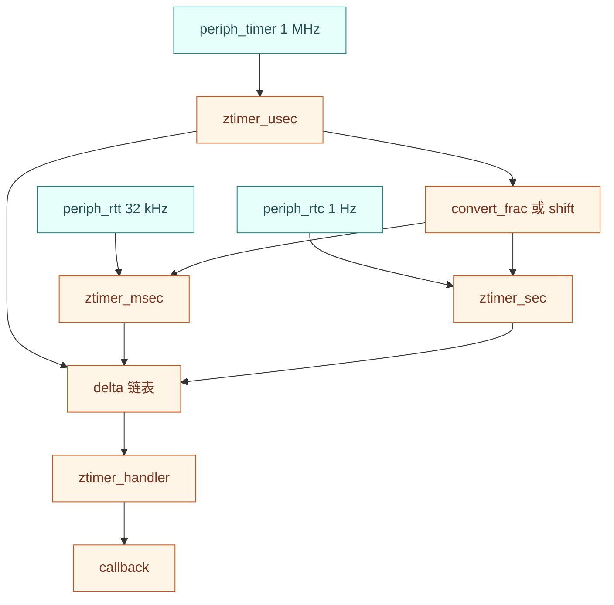

# ztimer —— RIOT 分层定时器框架

> 对应源文件：`sys/ztimer/core.c`（共 532 行）；同目录 `init.c`（451 行）、`periodic.c`（86 行）、`util.c`（257 行）、`convert.c`（72 行）、`convert_frac.c`（126 行）、`convert_shift.c`（99 行）
> 关联头文件：`sys/include/ztimer.h`（895 行）
> 说明：本仓库没有 `sys/ztimer.c`，核心实现拆在 `sys/ztimer/core.c`。
> 关联文档：[04-定时器与ztimer.md](../../../references/rtos/RIOT/Docs/04-定时器与ztimer.md)

---

## 1. 一句话职责

ztimer 是一个**可组合的软件定时器框架**：底层时钟（periph_timer / RTT / RTC）只提供 `now/set/cancel`，ztimer 在其上维护一条 delta 链表，支持任意数量的单次/周期定时器，并通过 convert 层派生不同频率的时钟。

---

## 2. 核心结构

### 2.1 `ztimer_base_t` / `ztimer_t`

```c
/* sys/include/ztimer.h:297-300 */
struct ztimer_base {
    ztimer_base_t *next;        /**< next timer in list */
    uint32_t offset;            /**< offset from last timer in list */
};
```

`ztimer_t` 在 316-320 行：

```c
/* sys/include/ztimer.h:316-320 */
typedef struct {
    ztimer_base_t base;             /**< clock list entry */
    ztimer_callback_t callback;     /**< timer callback function pointer */
    void *arg;                      /**< timer callback argument */
} ztimer_t;
```

| 字段 | 大小 | 含义 |
|---|---|---|
| `next` | 4 B | 链表下一节点 |
| `offset` | 4 B | 相对前一个节点的偏移（delta） |
| `callback` | 4 B | 到期回调 |
| `arg` | 4 B | 回调参数 |
| **合计** | **16 B** | 32 位 |

### 2.2 `ztimer_clock_t`

```c
/* sys/include/ztimer.h:329-362 */
typedef struct {
    /**
     * @brief   Set a new timer target
     * @param   clock       ztimer clock to set the new target
     * @param   val         Relative target (e.g. fire at value `now() + val`)
     */
    void (*set)(ztimer_clock_t *clock, uint32_t val);

    /**
     * @brief   Get the current count of the timer
     * @param   clock       ztimer clock to get the current time from
     */
    uint32_t (*now)(ztimer_clock_t *clock);

    /**
     * @brief   Cancel any set target
     * @param   clock       ztimer clock to cancel a pending alarm, if any
     */
    void (*cancel)(ztimer_clock_t *clock);

#if MODULE_ZTIMER_ONDEMAND || DOXYGEN
    /**
     * @brief   Starts the underlying timer
     * @param   clock       ztimer clock to start
     */
    void (*start)(ztimer_clock_t *clock);

    /**
     * @brief   Stops the underlying timer
     * @param   clock       ztimer clock to stop
     */
    void (*stop)(ztimer_clock_t *clock);
#endif
} ztimer_ops_t;
```

### 2.3 `ztimer_ops_t`

`ops` 表只有 5 个函数指针：`set(clock, val)`、`now(clock)`、`cancel(clock)`，以及 ondemand 模式下的 `start(clock)` / `stop(clock)`。所有底层时钟（periph_timer、RTT、RTC、convert、mock）都实现这 5 个方法，**ztimer 核心不包含任何硬件相关代码**。

## 3. 逐函数表（core.c）

| 函数 | 行号 | 职责 | 复杂度 |
|---|---|---|---|
| `_ztimer_acquire` | 54-73 | users++，首个用户启动时钟 | O(1) |
| `ztimer_acquire` | 75-86 | 公开 acquire + 更新 checkpoint | O(1) |
| `ztimer_release` | 88-112 | users--，最后一个停止时钟 | O(1) |
| `_is_set` | 115-123 | 判断 timer 是否在链表 | O(1) |
| `ztimer_is_set` | 125-132 | 关中断版 | O(1) |
| `ztimer_remove` | 134-157 | 删除定时器 | O(n) |
| `ztimer_set` | 159-214 | 设置/重设定时器 | O(n) |
| `_add_entry_to_list` | 216-253 | delta 插入 | O(n) |
| `_add_modulo` | 255-261 | 回绕安全的减法 | O(1) |
| `_ztimer_now_extend` | 264-283 | 32→64 位扩展 | O(1) |
| `_ztimer_update_head_offset` | 286-327 | 推进链表，扣减已过时间 | O(k) |
| `_del_entry_from_list` | 329-370 | 从链表摘除 | O(n) |
| `_now_next` | 372-396 | 取出 offset==0 的节点 | O(1) |
| `_ztimer_update` | 398-422 | 武装/取消硬件 | O(1) |
| `ztimer_handler` | 424-502 | 到期回调分发 | O(k) |
| `_ztimer_print` | 504-518 | 调试打印 | O(n) |
| `_ztimer_assert_clock_active` | 520-532 | ondemand 断言 | O(1) |

`k` = 本次到期的定时器数量。

---

## 4. 逐字摘录

### 4.1 delta 插入

```c
/* sys/ztimer/core.c:216-253 */
static void _add_entry_to_list(ztimer_clock_t *clock, ztimer_base_t *entry)
{
    uint32_t delta_sum = 0;

    ztimer_base_t *list = &clock->list;

#if MODULE_PM_LAYERED && !MODULE_ZTIMER_ONDEMAND
    /* First timer on the clock's linked list */
    if (list->next == NULL &&
        clock->block_pm_mode != ZTIMER_CLOCK_NO_REQUIRED_PM_MODE) {
        pm_block(clock->block_pm_mode);
    }
#endif

    /* Jump past all entries which are set to an earlier target than the new entry */
    while (list->next) {
        ztimer_base_t *list_entry = list->next;
        if ((list_entry->offset + delta_sum) > entry->offset) {
            break;
        }
        delta_sum += list_entry->offset;
        list = list->next;
    }

    /* Insert into list */
    entry->next = list->next;
    entry->offset -= delta_sum;
    if (entry->next) {
        entry->next->offset -= entry->offset;
    }
    else {
        clock->last = entry;
    }
    list->next = entry;
    DEBUG("_add_entry_to_list() %p offset %" PRIu32 "\n", (void *)entry,
          entry->offset);

}
```

例子：链表 `[A:100] -> [B:50]`，插入 `entry.offset=120`：

1. 跳过 A（100 ≤ 120），`delta_sum=100`；
2. B 的绝对偏移 150 > 120，停止；
3. `entry.offset = 120-100 = 20`；
4. `B.offset = 50-20 = 30`；
5. 结果 `[A:100] -> [entry:20] -> [B:30]`。

### 4.2 时间推进

```c
/* sys/ztimer/core.c:286-327 */
static uint32_t _ztimer_update_head_offset(ztimer_clock_t *clock)
{
    uint32_t old_base = clock->list.offset;
    uint32_t now = ztimer_now(clock);
    uint32_t diff = now - old_base;

    ztimer_base_t *entry = clock->list.next;

    DEBUG(
        "clock %p: _ztimer_update_head_offset(): diff=%" PRIu32 " old head %p\n",
        (void *)clock, diff, (void *)entry);
    if (entry) {
        do {
            if (diff <= entry->offset) {
                entry->offset -= diff;
                break;
            }
            else {
                diff -= entry->offset;
                entry->offset = 0;
                if (diff) {
                    /* skip timers with offset==0 */
                    do {
                        entry = entry->next;
                    } while (entry && (entry->offset == 0));
                }
            }
        } while (diff && entry);
        DEBUG(
            "ztimer %p: _ztimer_update_head_offset(): now=%" PRIu32 " new head %p",
            (void *)clock, now, (void *)entry);
        if (entry) {
            DEBUG(" offset %" PRIu32 "\n", entry->offset);
        }
        else {
            DEBUG("\n");
        }
    }

    clock->list.offset = now;
    return now;
}
```

把 `now - list.offset` 从链表头开始扣减，扣到 0 的节点留给 `_now_next()` 摘除。**不在这里删除**，因为删除要维护 `last` 指针，统一放在 `_del_entry_from_list()`。

### 4.3 到期处理

```c
/* sys/ztimer/core.c:464-488 */
    if (clock->list.next) {
        clock->list.offset += clock->list.next->offset;
        clock->list.next->offset = 0;

        ztimer_t *entry = _now_next(clock);
        while (entry) {
            DEBUG("ztimer_handler(): trigger %p->%p at %" PRIu32 "\n",
                  (void *)entry, (void *)entry->base.next, clock->ops->now(
                      clock));
            entry->callback(entry->arg);
#if MODULE_ZTIMER_ONDEMAND
            no_clock_user_left = ztimer_release(clock);
            if (no_clock_user_left) {
                break;
            }
#endif
            entry = _now_next(clock);
            if (!entry) {
                /* See if any more alarms expired during callback processing */
                /* This reduces the number of implicit calls to clock->ops->now() */
                _ztimer_update_head_offset(clock);
                entry = _now_next(clock);
            }
        }
    }
```

`_now_next()` 摘除 offset==0 的节点并返回；callback 里可能又 `ztimer_set()`，所以每轮重新取。回调期间时间又前进时，`_ztimer_update_head_offset()` 再检查一次。

## 5. 时钟树



`init.c` 的选择规则（`sys/ztimer/init.c:21-32` 注释）：

```
1. ztimer_usec 用 periph_timer，默认 TIMER_DEV(0) 32 位
2. ztimer_msec 优先 RTT，否则从 USEC convert
3. ztimer_sec 优先 LPTIMER/RTT/RTC，否则 convert
```

---

## 6. 周期定时器

### 6.1 周期定时器

```c
/* sys/ztimer/periodic.c:29-54 */
static void _ztimer_periodic_reset(ztimer_periodic_t *timer, ztimer_now_t now)
{
    ztimer_now_t target = timer->last + timer->interval;
    ztimer_now_t offset = target - now;

    if (offset > timer->interval) {
        offset = 0;
    }

    timer->last = target;

    ztimer_set(timer->clock, &timer->timer, offset);
}

static void _ztimer_periodic_callback(void *arg)
{
    ztimer_periodic_t *timer = arg;

    if (timer->callback(timer->arg) == ZTIMER_PERIODIC_KEEP_GOING) {
        ztimer_now_t now = ztimer_now(timer->clock);
        _ztimer_periodic_reset(timer, now);
    }
    else {
        timer->last = timer->last + timer->interval;
    }
}
```

**按绝对目标累加**：`target = last + interval`，不是 `now + interval`。callback 执行花掉的时间会自动从下一个 offset 里扣掉，周期不漂移。

`ztimer_sleep()` 本身不在 core.c 里，而在 `util.c:43-63`：它用一个初始锁定的 mutex 和 16 B 的 `ztimer_t`，回调里解锁，`mutex_lock()` 阻塞到到期。

## 7. 32 位回绕

| 时钟频率 | 回绕周期 |
|---|---|
| 1 MHz | 2^32 / 1e6 ≈ 4294.97 s ≈ 71.6 min |
| 32.768 kHz | 2^32 / 32768 ≈ 131072 s ≈ 36.4 h |
| 1 kHz | 2^32 / 1000 ≈ 4294967 s ≈ 49.7 天 |

**相对时间差**始终安全（无符号减法），只要间隔 < 2^32 tick。**绝对时间**需要 `ztimer_extend`：

```c
/* sys/ztimer/core.c:264-283 */
ztimer_now_t _ztimer_now_extend(ztimer_clock_t *clock)
{
    assert(clock->max_value);
    unsigned state = irq_disable();
    uint32_t lower_now = clock->ops->now(clock);

    DEBUG(
        "ztimer_now() checkpoint=%" PRIu32 " lower_last=%" PRIu32
        " lower_now=%" PRIu32 " diff=%" PRIu32 "\n",
        (uint32_t)clock->checkpoint, clock->lower_last, lower_now,
        _add_modulo(lower_now, clock->lower_last, clock->max_value));
    clock->checkpoint += _add_modulo(lower_now, clock->lower_last,
                                     clock->max_value);
    clock->lower_last = lower_now;
    DEBUG("ztimer_now() returning %" PRIu32 "\n", (uint32_t)clock->checkpoint);
    ztimer_now_t now = clock->checkpoint;

    irq_restore(state);
    return now;
}
```

限制：两次 `now()` 间隔必须小于一个回绕周期。`_ztimer_update()` 在扩展模式下最多设 `max_value/2`，保证中断至少每半圈来一次。

---

## 8. 陷阱与读码建议

### 8.1 callback 在 ISR 上下文

`ztimer_handler()` 由定时器 ISR 调用。callback 里不能 `mutex_lock()`、不能 `ztimer_sleep()`、不能长时间运算。需要线程上下文就 `msg_send_int()` 或 `thread_flags_set()`。

### 8.2 `ztimer_set()` 的 `val` 是相对时间

没有"绝对时刻"API。自己算 `target - now`，无符号减法回绕安全。

### 8.3 `adjust_set` / `adjust_sleep` 是减不是加

它们补偿"函数执行到硬件武装"的延迟，所以从 `val` 里**减**掉。补偿过头会提前到期。

### 8.4 同一 `ztimer_t` 不能同时挂两个时钟

`ztimer_t` 只有一个 `next` 指针。在 A 时钟设置后又在 B 时钟设置，会把 A 的链表指针覆盖，导致 A 链表损坏。

### 8.5 周期定时器返回 false 后不要重用栈对象

返回 false 后节点已从链表摘除，但 `ztimer_periodic_t` 仍在栈上。函数返回后对象失效，`ztimer_periodic_stop()` 不能再调用。

### 8.6 ondemand 的 users 计数必须配对

`ztimer_acquire()` 和 `ztimer_release()` 必须成对。多 release 会触发 `assert(clock->users > 0)`；少 release 会让时钟永远开着，功耗升高。

### 8.7 读码顺序

1. `sys/include/ztimer.h:297-390`（两个结构体）
2. `sys/ztimer/core.c:216-253`（插入）
3. `sys/ztimer/core.c:286-327`（推进）
4. `sys/ztimer/core.c:424-502`（到期）
5. `sys/ztimer/core.c:398-422`（武装）
6. `sys/ztimer/periodic.c:29-81`（周期）
7. `sys/ztimer/util.c:43-63`（睡眠）
8. `sys/ztimer/init.c:106-200`（时钟选择）
