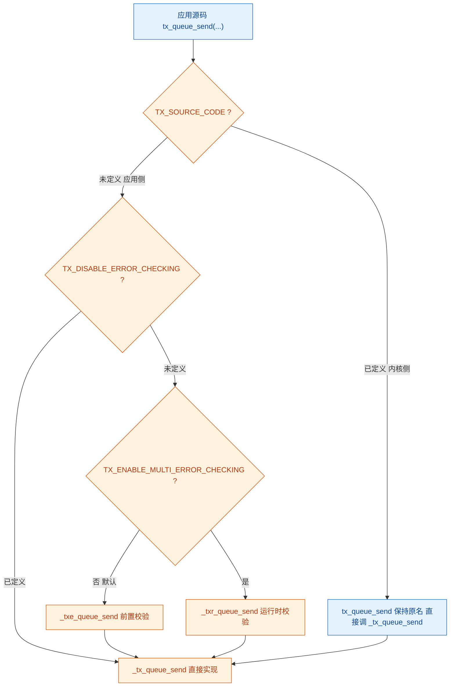

# tx_api.h —— 唯一应用头文件：对象、API 速查、错误码与命名约定

> 对应源文件：`common/inc/tx_api.h`（共 2359 行）
>
> 配套文档：[00-总览与架构.md](/Users/theo-richard/workspace/references/rtos/ThreadX/Docs/00-总览与架构.md)
> 相邻 KB：`tx_thread_create.md`、`tx_thread_schedule.md`、`tx_timer.md`
> 版本基线：`THREADX_MAJOR_VERSION 6` / `MINOR 5` / `PATCH 2` / `BUILD 202603`（`tx_api.h:91-95`）

---

## 1. 一句话职责

**`tx_api.h` 同时是应用 API 与内核内部声明，靠 `TX_SOURCE_CODE` 一分为二**：
前半段（1~1049 行）是常量、状态值、9 个对象控制块，两边都可见；
后半段（1057 行起）是 `tx_xxx → _txe_xxx / _txr_xxx / _tx_xxx` 的宏映射，
**只对应用可见**。内核源码在文件开头 `#define TX_SOURCE_CODE`，于是它写
`tx_thread_create(...)` 时不会被宏替换成 `_txe_thread_create`。

```c
/* tx_api.h:1049-1057 */
   selected by the user.  Note: this section is only applicable to
   application source code, hence the conditional that turns off this
   stuff when the include file is processed by the ThreadX source. */

#ifndef TX_SOURCE_CODE
```

这解决了 C 语言里"同一个名字既要当公开 API、又要当内部实现"的老问题，
代价是所有 API 在应用侧都是**函数式宏**（见 §8 陷阱 1）。

---

## 2. 文件结构图

| 行段 | 内容 | 关键符号 |
|---|---|---|
| 46-78 | 头文件保护、`TX_PARAMETER_NOT_USED`、`TX_NAME_CONST` | `TX_NAME_CONST` 默认空，定义 `TX_ENABLE_CONST_NAMES` 后才是 `const` |
| 84-102 | 版本宏 | `THREADX_MAJOR/MINOR/PATCH/BUILD_VERSION`、`AZURE_RTOS_THREADX`、`EL_PRODUCT_THREADX` |
| 103-134 | 通用参数常量 | `TX_NO_WAIT`、`TX_WAIT_FOREVER`、`TX_AND/OR`、`TX_1_ULONG..TX_16_ULONG`、`TX_NO_TIME_SLICE`、`TX_AUTO_START/DONT_START`、`TX_AUTO_ACTIVATE/NO_ACTIVATE`、`TX_INHERIT/NO_INHERIT`、`TX_STACK_FILL` |
| 139-153 | 线程状态值（15 个） | `TX_READY`…`TX_PRIORITY_CHANGE` |
| 158-194 | **错误码（37 个名字）** | `TX_SUCCESS`…`TX_FEATURE_NOT_ENABLED` |
| 199-263 | 扩展指针读写宏 | `TX_THREAD_EXTENSION_PTR_SET/GET`、`TX_TIMER_EXTENSION_PTR_*` |
| 264-273 | tick 频率 | `TX_TIMER_TICKS_PER_SECOND`（默认 100） |
| 278-280 | 队列消息上限 | `TX_QUEUE_MESSAGE_MAX_SIZE`（默认 `TX_16_ULONG`） |
| 286-311 | Trace 事件号分区与过滤器 | `TX_TRACE_USER_EVENT_START 4096`、`TX_TRACE_ALL_EVENTS` |
| 320-326 | 对齐类型 | `ALIGN_TYPE = ULONG` |
| 339-364 | `TX_TIMER_INTERNAL` | 线程超时与应用定时器共用 |
| 377-416 | `TX_TIMER` | 48 B |
| 423-599 | `TX_THREAD` | 184 B，前 40 B 是汇编 ABI |
| 604-661 | `TX_BLOCK_POOL` | 48 B |
| 682-756 | `TX_BYTE_POOL` | 52 B |
| 761-818 | `TX_EVENT_FLAGS_GROUP` | 40 B |
| 847-915 | `TX_MUTEX` | 52 B |
| 920-994 | `TX_QUEUE` | 60 B |
| 999-1049 | `TX_SEMAPHORE` | 32 B |
| 1057 | `#ifndef TX_SOURCE_CODE` —— 分界线 | 之后全是宏映射 |
| 1065 | `#ifdef TX_DISABLE_ERROR_CHECKING` | 关校验 → `_tx_*` |
| 1184 | `/* Services with error checking. */` | 开校验 |
| 1191 | `#ifdef TX_ENABLE_MULTI_ERROR_CHECKING` | → `_txr_*` |
| 1305 | `#else` | → `_txe_*`（默认） |
| 2346-2348 | `TX_THREAD_GET_SYSTEM_STATE` 默认定义 | 端口可覆盖 |

---

## 3. 状态值与错误码

### 3.1 线程状态（`tx_api.h:139-153`）

| 值 | 名称 | 是否在就绪位图 | 谁来解除 |
|---|---|---|---|
| 0 | `TX_READY` | 是 | — |
| 1 | `TX_COMPLETED` | 否 | `tx_thread_reset` |
| 2 | `TX_TERMINATED` | 否 | `tx_thread_reset` |
| 3 | `TX_SUSPENDED` | 否 | `tx_thread_resume` |
| 4 | `TX_SLEEP` | 否 | 超时定时器 |
| 5 | `TX_QUEUE_SUSP` | 否 | 队列 send / flush / delete |
| 6 | `TX_SEMAPHORE_SUSP` | 否 | semaphore put / delete |
| 7 | `TX_EVENT_FLAG` | 否 | event set / delete |
| 8 | `TX_BLOCK_MEMORY` | 否 | block release / delete |
| 9 | `TX_BYTE_MEMORY` | 否 | byte release / delete |
| 10 | `TX_IO_DRIVER` | 否 | 中间件（FileX 等） |
| 11 | `TX_FILE` | 否 | FileX |
| 12 | `TX_TCP_IP` | 否 | NetX |
| 13 | `TX_MUTEX_SUSP` | 否 | mutex put / delete |
| 14 | `TX_PRIORITY_CHANGE` | 否 | 优先级变更自恢复（瞬时态） |

10~12 是**给中间件预留**的挂起原因，ThreadX 内核自己不产生。
`TX_PRIORITY_CHANGE` 是唯一"自己会消失"的状态：`_tx_mutex_priority_change`
把线程临时摘出就绪表时用它，改完优先级立刻 resume 回 `TX_READY`。

### 3.2 错误码（`tx_api.h:158-194`）

| 值 | 名称 | 典型触发 |
|---|---|---|
| 0x00 | `TX_SUCCESS` | — |
| 0x01 | `TX_DELETED` | 等待期间对象被 delete |
| 0x02 | `TX_POOL_ERROR` | 块池/字节池指针非法 |
| 0x03 | `TX_PTR_ERROR` | 空指针、非法块指针 |
| 0x04 | `TX_WAIT_ERROR` | ISR 里用了带超时的 API |
| 0x05 | `TX_SIZE_ERROR` | 栈太小、池太小、消息尺寸 0/超限 |
| 0x06 | `TX_GROUP_ERROR` | 事件组指针非法 |
| 0x07 | `TX_NO_EVENTS` | 事件条件不满足（非阻塞） |
| 0x08 | `TX_OPTION_ERROR` | get 选项非法（非 AND/OR/CLEAR 组合） |
| 0x09 | `TX_QUEUE_ERROR` | 队列指针非法 |
| 0x0A | `TX_QUEUE_EMPTY` | 空队列非阻塞接收 |
| 0x0B | `TX_QUEUE_FULL` | 满队列非阻塞发送 |
| 0x0C | `TX_SEMAPHORE_ERROR` | 信号量指针非法 |
| 0x0D | `TX_NO_INSTANCE` | 计数为 0 时非阻塞 get |
| 0x0E | `TX_THREAD_ERROR` | 线程指针非法/重复创建 |
| 0x0F | `TX_PRIORITY_ERROR` | 优先级 ≥ `TX_MAX_PRIORITIES` |
| 0x10 | `TX_NO_MEMORY` | 池中无足够空间；**与 `TX_START_ERROR` 同值** |
| 0x10 | `TX_START_ERROR` | `auto_start` 参数非法 |
| 0x11 | `TX_DELETE_ERROR` | 线程未终止/未完成就 delete |
| 0x12 | `TX_RESUME_ERROR` | resume 一个不在挂起态的线程 |
| 0x13 | `TX_CALLER_ERROR` | 在 ISR 里调用了不允许的服务 |
| 0x14 | `TX_SUSPEND_ERROR` | suspend 非法目标 |
| 0x15 | `TX_TIMER_ERROR` | 定时器指针非法 |
| 0x16 | `TX_TICK_ERROR` | tick 参数为 0 / 非法 |
| 0x17 | `TX_ACTIVATE_ERROR` | 定时器已激活、或 remaining 为 0 |
| 0x18 | `TX_THRESH_ERROR` | 阈值 > 优先级、阈值非法 |
| 0x19 | `TX_SUSPEND_LIFTED` | `tx_thread_resume` 撤回了该线程的延迟挂起请求 |
| 0x1A | `TX_WAIT_ABORTED` | 被 `tx_thread_wait_abort` 中止 |
| 0x1B | `TX_WAIT_ABORT_ERROR` | 无可中止的等待 |
| 0x1C | `TX_MUTEX_ERROR` | 互斥量指针非法 |
| 0x1D | `TX_NOT_AVAILABLE` | 互斥量/信号量被占用（非阻塞） |
| 0x1E | `TX_NOT_OWNED` | 释放不是自己持有的互斥量 |
| 0x1F | `TX_INHERIT_ERROR` | `inherit` 参数非法 |
| 0x20 | `TX_NOT_DONE` | **内部哨兵**，不返回给应用 |
| 0x21 | `TX_CEILING_EXCEEDED` | 信号量 ceiling 被突破 |
| 0x22 | `TX_INVALID_CEILING` | ceiling 参数非法 |
| 0xFF | `TX_FEATURE_NOT_ENABLED` | 功能未编译进来（如未开 trace） |

三个必须记住的坑：

1. `TX_NO_MEMORY` 与 `TX_START_ERROR` **数值相同（0x10）**，因为二者永不出现在
   同一个 API 的返回路径上（前者池类，后者 create 类）。用 `switch` 分类错误码时
   不能把它们当两个不同分支。
2. `TX_NOT_DONE`（0x20）是 `_tx_mutex_put` 内部用来表示"还没处理完"的中间值
   （`tx_mutex_put.c:93`），不会传到应用。
3. `TX_FEATURE_NOT_ENABLED` 是 0xFF，单独一段，便于"功能开关"类检查。

---

## 4. 对象控制块一览

| 对象 | 结构体 | 行号 | 大小（32 位） | 首字段 | 内嵌定时器 |
|---|---|---|---|---|---|
| 线程 | `TX_THREAD` | 423-599 | 184 B | `tx_thread_id` | 有（`tx_thread_timer`） |
| 定时器 | `TX_TIMER` | 377-416 | 48 B | `tx_timer_id` | 有（`tx_timer_internal`） |
| 定时器内部块 | `TX_TIMER_INTERNAL` | 339-364 | 32 B | `remaining_ticks` | — |
| 块池 | `TX_BLOCK_POOL` | 604-661 | 48 B | `tx_block_pool_id` | 无 |
| 字节池 | `TX_BYTE_POOL` | 682-756 | 52 B | `tx_byte_pool_id` | 无 |
| 事件组 | `TX_EVENT_FLAGS_GROUP` | 761-818 | 40 B | `tx_event_flags_group_id` | 无 |
| 互斥量 | `TX_MUTEX` | 847-915 | 52 B | `tx_mutex_id` | 无 |
| 队列 | `TX_QUEUE` | 920-994 | 60 B | `tx_queue_id` | 无 |
| 信号量 | `TX_SEMAPHORE` | 999-1049 | 32 B | `tx_semaphore_id` | 无 |

所有对象都以一个 4 字节魔数开头，`_txe_*` 用它做类型校验：

| 对象 | 魔数 | 定义处 |
|---|---|---|
| `TX_THREAD` | `0x54485244`（"THRD"） | `tx_thread.h:48` |
| `TX_TIMER` | `TX_TIMER_ID` | `tx_timer.h` |
| `TX_QUEUE` | `0x51554555`（"QUUE"） | `tx_queue.h:48` |
| `TX_MUTEX` | `TX_MUTEX_ID` | `tx_mutex.h` |
| `TX_BYTE_POOL` | `0x42595445`（"BYTE"） | `tx_byte_pool.h:48` |
| `TX_BLOCK_POOL` | `TX_BLOCK_POOL_ID` | `tx_block_pool.h` |

`TX_CLEAR_ID`（0）是"已删除"标记。`tx_*_delete` 把 ID 清 0，
于是"删除后再用"能稳定返回 `TX_*_ERROR`，而不是静默改坏内存。

---

## 5. API 速查（按对象分组，共 89 个）

### 5.1 内核入口与中断（2）

| API | 作用 |
|---|---|
| `tx_kernel_enter()` | 启动 ThreadX，不返回（`_tx_initialize_kernel_enter`） |
| `tx_interrupt_control(new_posture)` | 关/开中断并返回旧状态；trace/EL 模块可能会接管 |

### 5.2 线程 `tx_thread_*`（18）

| API | 作用 | 常见错误 |
|---|---|---|
| `tx_thread_create` | 创建线程（TCB + 栈由调用者提供） | `TX_SIZE_ERROR`、`TX_THRESH_ERROR` |
| `tx_thread_delete` | 删除已终止/已完成的线程 | `TX_DELETE_ERROR` |
| `tx_thread_resume` | 从 `TX_SUSPENDED` 恢复 | `TX_RESUME_ERROR` |
| `tx_thread_suspend` | 挂起（支持延迟挂起） | `TX_SUSPEND_ERROR` |
| `tx_thread_terminate` | 强制终止（可从任意状态） | — |
| `tx_thread_reset` | 把 COMPLETED/TERMINATED 线程重置为 SUSPENDED | `TX_THREAD_ERROR`、`TX_CALLER_ERROR` |
| `tx_thread_relinquish` | 主动让出，同优先级轮转 | — |
| `tx_thread_sleep` | 睡眠 n tick | — |
| `tx_thread_identify` | 返回当前 TCB（ISR 中返回被中断线程） | — |
| `tx_thread_info_get` | 快照：状态/优先级/栈等 | — |
| `tx_thread_priority_change` | 改优先级，返回旧值 | `TX_PRIORITY_ERROR` |
| `tx_thread_preemption_change` | 改抢占阈值 | `TX_THRESH_ERROR` |
| `tx_thread_time_slice_change` | 改时间片 | — |
| `tx_thread_wait_abort` | 中止某线程的等待 | `TX_WAIT_ABORT_ERROR` |
| `tx_thread_entry_exit_notify` | 注册进入/退出回调 | — |
| `tx_thread_stack_error_notify` | 注册栈错误处理（需开栈检查） | `TX_FEATURE_NOT_ENABLED` |
| `tx_thread_performance_info_get` | 单线程统计（需开性能计数） | `TX_FEATURE_NOT_ENABLED` |
| `tx_thread_performance_system_info_get` | 全局统计 | 同上 |

### 5.3 定时器 `tx_timer_*`（8）与时间（2）

| API | 作用 |
|---|---|
| `tx_timer_create` | 创建（可自动激活） |
| `tx_timer_delete` | 删除 |
| `tx_timer_activate` | 启动（已激活/remaining 0 → `TX_ACTIVATE_ERROR`） |
| `tx_timer_deactivate` | 停止（不清 remaining） |
| `tx_timer_change` | 改 initial/reschedule（须先 deactivate） |
| `tx_timer_info_get` | 快照（含 remaining） |
| `tx_timer_performance_info_get` / `_system_info_get` | 统计 |
| `tx_time_get()` | 读 tick 计数（32 位，100Hz 下约 497 天回绕） |
| `tx_time_set(new_time)` | 改 tick 计数（影响所有相对超时的基准） |

### 5.4 队列 `tx_queue_*`（11）

| API | 作用 |
|---|---|
| `tx_queue_create` | `message_size` 单位是 **ULONG 字数** |
| `tx_queue_delete` | 删除，等待者得 `TX_DELETED` |
| `tx_queue_send` | 入队尾；有等接收者时直传 |
| `tx_queue_front_send` | 插到"下一个被读"的位置 |
| `tx_queue_receive` | 出队头 |
| `tx_queue_flush` | 清空并唤醒等发送者 |
| `tx_queue_info_get` | 快照 |
| `tx_queue_send_notify` | 发送回调 |
| `tx_queue_prioritize` | 等待者按优先级重排（默认 FIFO） |
| `tx_queue_performance_info_get` / `_system_info_get` | 统计 |

### 5.5 信号量 `tx_semaphore_*`（10）

| API | 作用 |
|---|---|
| `tx_semaphore_create` | 初值即计数 |
| `tx_semaphore_delete` | 删除 |
| `tx_semaphore_get` | P 操作；计数 0 时可阻塞 |
| `tx_semaphore_put` | V 操作 |
| `tx_semaphore_ceiling_put` | 带上限的 put，超限返回 `TX_CEILING_EXCEEDED` |
| `tx_semaphore_info_get` | 快照 |
| `tx_semaphore_put_notify` | put 回调 |
| `tx_semaphore_prioritize` | 等待者按优先级重排 |
| `tx_semaphore_performance_info_get` / `_system_info_get` | 统计 |

### 5.6 互斥量 `tx_mutex_*`（8）

| API | 作用 |
|---|---|
| `tx_mutex_create` | 第三个参数 `TX_INHERIT` / `TX_NO_INHERIT` |
| `tx_mutex_delete` | 删除 |
| `tx_mutex_get` | 可递归；触发优先级继承 |
| `tx_mutex_put` | 计数--；归零时移交或释放 |
| `tx_mutex_info_get` | 快照（含 owner） |
| `tx_mutex_prioritize` | 等待者重排 |
| `tx_mutex_performance_info_get` / `_system_info_get` | 统计 |

### 5.7 事件标志组 `tx_event_flags_*`（8）

| API | 作用 |
|---|---|
| `tx_event_flags_create` | 32 位标志组 |
| `tx_event_flags_delete` | 删除 |
| `tx_event_flags_set` | 按 `TX_AND`/`TX_OR` 语义置位 |
| `tx_event_flags_get` | 等待组合条件；支持 `TX_AND_CLEAR`/`TX_OR_CLEAR` |
| `tx_event_flags_info_get` | 快照 |
| `tx_event_flags_set_notify` | set 回调 |
| `tx_event_flags_performance_info_get` / `_system_info_get` | 统计 |

### 5.8 内存池 `tx_block_*` / `tx_byte_*`（16）

| API | 作用 |
|---|---|
| `tx_block_pool_create` / `_delete` / `_info_get` / `_prioritize` | 定长块池管理 |
| `tx_block_allocate` / `tx_block_release` | O(1) 摘链 / 压链；每块 4 B 链接字 |
| `tx_byte_pool_create` / `_delete` / `_info_get` / `_prioritize` | 变长池管理 |
| `tx_byte_allocate` / `tx_byte_release` | first-fit 搜索 / 标记释放；每块 8 B 头 |
| 四个 `*_performance_*` | 统计（含 fragment/merge/split 计数） |

### 5.9 Trace `tx_trace_*`（8）

| API | 作用 |
|---|---|
| `tx_trace_enable` / `tx_trace_disable` | 开关（需 `TX_ENABLE_EVENT_TRACE`） |
| `tx_trace_event_filter` / `tx_trace_event_unfilter` | 按事件类过滤 |
| `tx_trace_isr_enter_insert` / `tx_trace_isr_exit_insert` | ISR 边界事件 |
| `tx_trace_buffer_full_notify` | 缓冲满回调 |
| `tx_trace_user_event_insert` | 应用自定义事件（编号 ≥ 4096） |

---

## 6. 命名约定

| 前缀/后缀 | 含义 | 例子 |
|---|---|---|
| `tx_` | 应用可见 API | `tx_queue_send` |
| `_tx_` | 内核实现，**不校验参数** | `_tx_queue_send` |
| `_txe_` | 带参数校验的前置层（默认编译进来） | `_txe_queue_send` |
| `_txr_` | MISRA/多运行时校验层（需 `TX_ENABLE_MULTI_ERROR_CHECKING`） | `_txr_queue_send` |
| `_tx_<comp>_initialize` | 组件初始化，只由 `_tx_initialize_high_level` 调 | `_tx_queue_initialize` |
| `_tx_<obj>_cleanup` | 挂起被超时/中止时的清理回调 | `_tx_queue_cleanup` |
| `_tx_<obj>_system_activate` | 内部无校验版本（供内核自身调用） | `_tx_timer_system_activate` |
| `tx_<obj>_performance_*` | 统计接口，需对应 `*_ENABLE_PERFORMANCE_INFO` | `tx_queue_performance_info_get` |

动作是**固定词表**：`create / delete / get / put / send / receive / allocate /
release / info_get / prioritize / performance_*`，看到 `tx_<obj>_<verb>` 即可定位文件。

---

## 7. 三层映射

本文件末尾还有一个**可被端口覆盖**的映射——系统状态读取宏：

```c
/* tx_api.h:2346-2348 */
#ifndef TX_THREAD_GET_SYSTEM_STATE
#define TX_THREAD_GET_SYSTEM_STATE()        _tx_thread_system_state
#endif
```



`_txe_` 层的三个固定动作（以 create 类为例）：空指针检查 → `tx_*_id` 魔数校验 →
参数范围检查，最后调用 `_tx_*`。它还会多收一个 `sizeof(TX_OBJECT)` 参数
（由宏自动填入），用来校验调用者传的确实是该类型的控制块而不是一段裸内存：

```c
/* tx_api.h:1308 */
#define tx_block_pool_create(p,n,b,s,l)             _txe_block_pool_create((p),(n),(b),(s),(l),(sizeof(TX_BLOCK_POOL)))
```

---

## 8. 陷阱与读码建议

**陷阱 1：对 API 取地址。**
开校验时它是**函数式宏**，`&tx_thread_create` 编译不过；关校验时又是普通函数名。
写函数指针表只能显式用 `_tx_thread_create`，或用 `#ifdef` 备两套。

**陷阱 2：以为 `_txr_*` 一定存在。**
本仓库只包含 `_txe_*`（60 个文件）与 `_tx_*`（125 个文件），**没有 `_txr_*` 实现**。
打开 `TX_ENABLE_MULTI_ERROR_CHECKING` 会链接失败——该层由单独的
Safety-Critical / MISRA 交付物提供。

**陷阱 3：把 `TX_NAME_CONST` 当"名字会被拷贝"。**
默认它展开为空（`tx_api.h:77`），只有定义 `TX_ENABLE_CONST_NAMES` 时才展开成
`const`（`tx_api.h:75`）。无论哪种情况，所有 `create` 都只保存**指针**。
用栈上临时字符串命名对象，函数返回后名字就悬空了（`tx_*_info_get` 会读到垃圾）。

**陷阱 4：混用 `TX_NO_WAIT` 与 `0`。**
`TX_NO_WAIT` 就是 `(ULONG) 0`，但 `TX_WAIT_FOREVER` 是 `0xFFFFFFFF`。
不要写 `wait_option = -1`（会被提升成 `ULONG` 的 `0xFFFFFFFF`，恰好等价，
但类型不匹配在某些编译器上告警）。

**陷阱 5：把 `TX_AND`/`TX_OR` 当位运算。**
它们是 `UINT` 的 2/0，配合 `TX_AND_CLEAR`(3)/`TX_OR_CLEAR`(1) 传给
`tx_event_flags_get`。`TX_OR == 0` 意味着"默认就是 OR"，忘了传选项不会报错。

**陷阱 6：改 `TX_MAX_PRIORITIES` 非 32 的倍数。**
`tx_api.h:2111-2112` 有 `#error`。这不是风格要求：位图按 `ULONG` 数组组织，
>32 时 `MAP_INDEX`/`TX_MOD32_BIT_SET` 会展开成另一套带 `map_index` 的代码。

**陷阱 7：在应用里 `#include "tx_thread.h"`。**
内部头文件要求先 `#define TX_SOURCE_CODE`；而一旦定义它，`tx_api.h` 的宏映射会
整体消失，API 调用变成直接调 `_tx_*`（无校验）。应用只应包含 `tx_api.h`。

**陷阱 8：以为 `tx_time_set` 只影响 `tx_time_get`。**
所有相对超时都以 `_tx_timer_system_clock` 为基准做差值：时钟前跳会让等待线程
提前超时，后跳会延长等待。只在"校时"场景用，并接受这个副作用。

**读码建议（约 40 分钟）**：

1. `tx_api.h:84-194` —— 版本、常量、状态、错误码，一次看完（110 行）；
2. `tx_api.h:339-416` —— 先读 `TX_TIMER_INTERNAL`，它是线程与定时器的公共积木；
3. `tx_api.h:423-442` —— `TX_THREAD` 的 40 字节 ABI 区，对照 `tx_thread_create.md`；
4. `tx_api.h:604-1049` —— 其余 6 个对象，每个只看"id / 计数 / 链表 / 扩展"四类字段；
5. `tx_api.h:1057-1420` —— 三层映射的完整骨架，重点看 create 类宏多出的 `sizeof`；
6. `tx_api.h:2346-2348` —— 最后看 `TX_THREAD_GET_SYSTEM_STATE` 的默认定义，
   再回 `ports/cortex_m4/gnu/inc/tx_port.h:461-490` 看它如何被 IPSR 覆盖。
