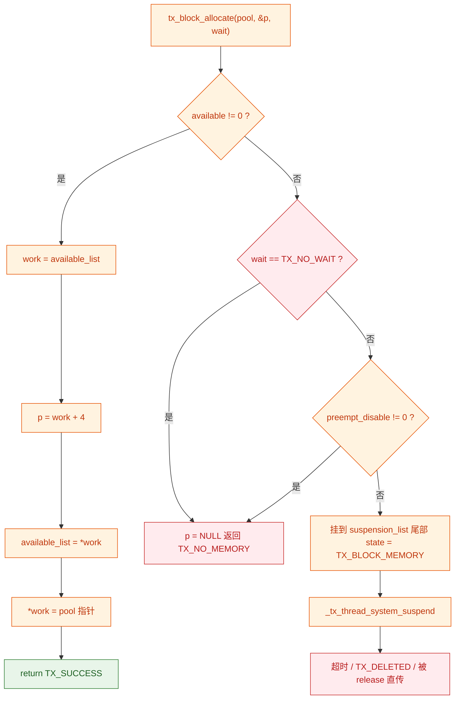
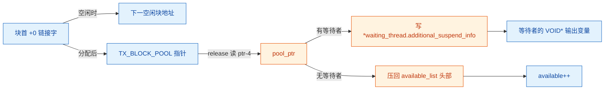

# tx_block_pool —— 定长块池（create / allocate / release / prioritize）逐函数深读

> 对应源文件：
> - `common/src/tx_block_pool_create.c`（共 209 行）
> - `common/src/tx_block_allocate.c`（共 366 行）
> - `common/src/tx_block_release.c`（共 198 行）
> - `common/src/tx_block_pool_delete.c`（共 201 行）
> - `common/src/tx_block_pool_cleanup.c`（共 207 行）
> - `common/src/tx_block_pool_prioritize.c`（共 243 行）
> - `common/src/tx_block_pool_info_get.c`（共 142 行）
> - `common/src/tx_block_pool_initialize.c`（共 122 行）
> - `common/inc/tx_api.h:602-660`（`TX_BLOCK_POOL` 结构体）
>
> 配套文档：[04-通信机制.md](/Users/theo-richard/workspace/references/rtos/ThreadX/Docs/04-通信机制.md)
> 相邻 KB：`tx_byte_pool.md`、`tx_queue.md`

---

## 1. 一句话职责

**块池把一整块 RAM 切成等长的小块，用"每块头部一个指针"串成空闲链表**：
分配 = 摘链头，释放 = 压回链头，两者都是 O(1)。它不合并、不分裂、不产生碎片，
代价是**块大小固定**和**每块 4 字节元数据**。

与字节池的分工：块池用于"同一结构体反复申请释放"（消息节点、控制块），
字节池用于"大小不定的顺序分配"。两者都建立在调用者提供的数组上。

---

## 2. `TX_BLOCK_POOL` 字段表

`tx_api.h:604-641`：

| 字段 | 行号 | 类型 | 含义 | 谁写 |
|---|---|---|---|---|
| `tx_block_pool_id` | 608 | `ULONG` | 魔数 `TX_BLOCK_POOL_ID`，`TX_CLEAR_ID` 表示已删 | create / delete |
| `tx_block_pool_name` | 611 | `CHAR*` | 名字指针（不拷贝字符串） | create |
| `tx_block_pool_available` | 614 | `UINT` | 当前空闲块数 | allocate / release / delete |
| `tx_block_pool_total` | 617 | `UINT` | 初始总块数（只读参考值） | create |
| `tx_block_pool_available_list` | 620 | `UCHAR*` | **空闲链表头**（指向块首的链接字） | create / allocate / release |
| `tx_block_pool_start` | 623 | `UCHAR*` | 池起始地址（调用者给的数组） | create |
| `tx_block_pool_size` | 626 | `ULONG` | 池大小（**向下取整到 ALIGN_TYPE**） | create |
| `tx_block_pool_block_size` | 629 | `UINT` | 每块大小（**向上取整**，不含链接字） | create |
| `tx_block_pool_suspension_list` | 634 | `TX_THREAD*` | 等块线程的循环链表头 | allocate / release / delete |
| `tx_block_pool_suspended_count` | 635 | `UINT` | 等待线程数 | 同上 |
| `tx_block_pool_created_next/previous` | 639-640 | 指针 | 全局 created 循环链表 | create / delete |

`tx_block_pool_available_list` 与 `tx_block_pool_start` 的区别要分清：
前者指向**当前第一个空闲块**（动态变化），后者指向池的物理起点（常量）。

---

## 3. 内存布局：一块 = 1 个链接字 + N 字节用户区

`tx_block_pool_create.c:104-126` 是整个组件的核心循环：

```c
    /* Calculate the total number of blocks.  */
    total_blocks =  pool_size/(block_size + (sizeof(UCHAR *)));

    /* Walk through the pool area, setting up the available block list.  */
    blocks =            ((UINT) 0);
    block_ptr =         TX_VOID_TO_UCHAR_POINTER_CONVERT(pool_start);
    next_block_ptr =    TX_UCHAR_POINTER_ADD(block_ptr, (block_size + (sizeof(UCHAR *))));
    while(blocks < (UINT) total_blocks)
    {

        /* Yes, we have another block.  Increment the block count.  */
        blocks++;

        /* Setup the link to the next block.  */
        block_link_ptr =  TX_UCHAR_TO_INDIRECT_UCHAR_POINTER_CONVERT(block_ptr);
        *block_link_ptr =  next_block_ptr;

        /* Advance to the next block.  */
        block_ptr =   next_block_ptr;

        /* Update the next block pointer.  */
        next_block_ptr =  TX_UCHAR_POINTER_ADD(block_ptr, (block_size + (sizeof(UCHAR *))));
    }
```

布局（32 位机，`sizeof(UCHAR*) == 4`）：

```text
pool_start
   │
   ├─ 块 0: [ link 4B ][ user block_size B ] ──► 块 1
   ├─ 块 1: [ link 4B ][ user block_size B ] ──► 块 2
   ├─ ...
   └─ 块 n-1: [ link 4B ][ user block_size B ] ──► NULL
                              │
                              └─ 尾部剩余 (pool_size % (block_size+4)) 字节被浪费
```

**量化（pool=1024、block=32）**：

| 项 | 计算 | 结果 |
|---|---|---|
| 对齐后块大小 | `(32+4-1)/4*4` | 32 |
| 每块实占 | `32 + 4` | 36 |
| 块数 | `1024 / 36` 向下取整 | 28 |
| 用户可用总量 | `28 × 32` | 896 B |
| 元数据开销 | `28 × 4` | 112 B |
| 尾部浪费 | `1024 - 28×36` | 16 B |
| 有效率 | `896 / 1024` | **87.5%** |

块越小、开销占比越高：block=8 时每块实占 12，有效率降到 66%。
选块大小时按这个式子反推：`total = pool_size / (block_size + 4)`。

---

## 4. 逐函数表

| 函数 | 文件:行 | 输入/输出 | 核心动作 | 错误码 |
|---|---|---|---|---|
| `_tx_block_pool_create` | `tx_block_pool_create.c:71` | `(pool, name, block_size, pool_start, pool_size)` | 对齐、串链、挂 created 表 | `TX_SIZE_ERROR`（连一块都放不下） |
| `_tx_block_allocate` | `tx_block_allocate.c:72` | `(pool, &block_ptr, wait_option)` | 摘链头 / 挂起等待 | `TX_NO_MEMORY`、`TX_WAIT_ERROR`、`TX_DELETED`、`TX_POOL_ERROR` |
| `_tx_block_release` | `tx_block_release.c:67` | `(block_ptr)` | 由块反查池；有等待者则直传，否则压回链头 | `TX_PTR_ERROR`（块地址越界/非法） |
| `_tx_block_pool_delete` | `tx_block_pool_delete.c:69` | `(pool)` | 摘 created 表；**唤醒所有等待者并置 `TX_DELETED`** | `TX_CALLER_ERROR`、`TX_POOL_ERROR` |
| `_tx_block_pool_cleanup` | `tx_block_pool_cleanup.c:70` | `(thread, seq)` | 超时/中止时把自己摘出挂起链 | 无（VOID） |
| `_tx_block_pool_prioritize` | `tx_block_pool_prioritize.c:67` | `(pool)` | 把挂起链表中最高优先级线程移到队首 | `TX_POOL_ERROR` |
| `_tx_block_pool_info_get` | `tx_block_pool_info_get.c:74` | 6 个出参 | 快照式读取，参数可为 NULL | `TX_POOL_ERROR` |

`_tx_block_release` 只收一个块指针、不收池指针，靠块头部的链接字反查池
（见 §5.3）。这是它比"先查池再释放"少一次参数传递的原因，也是它唯一的失效模式来源。

---

## 5. 三段逐字摘录

### 5.1 分配：返回"链接字之后"的地址

```c
/* tx_block_allocate.c:143-164 */
    /* Determine if there is an available block.  */
    if (pool_ptr -> tx_block_pool_available != ((UINT) 0))
    {

        /* Yes, a block is available.  Decrement the available count.  */
        pool_ptr -> tx_block_pool_available--;

        /* Pickup the current block pointer.  */
        work_ptr =  pool_ptr -> tx_block_pool_available_list;

        /* Return the first available block to the caller.  */
        temp_ptr =  TX_UCHAR_POINTER_ADD(work_ptr, (sizeof(UCHAR *)));
        return_ptr =  TX_INDIRECT_VOID_TO_UCHAR_POINTER_CONVERT(block_ptr);
        *return_ptr =  temp_ptr;

        /* Modify the available list to point at the next block in the pool. */
        next_block_ptr =  TX_UCHAR_TO_INDIRECT_UCHAR_POINTER_CONVERT(work_ptr);
        pool_ptr -> tx_block_pool_available_list =  *next_block_ptr;

        /* Save the pool's address in the block for when it is released!  */
        temp_ptr =  TX_BLOCK_POOL_TO_UCHAR_POINTER_CONVERT(pool_ptr);
        *next_block_ptr =  temp_ptr;
```

关键三行：

1. `temp_ptr = work_ptr + sizeof(UCHAR*)` —— **用户指针跳过链接字**，所以用户拿到的
   地址比块首高 4 字节。这使得 `block_size` 是"用户可用字节"而不是"实占字节"。
2. `available_list = *next_block_ptr` —— 先读链接字拿到下一块，再覆盖。
3. `*next_block_ptr = pool_ptr` —— **链接字被改写成池指针**。此刻块已不属于空闲链，
   这个字改为"归属信息"，供 release 反查。

这就是"每块 4 字节开销"的真正用途：**空闲时是 next 指针，分配后是 owner 指针**。
一个字节都没浪费（除了对齐）。

### 5.2 释放：把块直接交给等待者（不入空闲链）

```c
/* tx_block_release.c:107-108 */
    /* Determine if there are any threads suspended on the block pool.  */
    thread_ptr =  pool_ptr -> tx_block_pool_suspension_list;
```

```c
/* tx_block_release.c:149-156 */
        /* Return this block pointer to the suspended thread waiting for
           a block.  */
        return_block_ptr =  TX_VOID_TO_INDIRECT_UCHAR_POINTER_CONVERT(thread_ptr -> tx_thread_additional_suspend_info);
        work_ptr =          TX_VOID_TO_UCHAR_POINTER_CONVERT(block_ptr);
        *return_block_ptr =  work_ptr;

        /* Put return status into the thread control block.  */
        thread_ptr -> tx_thread_suspend_status =  TX_SUCCESS;
```

**块没有回到空闲链**，而是通过 `tx_thread_additional_suspend_info`（保存的是
"调用者传入的 `VOID **block_ptr`"）直接写进等待者的输出变量。这是一次零拷贝的所有权转移：
`available` 计数不减也不增，因为块从头到尾都是"已分配"状态。

只有无等待者时才走压栈路径：

```c
/* tx_block_release.c:180-189 */
        /* No thread is suspended for a memory block.  */

        /* Put the block back in the available list.  */
        *next_block_ptr =  pool_ptr -> tx_block_pool_available_list;

        /* Adjust the head pointer.  */
        pool_ptr -> tx_block_pool_available_list =  work_ptr;

        /* Increment the count of available blocks.  */
        pool_ptr -> tx_block_pool_available++;
```

注意"压回链头"（LIFO）而不是链尾。后果：刚释放的块会最先被下一次分配拿走，
**缓存局部性好**（刚用过的块还在 cache 里），但**不保证地址递增顺序**。
做 DMA 或需要固定块地址时不能依赖这一点。

### 5.3 释放时如何找到池

```c
/* tx_block_release.c:85-90 */
    /* Pickup the pool pointer which is just previous to the starting
       address of the block that the caller sees.  */
    work_ptr =        TX_VOID_TO_UCHAR_POINTER_CONVERT(block_ptr);
    work_ptr =        TX_UCHAR_POINTER_SUB(work_ptr, (sizeof(UCHAR *)));
    next_block_ptr =  TX_UCHAR_TO_INDIRECT_UCHAR_POINTER_CONVERT(work_ptr);
    pool_ptr =        TX_UCHAR_TO_BLOCK_POOL_POINTER_CONVERT((*next_block_ptr));
```

`block_ptr - 4` 读出归属池。所以：

- 传入**任意**指针都能反查一个"池"出来——如果那个地址不是块池里的块，
  读到的就是垃圾指针，后续写 `available_list` 会破坏内存。
- `_txe_block_release` 的保护只有两级（`txe_block_release.c:85-105`）：
  `block_ptr != NULL`，以及 `ptr-4` 解出来的"池"非 NULL 且 `tx_block_pool_id == TX_BLOCK_POOL_ID`。
  **它不验证块地址是否真的落在该池的 `[start, start+size)` 区间内**。
  一个野指针只要前面 4 字节恰好指向某个合法块池，就能通过校验，然后把这个池的空闲链改成垃圾。
- 关掉错误检查后连这两级都没了，直接调 `_tx_block_release`。所以"谁分配谁释放、
  不要释放野指针"在 ThreadX 里是**约定**，不是运行期保证。

---

## 6. 挂起链表：默认 FIFO，优先级要手动排

`allocate` 在无空闲块且 `wait_option != TX_NO_WAIT` 时把线程挂到
`tx_block_pool_suspension_list` **尾部**（`tx_block_allocate.c:273-279`）：

```c
                    /* This list is not NULL, add current thread to the end. */
                    next_thread =                                   pool_ptr -> tx_block_pool_suspension_list;
                    thread_ptr -> tx_thread_suspended_next =        next_thread;
                    previous_thread =                               next_thread -> tx_thread_suspended_previous;
                    thread_ptr -> tx_thread_suspended_previous =    previous_thread;
                    previous_thread -> tx_thread_suspended_next =   thread_ptr;
                    next_thread -> tx_thread_suspended_previous =   thread_ptr;
```

而 `release` 取的是**链表头**（第 108 行）。所以默认语义是 **FIFO**：
先等的先拿到块，与优先级无关。

要改成优先级序，必须应用显式调用 `tx_block_pool_prioritize()`。它的实现是
"遍历 + 临时开中断 + 检查链表是否被别人改动 + 重来"，属于**可被打断的搜索**
（`tx_block_pool_prioritize.c` 的 `list_changed` 逻辑），因此不是原子的、也不保证
在并发分配下一定成功——它只是把"当前快照里最高优先级的线程"移到队首。

这与 FreeRTOS 的队列/信号量"永远优先级序"是根本差异，也是 ThreadX 里
`_prioritize` 这一族 API（queue/semaphore/mutex/block_pool/byte_pool 各一个）
存在的原因。

---

## 7. 流程图





---

## 8. 陷阱与读码建议

**陷阱 1：`tx_block_pool_info_get` 里 `total_blocks` 当"当前可用"用。**
`total` 是 create 时算出的常量，`available` 才动态变化。两者之差 = 已借出块数，
但**无法知道借给了谁**（块池不记录分配者）。

**陷阱 2：以为块大小就是传入值。**
create 会把它**向上取整**到 `sizeof(ALIGN_TYPE)`（32 位机 4 字节）：
`block_size = ((block_size + 3) / 4) * 4`（`tx_block_pool_create.c:92`）。
传 30 得到 32，用户可用 32 —— 不是 30。反之 `pool_size` **向下取整**（第 96 行），
传 1000 得到 1000（4 的倍数），传 1022 得到 1020。

**陷阱 3：用 `tx_block_release` 释放非本池的指针。**
它会读 `ptr-4` 当池指针，然后无条件写这个"池"的 `available_list`。
野指针释放的典型症状是"某个毫不相关的池/队列突然链表错乱"。
校验层只查 `ptr-4` 解出来的对象 ID（`txe_block_release.c:100`），**不查块地址区间**，
所以野指针有相当概率蒙混过关（见 §5.3）。

**陷阱 4：block 大小刚好等于 `sizeof(VOID*)`。**
用户区只有 4 字节，却要存一个指针——没有额外空间。块池不做"最小块大小"检查，
只检查"至少能切出一块"（`tx_block_pool_create.c:133`）。块太小不会报错，
只会让用户写出界。

**陷阱 5：删池时还有线程在等。**
`delete` 会逐个唤醒并置 `TX_DELETED`（`tx_block_pool_delete.c:141-181`），
**调用者线程的 `TX_DELETE` 检查不阻止这种操作**——因为等块的线程不是池的拥有者。
删除后那些线程的 `block_ptr` 输出变量保持 NULL，应用必须检查返回值。

**陷阱 6：期望"先释放的块地址更低"。**
空闲链是 LIFO 压栈，地址顺序完全取决于分配/释放交错顺序。
要做地址有序的一次性遍历（比如 DMA 描述符），只能自己维护数组索引，不要靠块池。

**读码建议**：

1. `tx_block_pool_create.c:87-130` —— 先把"链接字 + 用户区"的布局算清楚；
2. `tx_block_allocate.c:143-164` —— 摘链 + 改写字，共 22 行；
3. `tx_block_release.c:85-90` —— 反查池的 4 行，理解为什么块头必须留字；
4. `tx_block_release.c:107-189` —— 两条路径：直传 vs 压栈；
5. `tx_block_pool_delete.c:139-181` —— 看"删除对象时如何疏散等待者"，这套模板
   在 queue/semaphore/mutex/byte_pool 里一模一样；
6. 最后看 `tx_block_pool_prioritize.c:120-200`，理解 ThreadX 默认 FIFO 的设计选择。
