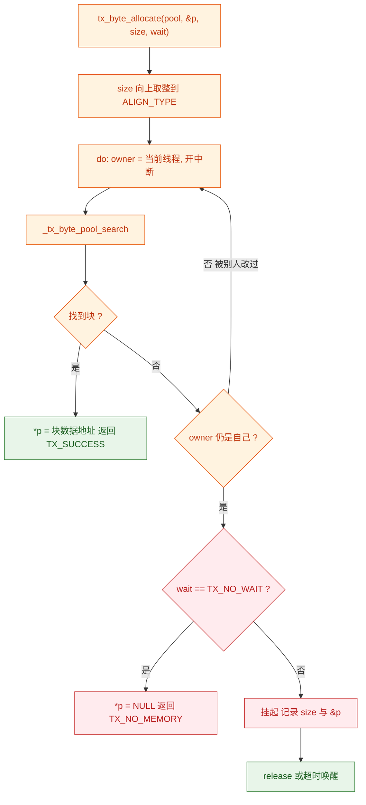
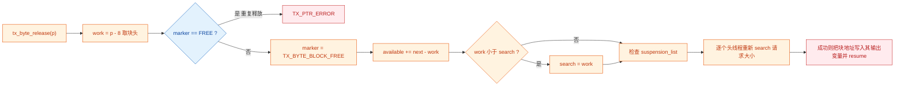

# tx_byte_pool —— 变长字节池（create / allocate / search / release）逐函数深读

> 对应源文件：
> - `common/src/tx_byte_pool_create.c`（共 193 行）
> - `common/src/tx_byte_pool_search.c`（共 343 行，**整个组件的核心**）
> - `common/src/tx_byte_allocate.c`（共 403 行）
> - `common/src/tx_byte_release.c`（共 370 行）
> - `common/src/tx_byte_pool_delete.c`（共 205 行）
> - `common/src/tx_byte_pool_cleanup.c`（共 206 行）
> - `common/src/tx_byte_pool_prioritize.c`（共 243 行）
> - `common/src/tx_byte_pool_info_get.c`（共 142 行）
> - `common/src/tx_byte_pool_initialize.c`（共 140 行）
> - `common/inc/tx_byte_pool.h:48-55`（`TX_BYTE_POOL_ID` / `TX_BYTE_BLOCK_FREE` / `TX_BYTE_BLOCK_MIN`）
> - `common/inc/tx_api.h:682-731`（`TX_BYTE_POOL` 结构体）
>
> 配套文档：[04-通信机制.md](/Users/theo-richard/workspace/references/rtos/ThreadX/Docs/04-通信机制.md)
> 相邻 KB：`tx_block_pool.md`、`tx_queue.md`

---

## 1. 一句话职责

**字节池是一个"带 8 字节块头的单向链表 + first-fit 搜索"的分配器**：
每次分配按 `ALIGN_TYPE` 向上取整、沿链表找第一个够大的空闲块、必要时**一分为二**；
释放只把标记改回 FREE 并归还字节数，**不立刻合并**——合并发生在下一次搜索途中。

它没有空闲链表、没有伙伴系统、没有位图。三个全局指针
（`list` / `search` / `owner`）加一个 `fragments` 计数就是全部状态。

---

## 2. `TX_BYTE_POOL` 字段表

`tx_api.h:682-731`：

| 字段 | 行号 | 类型 | 含义 | 谁写 |
|---|---|---|---|---|
| `tx_byte_pool_id` | 686 | `ULONG` | 魔数 `0x42595445`（"BYTE"） | create / delete |
| `tx_byte_pool_name` | 689 | `CHAR*` | 名字指针 | create |
| `tx_byte_pool_available` | 692 | `ULONG` | **可用字节数（含空闲块头）** | create / search / release |
| `tx_byte_pool_fragments` | 695 | `UINT` | 块总数（含 1 个哨兵） | create / search（split/merge） |
| `tx_byte_pool_list` | 698 | `UCHAR*` | 链表起点（= `start`，但语义不同） | create |
| `tx_byte_pool_search` | 702 | `UCHAR*` | **游标**：下次搜索从这里开始 | create / search / release |
| `tx_byte_pool_start` | 705 | `UCHAR*` | 池物理起点（常量） | create |
| `tx_byte_pool_size` | 708 | `ULONG` | 池大小（向下取整到 `ALIGN_TYPE`） | create |
| `tx_byte_pool_owner` | 714 | `TX_THREAD*` | **搜索所有权**：搜索中途被抢占时用于检测 | allocate / release / search |
| `tx_byte_pool_suspension_list` | 719 | `TX_THREAD*` | 等内存线程的循环链表 | allocate / release / delete |
| `tx_byte_pool_suspended_count` | 720 | `UINT` | 等待线程数 | 同上 |

`tx_byte_pool_list` 与 `tx_byte_pool_search` 是两回事：前者是链表的逻辑起点
（实际就是 `pool_start`），后者是"上次找到/释放的位置"，用来把 first-fit 变成
**下一次适配（next-fit）**，避免每次分配都从池头扫描。

---

## 3. 块布局与初始状态

`tx_byte_pool_create.c:101-135` 建出的初始布局：

```c
    /* Initially, the pool will have two blocks.  One large block at the
       beginning that is available and a small allocated block at the end
       of the pool that is there just for the algorithm.  Be sure to count
       the available block's header in the available bytes count.  */
    pool_ptr -> tx_byte_pool_available =   pool_size - ((sizeof(VOID *)) + (sizeof(ALIGN_TYPE)));
    pool_ptr -> tx_byte_pool_fragments =   ((UINT) 2);
```

每块头部 8 字节（32 位机）：

| 偏移 | 字段 | 空闲时 | 已分配时 |
|---|---|---|---|
| +0 | `next` 指针 | 下一块的块首 | 下一块的块首（不变） |
| +4 | `marker` | `TX_BYTE_BLOCK_FREE`（0xFFFFEEEE） | 所属 `TX_BYTE_POOL*` |
| +8 | 用户数据 | — | 返回给应用的地址 |

哨兵块：池的最后 8 字节被初始化成一个**永久的"已分配"块**
（`tx_byte_pool_create.c:116-126`），它的 `marker` 存池指针，`next` 指回 `pool_start`。
作用有两点：

1. 搜索永远能停下来（遇到 marker != FREE 就知道绕回起点了）；
2. 链表是**环形**的，不需要 NULL 判断。

```text
pool_start
   │
   ├─ 块 A: [next→哨兵][marker=FREE][              用户区 1008B              ]
   │
   └─ 哨兵: [next→pool_start][marker=pool_ptr]   ← 最后 8 字节，永不分配
```

1024 字节的池：`available = 1024 - 8 = 1016`，`fragments = 2`。
注意 `available` **把空闲块的 8 字节头也算进去了**（源码注释明说
"Be sure to count the available block's header in the available bytes count"）。
这不是笔误：当这块被整块分配时，头会被消耗掉，所以"可被应用使用的总字节"确实是
1016 - 8 = 1008；而 `available` 采用的口径是"如果这块空闲块被回收成数据，能腾出多少"。

这个口径在 release 里得到验证（`tx_byte_release.c:194-197`）：

```c
        block_link_ptr =  TX_UCHAR_TO_INDIRECT_UCHAR_POINTER_CONVERT(work_ptr);
        next_block_ptr =  *block_link_ptr;
        pool_ptr -> tx_byte_pool_available =
            pool_ptr -> tx_byte_pool_available + TX_UCHAR_POINTER_DIF(next_block_ptr, work_ptr);
```

归还的是 `next - work`，即**整块（头 + 数据）**，而不是只加数据部分。

---

## 4. 逐函数表

| 函数 | 文件:行 | 输入/输出 | 核心动作 | 错误码 |
|---|---|---|---|---|
| `_tx_byte_pool_create` | `tx_byte_pool_create.c:70` | `(pool, name, start, size)` | 对齐、建哨兵、挂 created 表 | `TX_SIZE_ERROR`（太小） |
| `_tx_byte_allocate` | `tx_byte_allocate.c:74` | `(pool, &mem, size, wait)` | 取整 → 循环调 search → 失败则挂起 | `TX_SIZE_ERROR`、`TX_NO_MEMORY`、`TX_WAIT_ERROR`、`TX_CALLER_ERROR` |
| `_tx_byte_pool_search` | `tx_byte_pool_search.c:76` | `(pool, size)` / `UCHAR*` | first-fit + 合并 + 分裂 + 记账 | 无（返回 NULL 表示失败） |
| `_tx_byte_release` | `tx_byte_release.c:69` | `(mem)` | 标 FREE、加字节数、回退游标、唤醒等待者 | `TX_PTR_ERROR` |
| `_tx_byte_pool_delete` | `tx_byte_pool_delete.c:73` | `(pool)` | 摘 created 表、唤醒等待者置 `TX_DELETED` | `TX_CALLER_ERROR`、`TX_POOL_ERROR` |
| `_tx_byte_pool_cleanup` | `tx_byte_pool_cleanup.c:70` | `(thread, seq)` | 超时/中止时摘链 | 无 |
| `_tx_byte_pool_prioritize` | `tx_byte_pool_prioritize.c:67` | `(pool)` | 最高优先级等待者移到队首 | `TX_POOL_ERROR` |
| `_tx_byte_pool_info_get` | `tx_byte_pool_info_get.c` | 6 个出参 | 快照读取 | `TX_POOL_ERROR` |

`_txe_byte_allocate` 的三道前置检查（`txe_byte_allocate.c:113-125`）：

```c
/* txe_byte_allocate.c:113-125 */
    else if (memory_size == ((ULONG) 0))
    {

        /* Error in size, return appropriate error.  */
        status =  TX_SIZE_ERROR;
    }

    /* Determine if the size is greater than the pool size.  */
    else if (memory_size > pool_ptr -> tx_byte_pool_size)
    {

        /* Error in size, return appropriate error.  */
        status =  TX_SIZE_ERROR;
    }
```

申请 0 字节直接报错；申请超过池总大小也直接报错。后者是**上界**检查，
不是"可用量"检查——真正够不够由 search 判断。

---

## 5. 逐字摘录

### 5.1 搜索前的"理论上界"：为什么能提前拒绝

```c
/* tx_byte_pool_search.c:97-108 */
    /* First, determine if there are enough bytes in the pool.  */
    /* Theoretical bytes available = free bytes + ((fragments-2) * overhead of each block) */
    total_theoretical_available = pool_ptr -> tx_byte_pool_available + ((pool_ptr -> tx_byte_pool_fragments - 2) * ((sizeof(UCHAR *)) + (sizeof(ALIGN_TYPE))));
    if (memory_size >= total_theoretical_available)
    {

        /* Restore interrupts.  */
        TX_RESTORE

        /* Not enough memory, return a NULL pointer.  */
        current_ptr =  TX_NULL;
    }
```

推导：设空闲块数 f，`fragments = f + 1`（含哨兵），故 `fragments - 2 = f - 1`。
`available` = Σ(各块数据) + 8f（头也计入）。f 块全合并后可分配 = Σ数据 + 8(f-1)，
**比 `total_theoretical_available` 少 8 字节**——差值就是必须留下当新头的"第一块的头"。
所以它是**只乐观 8 字节的上界**；用 `>=` 恰好抵消这 8 字节，真正可行的最大请求
不会被误杀。**这句是廉价的快速失败，避免明显不够时还遍历链表。**

### 5.2 合并：只在"当前块不够大"时向前合并

```c
/* tx_byte_pool_search.c:169-207 */
                else
                {

                    /* Clear the available bytes variable.  */
                    available_bytes =  ((ULONG) 0);

                    /* Not enough memory, check to see if the neighbor is
                       free and can be merged.  */
                    work_ptr =  TX_UCHAR_POINTER_ADD(next_ptr, (sizeof(UCHAR *)));
                    free_ptr =  TX_UCHAR_TO_ALIGN_TYPE_POINTER_CONVERT(work_ptr);
                    if ((*free_ptr) == TX_BYTE_BLOCK_FREE)
                    {

                        /* Yes, neighbor block can be merged!  This is quickly accomplished
                           by updating the current block with the next blocks pointer.  */
                        next_block_link_ptr =  TX_UCHAR_TO_INDIRECT_UCHAR_POINTER_CONVERT(next_ptr);
                        *this_block_link_ptr =  *next_block_link_ptr;

                        /* Reduce the fragment total.  We don't need to increase the bytes
                           available because all free headers are also included in the available
                           count.  */
                        pool_ptr -> tx_byte_pool_fragments--;
```

三个设计点：

1. **只在不够大时合并**（惰性）：够大直接 break。碎片长期存在，但分配路径最坏情况可控。
2. **只向前合并**：释放时不看前一块（单向链表无前驱），相邻空闲对只有搜索走到
   前块时才合成。
3. 合并后 `available` 不变、只减 `fragments`：`available` 已把每个空闲块的头算进去。

合并完不重算 `available_bytes`，而是回到 `do` 顶部用同一个 `current_ptr` 再算一次；
"连续 3 个空闲块"需要 2 次迭代才合成一块——代码短、迭代次数略多的取舍。

### 5.3 分裂与分配：阈值 20 字节

```c
/* tx_byte_pool_search.c:268-293 */
        if (available_bytes != ((ULONG) 0))
        {

            /* Determine if we need to split this block.  */
            if ((available_bytes - memory_size) >= ((ULONG) TX_BYTE_BLOCK_MIN))
            {

                /* Split the block.  */
                next_ptr =  TX_UCHAR_POINTER_ADD(current_ptr, (memory_size + ((sizeof(UCHAR *)) + (sizeof(ALIGN_TYPE)))));

                /* Setup the new free block.  */
                next_block_link_ptr =   TX_UCHAR_TO_INDIRECT_UCHAR_POINTER_CONVERT(next_ptr);
                this_block_link_ptr =   TX_UCHAR_TO_INDIRECT_UCHAR_POINTER_CONVERT(current_ptr);
                *next_block_link_ptr =  *this_block_link_ptr;
                work_ptr =              TX_UCHAR_POINTER_ADD(next_ptr, (sizeof(UCHAR *)));
                free_ptr =              TX_UCHAR_TO_ALIGN_TYPE_POINTER_CONVERT(work_ptr);
                *free_ptr =             TX_BYTE_BLOCK_FREE;

                /* Increase the total fragment counter.  */
                pool_ptr -> tx_byte_pool_fragments++;
```

`TX_BYTE_BLOCK_MIN = 20`（`tx_byte_pool.h:55`）。剩余少于 20 字节就不分裂，
整块给应用——**多给的那点内存应用看不到（不更新 `available` 的差额）**，
但它也确实被"浪费"在已分配块里。

为什么是 20？新块头 8 字节 + 最小数据 12 字节（3 个 ULONG）。
如果只剩 8~19 字节，分出来的块头都放不下一次有效的记录，不如整块送出。

分配完成的记账（`tx_byte_pool_search.c:305-311`）：

```c
            /* In any case, mark the current block as allocated.  */
            work_ptr =              TX_UCHAR_POINTER_ADD(current_ptr, (sizeof(UCHAR *)));
            this_block_link_ptr =   TX_UCHAR_TO_INDIRECT_UCHAR_POINTER_CONVERT(work_ptr);
            *this_block_link_ptr =  TX_BYTE_POOL_TO_UCHAR_POINTER_CONVERT(pool_ptr);

            /* Reduce the number of available bytes in the pool.  */
            pool_ptr -> tx_byte_pool_available =  (pool_ptr -> tx_byte_pool_available - available_bytes) - ((sizeof(UCHAR *)) + (sizeof(ALIGN_TYPE)));
```

`available` 减的是"整块数据 + 8 字节头"。但注意**没有分裂时** `available_bytes`
被第 293 行改写成 `memory_size`，所以"多给的零头"不计入扣减——这也是
`available` 与实际空闲量会缓慢偏离的原因之一。

### 5.4 搜索期间放开中断：`owner` 的作用

```c
/* tx_byte_pool_search.c:246-263 */
            /* Restore interrupts temporarily.  */
            TX_RESTORE

            /* Disable interrupts.  */
            TX_DISABLE

            /* Determine if anything has changed in terms of pool ownership.  */
            if (pool_ptr -> tx_byte_pool_owner != thread_ptr)
            {

                /* Pool changed ownership in the brief period interrupts were
                   enabled.  Reset the search.  */
                current_ptr =      pool_ptr -> tx_byte_pool_search;
                examine_blocks =   pool_ptr -> tx_byte_pool_fragments + ((UINT) 1);

                /* Setup our ownership again.  */
                pool_ptr -> tx_byte_pool_owner =  thread_ptr;
            }
        } while(examine_blocks != ((UINT) 0));
```

这是全组件最不寻常的一段：**每扫描一个块就开一次中断**。目的很明确——
把最坏关中断时间从"整个池扫描"压到"一个块的检查"。
代价是搜索可能被另一个线程的分配/释放打断，于是用 `owner` 做"乐观锁"：

- 进入搜索时 `owner = 当前线程`；
- 每轮结束开中断，让别的线程可以进来改链表（它们也会改 `owner`）；
- 回来发现 `owner` 变了 → 说明池被改过，**从头重来**（`current_ptr = search`，
  `examine_blocks` 重置为 `fragments + 1`）。

重试一定有界吗？不一定。高竞争下可能出现"一直被别人改"的活锁。
ThreadX 的假设是：字节池分配不是高频热路径，且每次持锁只做一次块检查，
窗口极短。实测中若看到 `_tx_byte_pool_performance_search_count` 远大于分配次数，
就是这个重试在发生。

---

## 6. 分配与释放的完整流程





`release` 的唤醒循环有一个不常见的做法（`tx_byte_release.c:213-243`）：
它不是"释放一块就唤醒一个线程"，而是**每释放一块就重新为队首线程尝试分配**，
成功才唤醒，失败就 break。因为一块释放可能同时满足多个小请求（如果块够大且能分裂），
循环让这件事在一次释放里完成。

---

## 7. 陷阱与读码建议

**陷阱 1：以为字节池会立即合并相邻空闲块。**
释放只置 FREE 标记，合并发生在**下一次搜索**且**只向前**。所以 `fragments`
通常大于"真实碎片数"：它是"链接的块数"，只有搜索走过的路径才会被合并。

**陷阱 2：用 `available` 判断"还能不能再申请 N 字节"。**
`available` 包含每块 8 字节头，且不含分裂时"多给的零头"造成的偏差。
保守估算按 `available - 8`，精确判断只能实际申请一次。

**陷阱 3：反复申请/释放不等长内存，期望不碎片化。**
first-fit + 惰性前向合并的组合在"大小交替"的负载下会产生大量无法利用的空洞。
典型场景：申请 100、再申请 32、释放 100，再申请 96——若 32 在 100 前面就找不到
连续空间。字节池适合"启动期分配、运行期不释放"；频繁申请释放请用块池。

**陷阱 4：把 `tx_byte_release` 的指针减 8 当作"总能找到池"。**
`release` 校验的是 `marker != TX_BYTE_BLOCK_FREE` 且 marker 解出的池 ID 合法
（`tx_byte_release.c:111-139`）。重复释放同一个指针会被 marker == FREE 拦住并返回
`TX_PTR_ERROR`——这是它比块池安全的地方（块池的链接字被复用，没有 FREE 哨兵值）。
但传一个"数据区恰好含合法池指针"的野指针仍然会通过。

**陷阱 5：在中断里申请字节池。**
`_txe_byte_allocate` 会检查系统状态与 `preempt_disable`，ISR 里只能非阻塞申请，
否则 `TX_WAIT_ERROR`；即使非阻塞，`_tx_byte_pool_search` 也会短暂开中断。

**陷阱 6：以为等待者是按优先级被唤醒的。**
挂起链表尾部插入（`tx_byte_allocate.c` 的挂起段）、`release` 取链表头，默认 FIFO。
需要优先级序必须显式 `tx_byte_pool_prioritize()`。
更微妙的是：**新来的 `tx_byte_allocate` 不检查是否有等待者**，
它会在 search 里直接抢走刚释放的块（第 165 行），而等待者只在 release 的循环里被服务。
所以字节池没有"先来先得"的公平性保证。

**陷阱 7：把 `tx_byte_pool_delete` 当"释放池内存"。**
它只摘 created 链表、清 ID、唤醒等待者（置 `TX_DELETED`）；池底下的数组仍在，
残留指针不会被清理（也没有 double-free 保护）。

**读码建议（约 1 小时）**：

1. `tx_byte_pool_create.c:101-135` —— 先把"两块初始布局 + 哨兵"画出来；
2. `tx_byte_pool_search.c:97-108` —— `total_theoretical_available` 的推导；
3. `tx_byte_pool_search.c:135-229` —— 单块判定、合并、跳过；
4. `tx_byte_pool_search.c:268-321` —— 分裂、标记已分配、扣账、移动游标；
5. `tx_byte_release.c:105-243` —— 释放、游标回退、唤醒循环；
6. `tx_byte_pool_search.c:246-263` —— owner 重试，全组件唯一的并发设计。
