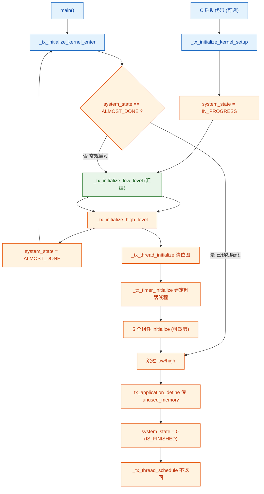
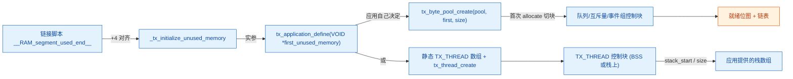

# tx_initialize —— ThreadX 启动链（kernel_enter / kernel_setup / low_level / high_level）逐函数深读

> 对应源文件：
> - `common/src/tx_initialize_kernel_enter.c`（共 155 行）
> - `common/src/tx_initialize_high_level.c`（共 149 行）
> - `common/src/tx_initialize_kernel_setup.c`（共 94 行）
> - `common/inc/tx_initialize.h`（共 105 行）
> - `common/src/tx_thread_initialize.c`（共 452 行，只读全局变量定义段）
> - `common/src/tx_timer_initialize.c`（共 299 行，只读 197-299）
> - `ports/cortex_m4/gnu/example_build/tx_initialize_low_level.S`（共 218 行，移植参照）
>
> 配套文档：[00-总览与架构.md](/Users/theo-richard/workspace/references/rtos/ThreadX/Docs/00-总览与架构.md)、
> [01-初始化与启动链.md](/Users/theo-richard/workspace/references/rtos/ThreadX/Docs/01-初始化与启动链.md)
> 相邻 KB：`tx_thread_create.md`、`tx_timer.md`

---

## 1. 一句话职责

**`_tx_initialize_kernel_enter()` 是 `main()` 里唯一需要手动调用的 ThreadX 函数**：它把"处理器初始化 →
内核组件初始化 → 应用对象创建 → 进入调度器"这四段串成一条**永不返回**的直线，并把
"调用者提供的空闲 RAM 起点"作为参数交给 `tx_application_define()`。

这条链的价值不在代码量（四个文件合计不到 400 行），而在于它定义了 ThreadX 的两个隐含契约：

| 契约 | 落点 | 后果 |
|---|---|---|
| 内核**不分配**内存，只接收内存 | `_tx_initialize_unused_memory` | 应用必须在这一步把 RAM 交给 `tx_byte_pool_create` 之类的对象 |
| 初始化期与运行期用**同一个变量**区分 | `_tx_thread_system_state` | 该变量同时是中断嵌套计数，初值不是 0 |

---

## 2. 三个"魔法状态值"决定了两条启动路径

`tx_initialize.h:48-50`：

```c
#define TX_INITIALIZE_IN_PROGRESS               ((ULONG) 0xF0F0F0F0UL)
#define TX_INITIALIZE_ALMOST_DONE               ((ULONG) 0xF0F0F0F1UL)
#define TX_INITIALIZE_IS_FINISHED               ((ULONG) 0x00000000UL)
```

为什么不是 0/1/2？因为 `_tx_thread_system_state` **同时充当 ISR 嵌套计数**（文档注释在
`tx_initialize_kernel_enter.c:96-98` 明说 "this variable is later used to represent interrupt nesting"）。
Cortex-M 的 IPSR 最大 511（9 位），0xF0F0F0F0 远大于任何真实异常号，
所以 `TX_THREAD_GET_SYSTEM_STATE() < TX_INITIALIZE_IN_PROGRESS` 这个判断能可靠区分
"正在跑 ISR"与"正在初始化"。若用 1/2 做状态值，中断嵌套 1 层就会和"初始化中"撞车。

三条路径：

| 入口 | 谁调 | 进入时 `system_state` | 行为 |
|---|---|---|---|
| 常规启动 | `main()` → `_tx_initialize_kernel_enter()` | `0xF0F0F0F0`（`.data` 初值，`tx_thread_initialize.c:84`） | 走 `low_level` + `high_level` |
| 启动代码预初始化 | C 启动代码 → `_tx_initialize_kernel_setup()` | 同上 | 走 `low_level` + `high_level`，末尾置 `ALMOST_DONE` |
| 预初始化后的 kernel_enter | `main()` | `0xF0F0F0F1` | **跳过** `low_level`/`high_level`，只做应用初始化与调度 |

关键：`_tx_thread_system_state` 是**带初值的 `.data` 变量**，不是 `.bss`。这意味着
即使启动代码把 `.bss` 清零顺序搞反，这个状态机仍然成立——但反过来，任何"把 ThreadX 的
`.data` 段也清零"的定制启动代码会破坏它（见 §8 陷阱 2）。

---

## 3. 全局变量表（初始化链真正写到的那些）

| 变量 | 定义处 | 初值 | 谁写 | 含义 |
|---|---|---|---|---|
| `_tx_initialize_unused_memory` | `tx_initialize_high_level.c:52` | 0（.bss） | `_tx_initialize_low_level` 汇编 | 第一块可用 RAM 地址，交给 `tx_application_define` |
| `_tx_thread_system_state` | `tx_thread_initialize.c:84` | `0xF0F0F0F0` | 三个 init 函数 | 初始化阶段标记 + ISR 嵌套计数 |
| `_tx_thread_current_ptr` | `tx_thread_initialize.c:58` | 0 | `_tx_thread_initialize` | 当前运行的 TCB，NULL = 无 |
| `_tx_thread_execute_ptr` | `tx_thread_initialize.c:65` | 0 | resume/suspend/time_slice | 下一个该跑的 TCB，可与 current 不同 |
| `_tx_thread_priority_maps[1]` | `tx_thread_initialize.c:92` | 0 | resume/suspend | 32 位就绪位图（32 优先级时只有 1 个字） |
| `_tx_thread_preempted_maps[1]` | `tx_thread_initialize.c:112` | 0 | resume/suspend | 阈值抢占记账位图 |
| `_tx_thread_highest_priority` | `tx_thread_initialize.c:128` | `TX_MAX_PRIORITIES`（32） | resume/suspend | 最高就绪优先级；等于 32 表示"无人就绪" |
| `_tx_thread_priority_list[32]` | `tx_thread_initialize.c:136` | 0 | resume/suspend | 每个优先级一条循环链表头 |
| `_tx_thread_preempt_disable` | `tx_thread_initialize.c:143` | 0 | 各服务 | 非 0 则禁止抢占（服务内部重入保护） |
| `_tx_thread_mutex_release` | `tx_thread_initialize.c:149` | 0 → `_tx_mutex_cleanup` | `_tx_mutex_initialize` | 线程退出时释放持有的互斥量（函数指针钩子） |
| `_tx_timer_system_clock` | `tx_timer_initialize.c` | 0 | tick ISR | 系统 tick 计数（`tx_time_get` 的来源） |
| `_tx_timer_list[32]` | `tx_timer.h:95` | 0 | timer activate | 时间轮：每个槽一条到期链表 |
| `_tx_timer_list_end` | `tx_timer_initialize.c:231-232` | `&list[32]`（越界一格） | 仅初始化 | 让汇编可以用"指针 == end"判断回绕，不必算模 |

`_tx_thread_highest_priority` 初值给 `TX_MAX_PRIORITIES` 而不是 0，是一条**哨兵约定**：
优先级 0 是最高优先级（合法值），只有"比所有合法值都大"的数才能表示空集。
调度器里所有 `if (priority < _tx_thread_highest_priority)` 都依赖这一点。

---

## 4. 逐函数表

| 函数 | 文件:行 | 参数/返回 | 职责 | 关键副作用 |
|---|---|---|---|---|
| `_tx_initialize_kernel_enter` | `tx_initialize_kernel_enter.c:87` | 无 / 无（不返回） | 启动总入口 | 置 3 个状态值、调 low/high、调 `tx_application_define`、进调度 |
| `_tx_initialize_kernel_setup` | `tx_initialize_kernel_setup.c:68` | 无 / 无 | 供 C 启动代码提前初始化 | 与 kernel_enter 前半段重复，末尾置 `ALMOST_DONE` |
| `_tx_initialize_high_level` | `tx_initialize_high_level.c:105` | 无 / 无 | 按依赖顺序初始化 7 个组件 | 创建系统定时器线程（`TX_DONT_START`） |
| `_tx_initialize_low_level` | `ports/*/src|example_build/tx_initialize_low_level.S` | 无 / 无 | 移植层：向量表、SysTick、`_tx_initialize_unused_memory`、系统栈指针 | 汇编实现，每个 port 各一份 |
| `_tx_thread_initialize` | `tx_thread_initialize.c:317` | 无 / 无 | 清位图/链表头/性能计数 | 写 `_tx_build_options`（编译选项指纹） |
| `_tx_timer_initialize` | `tx_timer_initialize.c:197` | 无 / 无 | 清时间轮、建系统定时器线程 | 线程优先级 `TX_TIMER_THREAD_PRIORITY`（默认 0） |
| `_tx_semaphore_initialize` 等 5 个 | `tx_semaphore_initialize.c` 等 | 无 / 无 | 清各自的 created 链表与计数 | 仅在 `!TX_DISABLE_REDUNDANT_CLEARING` 时调用 |

`_tx_initialize_high_level` 的调用顺序不是随意的：

```c
/* tx_initialize_high_level.c:115-125 */
    /* Call the thread control initialization function.  */
    _tx_thread_initialize();


#ifndef TX_NO_TIMER


    /* Call the timer control initialization function.  */
    _tx_timer_initialize();

#endif
```

线程组件必须先初始化，因为 `_tx_timer_initialize` 内部要**创建线程**（`tx_timer_initialize.c:250-255`）：

```c
        status =  _tx_thread_create(&_tx_timer_thread,
                                    TX_CONST_CHAR_TO_CHAR_POINTER_CONVERT("System Timer Thread"),
                                    _tx_timer_thread_entry,
                                    ((ULONG) TX_TIMER_ID),
                                    _tx_timer_stack_start, _tx_timer_stack_size,
                                    _tx_timer_priority, _tx_timer_priority, TX_NO_TIME_SLICE, TX_DONT_START);
```

注意最后两个实参：时间片 `TX_NO_TIME_SLICE`、启动方式 `TX_DONT_START`。
系统定时器线程**创建但不启动**，要等 `tx_application_define()` 返回、调度器第一次选线程时，
才因为它是优先级 0 而自然被选中。若这里用 `TX_AUTO_START`，`_tx_thread_create` 会在
`tx_application_define` 还没跑完时就调用 resume，把 `_tx_thread_execute_ptr` 指向定时器线程——
应用的初始化代码将失去"先创建高优先级线程"的机会（`tx_thread_create.c:292` 的补偿逻辑就是为此存在）。

`_tx_timer_initialize` 还被包在一个 `do { ... } while (status != TX_SUCCESS)` 里
（`tx_timer_initialize.c:245-272`）。这是**唯一**在初始化路径里带重试的调用：
`_tx_thread_create` 在正常配置下不会失败，但若 port 重定义了 `TX_TIMER_INITIALIZE_EXTENSION(status)`
（比如安全认证包要求检查返回值），循环保证失败时重试而不是带着半初始化状态继续。

---

## 5. 三段逐字摘录

### 5.1 双入口判据

```c
/* tx_initialize_kernel_enter.c:91-99 */
    if (_tx_thread_system_state != TX_INITIALIZE_ALMOST_DONE)
    {

        /* No, the initialization still needs to take place.  */

        /* Ensure that the system state variable is set to indicate
           initialization is in progress.  Note that this variable is
           later used to represent interrupt nesting.  */
        _tx_thread_system_state =  TX_INITIALIZE_IN_PROGRESS;
```

判据是 `!= ALMOST_DONE` 而不是 `== IN_PROGRESS`：状态值有三个，但只有 `ALMOST_DONE`
代表"启动代码已经替我做完了 low/high 级初始化"。用 `!=` 让"未初始化"和"其它任何中间态"
都走完整初始化——失败方向是**多做一次初始化**，而不是少做。

### 5.2 结尾：置 0 再进调度

```c
/* tx_initialize_kernel_enter.c:135-148 */
    /* Set the system state in preparation for entering the thread
       scheduler.  */
    _tx_thread_system_state =  TX_INITIALIZE_IS_FINISHED;

    /* Call any port specific pre-scheduler processing.  */
    TX_PORT_SPECIFIC_PRE_SCHEDULER_INITIALIZATION

#if defined(TX_ENABLE_EXECUTION_CHANGE_NOTIFY) || defined(TX_EXECUTION_PROFILE_ENABLE)
    /* Initialize Execution Profile Kit.  */
    _tx_execution_initialize();
#endif

    /* Enter the scheduling loop to start executing threads!  */
    _tx_thread_schedule();
```

`TX_INITIALIZE_IS_FINISHED` 就是 0，所以这句同时完成两件事：退出"初始化中"状态，
并把 ISR 嵌套计数归零。之后任何服务里的 `TX_THREAD_GET_SYSTEM_STATE()` 返回 0
都表示"在**线程上下文**里"。

### 5.3 移植层交出的两样东西

```asm
@ ports/cortex_m4/gnu/example_build/tx_initialize_low_level.S:95-102
    CPSID   i
@
@    /* Set base of available memory to end of non-initialised RAM area.  */
@
    LDR     r0, =_tx_initialize_unused_memory       @ Build address of unused memory pointer
    LDR     r1, =__RAM_segment_used_end__           @ Build first free address
    ADD     r1, r1, #4                              @
    STR     r1, [r0]                                @ Setup first unused memory pointer
```

```asm
@ ports/cortex_m4/gnu/example_build/tx_initialize_low_level.S:111-120
@    /* Configure SysTick for 100Hz clock, or 16384 cycles if no reference.  */
@
    MOV     r0, #0xE000E000                         @ Build address of NVIC registers
    MOV     r1, #0                                  @ Build value for SysTick reset
    STR     r1, [r0, #0x10]                         @ Reset SysTick Control
    STR     r1, [r0, #0x18]                         @ Reset SysTick Counter Value
    LDR     r1, =SYSTICK_CYCLES
    STR     r1, [r0, #0x14]                         @ Setup SysTick Reload Value
    MOV     r1, #0x7                                @ Build SysTick Control Enable Value
    STR     r1, [r0, #0x10]                         @ Setup SysTick Control
```

两段合起来看：**low_level 只做三件事——关中断、交出 RAM 起点、配好 tick 源**。
`SYSTICK_CYCLES` 在该文件第 47 行定义为 `((SYSTEM_CLOCK / 100) -1)`，
而 `SYSTEM_CLOCK = 6000000`（第 46 行）是**模板值**：6 MHz / 100 Hz - 1 = 59999 个周期。
真实板子必须按主频改，否则 tick 不是 10ms——这是移植时第一个必须改的常量。

---

## 6. 执行流图



图中唯一的分叉是 `CHK`。两条臂最终汇到同一句 `tx_application_define`，
所以"预初始化"只省掉了处理器与组件初始化，**不会**让应用初始化跑两遍。

---

## 7. 数据流：RAM 起点怎么变成内核对象



这条链解释了 ThreadX 为什么敢说"零 malloc"：`unused_memory` 之后的所有内存
都是应用**已经声明**的数组或链接器留出的段，内核只在其上做链表切分。

---

## 8. 陷阱与读码建议

**陷阱 1：以为 `TX_INITIALIZE_IN_PROGRESS` 是个序号。**
它是 0xF0F0F0F0，因为要和 IPSR（≤511）以及 ISR 嵌套计数共处一个变量。
自己写 port 时若把它改成 1，`TX_THREAD_GET_SYSTEM_STATE() < TX_INITIALIZE_IN_PROGRESS`
这条判断会在第一层中断里失效，`tx_thread_create` 的初始化补偿逻辑就会误触发。

**陷阱 2：在 `_tx_initialize_kernel_setup()` 之后又清零 `.data`。**
`_tx_thread_system_state` 的初值 `TX_INITIALIZE_IN_PROGRESS` 写在 `.data`
（`tx_thread_initialize.c:84`），而 `ALMOST_DONE`（0xF0F0F0F1）是 setup 运行期写进去的。
若定制启动代码在这之后把 `.data` 清零，kernel_enter 的 `!= ALMOST_DONE` 判据会成立，
于是 `low_level` 再跑一遍——SysTick 被重新配置、`_tx_initialize_unused_memory`
被重新指向"已用 RAM 末尾"，应用在 setup 与 kernel_enter 之间做的任何内存安排都会错位。

**陷阱 3：同时调用 `_tx_initialize_kernel_setup()` 和依赖它"只初始化一次"。**
setup 只做 low/high + 置 `ALMOST_DONE`，**不创建应用对象**；kernel_enter 之后仍会
调用 `tx_application_define`。所以 setup 不能被当作"提前跑完整个启动"。

**陷阱 4：在 `tx_application_define()` 里调用阻塞 API。**
此时 `system_state == 0xF0F0F0F0`，任何带超时的服务都会返回 `TX_WAIT_ERROR`。
这里只能创建对象、激活定时器，不能 `tx_queue_receive` / `tx_thread_sleep`。

**陷阱 5：以为 `TX_DISABLE_REDUNDANT_CLEARING` 只是省几条 memset。**
它让 `tx_initialize_high_level.c:127-148` 整段消失——信号量/队列/事件组/块池/字节池/互斥量
的 `_initialize` 都不再被调用。这些组件的全局"已创建链表"就完全依赖 C 启动代码的 `.bss` 清零。
在 no-init RAM 或热重启（不复位 RAM）场景下，残留数据会让第一次 `tx_queue_create` 挂到野指针上。

**陷阱 6：只改 `TX_TIMER_TICKS_PER_SECOND` 不改 SysTick 重装值。**
正确关系是 `SYSTICK_CYCLES = SYSTEM_CLOCK / TX_TIMER_TICKS_PER_SECOND - 1`，
但示例汇编把除数写死成 `/100`（`tx_initialize_low_level.S:47`）。若只把
`tx_api.h:272` 的宏改成 1000，硬件仍是 100Hz：`tx_thread_sleep(1)` 依旧睡 10ms，
而中间件里所有"毫秒 → tick"的换算会放慢 10 倍（1000ms 超时变成 10 秒）。

**读码建议（按此顺序 30 分钟可通）**：

1. `tx_initialize.h:48-50` —— 先记住三个状态值，后面所有判断都围着它们转；
2. `tx_initialize_kernel_enter.c:87-155` —— 全长 69 行，是整条链的目录；
3. `tx_initialize_high_level.c:105-149` —— 看组件初始化的**顺序**与 `#ifndef` 裁剪点；
4. `tx_timer_initialize.c:197-299` —— 唯一在初始化期创建线程的地方；
5. `ports/cortex_m4/gnu/example_build/tx_initialize_low_level.S:89-138` —— 看移植层实际交出了什么；
6. `ports/cortex_m4/gnu/inc/tx_port.h:459-500` —— 看 `TX_THREAD_GET_SYSTEM_STATE` 如何把 IPSR 或进来，
   这是理解"为什么 Cortex-M 上 `system_state` 初始化后恒为 0"的关键（详见 `tx_thread_schedule.md`）。
