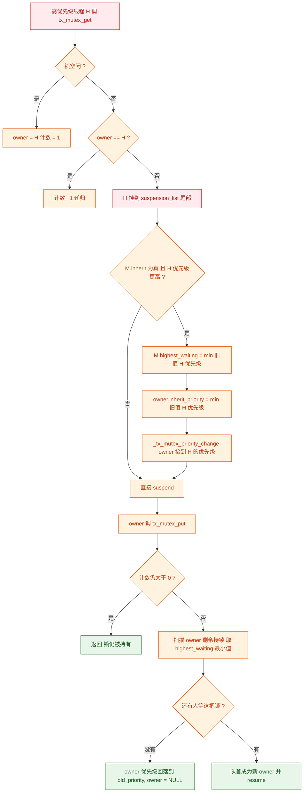

# tx_mutex —— 递归互斥量与优先级继承 owner 链逐函数深读

> 对应源文件：
> - `common/src/tx_mutex_create.c`（共 142 行）
> - `common/src/tx_mutex_get.c`（共 409 行）
> - `common/src/tx_mutex_put.c`（共 648 行）
> - `common/src/tx_mutex_priority_change.c`（共 322 行，**优先级继承的执行者**）
> - `common/src/tx_mutex_cleanup.c`（共 309 行，含 `_tx_mutex_thread_release`）
> - `common/src/tx_mutex_delete.c`（共 237 行）
> - `common/src/tx_mutex_prioritize.c`（共 259 行）
> - `common/src/tx_mutex_info_get.c`（共 143 行）
> - `common/inc/tx_api.h:847-915`（`TX_MUTEX` 结构体）
> - `common/inc/tx_api.h:508-518`（`TX_THREAD` 里的继承与持锁字段）
>
> 配套文档：[03-同步原语.md](/Users/theo-richard/workspace/references/rtos/ThreadX/Docs/03-同步原语.md)
> 相邻 KB：`tx_thread_schedule.md`、`tx_queue.md`

---

## 1. 一句话职责

**互斥量 = 一个 `owner` 指针 + 一个递归计数 + 一张"我持有哪些锁"的线程侧链表**。独特之处只有两点：

1. **归属性**：只有持有者能释放（`TX_NOT_OWNED`），且可递归获取（计数 +1）。
2. **优先级继承**：当高优先级线程被低优先级 owner 挡住时，临时把 owner 的优先级
   抬到等待者的水平；owner 释放时再按"它还持有的其它锁的最高等待优先级"回落。

第 2 点把互斥量和信号量彻底区分开：信号量只唤醒，互斥量会**改调度参数**。

---

## 2. `TX_MUTEX` 字段表

`tx_api.h:847-915`：

| 字段 | 行号 | 类型 | 含义 | 谁写 |
|---|---|---|---|---|
| `tx_mutex_id` | 851 | `ULONG` | 魔数 `0x4D555445`（"MUTE"） | create / delete |
| `tx_mutex_name` | 854 | `CHAR*` | 名字 | create |
| `tx_mutex_ownership_count` | 857 | `UINT` | **递归计数**，0 = 空闲 | get / put / delete |
| `tx_mutex_owner` | 861 | `TX_THREAD*` | 当前持有者 | get / put |
| `tx_mutex_inherit` | 865 | `UINT` | `TX_INHERIT` / `TX_NO_INHERIT` | create |
| `tx_mutex_original_priority` | 868 | `UINT` | 持有者**获得锁时**的优先级快照 | get（成功时） |
| `tx_mutex_suspension_list` | 873 | `TX_THREAD*` | 等待者循环链表 | get / put / delete |
| `tx_mutex_suspended_count` | 874 | `UINT` | 等待者数量 | 同上 |
| `tx_mutex_created_next/previous` | 878-879 | 指针 | 全局 created 链 | create / delete |
| `tx_mutex_highest_priority_waiting` | 883 | `UINT` | **本锁上最高的等待优先级**（初值/重置为 `TX_MAX_PRIORITIES`） | get / put |
| `tx_mutex_owned_next/previous` | 887-888 | 指针 | 挂在 **owner 线程** 的 owned 链表上 | get / put |

线程侧的相关字段（`tx_api.h:508-518`）：

| 字段 | 行号 | 含义 |
|---|---|---|
| `tx_thread_user_priority` | 511 | 应用设定的原始优先级（**永远不被继承改写**） |
| `tx_thread_user_preempt_threshold` | 512 | 应用设定的阈值 |
| `tx_thread_inherit_priority` | 513 | 当前继承到的优先级；`TX_MAX_PRIORITIES` = 无继承 |
| `tx_thread_owned_mutex_count` | 516 | 持有锁数量（递归也计 1 个锁） |
| `tx_thread_owned_mutex_list` | 518 | 持有锁的循环链表头 |

`priority` 是"当前生效"，`user_priority` 是"应还原到"，`inherit_priority` 是
"被抬到了多少"——三者构成一个可逆的优先级栈，但**只有一层**（所有锁取最小值）。

`TX_MUTEX` 在 32 位机默认配置下：13 个 4 字节字段 = **52 字节**。

---

## 3. 逐函数表

| 函数 | 文件:行 | 输入/输出 | 核心动作 | 错误码 |
|---|---|---|---|---|
| `_tx_mutex_create` | `tx_mutex_create.c:70` | `(mutex, name, inherit)` | 清零、记 inherit、挂 created 表 | `TX_INHERIT_ERROR`（inherit 非法） |
| `_tx_mutex_get` | `tx_mutex_get.c:75` | `(mutex, wait)` | 空闲→占用；自己持有→计数++；否则挂起+继承 | `TX_NOT_AVAILABLE`、`TX_WAIT_ERROR`、`TX_CALLER_ERROR` |
| `_tx_mutex_put` | `tx_mutex_put.c:72` | `(mutex)` | 计数--；归零则移交/释放并回退优先级 | `TX_NOT_OWNED`、`TX_MUTEX_ERROR` |
| `_tx_mutex_priority_change` | `tx_mutex_priority_change.c:70` | `(thread, new_priority)` | 改 `priority` 与 `preempt_threshold`，必要时重排就绪表 | 无（VOID） |
| `_tx_mutex_cleanup` | `tx_mutex_cleanup.c:70` | `(thread, seq)` | 超时/中止时摘链，返回 `TX_NOT_AVAILABLE` | 无 |
| `_tx_mutex_thread_release` | `tx_mutex_cleanup.c:251` | `(thread)` | 线程退出时**强制释放所有持有的锁** | 无 |
| `_tx_mutex_prioritize` | `tx_mutex_prioritize.c:67` | `(mutex)` | 最高优先级等待者移到队首 | `TX_MUTEX_ERROR` |
| `_tx_mutex_delete` | `tx_mutex_delete.c:70` | `(mutex)` | 摘 created 表，等待者置 `TX_DELETED` | `TX_CALLER_ERROR`、`TX_MUTEX_ERROR` |
| `_tx_mutex_info_get` | `tx_mutex_info_get.c:75` | 6 个出参 | 快照 | `TX_MUTEX_ERROR` |

`_tx_mutex_create` 的第三个参数只有 `TX_INHERIT` / `TX_NO_INHERIT`，传错返回
`TX_INHERIT_ERROR`。官方示例都用继承版——不开继承的互斥量几乎必然产生优先级反转。

---

## 4. 三条代码路径

`_tx_mutex_get` 分三支（`tx_mutex_get.c:111-189`）：

| 条件 | 行号 | 动作 | 耗时 |
|---|---|---|---|
| `ownership_count == 0` | 111-173 | 置 1、`owner = 当前线程`、挂 owned 链表、`available++` 语义上无 | 常数，无阻塞 |
| `owner == 当前线程` | 176-188 | `ownership_count++`（**递归**） | 一条自增 |
| 其它 | 189-393 | 挂起 + 可能触发继承 | 两次链表操作 + 可能改优先级 |

第二支是互斥量与二值信号量的**唯一功能差异**（除了继承）：同一线程可以重复 get，
必须 put 同样次数才真正释放。这让"函数 A 拿锁 → 调用也拿同一把锁的函数 B"不会自死锁。

---

## 5. 逐字摘录

### 5.1 首次获取：记录快照与互斥量上界

```c
/* tx_mutex_get.c:118-133 */
        /* Remember that the calling thread owns the mutex.  */
        mutex_ptr -> tx_mutex_owner =  thread_ptr;

        /* Determine if the thread pointer is valid.  */
        if (thread_ptr != TX_NULL)
        {

            /* Determine if priority inheritance is required.  */
            if (mutex_ptr -> tx_mutex_inherit == TX_TRUE)
            {

                /* Remember the current priority of thread.  */
                mutex_ptr -> tx_mutex_original_priority =   thread_ptr -> tx_thread_priority;

                /* Setup the highest priority waiting thread.  */
                mutex_ptr -> tx_mutex_highest_priority_waiting =  ((UINT) TX_MAX_PRIORITIES);
            }
```

`tx_mutex_original_priority` 是**每把锁一份**的"持有者当时的优先级"。
它和线程的 `user_priority` 不是一回事：

- `user_priority` 是应用通过 `tx_thread_priority_change` 设定的，永不变；
- `original_priority` 是"这把锁被拿到的瞬间，持有者实际在跑的优先级"，
  可能已经因为**别的锁**的继承而偏高。

### 5.2 继承：三件事按顺序做

```c
/* tx_mutex_get.c:348-386 */
                /* Determine if we need to raise the priority of the thread
                   owning the mutex.  */
                if (mutex_ptr -> tx_mutex_inherit == TX_TRUE)
                {

                    /* Determine if this is the highest priority to raise for this mutex.  */
                    if (mutex_ptr -> tx_mutex_highest_priority_waiting > thread_ptr -> tx_thread_priority)
                    {

                        /* Remember this priority.  */
                        mutex_ptr -> tx_mutex_highest_priority_waiting =  thread_ptr -> tx_thread_priority;
                    }

                    /* Determine if we have to update inherit priority level of the mutex owner.  */
                    if (thread_ptr -> tx_thread_priority < mutex_owner -> tx_thread_inherit_priority)
                    {

                        /* Remember the new priority inheritance priority.  */
                        mutex_owner -> tx_thread_inherit_priority =  thread_ptr -> tx_thread_priority;
                    }

                    /* Priority inheritance is requested, check to see if the thread that owns the mutex is lower priority.  */
                    if (mutex_owner -> tx_thread_priority > thread_ptr -> tx_thread_priority)
                    {

                        /* Yes, raise the suspended, owning thread's priority to that
                           of the current thread.  */
                        _tx_mutex_priority_change(mutex_owner, thread_ptr -> tx_thread_priority);
```

三步的顺序与含义：

1. **更新锁级上界** `highest_priority_waiting = min(旧值, 等待者优先级)`。
   这是"这把锁上还等着谁"的记忆，put 时要用它算回落目标。
2. **更新线程级继承值** `inherit_priority = min(旧值, 等待者优先级)`。
   它是"我被所有锁抬到过的最高水平"，put 时作为下限。
3. **真正改调度参数**——只有 owner 当前优先级**低于**等待者时才调
   `_tx_mutex_priority_change`。第 2 步无条件更新，第 3 步有条件执行：
   因为"记录"和"生效"是两回事，owner 可能已经因为别的锁被抬得更高了。

为什么只有一层 `inherit_priority` 而不是"每把锁一层"？调度只需要"当前该用哪个
优先级"，即所有等待者的**最小值**；put 时扫一遍 owned 链表取最小（§5.3），结果等价。

**`mutex_owner` 是在挂起前就捕获的局部变量**（第 211 行 `mutex_owner = mutex_ptr->tx_mutex_owner;`），
不是挂起后再读 `mutex_ptr->tx_mutex_owner`。原因：从 `TX_RESTORE` 到
`_tx_thread_system_suspend` 之间有一小段开中断窗口，owner 可能已经 put 并
把锁交给了别人；用捕获的指针才能保证"继承的是当时挡我的那个人"。

### 5.3 释放：先算回落目标，再移交

```c
/* tx_mutex_put.c:250-303 */
                            /* Default the inheritance priority to disabled.  */
                            inheritance_priority =  ((UINT) TX_MAX_PRIORITIES);

                            /* Search the owned mutexes for this thread to determine the highest priority for this
                               former mutex owner to return to.  */
                            next_mutex =  thread_ptr -> tx_thread_owned_mutex_list;
                            while (next_mutex != TX_NULL)
                            {

                                /* Does this mutex support priority inheritance?  */
                                if (next_mutex -> tx_mutex_inherit == TX_TRUE)
                                {

                                    /* Determine if highest priority field of the mutex is higher than the priority to
                                       restore.  */
                                    if (next_mutex -> tx_mutex_highest_priority_waiting < inheritance_priority)
                                    {

                                        /* Use this priority to return releasing thread to.  */
                                        inheritance_priority =   next_mutex -> tx_mutex_highest_priority_waiting;
                                    }
                                }

                                /* Move mutex pointer to the next mutex in the list.  */
                                next_mutex =  next_mutex -> tx_mutex_owned_next;

                                /* Are we at the end of the list?  */
                                if (next_mutex == thread_ptr -> tx_thread_owned_mutex_list)
                                {

                                    /* Yes, set the next mutex to NULL.  */
                                    next_mutex =  TX_NULL;
                                }
                            }
```

```c
/* tx_mutex_put.c:294-303 */
                            /* Set the inherit priority to that of the highest priority thread waiting on the mutex.  */
                            thread_ptr -> tx_thread_inherit_priority =  inheritance_priority;

                            /* Determine if the inheritance priority is less than the default old priority.  */
                            if (inheritance_priority < old_priority)
                            {

                                /* Yes, update the old priority.  */
                                old_priority =  inheritance_priority;
                            }
```

这是整个互斥量最绕的一段：**释放一把锁时，不能简单回到 `user_priority`**，
因为该线程可能还持有另一把锁，而那把锁上还有高优先级等待者。
所以它遍历 `owned_mutex_list`（此时当前锁已从链表摘除），取所有
`highest_priority_waiting` 的最小值作为新的继承水平；再与 `user_priority` 取小，
得到"现在应该用的优先级"。

交接路径有两条（`tx_mutex_put.c:356-405` 与 `406-` 之后）：

| 情况 | 动作 |
|---|---|
| 没有等待者 | `highest_priority_waiting = TX_MAX_PRIORITIES`，`_tx_mutex_priority_change(owner, old_priority)`，`owner = NULL` |
| 有等待者 | 把队首线程设为新 owner、`ownership_count = 1`、把它从挂起链摘除、`resume` |

注意"有等待者"时**没有**恢复旧 owner 的优先级——因为锁直接转给了新 owner，
旧 owner 的继承优先级要等它**不再持有任何锁**时才回落。这个设计让
"锁的移交"变成 O(1)，而不是"先降优先级再升优先级"的两次调度操作。

### 5.4 改优先级的实现：借一次 suspend/resume 重排

```c
/* tx_mutex_priority_change.c:96-115 */
    /* Determine if this thread is currently ready.  */
    if (thread_ptr -> tx_thread_state != TX_READY)
    {

        /* Change thread priority to the new mutex priority-inheritance priority.  */
        thread_ptr -> tx_thread_priority =  new_priority;

        /* Determine how to setup the thread's preemption-threshold.  */
        if (thread_ptr -> tx_thread_user_preempt_threshold < new_priority)
        {

            /* Change thread preemption-threshold to the user's preemption-threshold.  */
            thread_ptr -> tx_thread_preempt_threshold =  thread_ptr -> tx_thread_user_preempt_threshold;
        }
        else
        {

            /* Change the thread preemption-threshold to the new threshold.  */
            thread_ptr -> tx_thread_preempt_threshold =  new_priority;
        }
```

线程不在 `TX_READY`（正在跑、正在挂起、已挂起）时，直接改字段即可——
它不在就绪位图里，优先级只影响"以后入表时插到哪"。

线程在 `TX_READY` 时不能直接改：它在某条优先级链表和位图里，改字段会让
链表与 `priority` 不一致。于是走"临时挂起 → 改 → 恢复"（第 169-215 行）：

```c
/* tx_mutex_priority_change.c:169-179 */
        /* Increment the preempt disable flag.  */
        _tx_thread_preempt_disable =  _tx_thread_preempt_disable + ((UINT) 2);

        /* Set the state to priority change.  */
        thread_ptr -> tx_thread_state =    TX_PRIORITY_CHANGE;

        /* Set the suspending flag. */
        thread_ptr -> tx_thread_suspending =  TX_TRUE;
```

随后 `_tx_thread_system_suspend(thread_ptr)`（第 186 行）把它摘出就绪表，
改完 `tx_thread_priority`（第 195 行）再 `_tx_thread_system_resume(thread_ptr)`（第 215 行）。

`preempt_disable += 2` 而不是 `++`：suspend 与 resume 各自会 `--` 一次
（见 `tx_thread_system_suspend.c:149` 与 `tx_thread_system_resume.c:151`），
用 +2 抵消，保证整个过程对其他线程不可抢占。这是一个非常隐晦的配对约定，
改这段代码时必须同时数这两个减号。

`preempt_threshold` 的处理也值得注意：取 `min(user_preempt_threshold, new_priority)`。
继承抬高优先级时阈值必须跟着抬，否则"被抬高的线程"仍然会被原本不该抢占它的
线程打断，继承就白做了。

---

## 6. 对象关系




---

## 7. 陷阱与读码建议

**陷阱 1：以为优先级继承会把 `user_priority` 改掉。**
改的是 `tx_thread_priority` 与 `tx_thread_inherit_priority`，`user_priority` 始终是
应用设定值。调试时若发现优先级"变了又没变"，先分清这三个字段。

**陷阱 2：`tx_mutex_put` 由非持有者调用。**
`_tx_mutex_put` 检查 `mutex_ptr->tx_mutex_owner != current_thread` 就返回
`TX_NOT_OWNED`（`tx_mutex_put.c:124-140`）。但有一个**内部豁免**：
`if (_tx_thread_preempt_disable == 0)` 才检查归属。也就是说
"抢占被禁用时，任何人都能 put 别人的锁"。这是为 `_tx_mutex_thread_release`
（线程退出清理）预留的通道，应用代码不要依赖它。

**陷阱 3：线程被 terminate 时锁没释放。**
`_tx_thread_shell_entry` 在线程函数返回后调用 `_tx_thread_mutex_release`
（`tx_mutex_cleanup.c:251` 的 `_tx_mutex_thread_release`），它把
`ownership_count` 强制置 1 再 `put`，从而一次释放递归持有的锁。
但如果是 `tx_thread_terminate`（不是自然返回），清理走的是另一条路径，
**应用必须自己保证 terminate 前释放锁**，否则等待者会永久挂住。

**陷阱 4：等待者超时后，owner 的优先级不会立刻回落。**
`_tx_mutex_cleanup` 只做"摘链 + 置 `TX_NOT_AVAILABLE` + resume"
（`tx_mutex_cleanup.c:160-196`），**不重算 `highest_priority_waiting`，
也不调 `_tx_mutex_priority_change`**。因此：

- owner 的 `tx_thread_priority` 保持被抬高的值，直到它下一次 `put`；
- `mutex_ptr->tx_mutex_highest_priority_waiting` 仍是超时者的优先级，
  而 `put` 的回落扫描会读这个值（§5.3）。

后果是"超时后 owner 可能被回落到一个中间优先级而不是 `user_priority`"。
**实测建议**：同时打开 `priority_inversion_count` 与 `timeout_count`，
两者都非零时用 TraceX 看 owner 的优先级轨迹。

**陷阱 5：把 `tx_mutex_delete` 当"销毁等待者"。**
delete 只把等待者置 `TX_DELETED` 并 resume，**不释放锁**。
已删除的 `TX_MUTEX` 若还被 put，会因 ID 被清成 `TX_CLEAR_ID` 而返回
`TX_MUTEX_ERROR`（错误检查开启时）。

**陷阱 6：在中断里 get 互斥量，或用它做 ISR 同步。**
互斥量是"所有权"语义，ISR 不能成为 owner。`_txe_mutex_get` 在
`TX_THREAD_GET_SYSTEM_STATE() != 0` 且 `wait_option != TX_NO_WAIT` 时返回
`TX_WAIT_ERROR`；即便非阻塞，继承也无从谈起。ISR→线程用信号量/队列。

**读码建议（约 1 小时）**：

1. `tx_mutex_get.c:111-188` —— 三支路径的前两支，10 分钟看懂"递归"；
2. `tx_mutex_get.c:209-285` + `348-386` —— 挂起准备与继承三步；
3. `tx_mutex_put.c:115-208` —— 归属检查、递归递减、从 owned 链表摘除；
4. `tx_mutex_put.c:250-303` + `355-405` —— 回落扫描与恢复；
5. `tx_mutex_priority_change.c:96-121` 与 `169-215` —— READY 线程"先挂起再改"；
6. `tx_mutex_cleanup.c:251-300` —— 线程退出时的强制释放。
