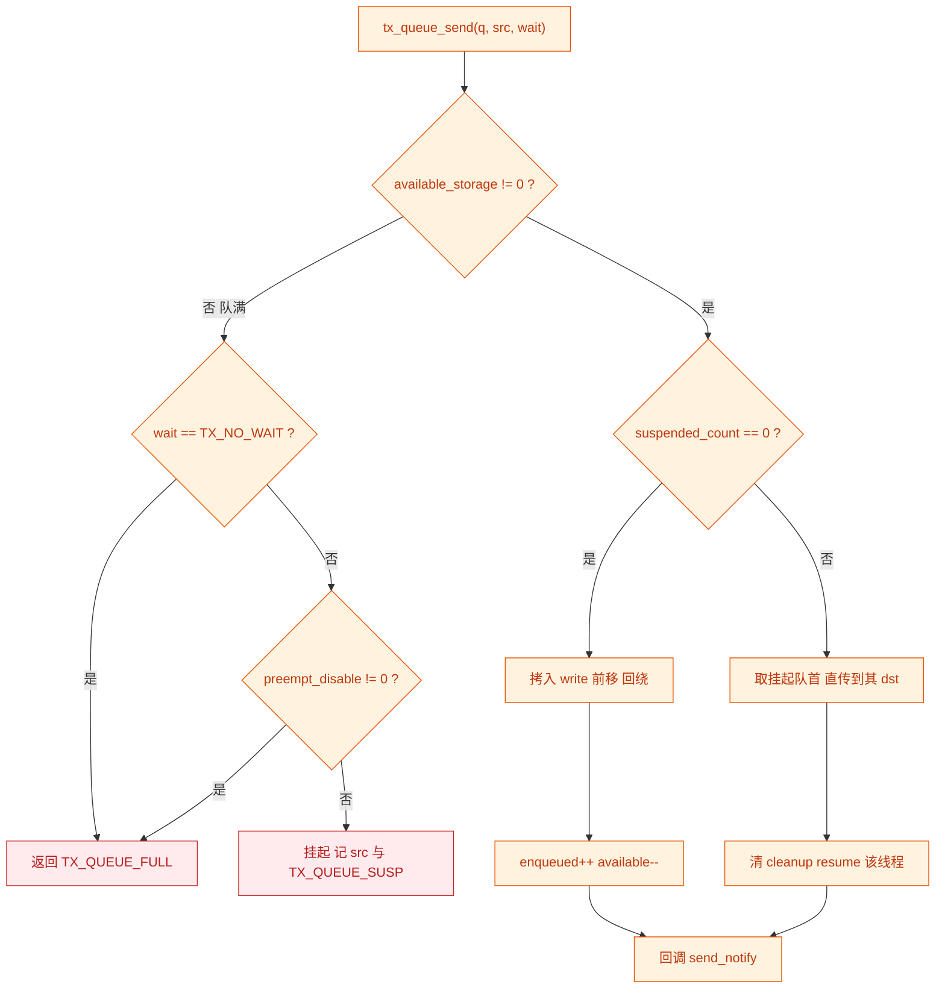
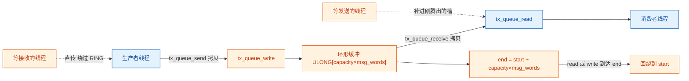

# tx_queue —— 消息队列（create / send / receive / front_send / flush）逐函数深读

> 对应源文件：
> - `common/src/tx_queue_create.c`（共 166 行）
> - `common/src/tx_queue_send.c`（共 425 行）
> - `common/src/tx_queue_receive.c`（共 480 行）
> - `common/src/tx_queue_front_send.c`（共 415 行）
> - `common/src/tx_queue_flush.c`（共 199 行）
> - `common/src/tx_queue_delete.c`（共 200 行）
> - `common/src/tx_queue_cleanup.c`（共 232 行）
> - `common/src/tx_queue_prioritize.c`（共 243 行）
> - `common/src/tx_queue_send_notify.c`（共 101 行）
> - `common/src/tx_queue_initialize.c`（共 131 行）
> - `common/inc/tx_queue.h:48-93`（`TX_QUEUE_ID`、`TX_QUEUE_MESSAGE_COPY`）
> - `common/inc/tx_api.h:278-280`（`TX_QUEUE_MESSAGE_MAX_SIZE = TX_16_ULONG`）
> - `common/inc/tx_api.h:920-994`（`TX_QUEUE` 结构体）
>
> 配套文档：[04-通信机制.md](/Users/theo-richard/workspace/references/rtos/ThreadX/Docs/04-通信机制.md)
> 相邻 KB：`tx_block_pool.md`、`tx_mutex.md`

---

## 1. 一句话职责

**队列是一条由调用者提供存储区的环形缓冲区，元素大小固定为 N 个 32 位字**：
`send` 把消息拷到 `write` 指针处并前移，`receive` 从 `read` 指针处拷出并前移。
队列为空/满时线程挂到同一个 `suspension_list` 上，发送与接收共用一条挂起链。

它有两个"零拷贝"快捷路径，是读源码时最容易漏掉的部分：
**接收者已在等 → 发送直接把消息写进接收者的缓冲区；发送者已在等 → 接收后立刻把
发送者的消息补进刚腾出的槽位**。两条路径都不让消息在队列缓冲区里停留。

---

## 2. `TX_QUEUE` 字段表

`tx_api.h:920-994`：

| 字段 | 行号 | 类型 | 含义 | 谁写 |
|---|---|---|---|---|
| `tx_queue_id` | 924 | `ULONG` | `0x51554555`（"QUUE"） | create / delete |
| `tx_queue_name` | 927 | `CHAR*` | 名字指针 | create |
| `tx_queue_message_size` | 930 | `UINT` | **每条消息的字数**（不是字节） | create |
| `tx_queue_capacity` | 933 | `UINT` | 可容纳消息条数 | create |
| `tx_queue_enqueued` | 937 | `UINT` | 当前条数 | send / receive / flush |
| `tx_queue_available_storage` | 938 | `UINT` | 剩余空槽 | send / receive / flush |
| `tx_queue_start` | 942 | `ULONG*` | 缓冲区起点 | create |
| `tx_queue_end` | 943 | `ULONG*` | **起点 + capacity×message_size**（越界一格） | create |
| `tx_queue_read` | 947 | `ULONG*` | 读指针（receive 用） | create / receive / flush |
| `tx_queue_write` | 948 | `ULONG*` | 写指针（send 用） | create / send / flush |
| `tx_queue_suspension_list` | 953 | `TX_THREAD*` | 等待线程循环链表（**收发共用**） | send / receive / flush / delete |
| `tx_queue_suspended_count` | 954 | `UINT` | 等待线程数 | 同上 |
| `tx_queue_created_next/previous` | 958-959 | 指针 | 全局 created 链 | create / delete |
| `tx_queue_send_notify` | 987 | 函数指针 | 每次成功 send 后回调（非阻塞） | 应用 |

`tx_queue_end` 是"越界一格"而不是"最后一个字"，这是为了让 `read == end` 能作为
**回绕条件**，同时避免计算 `end - 1`。`tx_queue_create.c:97-99` 的注释明说
"Note that the ending address is really one past the end!"。

---

## 3. 容量计算：单位是字，不是字节

```c
/* tx_queue_create.c:92-101 */
    /* Determine how many messages will fit in the queue area and the number
       of ULONGs used.  */
    capacity =    (UINT) (queue_size / ((ULONG) (((ULONG) message_size) * (sizeof(ULONG)))));
    used_words =  capacity * message_size;

    /* Save the starting address and calculate the ending address of the queue.
       Note that the ending address is really one past the
       end!  */
    queue_ptr -> tx_queue_start =  TX_VOID_TO_ULONG_POINTER_CONVERT(queue_start);
    queue_ptr -> tx_queue_end =    TX_ULONG_POINTER_ADD(queue_ptr -> tx_queue_start, used_words);
```

**`message_size` 的单位是 `ULONG`（4 字节）**，不是字节。传 `message_size = 4` 表示
每条消息 16 字节。`_txe_queue_create` 的范围检查是
`TX_1_ULONG <= message_size <= TX_QUEUE_MESSAGE_MAX_SIZE`（默认 16 字，即 64 字节）。

容量与浪费：

| 参数 | 值 | 结果 |
|---|---|---|
| `message_size` | 4（字） | 每条 16 B |
| `queue_size` | 1024 B | — |
| `capacity` | `1024 / 16` | 64 条 |
| `used_words` | `64 × 4` | 256 字 = 1024 B |
| 尾部浪费 | `queue_size - used_words×4` | 0 B |

若 `queue_size = 1000`，则 `capacity = 62`、`used_words = 248`（992 B），**尾部浪费 8 字节**。
浪费量 = `queue_size % (message_size × 4)`，不会报错，只会静默减少容量。

---

## 4. 逐函数表

| 函数 | 文件:行 | 输入/输出 | 队列非空/非满时 | 阻塞时 |
|---|---|---|---|---|
| `_tx_queue_create` | `tx_queue_create.c:71` | `(q, name, msg_words, buf, bytes)` | 建环、挂 created 表 | — |
| `_tx_queue_send` | `tx_queue_send.c:77` | `(q, src, wait)` | 有等待接收者→直传；否则写环 | 满则挂 `TX_QUEUE_SUSP`，记 `source_ptr` |
| `_tx_queue_receive` | `tx_queue_receive.c:74` | `(q, dst, wait)` | 有等待发送者→读一条+补一条；否则读环 | 空则挂 `TX_QUEUE_SUSP`，记 `destination_ptr` |
| `_tx_queue_front_send` | `tx_queue_front_send.c:72` | `(q, src, wait)` | 同 send，但**插到"下一个被读"的位置** | 满则挂起并置 `suspend_option = TX_TRUE` |
| `_tx_queue_flush` | `tx_queue_flush.c:69` | `(q)` | 丢弃全部消息、指针复位 | 唤醒所有等发送者（`TX_SUCCESS`） |
| `_tx_queue_delete` | `tx_queue_delete.c:68` | `(q)` | 摘 created 表 | 唤醒所有等待者置 `TX_DELETED` |
| `_tx_queue_cleanup` | `tx_queue_cleanup.c:70` | `(thread, seq)` | 超时/中止时摘链 | — |
| `_tx_queue_prioritize` | `tx_queue_prioritize.c:67` | `(q)` | 最高优先级等待者移到队首 | — |
| `_tx_queue_send_notify` | `tx_queue_send_notify.c:67` | `(q, fn)` | 注册/注销回调 | — |
| `_tx_queue_info_get` | `tx_queue_info_get.c:74` | 7 个出参 | 快照 | — |

`send` 与 `receive` **共用** `tx_queue_suspension_list`，靠 `tx_thread_state`
区分谁在等什么：

| 状态 | 谁 | 被谁唤醒 |
|---|---|---|
| `TX_QUEUE_SUSP` + `suspend_option == TX_FALSE` | 等发送的线程（队列满） | `receive` / `flush` / `delete` |
| `TX_QUEUE_SUSP` + `suspend_option == TX_TRUE` | `front_send` 的线程 | `receive`（优先被服务） |
| `TX_QUEUE_SUSP`（等接收） | 等接收的线程（队列空） | `send` / `front_send` / `delete` |

等等——等接收与等发送的状态值相同，怎么区分？靠 `tx_thread_additional_suspend_info`
的语义和队列当前状态：`send` 里只要 `suspension_list` 非空就当成"等接收者"
（因为队列满时不会走到那个分支，见 §5.1 的前置条件）。这套隐式约定是队列代码
最需要小心的地方（见 §7 陷阱 4）。

---

## 5. 逐字摘录

### 5.1 发送：先看有没有人在等

```c
/* tx_queue_send.c:120-135 */
    if (queue_ptr -> tx_queue_available_storage != TX_NO_MESSAGES)
    {

        /* There is room for the message in the queue.  */

        /* Determine if there are suspended on this queue.  */
        if (suspended_count == TX_NO_SUSPENSIONS)
        {

            /* No suspended threads, simply place the message in the queue.  */

            /* Reduce the amount of available storage.  */
            queue_ptr -> tx_queue_available_storage--;

            /* Increase the enqueued count.  */
            queue_ptr -> tx_queue_enqueued++;
```

外层条件是"队列还有空槽"，内层才是"有没有等待者"。这意味着一个**逻辑上不可能**
的组合被结构性地排除了：队列里有空槽 + 有等待接收者，是唯一会走直传的状态。
如果队列满（`available_storage == 0`），等待者只可能是"等发送"的线程，
此时 `send` 走的是挂起路径，不会误唤醒同类。

### 5.2 直传：消息不进队列缓冲区

```c
/* tx_queue_send.c:225-235 */
            /* Setup source and destination pointers.  */
            source =       TX_VOID_TO_ULONG_POINTER_CONVERT(source_ptr);
            destination =  TX_VOID_TO_ULONG_POINTER_CONVERT(thread_ptr -> tx_thread_additional_suspend_info);
            size =         queue_ptr -> tx_queue_message_size;

            /* Copy message. Note that the source and destination pointers are
               incremented by the macro.  */
            TX_QUEUE_MESSAGE_COPY(source, destination, size)

            /* Put return status into the thread control block.  */
            thread_ptr -> tx_thread_suspend_status =  TX_SUCCESS;
```

`thread_ptr->tx_thread_additional_suspend_info` 是 `tx_queue_receive` 挂起时保存的
**接收者输出缓冲区地址**。`TX_QUEUE_MESSAGE_COPY`（`tx_queue.h:84-92`）逐字拷贝并
**后置自增两个指针**：

```c
#define TX_QUEUE_MESSAGE_COPY(s, d, z)          \
                    *(d)++ = *(s)++;            \
                    if ((z) > ((UINT) 1))       \
                    {                           \
                        while (--(z))           \
                        {                       \
                            *(d)++ =  *(s)++;   \
                         }                      \
                    }
```

这条捷径省掉的是"写入环 + 前移 write + 更新计数 + 接收者再读一次"四次内存操作，
在中低频 IPC 里收益不明显，但在高频小消息（每 tick 数百条）场景下是实打实的。

**注意**：直传路径**不减少 `available_storage`、不增加 `enqueued`**。
因为消息从未入队，队列状态没有变化。

### 5.3 接收：读一条，立刻补一条

```c
/* tx_queue_receive.c:243-261 */
                /* Setup source and destination pointers.  */
                source =       queue_ptr -> tx_queue_read;
                destination =  TX_VOID_TO_ULONG_POINTER_CONVERT(destination_ptr);
                size =         queue_ptr -> tx_queue_message_size;

                /* Copy message. Note that the source and destination pointers are
                   incremented by the macro.  */
                TX_QUEUE_MESSAGE_COPY(source, destination, size)

                /* Determine if we are at the end.  */
                if (source == queue_ptr -> tx_queue_end)
                {

                    /* Yes, wrap around to the beginning.  */
                    source =  queue_ptr -> tx_queue_start;
                }

                /* Setup the queue read pointer.  */
                queue_ptr -> tx_queue_read =  source;
```

```c
/* tx_queue_receive.c:281-299 */
                /* Setup source and destination pointers.  */
                source =       TX_VOID_TO_ULONG_POINTER_CONVERT(thread_ptr -> tx_thread_additional_suspend_info);
                destination =  queue_ptr -> tx_queue_write;
                size =         queue_ptr -> tx_queue_message_size;

                /* Copy message. Note that the source and destination pointers are
                   incremented by the macro.  */
                TX_QUEUE_MESSAGE_COPY(source, destination, size)

                /* Determine if we are at the end.  */
                if (destination == queue_ptr -> tx_queue_end)
                {

                    /* Yes, wrap around to the beginning.  */
                    destination =  queue_ptr -> tx_queue_start;
                }

                /* Adjust the write pointer.  */
                queue_ptr -> tx_queue_write =  destination;
```

两段合起来是一个**原子置换**：先把队首消息交给接收者，再把等待最久的发送者的消息
写进刚空出的槽（队列满时 `write` 正好等于 `read`，所以空出的就是写入位），
最后 `suspended_count--` 并唤醒那个发送者（第 302-339 行）。

顺序不能颠倒：先补后读会覆盖尚未被接收的消息。`enqueued` 在这个分支里不变
（一条出、一条进），`available_storage` 也不变——代码只在"无等待发送者"的分支里
做 `++/--`。

### 5.4 front_send：插队，但不改指针

```c
/* tx_queue_front_send.c:305-308 */
                thread_ptr -> tx_thread_additional_suspend_info =  (VOID *) source_ptr;

                /* Set the flag to true to indicate a queue front send suspension.  */
                thread_ptr -> tx_thread_suspend_option =           TX_TRUE;
```

`front_send` 与 `send` 的差别只在**队列满时的行为**：它不是排队尾，而是标记
`suspend_option = TX_TRUE`。等到有接收者时，`receive` 先检查队首是不是
front 挂起（`tx_queue_receive.c:159`），是就**直接从它的 `source_ptr` 拷给接收者**，
连队列缓冲区都不经过。

这也解释了为什么 front 挂起线程必须排在队首：`receive` 只检查
`tx_queue_suspension_list` 的**头节点**的 `suspend_option`。
`tx_queue_prioritize` 会把高优先级线程移到头部——**一旦移进来的不是 front 线程，
front 语义就失效**（它会退回普通 send 语义）。这是两个 API 的隐式冲突。

---

## 6. 流程图





---

## 7. 陷阱与读码建议

**陷阱 1：把 `message_size` 当字节。**
单位是 `ULONG`。传 `message_size = 16` 表示每条 64 字节；传 16 字节的消息应写 4。
`_txe_queue_create` 只检查 `1 <= message_size <= 16`，所以写 16 不会报错，
只是每条消息占 64 字节、容量变成预期的 1/4。这是移植时最常见的静默错误。

**陷阱 2：以为 `queue_size` 就是可用字节。**
实际可用 = `capacity × message_size × 4`，尾部余数被丢弃
（`tx_queue_create.c:94`）。声明 1000 字节、消息 16 字节时只有 992 字节可用。

**陷阱 3：想要"零容量握手队列"。**
`_txe_queue_create` 要求 `queue_size / 4 >= message_size`，所以 `capacity` 至少为 1，
不存在容量 0 的队列。更关键的是 `tx_queue_send` 的外层条件是
`available_storage != 0`：若真能造出容量 0 的队列，它会永远走"队满"分支，
即使接收者已在等待也不会直传。要"发送方必须等接收方"的语义，只能用容量 1
并接受一条消息的缓冲。

**陷阱 4：以为 `send` 一定唤醒"等接收"的线程。**
`send` 只看 `suspension_list` 非空，而这条链表同时装"等接收"和"等发送"的线程。
能保证不出错的是外层 `available_storage != 0` 这个前提：队列有空槽时，
挂在上面的不可能是"等发送"的线程（等发送的线程只在队满时产生，且队满期间
不会有空槽，除非有人 receive——而 receive 会先把发送者摘掉）。
**这层不变式完全靠代码结构维持，没有任何断言**。自己改这段代码（比如为了
支持零容量队列而放宽外层条件）会立刻踩穿。

**陷阱 5：`tx_queue_flush` 之后未初始化变量。**
flush 把 `enqueued = 0`、`available_storage = capacity`、读写指针复位，
并唤醒所有挂起的发送者（返回 `TX_SUCCESS`，消息**被丢弃**）。
接收方不会收到任何"已丢弃"的通知，所以 flush 只适合"重启协议栈"这类场景。

**陷阱 6：在 ISR 里用带超时的 send/receive。**
`_txe_queue_send` 检查 `TX_THREAD_GET_SYSTEM_STATE() != 0` 且 `wait_option != TX_NO_WAIT`
→ `TX_WAIT_ERROR`。Cortex-M 上 `system_state` 是 0，但宏会 OR 进 IPSR，
所以判断仍然成立（见 `tx_thread_schedule.md` §7）。

**陷阱 7：`tx_queue_front_send` 与 `tx_queue_prioritize` 混用。**
front 语义只认链表头节点的 `suspend_option`。prioritize 把另一个线程移到头部后，
front 线程不在头部，它的"插队"意图就丢了。要么不用 prioritize，要么不要依赖
front_send 在多等待者下的严格顺序。

**陷阱 8：消息里存指针。**
队列拷贝的是 `message_size` 个字，指针会被原样复制——发送者栈上的缓冲区在
`send` 返回后就可以复用，但如果消息里放的是"指向发送者栈"的指针，接收者拿到的
就是悬空指针。队列不做深拷贝。

**读码建议（约 1 小时）**：

1. `tx_queue_create.c:92-111` —— 容量、`used_words`、`end` 三个量的关系；
2. `tx_queue_send.c:120-178` —— 无等待者时的入队路径（最短的完整路径）；
3. `tx_queue_send.c:179-235` —— 直传路径，注意它不改计数；
4. `tx_queue_receive.c:112-151` —— 无等待者时的出队路径；
5. `tx_queue_receive.c:152-235` —— front 挂起优先分支；
6. `tx_queue_receive.c:239-339` —— "读一条 + 补一条"的原子置换；
7. `tx_queue_front_send.c:290-320` —— front 挂起时只记 `suspend_option` 与源指针；
8. `tx_queue_flush.c:92-140` —— 一次看清 `enqueued/available/read/write` 四件套的复位。
