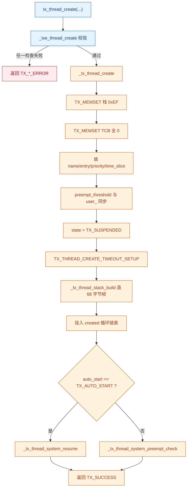
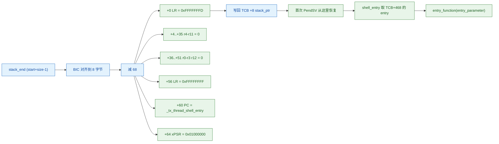

# tx_thread_create —— TCB 初始化、栈填充、就绪表挂接逐函数深读

> 对应源文件：
> - `common/src/tx_thread_create.c`（共 391 行）
> - `common/src/tx_thread_shell_entry.c`（共 217 行）
> - `common/src/txe_thread_create.c`（共 307 行，参数校验前置层）
> - `common/inc/tx_api.h:423-599`（`TX_THREAD` 结构体）
> - `common/inc/tx_thread.h:121-133`（`TX_THREAD_CREATE_TIMEOUT_SETUP`）
> - `ports/cortex_m4/gnu/src/tx_thread_stack_build.S`（共 131 行，造假中断帧）
>
> 配套文档：[02-线程与调度.md](/Users/theo-richard/workspace/references/rtos/ThreadX/Docs/02-线程与调度.md)
> 相邻 KB：`tx_thread_schedule.md`、`tx_mutex.md`、`tx_timer.md`

---

## 1. 一句话职责

**`tx_thread_create()` 把一个由调用者提供的 `TX_THREAD` 结构体和一段栈"点燃"成可调度实体**：
清 TCB → 填参数 → 用 `0xEF` 铺满栈 → 在栈顶伪造一个中断帧（PC 指向 `_tx_thread_shell_entry`）→
挂进全局 created 链表 → 可选地立刻 resume。

它不分配一个字节。所有"创建"动作都是**在调用者给定的内存上写初值**，因此失败模式只有
"参数非法"（`_txe_` 层检查），没有"内存不足"。

---

## 2. `TX_THREAD` 字段的分区与字节账

`TX_THREAD` 的字段顺序被两段注释切成三个区（`tx_api.h:425-428`、`tx_api.h:462-465`）：

```c
/* tx_api.h:425-428 */
    /* The first section of the control block contains critical
       information that is referenced by the port-specific
       assembly language code.  Any changes in this section could
       necessitate changes in the assembly language.  */
```

| 区 | 字段（行号） | 字节 | 写者 | 读者 |
|---|---|---|---|---|
| **汇编 ABI 区** +0..+39 | `id`(430) `run_count`(431) `stack_ptr`(432) `stack_start`(433) `stack_end`(434) `stack_size`(435) `time_slice`(436) `new_time_slice`(437) `ready_next`(441) `ready_previous`(442) | 40 | create / stack_build / resume / schedule.S | PendSV 汇编按固定偏移读写 |
| 调度决策区 | `name`(450) `priority`(451) `state`(452) `delayed_suspend`(453) `suspending`(454) `preempt_threshold`(455) `schedule_hook`(460) | 28 | create / suspend / preemption_change | 调度器与各服务 |
| 入口区 | `entry`(468) `entry_parameter`(469) | 8 | create | `shell_entry` |
| 内嵌定时器 | `tx_thread_timer`(473) = `TX_TIMER_INTERNAL` 8 字段 | 32 | create / sleep / 超时 | 时间轮 |
| 挂起信息 | `suspend_cleanup`(479) `suspend_control_block`(480) `suspended_next/previous`(482-483) `suspend_info`(484) `additional_suspend_info`(485) `suspend_option`(486) `suspend_status`(487) | 32 | 各阻塞服务 | 唤醒时清理 |
| created 链表 | `created_next/previous`(496-497) | 8 | create | info_get / trace |
| 优先级继承 | `user_priority`(511) `user_preempt_threshold`(512) `inherit_priority`(513) | 12 | create / mutex | mutex_put |
| 持锁清单 | `owned_mutex_count`(516) `owned_mutex_list`(518) | 8 | mutex | shell_entry 退出清理 |
| 栈监控 | `stack_highest_ptr`(558) | 4 | `TX_THREAD_STACK_CHECK` | stack_analyze |
| 通知回调 | `entry_exit_notify`(565) | 4 | 应用 | shell_entry |
| 其它 | `filex_ptr`(505) `suspension_sequence`(585) | 8 | create / suspend | wait_abort |

**合计 40+28+8+32+32+8+12+8+4+4+8 = 184 字节**（32 位机、默认配置、Cortex-M GNU port 的
`TX_THREAD_EXTENSION_*` 全为空）。32 个线程 = 5.9KB，这还不含栈。

`tx_thread_create.c` 只负责其中约 20 个字段；其余字段靠 `TX_MEMSET` 一次性清零
（`tx_thread_create.c:161`）。这条"先清后填"的顺序很重要：`inherit_priority` 的哨兵值
`TX_MAX_PRIORITIES` 是显式写的（第 181 行），而 `tx_thread_suspending` / `delayed_suspend`
依赖 memset 的 0——若打开 `TX_DISABLE_REDUNDANT_CLEARING`，这两条假设就落到
"调用者保证 TCB 已被清零"上。

---

## 3. 逐函数表

| 函数 | 文件:行 | 参数/返回 | 职责 | 关键点 |
|---|---|---|---|---|
| `_txe_thread_create` | `txe_thread_create.c:84` | 10 参数 + `sizeof(TX_THREAD)` / `UINT` | 校验层 | 6 类错误码；ISR 中调用返回 `TX_CALLER_ERROR` |
| `_tx_thread_create` | `tx_thread_create.c:81` | 同上 10 参数 / `UINT` | 真正创建 | 永远返回 `TX_SUCCESS` |
| `_tx_thread_stack_build` | `tx_thread_stack_build.S:68` | `(TCB*, 入口函数)` | 造 68 字节假中断帧 | 写 TCB+8 的 `stack_ptr` |
| `_tx_thread_shell_entry` | `tx_thread_shell_entry.c:70` | 无 / 无（不返回） | 线程的"第一层壳" | 调 `entry`，返回后清理并置 `TX_COMPLETED` |
| `_tx_thread_system_resume` | `tx_thread_system_resume.c:93` | `(TCB*)` | 进就绪表 | 见 `tx_thread_schedule.md` |
| `_tx_thread_system_preempt_check` | `tx_thread_system_preempt_check.c:70` | 无 / 无 | 非自动启动时补一次抢占检查 | 见 §5.3 |

`_txe_` 层的校验顺序（`txe_thread_create.c:207-291`）值得单独记：

| 检查 | 行号 | 错误码 |
|---|---|---|
| 线程已创建（`thread_ptr == next_thread`，遍历 created 链表） | 208-213 | `TX_THREAD_ERROR` |
| `stack_start == NULL` | 216-221 | `TX_PTR_ERROR` |
| `entry_function == NULL` | 224-229 | `TX_PTR_ERROR` |
| `stack_size < TX_MINIMUM_STACK`（Cortex-M4 为 200） | 232-237 | `TX_SIZE_ERROR` |
| `priority >= TX_MAX_PRIORITIES` | 240-245 | `TX_PRIORITY_ERROR` |
| `preempt_threshold > priority` | 248-253 | `TX_THRESH_ERROR` |
| `auto_start > TX_AUTO_START` | 256-261 | `TX_START_ERROR` |
| 在 ISR 中调用（`0 < system_state < 0xF0F0F0F0`） | 280-290 | `TX_CALLER_ERROR` |

`preempt_threshold > priority` 这一条是**语义的关键**：阈值必须**数值不大于**自身优先级。
阈值 0 表示"只有优先级 0 能抢占我"，阈值 == priority 表示"普通抢占"。这与很多人的直觉相反
（详见 §7 陷阱 1）。

---

## 4. 三段逐字摘录

### 4.1 栈填充：为什么先铺 0xEF

```c
/* tx_thread_create.c:120-124 */
    /* Set the thread stack to a pattern prior to creating the initial
       stack frame.  This pattern is used by the stack checking routines
       to see how much has been used.  */
    TX_MEMSET(stack_start, ((UCHAR) TX_STACK_FILL), stack_size);
#endif
```

`TX_STACK_FILL` 默认是 `0xEFEFEFEF`（`tx_api.h:133`），`TX_MEMSET` 按字节填，
所以整段栈是 `EF EF EF ...`。之后 `TX_THREAD_STACK_CHECK`（`tx_thread.h:209-237`）只做两件事：

1. 比较栈首 4 字节和 `stack_end + 1` 处 4 字节是否仍为 `TX_STACK_FILL` → 溢出检测；
2. 从"历史最低栈指针"往下找第一个非 `0xEF` 的 ULONG → 估算峰值用量。

所以**栈填充不是为了初始化，而是为了测量**。它有三个开关互相影响：

| 宏 | 默认 | 作用 |
|---|---|---|
| `TX_DISABLE_STACK_FILLING` | 未定义 | 定义后整段 `TX_MEMSET` 消失，栈内容是上电残留 |
| `TX_ENABLE_STACK_CHECKING` | 未定义 | 强制取消 `TX_DISABLE_STACK_FILLING`（`tx_port.h:210-214`），并让 create 对齐栈、留出哨兵 |
| `TX_ENABLE_RANDOM_NUMBER_STACK_FILLING` | 未定义 | 用随机字节代替 0xEF，防"栈上恰好有 0xEF 数据"导致的误判 |

打开 `TX_ENABLE_STACK_CHECKING` 后，`stack_size` 会被改写两次（`tx_thread_create.c:131-155`）：

```c
    stack_size =  ((stack_size/(sizeof(ULONG))) * (sizeof(ULONG))) - (sizeof(ULONG));
```

即"向下取整到 4 的倍数，再减 1 个 ULONG"。若 `stack_start` 本身不是 4 字节对齐，
再减一个 ULONG（第 146 行）。**应用看到的 `tx_thread_stack_size` 可能比传入值小 4~8 字节**，
算栈预算时要按这个值算，不是按自己写的常量。

### 4.2 参数落位与"哨兵优先级"

```c
/* tx_thread_create.c:171-186 */
    /* Place the supplied parameters into the thread's control block.  */
    thread_ptr -> tx_thread_name =              name_ptr;
    thread_ptr -> tx_thread_entry =             entry_function;
    thread_ptr -> tx_thread_entry_parameter =   entry_input;
    thread_ptr -> tx_thread_stack_start =       stack_start;
    thread_ptr -> tx_thread_stack_size =        stack_size;
    thread_ptr -> tx_thread_priority =          priority;
    thread_ptr -> tx_thread_user_priority =     priority;
    thread_ptr -> tx_thread_time_slice =        time_slice;
    thread_ptr -> tx_thread_new_time_slice =    time_slice;
    thread_ptr -> tx_thread_inherit_priority =  ((UINT) TX_MAX_PRIORITIES);

    /* Calculate the end of the thread's stack area.  */
    temp_ptr =  TX_VOID_TO_UCHAR_POINTER_CONVERT(stack_start);
    temp_ptr =  (TX_UCHAR_POINTER_ADD(temp_ptr, (stack_size - ((ULONG) 1))));
    thread_ptr -> tx_thread_stack_end =         TX_UCHAR_TO_VOID_POINTER_CONVERT(temp_ptr);
```

三处细节：

1. `user_priority` 与 `priority` 同时写：前者是"应用设定的值"，后者是"当前生效值"。
   互斥量优先级继承只改后者，`tx_mutex_put` 用前者还原（见 `tx_mutex.md`）。
2. `inherit_priority = TX_MAX_PRIORITIES`（32）是哨兵：**没有任何继承**。
   继承时它会被改成占有者的优先级（数值更小），于是"是否被继承过"退化为一次比较。
3. `stack_end` 是"最后一个**有效字节**"的地址，不是"栈顶之后一格"。
   计算式 `start + size - 1` 说明它是闭区间端点。`tx_thread.h:221` 的溢出检查写
   `stack_end + 1` 才拿到哨兵位置，正是这个约定的另一半。

### 4.3 壳入口：线程函数返回之后

```c
/* tx_thread_shell_entry.c:107-119 */
    /* Call current thread's entry function.  */
    (thread_ptr -> tx_thread_entry) (thread_ptr -> tx_thread_entry_parameter);

    /* Suspend thread with a "completed" state.  */

    /* Determine if the application is using mutexes.  */
    if (_tx_thread_mutex_release != TX_NULL)
    {

        /* Yes, call the mutex release function via a function pointer that
           is setup during mutex initialization.  */
        (_tx_thread_mutex_release)(thread_ptr);
    }
```

这三步的顺序不能换：**先调用户函数 → 再释放它可能持有的互斥量 → 最后置状态并挂起自己**。
`_tx_thread_mutex_release` 是全局函数指针，只有在 `_tx_mutex_initialize()` 里才被赋值
（`_tx_thread_initialize` 把它清成 NULL）。所以"不用互斥量"的工程连这个分支的调用都省了。

```c
/* tx_thread_shell_entry.c:122-135 */
    /* Lockout interrupts while the thread state is setup.  */
    TX_DISABLE

#ifndef TX_DISABLE_NOTIFY_CALLBACKS

    /* Pickup the entry/exit application callback routine again.  */
    entry_exit_notify =  thread_ptr -> tx_thread_entry_exit_notify;
#endif

    /* Set the status to suspending, in order to indicate the suspension
       is in progress.  */
    thread_ptr -> tx_thread_state =  TX_COMPLETED;

    /* Thread state change.  */
    TX_THREAD_STATE_CHANGE(thread_ptr, TX_COMPLETED)
```

注意它把状态设成 `TX_COMPLETED`（1），而不是 `TX_SUSPENDED`（3）。这个区别决定了
`tx_thread_reset` 能不能重启它：`reset` 只接受 `COMPLETED`/`TERMINATED`。
一个"跑完的线程"和一个"被 suspend 的线程"在调度器眼里都不在就绪表，但在 API 语义上是两类。

---

## 5. 图

### 5.1 创建执行流



### 5.2 栈帧数据流（Cortex-M4，共 68 字节）



字节账：`LR + r4..r11` 共 9 个 4 字节 = 36；硬件帧 `r0-r3/r12/lr/pc/xPSR` 8 个 = 32；
合计 68。`0xFFFFFFFD` 是 `EXC_RETURN`：bit2=1 表示返回线程模式、bit3=1 表示用 PSP，
bit4=0 表示**标准帧**（不含 FP 扩展）。若线程第一条指令就用了 FPU，硬件会在首次异常
返回时按自己的判断补栈——这也是为什么 `tx_thread_schedule.S:99-105` 在进调度器前
主动清 `CONTROL.FPCA`。

---

## 6. 与 `TX_AUTO_START` 相关的初始化补偿

`tx_thread_create.c:288-354` 有一整套"创建即启动"的特殊处理，核心是临时**篡改当前最高优先级
线程的阈值**：

```c
/* tx_thread_create.c:310-315 */
                /* Save the current preemption-threshold.  */
                saved_threshold =  saved_thread_ptr -> tx_thread_preempt_threshold;

                /* For initialization, temporarily set the preemption-threshold to the
                   priority level to make sure the highest-priority thread runs once
                   initialization is complete.  */
                saved_thread_ptr -> tx_thread_preempt_threshold =  saved_thread_ptr -> tx_thread_priority;
```

触发条件是 `TX_THREAD_GET_SYSTEM_STATE() >= TX_INITIALIZE_IN_PROGRESS`（第 292 行）。
原因：初始化期 `_tx_thread_execute_ptr` 已指向"当前最高的那个"，若它设了阈值，
新创建的高优先级线程可能被阈值挡住而无法抢占；临时把阈值拉到等于优先级，
等于临时取消这层保护。创建完成后第 348-354 行原样恢复。

这段代码只在 `tx_application_define()` 里"创建 + 自动启动多个线程"时才起作用，
运行期创建线程不会走进去（条件不成立，`saved_thread_ptr` 直接置 NULL）。

---

## 7. 陷阱与读码建议

**陷阱 1（语义反直觉）：以为"阈值越大保护越强"。**
`_txe_thread_create` 在 `preempt_threshold > priority` 时直接返回 `TX_THRESH_ERROR`
（`txe_thread_create.c:248-253`）。合法范围是 `[0, priority]`。
调度判断是 `priority < execute_ptr->preempt_threshold`（`tx_thread_system_resume.c:243`），
所以**阈值越小越难被抢占**：阈值 0 意味着只有优先级 0 能抢占；阈值 == 自身优先级意味着
"所有比我高的都能抢占"，即普通抢占。设 `threshold = priority` 是默认语义，
设 `threshold = 0` 是"除了最高优先级谁都别想打断我"。

**陷阱 2：用同一个 `TX_THREAD` 再 create 一次。**
`_txe_` 会遍历 created 链表发现重复并返回 `TX_THREAD_ERROR`，但**前提是校验层没被关掉**。
定义 `TX_DISABLE_ERROR_CHECKING` 后重复 create 会把同一个 TCB 挂成环、把栈帧重建，
大概率在第一次运行时崩在野指针上。

**陷阱 3：栈大小刚好 `TX_MINIMUM_STACK`。**
Cortex-M4 的 `TX_MINIMUM_STACK = 200`（`tx_port.h:122`）。其中假帧 68 字节，
若开了 `TX_ENABLE_STACK_CHECKING` 再少 4~8 字节，留给线程函数的不足 130 字节。
一个 `snprintf` + 浮点就可能踩穿 `0xEF` 哨兵。经验值见 `tx_thread_schedule.md` §8。

**陷阱 4：以为 `time_slice = 0` 表示"默认时间片"。**
`0` 就是 `TX_NO_TIME_SLICE`：该线程**不参与同优先级轮转**，会一直跑到阻塞或让出。
只有显式给非 0 值才启用轮转，且轮转还要求 `priority == preempt_threshold`（见调度 KB）。

**陷阱 5：线程函数 return 之后以为资源全回收。**
`shell_entry` 只做了"释放互斥量 + 置 COMPLETED + 挂起"。TCB 和栈仍然占着，
要 `tx_thread_delete` 才能标记可复用；且 delete 必须由别的线程调用。

**陷阱 6：在中断里创建线程。**
`_txe_` 的 `TX_THREAD_GET_SYSTEM_STATE() != 0` 检查在 Cortex-M 上返回的是
`system_state | IPSR`（`tx_port.h:478`），ISR 里必然非 0 且小于 `0xF0F0F0F0`，
于是返回 `TX_CALLER_ERROR`。**线程只能在初始化期或线程上下文创建**。

**读码建议**：

1. 先看 `tx_api.h:423-442` 的 40 字节 ABI 区，把偏移 +0/+4/+8/+16/+24 记住；
2. `tx_thread_create.c:161-231` 是"填 TCB"的全部内容，共 70 行；
3. `tx_thread_stack_build.S:94-127` 只有 33 行，对照 §5.2 的表逐行读；
4. `tx_thread_shell_entry.c:81-135` 看"第一次被执行"与"函数返回后"两段；
5. 最后回读 `txe_thread_create.c:207-291` 的错误码表，把每个错误码和触发条件对上。
