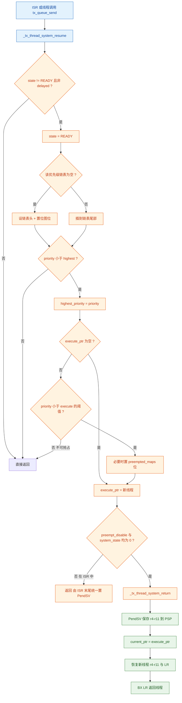

# tx_thread_schedule —— 位图 O(1) 选线程、抢占与时间片逐函数深读

> 对应源文件：
> - `ports/cortex_m4/gnu/src/tx_thread_schedule.S`（共 339 行，含 PendSV handler）
> - `common/src/tx_thread_system_resume.c`（共 1001 行）
> - `common/src/tx_thread_system_suspend.c`（共 1218 行）
> - `common/src/tx_thread_time_slice.c`（共 180 行）
> - `common/src/tx_thread_system_preempt_check.c`（共 126 行）
> - `common/src/tx_thread_relinquish.c`（共 163 行）
> - `common/inc/tx_thread.h:53-201`（位图宏、最低置位位计算）
> - `ports/cortex_m4/gnu/inc/tx_port.h:459-500`（`TX_THREAD_GET_SYSTEM_STATE` / `TX_THREAD_SYSTEM_RETURN_CHECK` 覆写）
> - `ports/cortex_m4/gnu/src/tx_thread_system_return.S`（共 98 行）
> - `ports/cortex_m4/gnu/src/tx_timer_interrupt.S`（共 251 行，只读时间片段）
>
> 配套文档：[02-线程与调度.md](/Users/theo-richard/workspace/references/rtos/ThreadX/Docs/02-线程与调度.md)
> 相邻 KB：`tx_thread_create.md`、`tx_timer.md`

---

## 1. 一句话职责

ThreadX 的调度被拆成**三个时间尺度**上的三段，而不是一个"调度函数"：

| 段 | 触发时机 | 做什么 | 代码 |
|---|---|---|---|
| 记账 | 每次线程状态变化 | 维护位图 + `_tx_thread_highest_priority` + `_tx_thread_execute_ptr` | `resume` / `suspend` |
| 决策 | tick 或主动让出 | 只把 `execute_ptr` 指对（时间片轮转、relinquish） | `time_slice` / `relinquish` |
| 搬运 | PendSV 异常 | 把 `execute_ptr` 变成 `current_ptr`，保存/恢复 r4-r11 | `schedule.S` |

"O(1) 调度"指的是第一段的查找：**位图 + RBIT/CLZ 两条指令**，与线程数无关。完整
一次切换的代价是"位图操作 + 两次寄存器拷贝 + 一次异常进出"。

---

## 2. 三张表与一个常量

| 数据结构 | 定义 | 类型 | 含义 |
|---|---|---|---|
| `_tx_thread_priority_maps[TX_MAX_PRIORITIES/32]` | `tx_thread_initialize.c:92` | `ULONG[]` | 第 N 位 = 1 表示优先级 N 上有就绪线程 |
| `_tx_thread_priority_list[TX_MAX_PRIORITIES]` | `tx_thread_initialize.c:136` | `TX_THREAD*[]` | 每个优先级的**循环**链表头（尾指回头） |
| `_tx_thread_highest_priority` | `tx_thread_initialize.c:128` | `UINT` | 当前最高就绪优先级；`== TX_MAX_PRIORITIES` 表示空 |
| `_tx_thread_preempted_maps[...]` | `tx_thread_initialize.c:112` | `ULONG[]` | 因阈值保护被绕过的优先级记账 |
| `_tx_thread_execute_ptr` | `tx_thread_initialize.c:65` | `TX_THREAD*` | 调度结果；可与 `current_ptr` 不同 |
| `_tx_thread_preempt_disable` | `tx_thread_initialize.c:143` | `UINT` | 服务内部禁止抢占的重入计数 |

位运算宏（`tx_thread.h:56-66`）：

```c
#if TX_MAX_PRIORITIES > 32
#define MAP_INDEX                               (map_index)
#ifndef TX_MOD32_BIT_SET
#define TX_MOD32_BIT_SET(a,b)                   (b) = (((ULONG) 1) << ((a)%((UINT)32)));
#endif
#else
#define MAP_INDEX                               (0)
#ifndef TX_MOD32_BIT_SET
#define TX_MOD32_BIT_SET(a,b)                   (b) = (((ULONG) 1) << ((a)));
#endif
#endif
```

`TX_MAX_PRIORITIES == 32`（默认）时 `MAP_INDEX` 恒为 0、取模被编译掉，位图访问
退化成**一次 load + 移位**：多优先级支持靠预处理期换代码，不靠运行期分支。

找最低置位位：`tx_thread.h:140-201` 的通用版本是一棵四层判定树
（先判 <0x10 / <0x100 / <0x10000，再逐级右移），最多 4 次比较 + 4 次移位。
Cortex-M 的 port 用 `RBIT` + `CLZ` 两条指令覆盖它（`tx_port.h` 的
`TX_LOWEST_SET_BIT_CALCULATE`），在 M3/M4 上各 1 周期。

**量化**：32 优先级时，从"就绪表变化"到"选出线程"的指令数约为
1 次 load（位图）+ 2 条位指令 + 1 次数组索引 = 常数，与就绪线程数 n 无关。
对比"遍历链表找最高优先级"的 O(n)，n=32 时差约一个数量级。

---

## 3. 逐函数表

| 函数 | 文件:行 | 触发者 | 关键动作 | 是否改 `execute_ptr` |
|---|---|---|---|---|
| `_tx_thread_system_resume` | `system_resume.c:78` | 队列/信号量/互斥量 put、`tx_thread_resume`、create | 状态置 READY、插就绪链表尾、置位图 | 仅当新线程成为**新的最高优先级**且可抢占 |
| `_tx_thread_system_ni_resume` | 同文件 `#else` 分支 | `TX_NOT_INTERRUPTABLE` 配置 | 同上但不关中断 | 同上 |
| `_tx_thread_system_suspend` | `system_suspend.c:81` | 所有阻塞服务、`tx_thread_suspend` | 摘链、清位图、必要时重算最高优先级 | 是（若被挂起的是 execute） |
| `_tx_thread_system_ni_suspend` | 同文件后段 | 不可中断配置 | 同上 | 同上 |
| `_tx_thread_time_slice` | `time_slice.c:69` | tick ISR 里 `_tx_timer_expired_time_slice` 置位后 | 重置时间片、同优先级轮转 | 是（轮转时） |
| `_tx_thread_relinquish` | `relinquish.c:70` | 应用主动让出 | 同优先级头指针后移；有更高优先级则直接选它 | 是 |
| `_tx_thread_system_preempt_check` | `preempt_check.c:70` | 服务末尾（`preempt_disable` 减到 0 后） | 比较 current 与 execute，需要就 `system_return` | 否，只触发切换 |
| `_tx_thread_system_return` | `system_return.S:70` | 上述所有"该切了"的场合 | 置 PendSV + 短暂开中断 | 否 |
| `_tx_thread_schedule` | `schedule.S:87` | 只在启动时调一次 | 清 `preempt_disable`、开中断、等 PendSV | 否 |
| PendSV_Handler | `schedule.S:130` | 硬件异常 | 保存/恢复上下文、`current_ptr = execute_ptr` | 是（写 current） |

**一个容易忽略的事实**：`_tx_thread_schedule()` 在整个生命周期里**只被调用一次**
（`tx_initialize_kernel_enter.c:148`）：清 `preempt_disable`、置 PendSV、死等。
此后的切换都从 PendSV 进入。别处再调它会把 `preempt_disable` 强行清零，
打破服务内部的临界区。

---

## 4. 三段逐字摘录

### 4.1 第一次调度：只负责"点火"

```asm
@ ports/cortex_m4/gnu/src/tx_thread_schedule.S:93-116
    /* Clear the preempt-disable flag to enable rescheduling after initialization on Cortex-M targets.  */

    MOV     r0, #0                                  // Build value for TX_FALSE
    LDR     r2, =_tx_thread_preempt_disable         // Build address of preempt disable flag
    STR     r0, [r2, #0]                            // Clear preempt disable flag

    /* Clear CONTROL.FPCA bit so VFP registers aren't unnecessarily stacked.  */

#ifdef __ARM_FP
    MRS     r0, CONTROL                             // Pickup current CONTROL register
    BIC     r0, r0, #4                              // Clear the FPCA bit
    MSR     CONTROL, r0                             // Setup new CONTROL register
#endif

    /* Enable interrupts */
    CPSIE   i

    /* Enter the scheduler for the first time.  */

    MOV     r0, #0x10000000                         // Load PENDSVSET bit
    MOV     r1, #0xE000E000                         // Load NVIC base
    STR     r0, [r1, #0xD04]                        // Set PENDSVBIT in ICSR
```

三件事按顺序：**清抢占禁用 → 清 FPCA → 开中断 → 手动 PendSV**。
`CONTROL.FPCA` 是"浮点上下文活跃"标志，硬件在异常入栈时用它决定是否压 s0-s15/s16-s31。
初始化阶段它可能是 1（启动代码用过浮点），若不主动清，第一个线程的第一次切换会
多压 68 字节（S0-S15 + FPSCR + 保留），并且**后续每个线程都被标记为用了浮点**。

### 4.2 保存现场：先判时间片，再存栈指针

```asm
@ ports/cortex_m4/gnu/src/tx_thread_schedule.S:177-192
    LDR     r4, =_tx_timer_time_slice               // Build address of time-slice variable
    STMDB   r12!, {LR}                              // Save LR on the stack

    /* Determine if time-slice is active. If it isn't, skip time handling processing.  */

    LDR     r5, [r4]                                // Pickup current time-slice
    STR     r12, [r1, #8]                           // Save the thread stack pointer
    CBZ     r5, __tx_ts_new                         // If not active, skip processing

    /* Time-slice is active, save the current thread's time-slice and clear the global time-slice variable.  */

    STR     r5, [r1, #24]                           // Save current time-slice

    /* Clear the global time-slice.  */

    STR     r3, [r4]                                // Clear time-slice
```

`r1` 是 `_tx_thread_current_ptr`，偏移 +8 写 `tx_thread_stack_ptr`、+24 写
`tx_thread_time_slice`。注意"全局时间片"（`_tx_timer_time_slice`）是**借来的**：
线程在跑的时候，它的剩余时间片存在全局变量里，tick ISR 减的是全局变量；
被换下时才写回自己的 TCB。这样 tick ISR 不必先解引用 TCB，少一次内存访问。

### 4.3 选下一个：从位图到 execute 指针

```c
/* tx_thread_system_suspend.c:329-338 */
    priority_map =    _tx_thread_priority_maps[MAP_INDEX];

    /* Make a quick check for no other threads ready for execution.  */
    if (priority_map == ((ULONG) 0))
    {

        /* Nothing else is ready.  Set highest priority and execute thread
           accordingly.  */
        _tx_thread_highest_priority =  ((UINT) TX_MAX_PRIORITIES);
        _tx_thread_execute_ptr =       TX_NULL;
```

```c
/* tx_thread_system_suspend.c:390-394 */
                /* Calculate the lowest bit set in the priority map. */
                TX_LOWEST_SET_BIT_CALCULATE(priority_map, priority_bit)

                /* Setup the next highest priority variable.  */
                _tx_thread_highest_priority =  base_priority + ((UINT) priority_bit);
```

这两段构成"选线程"的全部：**位图为 0 → execute = NULL（进 idle）；否则取最低置位位 →
`highest_priority` = 组基址 + 位号**。真正的 TCB 指针在下一句拿：
`_tx_thread_execute_ptr = _tx_thread_priority_list[_tx_thread_highest_priority];`（第 403 行）。

`_tx_thread_priority_list[]` 是循环链表，"同一优先级选谁"只看链表头。
`resume` 插到**尾部**（`head->previous` 之后，`system_resume.c:388-392`），
被换下的线程不移动，于是同优先级是 FIFO 轮转：

```c
/* tx_thread_system_resume.c:388-392 */
                    tail_ptr =                                 head_ptr -> tx_thread_ready_previous;
                    tail_ptr -> tx_thread_ready_next =         thread_ptr;
                    head_ptr -> tx_thread_ready_previous =     thread_ptr;
                    thread_ptr -> tx_thread_ready_previous =   tail_ptr;
                    thread_ptr -> tx_thread_ready_next =       head_ptr;
```

插入尾部还有一个调度含义：**新就绪的同优先级线程不会立刻抢占**。
`resume` 只在 `priority < _tx_thread_highest_priority` 时改 `execute_ptr`
（`system_resume.c:218`），同优先级不满足 `<`，所以当前线程继续跑完时间片。

---

## 5. 抢占判定：两处 `<` 与一张记账位图

`resume` 的抢占条件是（`system_resume.c:243`）：

```c
                            if (priority < execute_ptr -> tx_thread_preempt_threshold)
```

这里比较的是**新线程的优先级**与**当前 execute 线程的阈值**，不是两者优先级。
含义：一个线程可以声明"只有比我阈值更高的线程才能打断我"。

若当前线程确实用了阈值（`preempt_threshold != priority`，第 249 行），
就把它的优先级记进 `_tx_thread_preempted_maps`（第 263-264 行）。
这张表在 `suspend` 末尾被消费（`system_suspend.c:461-466`）：

```c
                /* Determine if the next highest priority thread is above the highest priority threshold value.  */
                if (_tx_thread_highest_priority >= (_tx_thread_priority_list[priority] -> tx_thread_preempt_threshold))
                {

                    /* Thread not allowed to execute until earlier preempted thread finishes or lowers its
                       preemption-threshold.  */
                    _tx_thread_execute_ptr =  _tx_thread_priority_list[priority];
```

语义：抢占者退出时，如果**当前最高优先级仍然不高于**被抢占者的阈值，
说明被抢占者本该继续跑，于是把它请回来。这就是"阈值保护在抢占者结束后继续生效"。

边界是 `>=` 而不是 `>`：阈值等于优先级时是"普通抢占"，被抢占者不该被恢复；
只有 `highest > threshold` 才允许新线程上。用 `>` 会让普通线程在抢占者退出后
多跑一次不必要的切换。

---

## 6. 时间片：ISR 只减一，C 层做决定

tick ISR（`tx_timer_interrupt.S:97-119`）对全局 `_tx_timer_time_slice` 做减法，
减到 0 就置 `_tx_timer_expired_time_slice = TX_TRUE`，**不做任何线程选择**。
出 ISR 前如果发现 `_tx_timer_expired_time_slice` 或 `_tx_timer_expired`，
就调用 C 层的 `_tx_thread_time_slice()` / `_tx_timer_expiration_process()`
（`tx_timer_interrupt.S:202-221`）。ISR 只在最后比较 `current_ptr != execute_ptr`
来决定是否置 PendSV（第 231-233 行）。

C 层的三个条件（`time_slice.c:117-133`）：

```c
            if (thread_ptr -> tx_thread_ready_next != thread_ptr)
            {

                /* Check to see if preemption-threshold is not being used.  */
                if (thread_ptr -> tx_thread_priority == thread_ptr -> tx_thread_preempt_threshold)
                {

                    /* Preemption-threshold is not being used by this thread.  */

                    /* There is another thread at this priority, make it the highest at
                       this priority level.  */
                    _tx_thread_priority_list[thread_ptr -> tx_thread_priority] =  thread_ptr -> tx_thread_ready_next;

                    /* Designate the highest priority thread as the one to execute.  Don't use this
                       thread's priority as an index just in case a higher priority thread is now
                       ready!  */
                    _tx_thread_execute_ptr =  _tx_thread_priority_list[_tx_thread_highest_priority];
```

| 条件 | 不满足时 | 原因 |
|---|---|---|
| 同优先级还有别人（`ready_next != self`） | 不轮转 | 环上只有自己，转了还是自己 |
| `priority == preempt_threshold` | 不轮转 | **阈值与时间片互斥**：阈值保护期内不允许同优先级打断 |
| 状态 `TX_READY`（第 106 行） | 不轮转 | 线程正在挂起过程中，别动它 |

第 133 行的索引用的是 `_tx_thread_highest_priority` 而不是
`thread_ptr->tx_thread_priority`，这是防御性写法：从进临界区到这一行之间，
中断被关着，理论上不会变；但 `TX_ENABLE_STACK_CHECKING` 等扩展点可能放开了中断，
用缓存变量能避免"用了过期的优先级索引"。

**时间片量化**：默认 `TX_TIMER_TICKS_PER_SECOND = 100`（10ms/tick）。
若给线程 `time_slice = 2`，每次运行 20ms 后被轮转；`time_slice = 0`
（`TX_NO_TIME_SLICE`）则永不轮转，直到阻塞或让出。

---

## 7. 一次抢占的完整路径



关键分叉在 `N`：**中断里绝不切上下文**。Cortex-M 的 port 把
`TX_THREAD_SYSTEM_RETURN_CHECK` 覆写成**只看 `_tx_thread_preempt_disable`**
（`tx_port.h:498-500`），注释写得明白：

```c
/* ports/cortex_m4/gnu/inc/tx_port.h:493-500 */
/* Define the check for whether or not to call the _tx_thread_system_return function.  A non-zero value
   indicates that _tx_thread_system_return should not be called. This overrides the definition in tx_thread.h
   for Cortex-M since so we don't waste time checking the _tx_thread_system_state variable that is always
   zero after initialization for Cortex-M ports. */

#ifndef TX_THREAD_SYSTEM_RETURN_CHECK
#define TX_THREAD_SYSTEM_RETURN_CHECK(c)    (c) = ((ULONG) _tx_thread_preempt_disable);
#endif
```

也就是说，在 Cortex-M 上 `_tx_thread_system_state` 初始化后**从不被中断入口递增**
（`tx_thread_context_save.S` / `tx_thread_context_restore.S` 里只有 profile 钩子，
核心代码就是一条 `BX lr`）。ISR 上下文靠 **IPSR** 区分：
`TX_THREAD_GET_SYSTEM_STATE()` = `_tx_thread_system_state | __get_ipsr_value()`
（`tx_port.h:478`）。所以：

| 端口类型 | `system_state` 用途 | ISR 中 resume 的行为 |
|---|---|---|
| Cortex-M | 只用于初始化状态；ISR 中恒 0 | **直接调 `system_return` 置 PendSV**，PendSV 优先级最低，ISR 退出后才切 |
| Cortex-A/R | ISR 入口自增、出口自减 | `system_return` 被抑制，等最外层中断返回时统一处理 |

这解释了为什么 Cortex-M 上"ISR 里可以直接调任何 API"：切换请求不会立即生效，
只是挂起一个最低优先级异常。

---

## 8. 陷阱与读码建议

**陷阱 1：把 `_tx_thread_highest_priority` 当实时值。**
它是**缓存**，只在 resume/suspend/time_slice 里更新；过期就会选到空指针或错线程。
调试时打印 `(highest, execute->priority, current->priority)` 三元组核对。

**陷阱 2：以为 `_tx_thread_execute_ptr == _tx_thread_current_ptr` 恒成立。**
两者不同正是"有切换待发生"的标志。不等且 `preempt_disable != 0` 说明在服务
临界区内（正常）；长期不等且为 0 说明 `system_return` 没执行（PendSV 没配好）。

**陷阱 3：在 `TX_NOT_INTERRUPTABLE` 配置下仍按关中断思路读代码。**
此时 resume 走 `#else` 分支（`system_resume.c:538` 起），被替换成
`_tx_thread_system_ni_resume`，`TX_DISABLE/TX_RESTORE` 变空宏，行号也不同。

**陷阱 4：`tx_thread_relinquish` 的两个 if 是并列的。**
`relinquish.c:106-118` 先处理"同优先级把链表头后移"，再处理"有更高优先级直接选它"，
两个 `if` 不是 `else if`。后者覆盖前者，所以"让出"在存在更高优先级线程时等价于
一次普通抢占。

**陷阱 5：认为时间片能打断阈值保护。**
不能。`time_slice.c:121` 要求 `priority == preempt_threshold`。一个设了阈值的线程
不会因为时间片耗尽被同优先级线程替换——这是刻意的语义，不是缺陷。

**陷阱 6：在 Cortex-M 上用 `interrupt_preemption_count` 判断 ISR 抢占比例时忘记 IPSR。**
`system_resume.c:271` 用 `TX_THREAD_GET_SYSTEM_STATE() == 0` 判断"调用者是线程"。
Cortex-M 上该宏 OR 进了 IPSR，ISR 里返回非 0，计数正确。若自己重定义成只读
`system_state`，统计会全算成 solicited。

**陷阱 7：改 `TX_MAX_PRIORITIES` 后忘了 `tx_thread.h` 的 `MAP_INDEX` 需要局部变量 `map_index`。**
`MAP_INDEX` 在 >32 时展开成 `map_index`，使用位图的函数都要在栈上声明它
（`#if TX_MAX_PRIORITIES > 32`）。扩展代码照抄位图操作却漏声明，编译期报未定义。

**读码建议（约 1.5 小时）**：

1. `tx_thread_initialize.c:92-136` —— "位图 + 链表头 + 最高优先级缓存"三件套；
2. `system_resume.c:194-215` —— 空链表插入 + 置位，最短的完整逻辑；
3. `system_suspend.c:204-269` —— 摘链 + 清位（含"只剩自己"特判）；
4. `system_suspend.c:329-395` —— 重算 highest；
5. `system_suspend.c:399-466` —— 阈值恢复，`preempted_maps` 的消费时机；
6. `time_slice.c:99-133` —— 轮转三条件；
7. `tx_thread_schedule.S:157-254` —— PendSV 保存/恢复，对照 TCB 偏移 +4/+8/+24；
8. `tx_port.h:459-500` —— 解释"为什么 Cortex-M 的 ISR 里可以直接调 API"。
