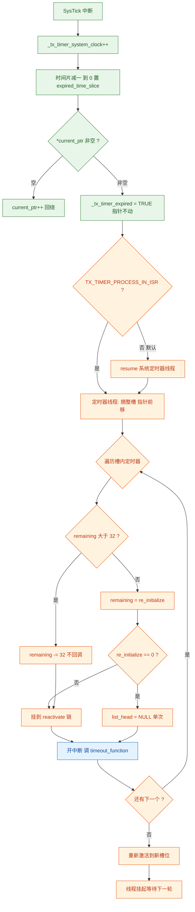

# tx_timer —— 32 槽时间轮、定时器线程与到期处理逐函数深读

> 对应源文件：
> - `common/src/tx_timer_create.c`（共 163 行）
> - `common/src/tx_timer_activate.c`（共 134 行）
> - `common/src/tx_timer_deactivate.c`（共 244 行）
> - `common/src/tx_timer_change.c`（共 97 行）
> - `common/src/tx_timer_system_activate.c`（共 160 行）
> - `common/src/tx_timer_system_deactivate.c`（共 126 行）
> - `common/src/tx_timer_expiration_process.c`（共 473 行）
> - `common/src/tx_timer_thread_entry.c`（共 474 行）
> - `common/src/tx_timer_initialize.c`（共 299 行）
> - `common/inc/tx_timer.h:49-95`（`TX_TIMER_ENTRIES`、全局时间轮声明）
> - `common/inc/tx_api.h:339-364`（`TX_TIMER_INTERNAL`）、`tx_api.h:377-416`（`TX_TIMER`）
> - `ports/cortex_m4/gnu/src/tx_timer_interrupt.S`（共 251 行，tick ISR）
>
> 配套文档：[05-定时器与时间管理.md](/Users/theo-richard/workspace/references/rtos/ThreadX/Docs/05-定时器与时间管理.md)
> 相邻 KB：`tx_thread_schedule.md`、`tx_initialize.md`

---

## 1. 一句话职责

**ThreadX 的定时器不是"按到期时间排序的链表"，而是一个 32 槽的哈希时间轮**：
每个 tick 推进一格，槽内 FIFO，到期与否只看"是否被转到"。超长定时器（> 32 tick）
放进第 31 格，每转一圈把 `remaining_ticks` 减 32 再放回，直到落进一圈之内。

到期后的回调有两种执行位置，由 `TX_TIMER_PROCESS_IN_ISR` 选择：

| 配置 | 谁执行回调 | 代价 |
|---|---|---|
| 默认（未定义该宏） | 系统定时器线程（优先级 0，栈 1024 B） | 多一次上下文切换，ISR 极短 |
| 定义该宏 | tick ISR 直接执行 | 省掉线程与栈，但回调期间中断被拉长 |

---

## 2. 数据结构

### 2.1 `TX_TIMER_INTERNAL`（真正挂到时间轮上的部分）

`tx_api.h:339-364`，8 个字段 = **32 字节**（32 位机）：

| 字段 | 行号 | 含义 | 谁写 |
|---|---|---|---|
| `tx_timer_internal_remaining_ticks` | 343 | 还剩多少 tick；`TX_WAIT_FOREVER` 表示"永不到期" | create / activate / expiration |
| `tx_timer_internal_re_initialize_ticks` | 344 | 到期后重新装入的值；**0 = 单次定时器** | create / change |
| `tx_timer_internal_timeout_function` | 347 | 到期回调 | create |
| `tx_timer_internal_timeout_param` | 348 | 回调参数 | create |
| `tx_timer_internal_active_next/previous` | 354-355 | 槽内循环链表 | activate / expiration |
| `tx_timer_internal_list_head` | 359 | **指回"槽头指针"的二级指针**；`NULL` = 未激活 | activate / deactivate / expiration |

`list_head` 存的是"槽数组元素的地址"（`TX_TIMER_INTERNAL **`），不是槽本身。
于是定时器换槽只需改自己的 `list_head`，deactivate 也能直接 `*list_head = next`
更新槽头，不必携带槽索引。这是整份代码里最省事的指针技巧。

### 2.2 `TX_TIMER`

`tx_api.h:377-416` = `id` + `name` + 内嵌 `TX_TIMER_INTERNAL` + created 链表
= 4 + 4 + 32 + 8 = **48 字节**（不含性能计数）。

应用拿到 `TX_TIMER*`，时间轮里挂的是 `&timer->tx_timer_internal`，换算靠宏：

```c
/* tx_api.h:2026-2032 */
#define TX_USER_TIMER_POINTER_GET(a,b)                  { \
                                                            UCHAR   *working_ptr; \
                                                            working_ptr =  (UCHAR *) (a);   \
                                                            (b) =  (TX_TIMER *) working_ptr; \
                                                            working_ptr =  working_ptr - (((UCHAR *) &(b) -> tx_timer_internal) - ((UCHAR *) &(b) -> tx_timer_id)); \
                                                            (b) =  (TX_TIMER *) working_ptr; \
                                                        }
```

这也是"线程的睡眠超时"复用同一套时间轮的方式：`TX_THREAD` 内嵌一个
`TX_TIMER_INTERNAL`（`tx_api.h:473`），到期回调设成 `_tx_thread_timeout`，
参数是 TCB 地址。所以**线程睡眠与用户定时器共享同一个 32 槽轮**，
`_tx_timer_expiration_process` 里用
`timeout_function != &_tx_thread_timeout` 来区分"应用定时器"与"线程超时"
（`tx_timer_expiration_process.c:244`），只影响性能计数。

### 2.3 全局时间轮

| 变量 | 定义 | 含义 |
|---|---|---|
| `_tx_timer_list[32]` | `tx_timer.h:95` | 32 个槽，每槽一条循环链表 |
| `_tx_timer_list_start` | `tx_timer_initialize.c:226` | `&_tx_timer_list[0]` |
| `_tx_timer_list_end` | `tx_timer_initialize.c:231-232` | `&_tx_timer_list[32]`（**越界一格**） |
| `_tx_timer_current_ptr` | `tx_timer_initialize.c:227` | 下一个将被处理的槽 |
| `_tx_timer_system_clock` | `tx_timer_initialize.c:207` 清零 | tick 计数，`tx_time_get()` 的来源 |
| `_tx_timer_time_slice` | `tx_timer_initialize.c:210` | 当前线程剩余时间片（借放于此） |
| `_tx_timer_expired` | `tx_timer_initialize.c:214` | ISR 置位：当前槽有定时器到期 |
| `_tx_timer_expired_time_slice` | `tx_timer_initialize.c:213` | ISR 置位：时间片耗尽 |
| `_tx_timer_expired_timer_ptr` | `tx_timer_initialize.c:217` | 正在执行回调的定时器（防重入/防删） |
| `_tx_timer_thread` | `tx_timer_initialize.c:95` | 系统定时器线程的 TCB |

`_tx_timer_list_end` 指向"第 33 个元素"，让越界判断退化成一次指针比较。

---

## 3. 逐函数表

| 函数 | 文件:行 | 输入/输出 | 核心动作 | 错误码 |
|---|---|---|---|---|
| `_tx_timer_create` | `tx_timer_create.c:72` | `(timer, name, fn, param, initial, reschedule, auto)` | 填 internal 字段、挂 created 表、可选激活 | `TX_TIMER_ERROR`、`TX_TICK_ERROR`、`TX_ACTIVATE_ERROR` |
| `_tx_timer_activate` | `tx_timer_activate.c:71` | `(timer)` | 调用 system_activate | `TX_ACTIVATE_ERROR`（已激活 / remaining==0） |
| `_tx_timer_deactivate` | `tx_timer_deactivate.c:64` | `(timer)` | 调用 system_deactivate，`remaining` 不清零 | `TX_TIMER_ERROR` |
| `_tx_timer_change` | `tx_timer_change.c:67` | `(timer, initial, reschedule)` | 改两个 tick 值（**必须先 deactivate**） | `TX_ACTIVATE_ERROR`（仍激活） |
| `_tx_timer_system_activate` | `tx_timer_system_activate.c:69` | `(internal*)` | 算槽位、插链尾、设 `list_head` | 无（VOID） |
| `_tx_timer_system_deactivate` | `tx_timer_system_deactivate.c:66` | `(internal*)` | 从槽中摘除、`list_head = NULL` | 无（VOID） |
| `_tx_timer_expiration_process` | `tx_timer_expiration_process.c:72` | 无 | 通知/执行到期处理 | 无 |
| `_tx_timer_thread_entry` | `tx_timer_thread_entry.c:69` | `(id)` | 定时器线程主循环 | 无（不返回） |
| `_tx_timer_initialize` | `tx_timer_initialize.c:197` | 无 | 清轮、建定时器线程（`TX_DONT_START`） | — |
| `_tx_timer_info_get` | `tx_timer_info_get.c:73` | 6 个出参 | 快照（含 `remaining_ticks`） | `TX_TIMER_ERROR` |

---

## 4. 三段逐字摘录

### 4.1 槽位计算：`remaining - 1` 与"封顶 31"

```c
/* tx_timer_system_activate.c:99-126 */
                /* Calculate the amount of time remaining for the timer.  */
                if (remaining_ticks > TX_TIMER_ENTRIES)
                {

                    /* Set expiration time to the maximum number of entries.  */
                    expiration_time =  TX_TIMER_ENTRIES - ((ULONG) 1);
                }
                else
                {

                    /* Timer value fits in the timer entries.  */

                    /* Set the expiration time.  */
                    expiration_time =  (remaining_ticks - ((ULONG) 1));
                }

                /* At this point, we are ready to put the timer on one of
                   the timer lists.  */

                /* Calculate the proper place for the timer.  */
                timer_list =  TX_TIMER_POINTER_ADD(_tx_timer_current_ptr, expiration_time);
                if (TX_TIMER_INDIRECT_TO_VOID_POINTER_CONVERT(timer_list) >= TX_TIMER_INDIRECT_TO_VOID_POINTER_CONVERT(_tx_timer_list_end))
                {

                    /* Wrap from the beginning of the list.  */
                    delta =  TX_TIMER_POINTER_DIF(timer_list, _tx_timer_list_end);
                    timer_list =  TX_TIMER_POINTER_ADD(_tx_timer_list_start, delta);
                }
```

三个要点：

1. **`remaining - 1`**：`current_ptr` 指向"下一次 tick 要处理的槽"，剩余 1 tick 必须
   放进当前槽（偏移 0），用 `remaining` 会整体晚一拍。
2. **> 32 一律放第 31 槽**：放第 32 槽越界，放更小的槽又与"每圈减 32"的节奏对不上。
3. **回绕用指针差**：`delta = timer_list - list_end` 即 `%32`。

插入是**链尾**（`tx_timer_system_activate.c:144-150`），所以同一槽内 FIFO：
同一 tick 到期的多个定时器按激活顺序回调。

### 4.2 tick ISR：只做三件事

```asm
@ ports/cortex_m4/gnu/src/tx_timer_interrupt.S:85-91
    /* Increment the system clock.  */
    // _tx_timer_system_clock++;

    LDR     r1, =_tx_timer_system_clock             // Pickup address of system clock
    LDR     r0, [r1, #0]                            // Pickup system clock
    ADD     r0, r0, #1                              // Increment system clock
    STR     r0, [r1, #0]                            // Store new system clock
```

```asm
@ ports/cortex_m4/gnu/src/tx_timer_interrupt.S:129-141
    LDR     r1, =_tx_timer_current_ptr              // Pickup current timer pointer address
    LDR     r0, [r1, #0]                            // Pickup current timer
    LDR     r2, [r0, #0]                            // Pickup timer list entry
    CBZ     r2, __tx_timer_no_timer                 // Is there anything in the list?
                                                    // No, just increment the timer

        /* Set expiration flag.  */
        // _tx_timer_expired =  TX_TRUE;

    LDR     r3, =_tx_timer_expired                  // Pickup expiration flag address
    MOV     r2, #1                                  // Build expired value
    STR     r2, [r3, #0]                            // Set expired flag
    B       __tx_timer_done                         // Finished timer processing
```

ISR 的全部工作：

1. `_tx_timer_system_clock++`（每 tick 一次，`tx_time_get` 就是读它）；
2. 时间片减一（见 `tx_thread_schedule.md` §6）；
3. 看当前槽有没有定时器：**有 → 只置 `_tx_timer_expired` 就退出**，指针不动；
   **没有 → 指针前移一格并回绕**。

注意第 3 点的分工：**"推进指针"和"处理到期"是分开的两件事**。
槽为空时 ISR 自己推进（便宜）；槽非空时把推进权交给
`_tx_timer_expiration_process` / 定时器线程（它们在第 172-177 行 / 124-129 行推进）。
这样 ISR 里不会执行任何应用回调，最坏关中断时间被压到常数。

### 4.3 到期处理：先摘槽，再逐个决定"真到期"还是"再放一圈"

```c
/* tx_timer_expiration_process.c:156-180 */
                /* Save the current timer expiration list pointer.  */
                expired_timers =  *_tx_timer_current_ptr;

                /* Modify the head pointer in the first timer in the list, if there
                   is one!  */
                if (expired_timers != TX_NULL)
                {

                    expired_timers -> tx_timer_internal_list_head =  &expired_timers;
                }

                /* Set the current list pointer to NULL.  */
                *_tx_timer_current_ptr =  TX_NULL;

                /* Move the current pointer up one timer entry wrap if we get to
                   the end of the list.  */
                _tx_timer_current_ptr =  TX_TIMER_POINTER_ADD(_tx_timer_current_ptr, 1);
                if (_tx_timer_current_ptr == _tx_timer_list_end)
                {

                    _tx_timer_current_ptr =  _tx_timer_list_start;
                }

                /* Clear the expired flag.  */
                _tx_timer_expired =  TX_FALSE;
```

```c
/* tx_timer_expiration_process.c:261-276 */
                        /* Decrement the remaining ticks of the timer.  */
                        current_timer -> tx_timer_internal_remaining_ticks =
                                current_timer -> tx_timer_internal_remaining_ticks - TX_TIMER_ENTRIES;

                        /* Set the timeout function to NULL in order to bypass the
                           expiration.  */
                        timeout_function =  TX_NULL;

                        /* Make the timer appear that it is still active while interrupts
                           are enabled.  This will permit proper processing of a timer
                           deactivate from an ISR.  */
                        current_timer -> tx_timer_internal_list_head =    &reactivate_timer;
                        current_timer -> tx_timer_internal_active_next =  current_timer;

                        /* Setup the temporary timer list head pointer.  */
                        reactivate_timer =  current_timer;
```

第一段是"整槽摘除"：把 `*current_ptr` 取到局部变量 `expired_timers`，
槽置 NULL，指针前移。**摘槽是 O(1)**，不管槽里有几个定时器。

第二段是关键判定：`remaining_ticks > 32` 的定时器**没有真正到期**，
只是在这一圈被转到了。处理方式是：

- `remaining -= 32`；
- `timeout_function = NULL`，本次不回调；
- 用临时链表头 `&reactivate_timer` 标记"仍激活"，这样放开中断的窗口里
  `tx_timer_deactivate` 仍能正确摘除（`list_head != NULL` 即激活中）；
- 循环结束后统一 `_tx_timer_system_activate` 重新入轮。

真到期的路径（`tx_timer_expiration_process.c:308-334`）：

- `remaining = re_initialize_ticks`；
- `re_initialize_ticks == 0` → `list_head = NULL`（变回未激活，单次定时器）；
- 否则同样用 `reactivate_timer` 临时挂起，循环后重插（周期定时器）；
- 把 `timeout_function` / `timeout_param` 拷到局部变量，**放开中断**后调用
  （第 340-348 行）。

"先摘光、再逐个处理、回调时开中断"的结构，使回调里
`tx_timer_deactivate(&self)` 安全：`_tx_timer_expired_timer_ptr` 指向当前定时器，
deactivate 只清标志不动链表。

---

## 5. 执行流



---

## 6. 数据流：一个定时器如何穿过 32 个槽

```mermaid
flowchart LR
    A["tx_timer_create initial=100 resched=0"] --> B["internal.remaining = 100"]
    B --> C["activate: remaining 大于 32"]
    C --> D["放 current + 31 槽"]
    D -->|"每 32 tick 被转到一次"| E["remaining -= 32"]
    E --> F{"remaining <= 32 ?"}
    F -->|"否"| D
    F -->|"是"| G["放 current + remaining - 1 槽"]
    G -->|"精确 remaining tick 后"| H["回调 timeout_function"]
    H --> I{"re_initialize == 0 ?"}
    I -->|"是 单次"| J["list_head = NULL 未激活"]
    I -->|"否 周期"| K["remaining = re_initialize 重入轮"]

    classDef api fill:#E3F2FD,stroke:#1565C0,color:#0D47A1
    classDef mem fill:#FFF3E0,stroke:#E65100,color:#BF360C
    classDef done fill:#E8F5E9,stroke:#2E7D32,color:#1B5E20
    class A api
    class B,C,D,E,F,G,K mem
    class H,J done
```



用 100 tick（默认 100Hz 下 1 秒）举例：激活放 +31 槽；第 32/64 tick 各减 32 重放
+31；第 96 tick 剩 4，放 +3 槽；第 100 tick 回调，`re_initialize == 0` → 未激活。

共 4 次入轮、1 次回调。**调整次数与 `ticks/32` 成正比**：1 小时的定时器（360000 tick）
要被处理 11250 次，100Hz 下约每 320ms 一次——每次 O(1)，但"超长定时器并非零成本"。

---

## 7. 陷阱与读码建议

**陷阱 1：`initial_ticks = 0` + `TX_AUTO_ACTIVATE` 不会启动。**
`_tx_timer_system_activate` 第一句就是 `if (remaining_ticks != 0)`
（`tx_timer_system_activate.c:84`），0 被忽略而 `create` 仍返回 `TX_SUCCESS`；随后
`tx_timer_activate` 才返回 `TX_ACTIVATE_ERROR`。应传 `TX_NO_ACTIVATE` 再用 change 设值。

**陷阱 2：以为 `TX_TIMER_TICKS_PER_SECOND` 改了，定时器就精确到 ms。**
tick 周期由 port 的 SysTick 重装值决定（示例汇编是 `(SYSTEM_CLOCK/100)-1`）。
改 `tx_api.h` 的宏只改换算不改硬件节拍，两者必须一起改。

**陷阱 3：在定时器回调里做长操作。**
默认配置下回调跑在**优先级 0 的定时器线程**里，会抢占所有应用线程；打开
`TX_TIMER_PROCESS_IN_ISR` 后直接在 ISR 里跑，代价更大。回调只应投递信号/置标志。

**陷阱 4：`tx_timer_change` 前不 deactivate。**
仍在轮上（`list_head != NULL`）时 change 返回 `TX_ACTIVATE_ERROR`。正确顺序是
`deactivate → change → activate`；change 只改数值，不改槽位。

**陷阱 5：回调里 `tx_timer_deactivate(self)` 以为会崩。**
不会。到期处理在调用回调前已把定时器摘出槽，并用 `_tx_timer_expired_timer_ptr`
标记"正在处理"，deactivate 遇到它只清状态不动链表。但**回调里
`tx_timer_delete(self)` 是未定义行为**——回调返回后代码还要读 `current_timer`。

**陷阱 6：把 `tx_time_get()` 当高精度时间戳。**
返回 tick 计数，分辨率即一个 tick（默认 10ms），100Hz 下约 497 天回绕。
微秒级测量用 DWT->CYCCNT 或硬件定时器。

**陷阱 7：多线程同时操作同一个定时器。**
三个 API 都关中断，但**不禁止"activate 与 change 交错"**：A change 完准备
activate，B 抢先 activate，A 再 activate 就返回 `TX_ACTIVATE_ERROR`。
定时器的生命周期应由单一所有者管理。

**陷阱 8：`TX_TIMER_ENTRIES` 改大。**
它同时出现在 `tx_timer.h:49`（槽数）、`tx_timer_system_activate.c:100-104`
（封顶判断）和 ISR 的指针运算里。改大可行（32→64 即每圈 64 tick），但每圈的
减量随之变化；且 `_tx_timer_list` 是静态数组，汇编按 4 字节步长硬编码。

**读码建议（约 50 分钟）**：

1. `tx_timer.h:49-95` —— 32 个槽与四个全局指针的声明；
2. `tx_timer_initialize.c:197-240` —— 槽清空、`list_end` 越界一格、建线程；
3. `tx_timer_system_activate.c:80-155` —— `remaining-1`、封顶 31、回绕、尾插；
4. `tx_timer_interrupt.S:85-160` —— ISR 的时钟、时间片、"置标志或推进指针"；
5. `tx_timer_expiration_process.c:96-121` + `230-335` —— 默认路径与"减 32 / 重装"；
6. `tx_timer_thread_entry.c:99-142` —— 线程版摘槽与推进；
7. `tx_timer_system_deactivate.c:74-124` —— `list_head` 二级指针的摘链技巧。
